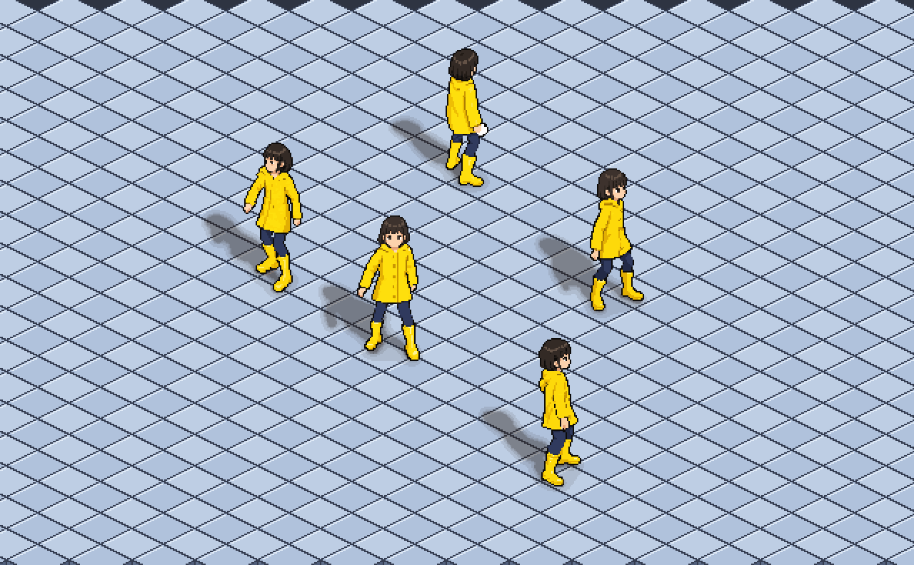
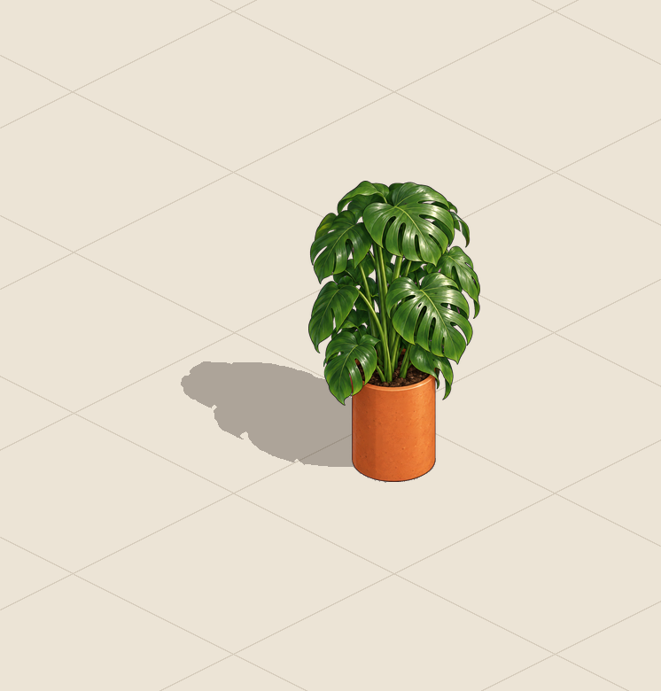
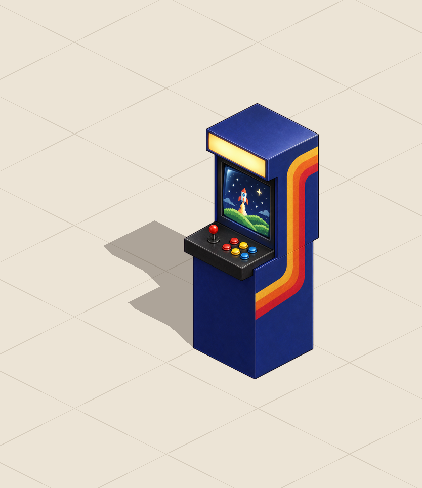

<h1 align="center"></h1>

<p align="center"></p>

<p align="center"><b>Entra una ilustración. Sale un personaje de juego.</b><br>
Un generador de sprites isométricos para Claude Code: caminatas en 8 direcciones, acciones y pixel art<br>
con el ángulo de cámara de tu juego, con una sombra 3D bajo cada fotograma, y los props que van a su lado.</p>

<p align="center"><a href="https://github.com/Sunghwan0112/spritecast/stargazers"></a></p>

<p align="center">
<a href="#lo-que-puedes-hacer">Lo que puedes hacer</a> ·
<a href="#personajes-que-caminan">Personajes</a> ·
<a href="#pixel-art-tamaño-arcade">Pixel art</a> ·
<a href="#props-y-escenario">Props</a> ·
<a href="#instalación">Instalación</a> ·
<a href="#preguntas-frecuentes">Preguntas frecuentes</a> ·
<a href="README.md">English</a> · <a href="README.ko.md">한국어</a> · <a href="README.zh-CN.md">简体中文</a> · <a href="README.ja.md">日本語</a> · <a href="README.pt-BR.md">Português</a>
</p>


<p align="center"><i>El mismo modelo de imagen, la misma hoja de personaje. Izquierda: lo que salió al pedirle a GPT una caminata. Derecha: lo que aporta el 3D.</i></p>


<p align="center"><i>Y cosas, no solo personas: cualquier objeto en pixel art, desde cualquier lado, a la escala del personaje. <a href="#props-en-pixel-art-cualquier-objeto-desde-cualquier-lado">Cómo</a>.</i></p>

```
claude plugin marketplace add Sunghwan0112/spritecast
claude plugin install spritecast@spritecast
```

Luego solo pide: *"Aquí está mi personaje (hero.png). Haz que camine en 8 direcciones."*
**Para probarlo gratis, sin clave**, pídele a Claude *"prueba SpriteCast"*.

Un modelo de imagen (el de OpenAI, con tu propia clave) hace el dibujo. El cuerpo, el movimiento, el ángulo y la sombra salen del 3D, así que
cada fotograma es la misma persona, y de verdad camina.

| | das | recibes | pagas |
|---|---|---|---|
| **Un personaje que camina** | una ilustración | una caminata en 8 orientaciones, vistas en reposo, una sombra por fotograma | unos $2.2 + 75 créditos de Tripo |
| **Más acciones** | un nombre, o un FBX de Mixamo | correr, saltar, dar un tajo, lanzar... en 8 orientaciones | unos 10 créditos de Tripo cada una (un FBX: nada) + el dibujo |
| **Pixel art** | un personaje que camina | sprites en píxeles de unos 100 px de alto | unos $0.075 por hoja (una caminata, 8 orientaciones: ~$1.35) |
| **Un animal** | una ilustración | una caminata a cuatro patas en 8 orientaciones | 30 créditos de Tripo + el dibujo |
| **Sentado** | un personaje que camina | sentado en 8 orientaciones, colocado sobre tus props | unos $0.22 |
| **Un prop, o un NPC en pose** | una descripción | un sprite, su sombra, su ancla | unos $0.07 (+ $0.08 por cada orientación más) |
| **Un prop en pixel art** | una descripción | sprites en píxeles desde cada lado, a la escala del personaje en píxeles | unos 20 créditos de Tripo + $0.08 por lado |

Gratis y MIT. Pagas a OpenAI y a Tripo directamente; cada paso de pago muestra su coste y espera tu OK.

**La mitad del dibujo: cuatro orientaciones.** `"facings": 4` en el spec dibuja solo las diagonales (sureste, suroeste, noreste,
noroeste): más o menos la mitad del coste de dibujo (un paseo: ~$1 en vez de ~$2; en pixel art ~$0.7 en vez de ~$1.35). El personaje
exportado sigue caminando en las ocho direcciones: si pides el este, muestra la orientación dibujada más cercana y la mantiene, así que caminar en línea recta de lado no parpadea.

## Lo que puedes hacer

| | |
|---|---|
|  |  |
| **[Una caminata en 8 orientaciones](#personajes-que-caminan)** a partir de una ilustración, una sombra por fotograma | **[Acciones](#más-acciones-correr-saltar-dar-tajos)**: correr, saltar, dar un tajo, o cualquier clip de Mixamo |
|  |  |
| **[Pixel art](#pixel-art-tamaño-arcade)**, de unos 100 px de alto, con cosas que se sostienen y se lanzan | **[Animales de cuatro patas](#animales-de-cuatro-patas)**, sin comprar un rig |
|  |  |
| **[Sentarse](#sentarse)** en tus props, con el reposabrazos que queda delante de ella calculado en 3D | **[Props](#props-y-escenario)** a su tamaño real, todos en un mismo suelo |
|  |  |
| **[Sombras horneadas desde el modelo 3D](#light-shadow-wind)**: el sol, un día gris o una lámpara que colocas tú | **[Viento en las hojas](#light-shadow-wind)**, rama a rama, desde el mismo modelo |

## Cosas que puedes pedir

- *"Aquí está mi personaje (hero.png). Haz que camine en 8 direcciones."*
- *"Añade correr y saltar. Y un lanzamiento: aquí tienes un clip de Mixamo (Throw.fbx); ponle una bola de nieve en la mano."*
- *"Nuestro juego es pixel art. Haz que camine y lance como sprites en píxeles, de unos 96 px de alto."*
- *"Haz que se siente, y ponla en este sillón."*
- *"Haz un NPC tendero, un anciano con una chaqueta de punto marrón, en cuatro direcciones."* (una figura en pose: basta con una descripción)
- *"Haz una estantería isométrica, de 1.8 m de alto, llena de libros, en el estilo cozy."*
- *"Aquí tienes un prop de mi juego (props/barrel.png). Haz una caja a juego en ese estilo."*

## Por qué funciona

Un modelo de imagen no puede mantener un cuerpo y una pose de un fotograma al siguiente. Si le pides una caminata con palabras, te da ocho dibujos bonitos
que no caminan: la parte izquierda de la imagen de arriba, tal como salió:

| GPT solo | SpriteCast |
|---|---|
| la misma pierna delante en los ocho fotogramas | las piernas salen de una caminata 3D |
| los brazos se sacuden al azar | los brazos se balancean contra las piernas |
| la cámara a la altura de los ojos | la cámara de tu juego (30° hacia abajo por defecto) |
| sin sombra | la propia sombra del cuerpo 3D, fotograma a fotograma |

Así que SpriteCast nunca se lo pide. **El 3D hace el movimiento; el modelo de imagen solo vuelve a dibujar** cada fotograma renderizado con el aspecto
de tu ilustración. Después, cada dibujo se ajusta de nuevo sobre su render y se compara con él: un fotograma dibujado en otra pose se marca y se puede
volver a dibujar, nunca se fuerza para que encaje. Los props funcionan igual, con bloques a tamaño real en lugar del rig.

**Lo que obtienes de eso:**
- **El ángulo y el tamaño son correctos.** Los props sólidos de los ejemplos caen sobre su guía con un 95–99 % de solapamiento de contorno; la planta,
  dibujada suelta a propósito, con un 87 %, y las figuras vestidas con un 69–88 % (la ropa y el pelo sobresalen del maniquí liso). Los personajes
  que caminan se puntúan fotograma a fotograma (más abajo). La cámara y la escala son fijas, así que los props hechos en momentos distintos encajan en un mismo suelo.
- **Sombras que se ven bien.** Una sola luz compartida por todos los props, así que todas las sombras caen hacia el mismo lado. Los props sólidos proyectan la
  propia sombra de la guía 3D. Las figuras en pose y las plantas proyectan una sombra con la forma del propio dibujo (la capucha, el pelo, las hojas), colocada por
  el modelo 3D, de modo que un pie o la base de una maceta empiezan su sombra donde se apoyan. Los personajes que caminan proyectan la propia sombra de su cuerpo 3D,
  fotograma a fotograma. No una mancha pintada, no un maniquí de bloques.
- **Se revisa a sí mismo.** Después de dibujar, el resultado se compara con su guía. Si el modelo dibujó otro ángulo, no se fuerza nada para
  que encaje: recibes un aviso, y Claude sugiere una corrección antes de volver a dibujar.
- **La vista de tu juego y tu estilo.** Isométrico 2:1, isométrico real, cenital 3/4, frontal o cualquier ángulo; las cuatro orientaciones de un
  objeto; el estilo `cozy` incluido o una imagen tuya.
- **Una luz que concuerda.** Cada guía se ilumina con el mismo sol, fijo a la pantalla, y el modelo de imagen dibuja encima de ese
  render: las luces y sombras de un objeto salen de su forma 3D, igual en cada lado de cada objeto. Nada se sombrea a mano
  ([en un juego](#hecho-con-spritecast-rain-girl)).

## Hecho con SpriteCast: Rain Girl

<p align="center"><a href="https://sunghwan0112.github.io/rain-girl/"></a></p>

<p align="center"><a href="https://sunghwan0112.github.io/rain-girl/"><b>▶ Juégalo en el navegador</b></a> &nbsp;·&nbsp; <a href="https://github.com/Sunghwan0112/rain-girl">el código del juego</a><br>Sin instalar nada y sin cuenta. Publica tu puntuación y sales en la clasificación de abajo.</p>

<p align="center"><a href="https://sunghwan0112.github.io/rain-girl/"></a></p>

<p align="center"><i>Rain Girl, un pequeño juego de acción en pixel art: una niña con impermeable amarillo apaga monstruos de
fuego con el agua de su paraguas antes de que arda el bosque. La niña y todos los objetos salieron de SpriteCast.</i></p>

- **La niña.** Una ilustración; un modelo de Tripo con esqueleto, renderizado con la cámara del juego (2:1, 30° hacia abajo): caminar
  con el paraguas, el golpe y de pie, en las cuatro direcciones diagonales (`"facings": 4`), cada fotograma redibujado como pixel art de
  96 px. El agua que lanza es el efecto del golpe, renderizado en 3D y dibujado igual; el bucle de pie es `idleclip.py`.
- **El bosque.** Siete objetos - un árbol, un árbol medio quemado, un árbol quemado, un arbusto, un tocón quemado, una roca, setas -
  cada uno un modelo de Tripo renderizado desde cuatro lados a la escala de la niña (74 px por metro: un árbol de 2,4 m mide unos
  175 px) y dibujado como pixel art: 28 sprites. El juego muestra cada objeto desde un lado al azar; un árbol que arde pasa a medio
  quemado y luego a quemado, desde el mismo lado.
- **Una sola luz, ningún sombreado a mano.** Los 28 reciben la luz desde arriba a la derecha, como sus guías 3D. Abajo, cada lado de
  cada objeto:

<details><summary>los 28 sprites sobre la hierba del juego</summary>


</details>

- **El combo.** Dos movimientos de Mixamo de una misma serie - un tajo hacia abajo y un revés giratorio - llevados a su rig, el hachazo
  convertido en un tajo de espada en arco, el segundo empezando en la última pose del primero (`motion.py`), dibujados como pixel art en
  cuatro direcciones, con agua que se desvanece al doble de su altura. Pulsa otra vez durante el tajo y sigue el revés: un anillo a su alrededor tan ancho como su alcance.
- **Los efectos.** Golpes, fuegos apagados, bolas de fuego en vuelo y al chocar, objetos recogidos y los anillos del revés son efectos de
  [PVFX Foundry](https://nerijs.itch.io/pvfx-foundry) (CC0), que ahora viene con SpriteCast: 253, y `fxpack.py` para encontrar uno y exportarlo
  al tamaño y en los colores de tus sprites. Un anillo a su alrededor se corta por la mitad: la mitad lejana detrás de ella, la cercana delante.


<details><summary>32 de los 253 efectos que vienen con SpriteCast</summary>


</details>

- **Una sola paleta.** Al final los objetos y la baldosa de hierba se pasaron a una paleta de 48 colores (desde 755): el verde de
  un árbol y el de un arbusto son el mismo verde.
- **El 3D sigue trabajando en el juego.** Las sombras en el suelo salen horneadas del modelo de cada objeto ([cómo](#light-shadow-wind)), y la niña se oscurece a la sombra de un
  objeto: sus pies, su cintura y su cabeza, cada uno según lo que hay entre ellos y el sol. Dónde se rompe una bola de fuego contra una cobertura sale del propio modelo de cada objeto,
  cortado a la altura de la bola (0,55 m), para el lado que se ve: un tronco la para, la copa de arriba no, una seta es demasiado baja.
- **El viento también sale del modelo.** Las hojas se agrupan según dónde están en el modelo 3D y cada grupo se mueve entero, un
  píxel cada vez: las copas se mecen rama a rama, con el viento de la ronda y más fuerte en una ráfaga ([cómo](#light-shadow-wind)).
- **Lo que cuesta un objeto:** unos 20 créditos de Tripo por el modelo y unos $0,3 por dibujar sus cuatro lados.

## Personajes que caminan


Dale una ilustración de un personaje (de frente, erguido, sin pose) y obtienes una caminata en 8 orientaciones (8 fotogramas cada una) y 8 vistas en reposo, con el aspecto de esa
ilustración. Un modelo de imagen no puede mantener un cuerpo y una pose de fotograma a fotograma, así que el movimiento sale del 3D:
1. Se dibuja un turnaround a partir de la ilustración.
2. [Tripo](https://www.tripo3d.ai) hace el modelo 3D a partir de él, le pone un rig y le da una caminata y un idle.
3. La caminata se renderiza con la cámara del juego (gratis), cada fotograma con la propia sombra del cuerpo 3D, aplastada contra el suelo
   en la dirección de la luz.
4. El modelo de imagen dibuja sobre los renders, 4 fotogramas por llamada. Primero se dibuja el frente y todas las demás orientaciones lo siguen, así
   sigue siendo la misma persona.
5. Cada fotograma se ajusta de nuevo sobre su render, se estabiliza el tamaño de la cabeza y se limpian los bordes. Obtienes tiras, una sombra por fotograma
   (los pies la tocan, un pie levantado proyecta la suya) y un ancla.

```
$PYTHON skills/spritecast/scripts/charpipe.py turnaround hero.json --yes   # then 3d (model, rig, renders) and draw (then finish, preview by themselves)
```
Por defecto se dibujan las ocho orientaciones. Un diseño que es igual por ambos lados puede usar `"mirror": true` para voltear las orientaciones oeste
a partir de las este (cada una con su propia sombra), unos $0.66 menos.
O `"facings": 4`: solo las cuatro diagonales, más o menos la mitad del dibujo; el personaje exportado muestra la más cercana de ellas en cualquiera de las ocho direcciones.

Coste por personaje: unos $2.2 (OpenAI; ~$1.5 con `"mirror": true`) y 75 créditos de Tripo (~$0.75; un animal 30). O trae tu
propio GLB con rig (`"rig_glb"`) y salta directamente a `render`.

<details>
<summary><b>Más: el vídeo de vista previa, Meshy, y el personaje de ejemplo con su rig</b></summary>

`preview` también genera `walk-all.mp4` (todas las orientaciones caminando a la vez, con ffmpeg): la forma más rápida de ver una cabeza que crece y
encoge o un fotograma que salta. Tripo a veces devuelve un modelo girado de lado o sin color; ambas cosas se corrigen solas.
`"modeler": "meshy"` (y `MESHY_API_KEY`) hace que [Meshy](https://www.meshy.ai) cree el modelo en su lugar (~30 créditos de Meshy); el rig
sigue siendo de Tripo.

Más opciones (varios atuendos, anclaje en las suelas) y lecciones aprendidas:
[reference/character.md](skills/spritecast/reference/character.md). La chica de arriba está en
[`examples/rain_girl`](examples/rain_girl): su ilustración, turnaround, spec, tiras, sombras, `character.json` y la hoja.
Se hizo solo con Tripo: unos $1.7 de dibujo y 85 créditos de Tripo. Su modelo con rig también está ahí (`rig.glb`, con su caminata,
carrera, salto y tajo, MIT como el resto del repo), así que puedes probar toda la parte 3D sin claves y sin pagar nada: copia la carpeta,
añade `"draw": false` a la spec y ejecuta `charpipe.py render rain_girl.json` y luego `finish`; las tiras, sombras y anclas salen
del propio modelo 3D. Su spec también muestra para qué sirve `"notes"`: el render 3D tenía rayas oscuras por los costados del impermeable y
por dentro de los brazos, y una línea en `notes` ("no dark line, stripe or seam on it anywhere... leave them out") hizo que desaparecieran de
todos los fotogramas: un defecto del modelo corregido en el dibujo, no en el 3D.

</details>

### Animales de cuatro patas

El rig de Tripo para animales de cuatro patas camina mal (sin columna, con los hombros colgando del cuello), así que un animal no lleva un rig comprado.
Con `"kind": "animal"` basta con el modelo 3D (Tripo, ~30 créditos): su esqueleto se deduce de la malla (las patas, el
lomo, la cabeza, la cola y hacia dónde mira), camina con el paso de un gato o de un perro, y recibe el mismo dibujo, ajuste y
sombras 3D que una persona.

El turnaround se dibuja a cuatro patas, cada pata separada de las demás, la cola estirada hacia atrás; ropa, solo ajustada (un chaleco de punto, no una
capa ni una bufanda: todo lo que cuelga se mueve con la pata más cercana). Revisa los renders antes de dibujar: cuatro patas, la cabeza hacia delante, la cola
detrás. Si al modelo de Tripo le sale una pata de más, hazlo de nuevo o usa Meshy (`"modeler": "meshy"`).

<details><summary>un gato atigrado naranja con impermeable amarillo caminando en 8 orien…</summary>


</details>

El gato está en [`examples/tabby_cat`](examples/tabby_cat): un atigrado naranja con un pequeño impermeable amarillo (el de la chica), su diseño,
turnaround, spec, tiras, sombras y hoja: 30 créditos de Tripo y unos $2.5 de dibujo, incluidos los redibujados y las pruebas de diseño. Sus
fotogramas se ajustan a sus renders con 0.76-0.97 (noreste y noroeste mezclados fotograma a fotograma con `"mix"`, ver reference/character.md).

### Más acciones: correr, saltar, dar tajos

Además de caminar, un personaje puede correr, saltar o blandir algo. Enuméralas en la spec, `"actions": ["run", "jump", {"name": "slash",
"hold": "umbrella"}]`: el rig recibe esas animaciones de Tripo (unos 10 créditos cada una; están run, jump, slash, shoot, dive, climb, fall,
hurt y turn), y cada una se renderiza, se dibuja y se termina en 8 orientaciones como la caminata, en sus propias tiras con una sombra por
fotograma. Un tajo necesita algo en la mano: `"hold"` lo construye con formas simples y lo pone en la mano, así que se mueve en
cada fotograma (por ahora un paraguas, una pistola o una pistola de agua; la mano derecha, o `"hand": "left"`). Con tu propio modelo con rig, cualquier clip que tenga puede ser una acción. Un objeto en la mano se le describe al
modelo de imagen pieza a pieza, con más cuidado el extremo de la mano (el mango, el primer tramo del palo), que es pequeño y queda pegado
al cuerpo, y es donde, si no, el modelo se lo inventa.


**Casi todo sale a la primera.** La caminata, la carrera y el salto de la chica de la lluvia se ajustan a sus renders 3D con 0.78 o más en todos los fotogramas, todo
dibujado una sola vez. El tajo con el paraguas es más difícil (algo fino que gira alrededor del cuerpo): un arma dibujada en el sitio equivocado se vuelve a dibujar
sola, y lo que queda se ajusta un poco menos donde ella se agacha mucho: una pose dibujada algo más erguida, que en movimiento se lee bien.
Esos fotogramas se te listan para que los mires; guárdalos o vuelve a dibujarlos.

**Algo que se lleva todo el tiempo, en cualquiera de las dos manos** (lo pediste). Pon `"hold"` en la propia spec en lugar de en una acción,
`"hold": {"kind": "watergun", "hand": "left"}`, y el personaje lo lleva durante la caminata, las vistas en reposo y cada acción.
Abajo, una pistola de agua en la mano izquierda: la guía 3D arriba, los fotogramas dibujados debajo.

<details><summary>una pistola de agua llevada en la mano izquierda</summary>


</details>

- **Se queda en esa mano.** Un personaje con algo en una mano no es igual por ambos lados, así que ningún fotograma se hace nunca
  volteando otro: al voltearlo, el objeto cambiaría de mano. (`"mirror": "never"` pide lo mismo para cualquier personaje que no sea
  simétrico: un parche en el ojo, una sola manga.) A cada hoja se le dice qué mano y dónde tiene el objeto su render, y después cada
  fotograma se compara con su render: de los 24 fotogramas de arriba, se te señaló uno para que lo revisaras.
- **La mano se cierra sobre el mango.** Los dedos de un rig están estirados, y un dibujo encima de eso tiene una mano abierta junto a una pistola
  flotando. Así que la guía dobla la propia mano que sujeta: el mango entra en el puño, los cuatro dedos lo rodean por un lado y
  el pulgar por el otro, cada dedo doblado solo hasta que toca. Un mango grueso lleva una mano más abierta; uno demasiado grueso para
  rodearlo con la mano se adelgaza.
- **Mira la mano antes de dibujar nada.** En un fotograma el agarre son unos pocos píxeles, así que el paso gratuito `render` también guarda la mano
  desde todos los lados, de cerca (`render/hand-walk.png`), e imprime a qué distancia del mango queda cada yema. Corrígelo ahí, sin coste.
- Un objeto que ya forma parte de tu propio modelo con rig: `"hold": {"in_model": true, "words": "In the LEFT hand: a black pistol."}`.

El ejemplo de arriba costó unos $0.7 de dibujo (8 hojas: la caminata desde tres lados y la carrera desde uno).

<details>
<summary><b>Otros tamaños: 512, 64 y 32 px a partir de los mismos dibujos</b></summary>

**Cualquier tamaño que necesites** (lo pediste): los fotogramas salen de 256 px de alto, y `charpipe.py pack CHAR.json --px 64` genera otro juego a
cualquier altura a partir de los mismos dibujos (por encima de 256 también queda nítido, los fotogramas se guardan con el detalle propio de los dibujos): tiras, sombras y `character.json` a ese tamaño, en `out-64px/`, sin
volver a dibujar nada y dejando `out/` como está (`"frame_px"` en la spec fija el valor por defecto). Abajo, 512, 256 (por defecto), 64 y 32 px de alto, cada uno mostrado al mismo tamaño (ampliado píxel a píxel). A 64 se leen el pelo, el impermeable,
las botas y el paraguas; a 32 la pose y los colores se mantienen, pero la cara casi desaparece: un simple redimensionado, nada hecho para ese tamaño
todavía (ver la [Hoja de ruta](#hoja-de-ruta)).


</details>

### Efectos en un golpe: agua, fuego, hojas

Un golpe puede dejar algo en el aire. Añade `"trail"` a la acción, `{"name": "slash", "hold": "umbrella", "trail": "water"}`, y
obtienes el efecto como un sprite propio, superpuesto al cuerpo. **Es gratis y no se vuelve a dibujar nada**: el rig 3D sabe dónde está la
punta del paraguas en cada momento, así que el efecto se calcula a partir de esa trayectoria. A un tajo que ya tienes se le puede añadir sin tocar
sus fotogramas.

<details><summary>el tajo con paraguas de la chica de la lluvia con ocho efectos</summary>


</details>

- **Sigue el movimiento real.** Un modelo de imagen al que se le pide un tajo se inventa un arco y lo repite; un efecto de stock es una forma pegada
  en cada golpe. Aquí la banda y las piezas salen de la trayectoria que sigue el paraguas de este personaje en esta acción, vista desde cada una
  de las 8 orientaciones, y el cuerpo y el paraguas tapan la parte que pasa por detrás. Cambia el movimiento y el efecto cambia.
- **Once aspectos**: `plain`, `wind`, `water`, `fire`, `drops`, `flames`, `leaves`, `greenleaves`, `petals`, `snow`, `sparkle`. Los colores,
  las cantidades y las velocidades se pueden cambiar, un aspecto nuevo es una entrada más en un archivo, y puedes dar tus propias imágenes pequeñas para que se
  esparzan (`"image": "mine.png"`).
- **Las piezas siguen volando de un fotograma a otro.** Una hoja se suelta una vez, el golpe la arrastra un poco, gira, se mece y se posa en el
  suelo: la misma hoja en cada fotograma, no una dispersión nueva cada vez.
- **El agua y el fuego se mueven como un solo cuerpo** (lo pediste). El agua sale como una lámina, se estira en hilos, se rompe en gotas y deja
  bruma; la llama es blanca amarillenta en el centro, naranja, y luego un borde rojo que se oscurece al enfriarse, con ceniza que sube flotando.
- **El agua parece agua.** El agua fina es pálida y transparente, la profunda más oscura, con un borde brillante y un reflejo de la
  misma luz que el personaje; las gotas rápidas se dibujan alargadas en su dirección, y unas cuantas revientan en el suelo en un anillo y una salpicadura.
- **Solo el golpe en sí.** No sale nada mientras se levanta el paraguas: el tramo rápido del movimiento se detecta solo.
- **Más fotogramas que el cuerpo.** El cuerpo se dibuja 8 veces, pero el agua tiene 24 fotogramas de efecto (tres por cada uno) y el fuego 16 (dos), reproducidos
  más rápido encima: a 8, la lámina estaba entera en un fotograma y ya eran gotas en el siguiente. Se reparten alrededor de cada
  fotograma del cuerpo (un tercio antes, en él, un tercio después), así el agua acompaña al paraguas dibujado en vez de adelantarse.
- **También en pixel art**, al tamaño del sprite: lo sólido mantiene bordes duros, la bruma sigue siendo transparente.


Un combo en pixel art - el tajo hacia abajo y el revés giratorio de Rain Girl en cuatro direcciones, con su agua y el anillo del revés (`motion.py`, `fxpack.py`):


**Siendo sinceros:** estos efectos se calculan, no se pintan, así que son limpios más que dibujados a mano. La trayectoria
es la del objeto en la mano, así que una acción necesita algo en la mano. Hechos y revisados solo en el tajo con paraguas.

### Unir dos animaciones: entrar en un golpe y salir de él

Una caminata no termina en la primera pose de un ataque, y un ataque no termina en la de la caminata: si se reproducen una tras otra, el cuerpo salta.
El rig 3D genera los fotogramas intermedios (lo pediste): `{"name": "ready", "between": ["walk", "slash"], "frames": 3}` y
`{"name": "recover", "between": ["slash:end", "walk"], "frames": 4}`. Abajo, todo dibujado: camina con su paraguas, baja a
la postura (3 fotogramas del rig), golpea con el efecto de agua, vuelve a subir (4 más) y sigue caminando.

<details><summary>la chica de la lluvia caminando con su paraguas, bajando a una postura…</summary>


</details>

- **Cómo.** El rig reproduce las dos animaciones a la vez, cada una detenida en un momento, y pasa de una a otra, suavizando la entrada y
  la salida. `"slash:end"` empieza desde la última pose de un ataque en lugar de la primera.
- **Gratis de renderizar, se dibuja como cualquier acción**: una hoja para tres o cuatro fotogramas, unos $0.08.
- **Míralas unidas**: `charpipe.py loop hero.json --only walk,ready,slash,recover --facing south-east` (gratis) genera un GIF como el
  de arriba con los fotogramas terminados, así se ve un fotograma que salta antes de volver a dibujar nada. Un set en
  pixel art se puede corregir así también, con todos los fotogramas seguidos en el editor: `pixeledit.py hero.json --join walk,ready,slash,recover --facing south-east`.
- **¿Un fotograma mal? Dibújalo solo.** `charpipe.py frame hero.json --only slash --facing south-east --frame 5 --yes` (~$0.08) vuelve a dibujar
  solo ese fotograma; `"frame_words"` en la acción le dice al modelo de imagen lo que el render de ese fotograma no puede. El fotograma 5 de arriba tenía el
  puño izquierdo flotando sobre el paraguas cinco veces seguidas; tras decirle que la mano queda casi oculta detrás de la cabeza, salió bien.
- **El objeto en la mano se queda en la mano.** Para que también esté en la caminata, la caminata lo lleva (aquí, una acción sobre el clip de la
  caminata con el paraguas); si no, aparecería de la nada en el primer fotograma intermedio.

### Pixel art (tamaño arcade)

<details><summary>cinco orientaciones de la chica de la lluvia lanzando una bola de niev…</summary>


</details>

Para un juego dibujado en píxeles (un beat 'em up de scroll lateral, uno de lucha, un plataformas arcade), el mismo personaje como pixel art de verdad, de unos 100 px
de alto: un color por píxel, una paleta de unos 40, un contorno oscuro, sin desenfoque, y la sombra 3D de cada fotograma. No es un redimensionado de los fotogramas
pintados: el orden es al revés.


El render 3D se pixela para formar una guía, el modelo de imagen la vuelve a dibujar como pixel art, y el dibujo se **lee de nuevo sobre la cuadrícula en la que
el modelo lo dibujó** (la cabeza con líneas de cuadrícula propias, para que sobrevivan los ojos y la boca) y luego el render lo dimensiona y lo coloca.

```
$PYTHON skills/spritecast/scripts/pixelart.py hero.json                        # the plan and its cost - spends nothing
$PYTHON skills/spritecast/scripts/pixelart.py hero.json --clips walk,throw --yes
```
Unos $0.075 por hoja: una caminata en las ocho orientaciones son 18 hojas (unos $1.35); el lanzamiento de arriba, cinco orientaciones, fueron 14.

- **Cosas que se sostienen y se lanzan.** `"hold": {"kind": "snowball", "until": "auto"}` lo pone en la mano y lo suelta cuando la mano
  se mueve más rápido. `pixel.json` dice entonces en qué fotograma, en qué punto del fotograma, en qué dirección y a qué velocidad (suficiente para que tu motor genere
  el proyectil), y recibes la bola, su forma en vuelo y un estallido de 4 fotogramas. La imagen de arriba son esos datos reproducidos.
- **Cualquier animación de Mixamo.** `addclip.py hero.json Throw.fbx throw` lleva un clip FBX al rig del personaje, gratis. El lanzamiento
  de arriba entró así.
- **Combos que enlazan.** `motion.py` une un ataque con el siguiente como lo hacen los juegos: el segundo empieza en la pose en que acaba el
  primero, sin tocar el golpe; además devuelve al suelo los pies de un clip importado y convierte un hachazo en un tajo de espada en arco. Gratis, sobre el rig - [la receta, de Mixamo al juego](skills/spritecast/reference/character.md).
- **Se revisa a sí mismo.** Cada fotograma se compara con su render (la pose, el objeto en la mano); `--redraw` vuelve a dibujar las hojas marcadas
  y se queda con el mejor dibujo. Los 40 fotogramas del lanzamiento pasaron todos tras un redibujado.
- **Y luego un editor de píxeles para el último detalle.** No todo el pixel art se consigue con reglas. `pixeledit.py hero.json` abre cada fotograma en
  el navegador: borrado mágico de una mancha de blanco sobrante, lápiz, cambiar un color, mover una selección, copiar una cara buena en los otros
  fotogramas. Añade cualquier color a la paleta; y los propios fotogramas se pueden copiar (un intermedio sobre el que dibujar: de 8 fotogramas salieron 9),
  borrar y mover: la sombra y los datos del juego los siguen. Los retoques se guardan y se vuelven a aplicar en cada build posterior.
  Las animaciones que se reproducen una tras otra se pueden abrir como una sola, para ver el bucle entero y corregir donde salta:
  `pixeledit.py hero.json --join walk,ready,slash,recover --facing south-east`.

<details><summary>el editor de píxeles</summary>


</details>

Y el render 3D del que se dibujó el fotograma se puede mostrar al lado (tecla `3`) o tenue debajo, así puedes ver qué debería ser un píxel
dudoso antes de tocarlo:

<details><summary>el editor de píxeles con un personaje de 64 px a punto de lanzar una b…</summary>


</details>

Cuánto queda para hacer a mano: muy poco. Para los 40 fotogramas del lanzamiento, unos 6 minutos de dibujo con IA y 2 de recorte con IA; después, el único
trabajo a mano fue el borrador mágico: un clic en cada mota de blanco sobrante, en 10 de los 40 fotogramas (131 píxeles, el 0.15 % de los
sprites). No se tocó ninguna cara: están como las dejó el pipeline. El build imprime esas cifras cada vez.

**Un juego más difícil, y lo que hizo la mano.** Si el personaje lleva algo (un arma, un paraguas), los detalles de eso necesitan un
pequeño retoque a mano: unos pocos píxeles por fotograma, con un borrador y un lápiz, sin saber dibujar. El mismo bucle que el de "Unir
dos animaciones", en pixel art: camina con su paraguas, baja a la postura, golpea, vuelve a subir y sigue caminando; cuatro animaciones
unidas, 23 fotogramas. Solo se retocó a mano el paraguas: la punta y el borde igualados de un fotograma a otro. El personaje no; solo se
borraron unas pocas motas blancas sobrantes. En total, 1,196 píxeles de 51,442 (2.3 %), por alguien que no dibuja, en unos minutos. Lo que lo hizo rápido, y lo que más importa en pixel art: ver los 23 fotogramas seguidos, en reproducción, no uno por uno; corregir es
lograr que ninguna parte cambie mucho de píxeles de un fotograma al siguiente. Sin corregir: en dos
fotogramas de la caminata el paraguas está dibujado con un ángulo y una longitud algo distintos de los del 3D.


- **El editor muestra dónde tiene las cosas el 3D** (tecla `4`): el objeto en la mano en rojo y el contorno del cuerpo en azul, sobre el fotograma que
  estás dibujando, así un paraguas dibujado demasiado largo o con el ángulo equivocado se ve al instante.

<details><summary>el editor de píxeles con el paraguas 3D en rojo y el contorno del cuer…</summary>


</details>

**Cuántos colores.** Un juego sale con unos 40 colores. `--colours 16` le da 16 como máximo (8 es el mínimo), y
`--palette` le da a cada píxel su color más cercano en una paleta fija: una de las 15 que vienen con el skill, por nombre
(`--palette pico8`; `--palette list` las muestra), o tu propio archivo en un formato que lea Aseprite: `.png` `.gif` `.bmp` `.pcx`, `.hex`
(Lospec), `.gpl`, `.pal`, `.act`, `.col`, `.aseprite`. Las dos son gratis: no se vuelve a dibujar nada, los mismos dibujos se leen con
otra paleta. Los props aceptan las mismas dos opciones. Hasta 16 el personaje aguanta bien; a 8 los colores cercanos se funden (sus piernas azul marino
se vuelven negras), y una paleta sin nada parecido a uno de sus colores cambiará ese color: mira el resultado antes de quedártelo.

<details><summary>los mismos tres sprites con los 43 colores por defecto, con --colours …</summary>


</details>

Las paletas que vienen incluidas, sobre los mismos dos sprites (un abrigo amarillo necesita un amarillo en la paleta; `c64`, `gameboy`,
`slso8` y `sweetie16` no tienen ninguno):

<details><summary>la chica de la lluvia y el carrito de ramen en cada una de las 15 pale…</summary>


</details>

*Las paletas son de sus autores: AAP-64 de Adigun A. Polack, Apollo de AdamCYounis, DawnBringer 16/32 de DawnBringer, Endesga 32/64
de ENDESGA, Resurrect 64 de Kerrie Lake, SLSO8 de Luis Miguel Maldonado, Sweetie 16 de GrafxKid; tomadas de
[Lospec](https://lospec.com/palette-list).*

**Tamaños.** 96 px es el tamaño para un personaje de proporciones normales. **64 px funciona para un personaje diseñado pequeño** (de unas tres
cabezas de alto, con su propio modelo 3D) y sale de unos 70 px. Por debajo de eso, nunca se le pide al modelo de imagen: no se ciñe a tan
pocos cuadros (se probó 32 px de cuatro maneras). `--px 32` dibuja a 64 y genera el juego de 32 a partir de él, gratis: el mismo movimiento y los mismos fotogramas, con
caras más toscas. 64 es el que sale bien.

<details><summary>el personaje pequeño caminando y lanzando en ocho orientaciones a 64 p…</summary>


</details>

Los dos juegos están en [`examples/rain_chibi`](examples/rain_chibi): el diseño de tres cabezas dibujado a partir de la chica de la lluvia, su turnaround, la
spec, `pixel64/` (caminata y lanzamiento en ocho orientaciones, 128 fotogramas, cada uno con su sombra; no se tocó ningún píxel a mano) y `pixel32/` generado a partir de él. Su lanzamiento es un clip de Mixamo añadido con `addclip.py --clear-head 55`; el clip y el
rig no están en el repo.

<details><summary>el mismo personaje pequeño de cinco maneras</summary>


</details>

**¿Por qué no pedir 32 px?** El modelo de imagen (GPT) no hace bien pixel art pequeño por debajo de 64. Dibuja sus "píxeles" a un tamaño
propio (al pedirle cuadros de 8 px los dibujó de entre 7.4 y 10.8) y con 32 cuadros, un cuadro desviado es un ojo perdido. Arriba: la fila superior
es lo que dibuja a 64; las tres filas rojas son 32 px pedidos directamente, cada una con una disposición de hoja distinta, todas de la misma caminata. Así que el
skill pide 64 y genera 32 a partir de eso (la fila verde). Los detalles: [reference/pixel.md](skills/spritecast/reference/pixel.md).

Los sprites de arriba están en [`examples/rain_girl/pixel`](examples/rain_girl/pixel): el lanzamiento en cinco orientaciones, una caminata en dos y el
tajo con paraguas como tiras, sus sombras, la bola de nieve con su forma en vuelo y su estallido, y `pixel.json` con los datos del lanzamiento.

### Props en pixel art: cualquier objeto, desde cualquier lado

<details><summary>un carrito de ramen callejero como modelo 3D desde cuatro lados, y eso…</summary>


</details>

Lo mismo que con un personaje, pero para una cosa: su guía 3D se pixela, el modelo de imagen la vuelve a dibujar como pixel art sobre la misma cuadrícula,
y el dibujo se lee de nuevo sobre esa cuadrícula y se lleva al tamaño de la guía. El ángulo es el de la cámara, así que una cosa girada de cuatro maneras son
cuatro sprites de UNA sola cosa: el mismo techo, las mismas ruedas, cada lado con lo que le corresponde.

```
$PYTHON skills/spritecast/scripts/isoprop.py model cart.json --yes    # Tripo makes the 3D model from the description (~20 credits)
$PYTHON skills/spritecast/scripts/isoprop.py render cart.json         # free: the guide from each side ("views": [0, 90, 180, 270])
$PYTHON skills/spritecast/scripts/proppixel.py cart.json --yes        # ~$0.08 a side → out-pixel/sprite-<side>.png
```

- **Un modelo 3D de verdad es lo que hace que los lados salgan bien.** Solo con bloques, el modelo de imagen no sabe qué cara tiene qué:
  una máquina recreativa salió con la pantalla en la cara equivocada en una de cuatro vistas. El carrito de arriba es un modelo de Tripo; los cuatro lados
  coincidieron con él en el primer dibujo. Una sola vista de algo simple (una silla, una caja) está bien a partir de bloques.
- **La misma escala que el personaje.** `--ppm` son píxeles por metro: la altura del personaje en píxeles dividida entre su altura en metros
  (54 para el personaje pequeño de ejemplo), así el prop y el personaje están en un mismo suelo con el mismo tamaño de píxel.
- **El recorte lo terminas tú.** El aire bajo un techo y entre radios lo limpia el recorte con IA; lo que deje, ábrelo en el
  mismo editor de píxeles que los personajes (`pixeledit.py cart.json`): los cuatro lados son cuatro fotogramas, el render 3D se puede mostrar al lado
  o debajo del sprite, y lo que borres se guarda. Al carrito de arriba se le terminaron así 122 píxeles.
- El carrito está en [`examples/ramen_cart`](examples/ramen_cart): la spec, el modelo de Tripo, las cuatro guías
  y los cuatro sprites.

<a name="light-shadow-wind"></a>
### Luz, sombra y viento desde el modelo 3D

El modelo que dio al objeto sus lados también sabe dónde se tapa la luz y dónde están sus ramas. Por eso su sombra, la luz de una
lámpara en el suelo y el viento en sus hojas se calculan a partir de él: gratis, en tu ordenador y sin dibujar.

- **Su sombra, horneada desde su modelo 3D** (gratis, unos segundos, sola): la luz del sol y la del cielo sobre el suelo, cada una
  según lo que el objeto deja ver - oscura de cerca (bajo el carrito, alrededor del pie de un tronco) y más pálida donde cae desde
  lo alto (la de una copa, con luz entre sus hojas), en cinco pasos de pixel art. El sol es la propia luz de la guía, así que el sombreado dibujado en el objeto
  y la sombra en el suelo concuerdan. `--shadow overcast` (o `"shadow": "overcast"` en la spec) para un día gris: sin sol, solo la
  penumbra suave alrededor. `out-pixel/shadow-<lado>.png` y dónde va en `pixel.json`; se dibuja debajo del sprite.


- **Cuánta fuerza tiene la sombra** (gratis): `"shadow_strength"` en la especificación, o `--shadow-strength` - la sombra como si se
  pusiera esa cantidad de veces sobre sí misma. Tal como la da la luz (1) la sombra es correcta pero floja: sobre suelo oscuro se pierde,
  y el sprite parece flotar en vez de estar de pie en el suelo. El pixel art dice las cosas un poco más fuerte de lo que son, así que
  **los sprites en pixel art usan 1.5 por defecto**, objetos y personajes por igual (71 % en lo más oscuro en lugar de 56 %). En un
  suelo claro donde pese demasiado, pide 1; en suelo muy oscuro, 2. El editor de luz tiene un control deslizante para esto.

<details><summary>el mismo árbol y la niña de la lluvia con sus sombras a fuerza 1, 1.5 …</summary>


</details>

- **En interiores, una lámpara donde la pongas.** `--lamp -1,2.4,-0.2 --lamp-size 0.03` (metros desde el pie del objeto: a la
  derecha, hacia arriba, hacia quien mira; el tamaño de la propia lámpara) - la sombra cae lejos de ella, más larga cuanto más baja
  cuelga, nítida con una bombilla desnuda y suave con una pantalla grande, y se desvanece con la luz sobre el suelo. También sale su luz
  sobre el suelo: `light-<lado>.png`, más fuerte justo debajo, con la sombra del objeto recortada y los pasos tramados - se pone
  sobre el suelo en modo suma (ADD). La lámpara misma sale como pixel art (`lamp.png`) y su sitio en cada lado
  queda en `pixel.json`: un juego dibuja el suelo, su luz, la sombra, el objeto y la lámpara tal como los mostró el editor. Sin ella, el sol.
  **Las partes que dejan pasar luz** (un tejido de mimbre, hojas, una red) en el modelo están pintadas, no caladas:
  `"see_through": [{"colour": "#c8955a", "open": 0.35}]` deja pasar esa parte de la luz por lo que tiene ese color. Una silla
  pavo real de ratán ([`examples/rattan_peacock_chair`](examples/rattan_peacock_chair)) bajo seis luces:

<details><summary>una silla pavo real de ratán en pixel art bajo el sol, un día gris, un…</summary>


</details>

- **Mueve la luz tú mismo**: `lightedit.py PROP.json` abre una página en tu ordenador: arrastra la lámpara por el suelo, súbela con
  la rueda, cambia su tamaño - la sombra y la luz de la lámpara en el suelo se redibujan al momento; Guardar hornea todos los lados con ella y la deja en la spec.
  **Tu propia lámpara**: carga su imagen (un PNG recortado a la escala del objeto), haz clic donde sale su luz - se queda donde la
  arrastres, delante o detrás del objeto como corresponde, y su luz sale de ahí. La sombra, el brillo y la luz del suelo, en pixel art
  (pasos, tramados) o suaves (degradados, para un juego en otro estilo: `"light_style": "smooth"`).


<details><summary>una lámpara de pie en pixel art movida alrededor de la silla de ratán …</summary>


</details>

- **El viento, también desde su modelo 3D** (`"sway": "leaves"` en la spec, o `propshade.py PROP.json --sway leaves`; gratis): una copa
  son ramas, no una lámina. Cada píxel de hoja toma el punto del modelo que muestra, los puntos se agrupan por su lugar en 3D - las
  ramas de delante aparte de las de detrás - y cada grupo se mueve entero, de píxel en píxel, los lejanos primero; el tronco no se
  mueve. Sin deformar el dibujo ni dibujar fotogramas a mano. Sale `sway-<lado>.png` (12 fotogramas x calma / brisa / ráfaga: una
  fila en bucle), `clumps-<lado>.png` con el lugar 3D de cada grupo para moverlos tú, y `preview-sway.gif`. El árbol está en
  [`examples/forest_tree`](examples/forest_tree).


- **Dónde estorba, desde el mismo modelo** (gratis, horneado con la sombra): `solid-<side>.png` es donde un personaje no puede pisar:
  la huella del objeto, cortada del modelo cerca del suelo (el pie de un tronco, una mesa por sus cuatro patas). Con
  `"collide": {"cover": [0.55]}` sale además lo que detiene algo que vuela a esa altura: un tronco para una bola de fuego, la copa de
  arriba no. Cada una viene con su posición y un contorno para un polígono de colisión. Y **un personaje se oscurece a su sombra**:
  cada sombra dice cómo leerla para un punto sobre el suelo, así que sus pies, su cintura y su cabeza toman cada uno lo que hay entre
  ellos y el sol.
- **A tu motor**: `export.py PROP/out-pixel` escribe un módulo de Phaser 3 y una escena de Godot 4: la sombra, la luz de una lámpara,
  el viento, la huella como polígono de colisión y `shade()` / `cover()` para preguntar (abiertos y comprobados en Phaser 3.90 y
  Godot 4.7; Unity y Aseprite, por ahora solo para personajes). Lo pequeño también se mece: las setas cabecean
  (`"sway": "caps"`, [`examples/forest_mushrooms`](examples/forest_mushrooms)).

<details><summary>dos árboles en pixel art y tres grupos de setas exportados a Phaser, s…</summary>


</details>

### Sin dibujo: los renders 3D como fotogramas

Con `"draw": false` en la spec, ningún modelo de imagen dibuja los fotogramas: los propios renders del modelo 3D (con sombreado toon, con su propia textura) son
los fotogramas, con las mismas sombras 3D y anclas. El modelo de imagen solo dibuja el turnaround (~$0.09); con tu propio GLB con rig
(`"rig_glb"`; un animal: su modelo, `"model_glb"`) no dibuja nada en absoluto. Un personaje cuesta entonces el turnaround y el 3D
(75 créditos de Tripo, un animal 30): dos OK, y listo en cuanto termina `3d`. Lo que pierdes es nitidez: sin líneas dibujadas, una cara más simple,
la textura del modelo tal como vino (pelaje y pliegues más borrosos).

<details><summary>la misma chica y el mismo gato caminando</summary>


</details>

<details><summary>primer plano a los píxeles propios de las tiras</summary>


</details>

## Sentarse


Una vez que un personaje camina, pídele a Claude *"haz que se siente"*. Su modelo 3D se dobla en postura sentada (muslos horizontales, rodillas dobladas, manos sobre los
muslos) en 8 orientaciones gratis; revisas esos renders y luego se dibujan como las vistas en reposo (dos hojas, unos $0.22). Se
sienta sobre nada: la silla de tu juego va debajo de ella. `character.json` recibe un bloque `sit`: para cada orientación, el archivo, el **punto de asiento**
(ponlo sobre el asiento de la silla; una fracción del fotograma, como `anchor`), la altura del asiento y la sombra. Para ponerla en uno de
tus props, `seat.py` la coloca sobre su asiento y calcula la **pieza delantera del prop para ella** (un reposabrazos, el respaldo de un banco de iglesia, el
respaldo de un banco) a partir de las alturas 3D de ambos, sin pintar nada:

<details><summary>La chica de la lluvia sentada en diez asientos</summary>


</details>

Encuentra la altura del asiento y hacia dónde mira, y la echa hacia atrás hasta que sus rodillas llegan al borde del asiento. Si queda un poco desplazada,
arrástrala en la página de retoque (abajo): al soltarla, la pieza delantera se vuelve a calcular desde ahí.
Los detalles: [reference/sitting.md](skills/spritecast/reference/sitting.md).

```
$PYTHON skills/spritecast/scripts/charpipe.py sit <name>.json            # free: the seated renders
$PYTHON skills/spritecast/scripts/charpipe.py sit <name>.json --draw     # ~$0.22: drawn and finished
$PYTHON skills/spritecast/scripts/seat.py <prop>.json <name>.json --height 1.3   # free: on a prop, its front piece worked out
```

## Retoques a mano


Los pasos automáticos te llevan casi hasta el final; el último tramo se hace mejor a ojo. **Pintar a mano es más preciso que cualquiera de los
pasos automáticos**: arriba, el respaldo del banco de iglesia tapaba a la chica entera hasta que se pintó y se la subió, y los respaldos de la silla de comedor y del
sillón la cortaban por donde no era. Los recortes tampoco son perfectos: un poco de papel que queda entre un brazo y el cuerpo, una camisa
blanca que el recorte tomó por el papel. Pídele a Claude que
abra la página de retoque (o ejecuta `$PYTHON skills/spritecast/scripts/touchup.py <spec>.json`): todas las imágenes terminadas de ese prop o
personaje, pintadas en el navegador y guardadas sobre la marcha.

| color | hace |
|---|---|
| rojo | borra: lo vuelve transparente |
| verde | restaura: esos píxeles se toman del propio dibujo (activa "drawing under" para verlo) |
| azul (props) | la **pieza delantera**: lo que queda delante de un personaje dentro del objeto: los postes cercanos de un arco, el techo de un cenador, el reposabrazos cercano de una silla |
| ⬠ polígono (P) | haz clic en las esquinas y ciérralo (doble clic, Enter, o la primera esquina): se rellena con el color con el que pintas, o se borra |
| 🪑 (un asiento) | arrastra al personaje sentado (o usa las flechas); al soltar se rehacen el asiento y su pieza delantera desde ahí |

Luego `touchup.py <spec>.json --apply` (las tiras de un personaje se vuelven a empaquetar). Un prop con pieza delantera recibe `sprite-front.png` y
`"front"` en `sprite.json`: dibuja el sprite detrás de quien esté dentro y la pieza delantera por encima. `finish` vuelve a aplicar lo pintado
solo; una imagen que se ha vuelto a dibujar después de pintarla guarda lo pintado aparte en lugar de aplicarlo sobre un dibujo distinto.

**Los sprites en píxeles** tienen su propio editor, píxel a píxel: ver [Pixel art](#pixel-art-tamaño-arcade).

## Props y escenario


Pídele a un modelo de imagen "un sillón isométrico" y obtienes una imagen bonita con un ángulo un poco equivocado. Pídelo otra vez y obtienes un
ángulo equivocado distinto y un tamaño distinto. Pon diez en un mismo suelo y nada encaja.

SpriteCast le da al modelo una guía difícil de malinterpretar (y cuando la malinterpreta, se te avisa):
1. Claude construye el objeto con bloques simples a su **tamaño real en metros**.
2. Los bloques se renderizan con la **cámara exacta** de tu juego.
3. El modelo de imagen solo vuelve a dibujar esa guía en tu **estilo artístico**.
4. El dibujo se recorta y se **ajusta a la caja de la guía**, así su tamaño y su huella son los de la guía; un dibujo cuyo contorno
   no sigue la guía se marca, no se fuerza. También recibe una sombra horneada y un punto de anclaje para tu motor.

Los props salen pintados (el aspecto `cozy`: sombreado suave, contornos finos), o en el estilo de una imagen tuya.

## Cómo va una sesión


Describes el prop. Claude solo pregunta lo que falta: el tamaño, la orientación, la vista de tu juego, tu estilo. Renderiza la
guía gratis y te la muestra. Te dice el coste y espera tu OK. Luego recibes `sprite.png`, `shadow.png` y
`sprite.json`.

## Ejemplos

Todos en [`examples/`](examples), cada uno con su spec y los archivos que produjo (los dibujos en bruto como WebP, para que el repo sea pequeño).

| | | |
|---|---|---|
|  |  |  |
| `reading_armchair`: 9 bloques: asiento, respaldo, brazos, patas | `potted_monstera`: una maceta, y la planta dada como un solo volumen | `arcade_cabinet`: su frente mira abajo a la izquierda |

<details><summary>cuatro orientaciones y una vista cenital</summary>


</details>
`armchair_four_ways`: `views: [0, 90, 180, 270]`. Las vistas posteriores se dibujan con la primera como referencia, así sigue siendo el mismo
sillón. `arcade_cabinet_topdown`: `camera: "topdown"`. `reading_armchair_tripo`: el mismo sillón a partir de un modelo de Tripo (abajo).

Los modelos 3D de los ejemplos (`reading_armchair_tripo`, y las mallas y rigs de los personajes que caminan) se generaron con la API de [Tripo](https://www.tripo3d.ai).

## Más detalle: primero un modelo 3D (Tripo)

<details><summary>bloques frente a un modelo de Tripo como guía</summary>


</details>

Los bloques bastan cuando lo que importa es dónde están las cosas y qué tamaño tienen. Para más detalle (brazos curvos, patas cónicas, botones,
tallas), deja que [Tripo](https://www.tripo3d.ai) haga primero un modelo 3D de verdad a partir de la descripción. Se hace tan alto como dicen los bloques y
mantiene sus propias proporciones (la huella que entonces ocupa se escribe en `sprite.json`; `"shape": "box"` lo comprime en la caja de los bloques
en su lugar), y se convierte en la guía. El modelo de imagen dibuja entonces sobre una forma real, y la sombra
3D es la del propio modelo.

```
$PYTHON skills/spritecast/scripts/isoprop.py model  armchair.json --yes   # Tripo text-to-model (~20-40 Tripo credits, ~2 min); the spec now uses it
$PYTHON skills/spritecast/scripts/isoprop.py yaws   armchair.json         # free: the model turned four ways; set "model": {"yaw": ...} to the right one
$PYTHON skills/spritecast/scripts/isoprop.py render armchair.json         # then draw, finish as usual
```
Necesita `TRIPO_API_KEY`. Los bloques se quedan en la spec como `blocks_draft`.

## Personajes en pose (a partir de una descripción)

<details><summary>una guía de maniquí y dos personajes en cuatro orientaciones</summary>


</details>

Un NPC que solo está de pie no necesita ilustración ni rig: funciona como un prop. Claude pone en pose un maniquí liso a la altura real de la persona y lo renderiza en cada orientación (4 u
8). El modelo de imagen lo viste como lo describas. La primera orientación se dibuja primero y las demás la siguen, así sigue siendo la misma persona.

```json
{ "name": "barista",
  "character": { "height": 1.63, "build": "slim", "directions": ["south-east", "south-west", "north-east", "north-west"] },
  "description": "a cheerful young café barista: a short dark-brown bob, a cream cable-knit sweater under a forest-green apron, ..." }
```

El ancla está entre los pies. Unos $0.07 por la primera orientación y $0.08 por cada una de las demás.

<details>
<summary><b>Poses, tus propios ángulos, y volver a dibujar una orientación</b></summary>

**Poses.** El maniquí tiene articulaciones. `"pose"` es una de `stand` (por defecto), `wave`, `point`, `hold` (manos juntas delante: una taza,
una bandeja, un libro), `arms-crossed` o `walk` (a media zancada). Describe lo que va con ella ("waving hello", "holding a coffee cup"). O da los ángulos tú mismo, y Claude puede ajustarlos
por ti ("sube más el brazo") y comprobarlos en el render gratuito:

```json
"pose": { "base": "stand", "arm": { "left": [[150, 10], [170, 10]], "right": [[150, 10], [170, 10]] } }
```
Cada extremidad son dos partes, superior e inferior (`[out, forward]` grados cada una): girada hacia su lado y luego llevada hacia delante. `left` y
`right` son los de la propia figura.


**Imágenes sueltas.** Estas figuras en pose son una imagen por orientación; para una caminata, ver [Personajes que caminan](#personajes-que-caminan).
Revisa tú cada orientación (la comprobación del contorno no ve una cabeza girada hacia el lado equivocado); vuelve a dibujar una con
`draw <spec> --yes --again --only north-west`.

</details>

## Sombras que coinciden con el dibujo

La sombra de la guía 3D es correcta para cosas sólidas como los muebles. Pero un dibujo tiene cosas que los bloques no tienen: pelo, la capucha de un abrigo,
hojas que se salen de una maceta.

<details>
<summary><b>Cómo se calcula la sombra</b></summary>

Así que SpriteCast también renderiza un **mapa de alturas** de la guía: a qué altura del suelo está cada píxel. Un punto a h metros de altura proyecta su
sombra a un paso fijo en pantalla (h por el desplazamiento de la luz), sea cual sea su profundidad. Así, cada píxel del dibujo toma la altura de
la guía que tiene debajo, o del píxel de guía más cercano para el pelo o las hojas que sobresalen de la guía, y se desplaza ese paso.

La forma es la del dibujo. Dónde empieza es cosa del modelo 3D: cada pie empieza su propia sombra, y la sombra de una maceta empieza en su
base. Solo lo que toca el suelo tiene que ser exacto. Más arriba (del 10 % al 35 % de la altura del objeto) la altura pasa suavemente a una
altura suave leída de la pantalla, así el pelo, los sombreros y las hojas proyectan una sombra natural en lugar de las esquinas del maniquí. Donde se apoya
(los bloques hasta 12 cm: zapatos, la base de una maceta) se añade la propia sombra 3D de la guía, así la sombra se une al objeto como lo haría una real:
del lado opuesto a la luz, nunca delante. Las figuras en pose y las cosas `loose` la reciben; los props sólidos mantienen la sombra
3D, y los personajes que caminan proyectan la de su propio cuerpo 3D (arriba). Elige con `"shadow": "drawn" | "guide"`.

</details>

<details><summary>sombras a partir de los bloques y a partir del dibujo</summary>


</details>

**La sombra de un personaje que camina es la luz tal como cae** (desde 0.20): el cuerpo 3D en su pose se aplasta contra el suelo en 16 direcciones del disco
del sol y 48 del cielo, y se suma lo que tapa cada una: la misma cuenta que [la sombra horneada de un objeto](#light-shadow-wind). Por eso es
profunda donde pisan los pies y bajo el cuerpo y pálida en su borde lejano, y cambia con la pose de cada fotograma. Las tiras se muestran con el
`shadow_alpha` de character.json (0,56); los sets en pixel art la reciben en cinco pasos. `"shadow": "flat"` en la spec conserva la forma dura de antes.

<details><summary>la niña del impermeable caminando, corriendo y saltando sobre su sombra</summary>


</details>

## Cámaras

| `camera` | mira hacia abajo | para |
|---|---|---|
| `"iso-2:1"` (por defecto) | 30°, girada 45° | la mayoría de juegos isométricos; baldosas del suelo el doble de anchas que de altas |
| `"isometric"` | 35.26°, girada 45° | isométrico real (120° entre los ejes) |
| `"topdown"` | 50°, de frente | RPG con vista cenital 3/4 |
| `"front"` | 12°, de frente | juegos de scroll lateral |
| `{"pitch": 40, "yaw": 30}` | cualquiera | tu propio ángulo |

`"light": "left"` refleja la luz y la sombra.

Los personajes que caminan aceptan solo `"pitch"`, no `camera`: 30 (por defecto, 2:1), 35.26 (isométrico real), 50 (cenital 3/4), 12 (frontal);
sus 8 orientaciones están separadas 45°. `camera` es para props y figuras en pose.

## Llevarlo a tu motor

**Archivos listos para Godot, Unity, Phaser y Aseprite.** `export.py <name>/out` (gratis) escribe `out/export/`:

| | lo que recibes | cómo lo usas |
|---|---|---|
| `godot/` | una escena con Shadow, Body y Effect, y un pequeño script | suelta la carpeta en un proyecto de Godot 4; `play("walk", "south-east")` |
| `unity/` | las tiras y un script de editor | cópialo en `Assets/`; un prefab y un clip por animación se generan solos; `GetComponent<Animator>().Play("walk_south_east")` |
| `phaser/` | un módulo ES para Phaser 3 | `preload(this, base)`, `create(this)`, `add(this, x, y).play('walk', 'south-east')` |
| `aseprite/` | un `.aseprite` por acción | una etiqueta por orientación, capas `shadow`, `body`, `effect`, un slice que marca los pies |

El personaje se queda donde lo pones (el punto entre los pies), la sombra sigue el paso del cuerpo, y el efecto de un golpe
se reproduce por encima. Cada uno se abrió para comprobarlo: Godot 4.7, Unity 6000.3, Phaser 3.90 y Aseprite. Los juegos en píxeles aún no se exportan.

Para hacerlo tú mismo, todos los números están en el JSON:

`sprite.json` te dice dónde toca el suelo el prop:

```json
"sprite": { "file": "sprite.png", "size": [299, 357], "anchor": [0.4993, 0.9966], "anchor_px": [149.3, 355.8] },
"shadow": { "file": "shadow.png", "offset_px": [-66, 116] },
"px_per_m": 256
```

- **anchor**: la esquina delantera de la huella en el suelo (el centro de su borde delantero en las vistas de frente). Pon ese punto sobre
  la baldosa donde está el prop.
- **shadow**: dibuja `shadow.png` en `offset_px` desde la esquina superior izquierda del sprite, con un 30 % de opacidad aproximadamente, debajo de todos los sprites.
- **scale**: todo se dibuja a `px_per_m` píxeles por metro. Para un mapa 2:1 cuyas baldosas miden 1 m y `T` px de ancho, escala por
  `T / 1.414 / px_per_m`.

| motor | cómo |
|---|---|
| Phaser | `this.add.image(x, y, 'armchair').setOrigin(anchor[0], anchor[1])` |
| Godot 4 | `Sprite2D`: `centered = false`, `offset = -anchor_px` |
| Unity | Sprite Editor → Pivot: Custom, `(anchor[0], 1 - anchor[1])` |

**Personajes que caminan.** `character.json` da `frame` (`[w, h]` en px), `anchor` (entre los pies, como fracción del fotograma)
y `fps`. Cada `walk-<facing>.png` es una tira de 8 fotogramas uno al lado del otro, y cada `idle-<facing>.png` un fotograma. La sombra `i` de una
orientación, `shadows.walk[facing][i]`, se dibuja en su `offset` desde la esquina superior izquierda del fotograma `i`, con un 30 % aproximadamente, debajo de todo.
No hay `px_per_m`: escala los fotogramas a la altura que quieras que tenga tu personaje. En Phaser, con los números de `rain_girl`:

```js
this.load.spritesheet('girl-se', 'walk-south-east.png', { frameWidth: 165, frameHeight: 256 });
this.anims.create({ key: 'walk-se', frames: this.anims.generateFrameNumbers('girl-se'), frameRate: 6.76, repeat: -1 });
this.add.sprite(x, y, 'girl-se').setOrigin(0.4926, 0.8839).play('walk-se');
```
El formato completo: [reference/character.md](skills/spritecast/reference/character.md#output-nameout).

## Instalación

En una terminal:
```
claude plugin marketplace add Sunghwan0112/spritecast
claude plugin install spritecast@spritecast
```
o dentro de Claude Code: `/plugin marketplace add Sunghwan0112/spritecast`, y luego `/plugin install spritecast@spritecast`.

**Además solo necesitas** Python 3.9+ y un navegador (Chrome, o Edge: todo Windows lo trae). La primera vez, Claude ejecuta la comprobación
de instalación (`doctor.py --fix`): crea su propio venv en `~/.cache/spritecast/` con los pocos paquetes necesarios (unos 10 s), no toca tu Python
y te dice para qué sirve cada cosa. No hay nada que instalar a mano.

<details>
<summary><b>Ejecutar los scripts tú mismo</b></summary>

**Ejecutar los scripts tú mismo.** Claude los ejecuta por ti. Para ejecutarlos a mano desde un clon de este repo, usa el Python que
`doctor.py` imprime en su última línea (`PYTHON=...`); después de `--fix` es `~/.cache/spritecast/venv/bin/python` (Windows:
`%USERPROFILE%\.cache\spritecast\venv\Scripts\python.exe`). Un `python` normal puede no tener los paquetes (`No module named ...`). Los comandos de abajo
lo escriben como `$PYTHON`:
```bash
python3 skills/spritecast/scripts/doctor.py --fix
PYTHON=$(python3 skills/spritecast/scripts/doctor.py | sed -n 's/^PYTHON=//p')
$PYTHON skills/spritecast/scripts/isoprop.py --help
```
En Windows, en PowerShell:
```powershell
python skills/spritecast/scripts/doctor.py --fix
$PYTHON = "$env:USERPROFILE\.cache\spritecast\venv\Scripts\python.exe"
& $PYTHON skills/spritecast/scripts/isoprop.py --help
```
Ahí, ejecuta los comandos `$PYTHON ...` de abajo como `& $PYTHON ...`.

</details>

| qué | para qué | ¿necesario? |
|---|---|---|
| Python 3.9+ | ejecuta los scripts | sí |
| numpy, pillow, scipy | recorte, ajuste, sombras | sí (se instala por ti) |
| playwright + Chrome o Edge | renderiza la guía 3D en tu ordenador (gratis) | sí (se instala por ti; se usa un navegador que ya tengas) |
| onnxruntime + un modelo de 224 MB | solo personajes: el recorte con IA que conserva zapatos blancos sobre papel blanco | personajes (se descarga una vez, solo) |
| `OPENAI_API_KEY` | dibujar, unos $0.07 por prop | para dibujar |
| `TRIPO_API_KEY` | personajes: el modelo 3D, su rig y su caminata | para personajes que caminan |

**Pruébalo primero, gratis, sin clave:** pídele a Claude *"prueba SpriteCast"*. Renderiza en tu ordenador la guía de uno de los ejemplos y
la termina con el dibujo que venía con el ejemplo (`isoprop.py try`), así ves todo el proceso antes de pagar nada.

<details>
<summary><b>Claves: dónde van, y la verificación de OpenAI</b></summary>

Claves: **en los ajustes del plugin.** Cuando activas SpriteCast, Claude Code te las pide (`/plugin` → SpriteCast → configure,
para cambiarlas más tarde): la clave de OpenAI, y la de Tripo si haces personajes que caminan. Se guardan en el almacén de credenciales de tu
sistema, enmascaradas, y se pasan a los scripts de SpriteCast cuando empieza una sesión (reinicia Claude Code después de cambiar una). Una clave que ya esté en tu
entorno sigue funcionando cuando los ajustes no tienen ninguna:

```bash
export OPENAI_API_KEY=sk-...          # macOS / Linux (add it to ~/.zshrc or ~/.bashrc to keep it)
```
```powershell
setx OPENAI_API_KEY "sk-..."          # Windows (then open a new terminal)
```
En Windows, los ajustes solo llegan a los scripts cuando Claude Code ejecuta sus comandos en Git Bash (lo que hace por defecto si Git está instalado); en
PowerShell usa el entorno. Tu clave se queda en tu ordenador. Solo se envía a OpenAI, y pagas a OpenAI por cada dibujo (unos $0.07).

OpenAI puede pedirte que verifiques tu organización antes de que una clave pueda usar modelos de imagen (platform.openai.com → Settings →
Organization): hazlo una vez antes de tu primer dibujo. Configura la clave antes de iniciar Claude Code; una clave configurada mientras se ejecuta solo se ve
tras reiniciar. Los personajes que caminan también necesitan `TRIPO_API_KEY`, de la plataforma de API de Tripo, donde se compran los créditos de API
(75 por personaje, 30 por animal).

</details>

## Cómo funciona

| paso | qué | coste |
|---|---|---|
| spec | Claude escribe `<name>.json`: huella, bloques en metros, una descripción del objeto terminado | gratis |
| `render` | three.js en Chrome headless: la guía, su sombra y la entrada del modelo | gratis |
| `draw` | OpenAI Images (`gpt-image-2.5-sunburst` por defecto): la guía redibujada en tu estilo | ~$0.07 |
| `finish` | magenta eliminado con suavidad, ajustado de nuevo a la caja de la guía, sombra horneada, ancla medida | gratis |
| `preview` | el sprite sobre una cuadrícula de suelo de 1 m | gratis |

También puedes ejecutar los pasos tú mismo:
`$PYTHON skills/spritecast/scripts/isoprop.py render|draw|finish|preview examples/reading_armchair.json` (`$PYTHON`: ver
[Instalación](#instalación)). `draw` solo imprime el coste
hasta que añades `--yes`. El formato de la spec está en [reference/spec.md](skills/spritecast/reference/spec.md). Los consejos para buenas guías están en
[reference/tips.md](skills/spritecast/reference/tips.md).

## Si algo falla

| problema | solución |
|---|---|
| `No module named ...` | ejecuta el script con el `PYTHON=` que imprime `python3 skills/spritecast/scripts/doctor.py` (primero `--fix` si dice que no está listo; Claude lo hace por ti) |
| no hay navegador | instala Chrome, o `doctor.py --fix --browser` (el Chromium de Playwright, ~150 MB) |
| `this Python cannot make a venv` | Debian/Ubuntu: `sudo apt install python3-venv`, o usa otro Python (python.org, conda) |
| `draw: set OPENAI_API_KEY` | pon la clave en los ajustes del plugin (`/plugin` → SpriteCast), o configúrala en el entorno (arriba), y reinicia Claude Code |
| `HTTP 401` / `403` | la clave está mal, o OpenAI quiere que verifiques tu organización antes de permitir los modelos de imagen (platform.openai.com → Settings → Organization) |
| `finish: WARNING - the drawing does not follow the guide` | el modelo dibujó otro ángulo u otra forma: haz que la descripción diga lo que se ve desde esta cámara, revisa la guía, vuelve a dibujar con `--again`. Para plantas y otras formas sueltas que pueden sobresalir de su guía, pon `"loose": true` |
| el dibujo añadió cosas | di en la descripción lo que NO debe aparecer ("no rug, no logos"), y vuelve a dibujar |
| la forma no está bien | corrige los bloques: el dibujo sigue a la guía |

## Qué envía y qué descarga

<details>
<summary><b>Qué se envía a dónde, y qué se descarga</b></summary>

Todo se ejecuta en tu ordenador excepto los pasos de abajo. Cada paso de pago imprime antes su coste y espera tu OK.

| cuándo | se envía a | qué |
|---|---|---|
| `draw` | OpenAI (`api.openai.com`) | la imagen de la guía, tu imagen de estilo y la descripción en texto, con tu `OPENAI_API_KEY` |
| personajes: `turnaround`, `draw` | OpenAI | la ilustración, el turnaround y los renders 3D, con la misma clave |
| personajes: `3d` | Tripo (`openapi.tripo3d.ai`) | las cuatro vistas del turnaround, con tu `TRIPO_API_KEY`; vuelven el modelo, su rig y su caminata |
| `model` (props, opcional) | Tripo | la descripción en texto |
| personajes, `"modeler": "meshy"` (opcional) | Meshy (`api.meshy.ai`) | las cuatro vistas, con tu `MESHY_API_KEY` |

Las claves se leen solo de tu entorno, se envían solo a su propio servicio, y nunca se escriben en un archivo ni se imprimen. Lo que se descarga:

| qué | de dónde | cuándo |
|---|---|---|
| numpy, pillow, scipy, playwright, onnxruntime | PyPI, en su propio venv (`~/.cache/spritecast/venv`) | `doctor.py --fix`, una vez |
| Chromium (~150 MB) | los servidores de Playwright | solo si no hay Chrome ni Edge, y solo después de que digas que sí |
| el modelo de recorte, BiRefNet lite (224 MB, MIT), o el completo (973 MB) con `SPRITECAST_KEY_MODEL=general` | [la release de GitHub de rembg](https://github.com/danielgatis/rembg/releases/tag/v0.0.0), con su md5 comprobado | personajes, el primer `finish` |
| MediaPipe Face Landmarker (3.7 MB, Apache-2.0); `mediapipe` en sí es un `pip install` aparte | Google (`storage.googleapis.com/mediapipe-models`) | solo `facecheck` (opcional), la primera vez |

Los renders se ejecutan en un navegador headless en tu ordenador sin cargar nada de internet: three.js va incluido
(`skills/spritecast/scripts/vendor/three/`, MIT).

</details>

## Hoja de ruta

Lo que está previsto a continuación, más o menos en este orden (sin fechas: cambia según los comentarios):
- **Poses adaptadas al asiento, y montar** (sentarse en sí ya está hecho, ver Sentarse): una pose con la forma de cada asiento (recostada en un sofá profundo, los pies
  en el reposapiés de una atracción) en lugar de una sola pose sentada para todas las sillas, y personajes montados en carritos y vehículos.
- **Objetos que giran**: un vehículo o una atracción rotados por muchos ángulos, para que giren con suavidad en lugar de saltar entre 8 orientaciones.
- **Versiones nocturnas**: una máscara de lo que da luz (ventanas, bombillas, neón), para que tu motor pueda iluminar solo esas partes de noche.
- **Props que se atraviesan, automáticos**: la pieza delantera calculada a partir de la guía 3D (hoy se pinta a mano en la página de retoque).
- **Más acciones y cosas que sostener**: correr, saltar y dar tajos ya están, y se puede añadir cualquier clip de Mixamo (un lanzamiento, con una bola de nieve que se suelta); lo siguiente, más objetos en la mano (una espada, un bastón) y una respiración en reposo.
- **Sprites pequeños**: el pixel art a 96 px, y a 64 px para un personaje diseñado pequeño, ya está (ver Pixel art); un juego de 32 px se genera a partir del
  de 64. Lo siguiente: crear el diseño pequeño a partir del normal en un solo paso, y una cara a 32 px que no necesite retoque a mano.
- **Exportación a motores**: los archivos para Godot, Unity, Phaser y Aseprite ya están (ver Llevarlo a tu motor). Lo siguiente: los juegos en píxeles.
- **Efectos**: el agua, el fuego, las hojas y más de un golpe ya están (ver Efectos en un golpe). Lo siguiente: efectos sin objeto en la mano (una patada, la
  salpicadura de un paso), y piezas pintadas.

Consulta [CHANGELOG.md](CHANGELOG.md) para ver qué cambió en cada versión.

## Comentarios

Los comentarios deciden lo que viene después, y lo que cambió gracias a ellos se marca en el changelog.
- **Algo se rompió**: abre un [issue](https://github.com/Sunghwan0112/spritecast/issues/new/choose) con el formulario de bug: tu sistema operativo, la versión de Python,
  el comando y el mensaje son lo que más ayuda.
- **Una idea o una función que falta**: el formulario de funciones en [issues](https://github.com/Sunghwan0112/spritecast/issues/new/choose).
- **Enseña lo que has hecho, o pregunta cómo**: [Discussions](https://github.com/Sunghwan0112/spritecast/discussions).

## Notas
- El resultado es tuyo.
- Deja fuera de las descripciones las marcas reales, los logotipos y los personajes de juegos existentes.
- No uses la obra de un artista vivo como imagen de estilo sin su permiso.
- Una `photo` para el parecido de un personaje: solo de alguien que lo haya aceptado.
- Los props sólidos reciben la sombra 3D de sus bloques; las figuras en pose y las cosas `loose`, una sombra con la forma del propio dibujo (ver Sombras);
  los personajes que caminan, la de su cuerpo 3D.
- Ajustes: `SPRITECAST_MODEL` (p. ej. `gpt-image-2.6-sunburst` para probar el modelo más nuevo; el valor por defecto es aquel con el que se calibraron las comprobaciones) y `SPRITECAST_QUALITY` (`low` | `medium` | `high`).

## Preguntas frecuentes
- **¿Cuánto cuesta?** Las guías, el acabado y el `try` son gratis. Unos $0.07 por prop, $0.08 por cada orientación más; un personaje que camina,
  unos $2.2 de dibujo (~$1.5 con `"mirror": true`) y 75 créditos de Tripo (un animal 30). Cada paso de pago muestra su coste
  y espera tu OK. El plugin es gratis; pagas a OpenAI y a Tripo directamente, al autor no le llega nada.
- **¿Qué claves necesito?** `OPENAI_API_KEY` para dibujar, `TRIPO_API_KEY` para personajes que caminan y animales (Meshy opcional). OpenAI puede
  pedirte primero que verifiques tu organización. Ver [Claves](#instalación).
- **¿No es esto arte con IA?** Sí: un modelo de imagen hace la pintura. Lo que aporta SpriteCast es la geometría: el tamaño, el ángulo de cámara, la
  caminata y las sombras salen del 3D. Puedes dar tu propio arte como estilo, o poner `"draw": false` para que ningún modelo de imagen dibuje los fotogramas
  de un personaje que camina: los renders 3D son los fotogramas. El turnaround se sigue dibujando, a menos que traigas tu propio modelo con rig
  ([Sin dibujo](#sin-dibujo-los-renders-3d-como-fotogramas)).
- **¿Qué no hace?** Los personajes que caminan parten de una ilustración de frente, erguidos. El pixel art funciona a 96 px, y a 64 px para un personaje
  diseñado pequeño; un juego de 32 px se genera a partir del de 64, con caras más toscas
  ([Hoja de ruta](#hoja-de-ruta)). Las imágenes sueltas en pose (saludar, señalar, sostener...) solo necesitan una descripción. Las cosas grandes y planas como las alfombras quedan mejor dibujadas en vista cenital y sesgadas sobre el suelo
  ([consejos](skills/spritecast/reference/tips.md)). Revisa tú los resultados: la comprobación del contorno no ve una cabeza girada hacia el lado equivocado.
- **¿Qué motor?** Cualquiera que acepte PNG: recibes el sprite, su sombra y el ancla en JSON. Ver
  [Llevarlo a tu motor](#llevarlo-a-tu-motor) para Phaser, Godot y Unity.

## Licencia
MIT: el código y los ejemplos (imágenes, tiras y el modelo con rig de la chica de la lluvia por igual). three.js (incluido en `skills/spritecast/scripts/vendor/three`) es MIT, © three.js authors. Los efectos de `skills/spritecast/effects/pvfx` son PVFX Foundry de Pixel VFX Studio, CC0 1.0 (su LICENSE.txt allí).
