<h1 align="center"></h1>

<p align="center"><b>イラスト1枚を入れれば、ゲームキャラクターが出てくる。</b><br>
Claude Code 用の2Dスプライトジェネレーターです。アイソメトリックにも横スクロールにも使えます。8方向の歩行、アクション、ピクセルアートを<br>
ゲームのカメラアングルで作り、すべてのフレームの下に3Dの影を付けます。その横に置くプロップも作れます。<br>
3Dモデルなしで、キャラクター、モンスター、町の人をマネキンの歩きの上に描くこともできます。</p>

<p align="center"><a href="https://github.com/Sunghwan0112/spritecast/stargazers"></a></p>

<p align="center">
<a href="#作れるもの">作れるもの</a> ·
<a href="#歩くキャラクター">キャラクター</a> ·
<a href="#3dモデルなしで-マネキンの上の歩き">3Dモデルなし</a> ·
<a href="#横スクロールのゲーム-1方向だけ描きモンスターは2dで">横スクロール</a> ·
<a href="#ピクセルアート-アーケードサイズ">ピクセルアート</a> ·
<a href="#プロップと背景物">プロップ</a> ·
<a href="#インストール">インストール</a> ·
<a href="#よくある質問">よくある質問</a> ·
<a href="README.md">English</a> · <a href="README.ko.md">한국어</a> · <a href="README.zh-CN.md">简体中文</a> · <a href="README.es.md">Español</a> · <a href="README.pt-BR.md">Português</a>
</p>

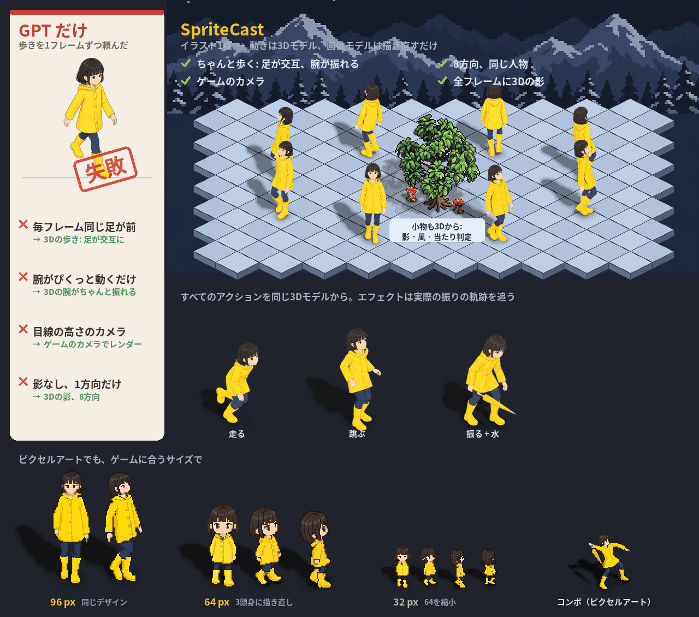

<p align="center"><i>同じ画像モデル、同じキャラクターシート。左: GPT に歩きを頼んで出てきたそのまま。右: 3D が加えるもの。<br>下: 横スクロールのゲームの生き物と人。それぞれ、横にある無地のマネキンの歩きの上に描いたものです。</i></p>


<p align="center"><i>人だけでなく物も作れます。どんな物でも、どの面からでも、キャラクターと同じ縮尺のピクセルアートにします。<a href="#ピクセルアートのプロップ-どんな物でもどの面でも">方法</a>。</i></p>

```
claude plugin marketplace add Sunghwan0112/spritecast
claude plugin install spritecast@spritecast
```

あとは頼むだけです: *「これが私のキャラクターです (hero.png)。8方向に歩かせてください。」*
**キーなしで無料で試すには**、Claude に *「SpriteCast を試して」* と頼んでください。

絵を描くのは画像モデル (OpenAI のもの、自分のキーで使います) です。体、動き、アングル、影は3Dから来ます。だから
どのフレームも同じ人物で、ちゃんと歩きます。

**すべてを同じ角度で。** アイソメトリックのゲームがAI製っぽく見える理由は、一枚の絵の出来であることはまれです。違うカメラから見たものが並んでいるからです。斜め上から描いたキャラクターが平らに敷いた四角いタイルの上に立ち、その隣にアイコンパックの正面向きのハートとポーションが置かれる、というように。キャラクターや木や地面だけでなく、彼女が拾うハートやポーションまで、すべてを同じアイソ視点・同じ光で描きましょう。それぞれ自分の3Dモデルと影を持たせて。そうすれば、切り貼りしたようには見えなくなります。(画面上部のハートのように画面に貼り付くUIは正面でかまいません。同じ3Dのハートを正面から描けばOKです。)

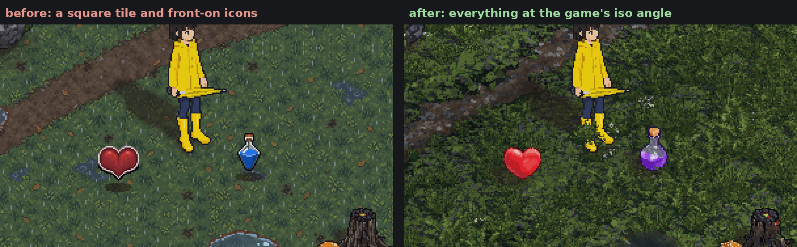

<a name="cost"></a>無料、MIT ライセンスです。OpenAI と Tripo には直接支払い(Tripo 1クレジット = $0.01)、作者には何も入りません。有料のステップはすべて費用を表示し、OK を待ちます。歩くキャラクター1体で、自分の3Dモデルなら約 **$3**、Tripo なしでマネキンの上に描けば約 **$0.55**、小物は数セント、横スクロールのゲームのモンスターは約 **$0.18** です。3Dガイド、仕上げ、地面(草原、道、水たまり)、3Dの影、半透明、生き物のポーズ、風、Phaser・Godot への書き出し、お試しは無料です。

<details><summary>項目ごとの費用</summary>

| | 渡すもの | 得られるもの | 約 |
|---|---|---|---|
| **歩くキャラクター** | イラスト1枚 | 8方向の歩き、立ち姿、フレームごとの影 | **$2.9** (描画 $2.1 + Tripo $0.75) |
| **マネキンの上に描く歩くキャラクター** | 説明と、自分のゲームの絵1枚 | 上から見た8方向の歩き (または横から)、SpriteCast のマネキンの上に描く。キャラクターの3Dモデルは作らない | **$0.54** (デザイン $0.06 + 1方向ごとに $0.06、ピクセルアートなら約 $1.2) |
| **動作の追加** | 動作の名前(Tripo: 手早い)、または Mixamo の FBX(より自然) | 走る、跳ぶ、斬る、投げる… 8方向 | 1動作 **$0.8〜1.5** (描画 $0.7〜1.4 + Tripo $0.10、FBX は無料) |
| **ピクセルアート** | 歩くキャラクター | 身長約100pxのピクセルスプライト | 8方向の歩き **$1.35** (1シート $0.075) |
| **動物** | イラスト1枚 | 四足歩行 8方向 | **$2.8** (描画 $2.5 + Tripo $0.30) |
| **横スクロールのゲームの主人公** | イラスト1枚 | 横から見た歩きと立ち姿(1方向だけ描き、反対側は左右反転)、その動作 | **$1.1** (描画 $0.33 + Tripo $0.75)、動作ごとに約 $0.3 |
| **横スクロールのゲームのモンスター、町の人** | 説明と、自分のゲームの絵1枚 | デザイン、マネキンのポーズの上に描いた歩き、4つの場面のシート(殴られる、崩れる) | **$0.18** (1枚 $0.06、3Dモデルは作らない) |
| **座る** | 歩くキャラクター | 8方向の座り姿、小物の上に配置 | **$0.22** (4方向: $0.11) |
| **小物、ポーズを取ったNPC** | 説明 | スプライト、影、アンカー | **$0.08** (向きを足すごとに $0.09) |
| **ピクセルアートの小物** | 説明 | 全方向のピクセルスプライト、ピクセルキャラと同じ縮尺 | 1方向 **$0.28** (Tripo $0.20 + 1方向ごとに $0.08) |

これは各スクリプトがお金を使う前に表示する金額です。実際の請求はこれより少し下回りました (小物1つの描画: $0.068)。

</details>

**API キーがなければ: ChatGPT アプリで手作業で描く。** `pixelart.py CHAR.json --manual`(ほかのステップは `SPRITECAST_DRAW=manual`)は API を呼ばず、費用はかかりません。シートごとにローカルページ(127.0.0.1:8790)に、送るものが出ます。ChatGPT の新しいチャットで(無料プランでも可、回数の上限内で)メッセージを2回送ります。まず参考画像を送ると「ready」とだけ返ってきて、次にガイド画像とプロンプトを送ると描いてくれます。結果を保存すると、ダウンロードフォルダから自動で取り込みます。雨の少女の歩きで試したところ、ガイドだけでも8フレームとも同じキャラクターで、参考画像を先に送ると(3フレーム)レインコートのボタンまで描かれました。それでも API より少し素朴で、1〜2フレームは描き直しが要ることがあります。

## 作れるもの

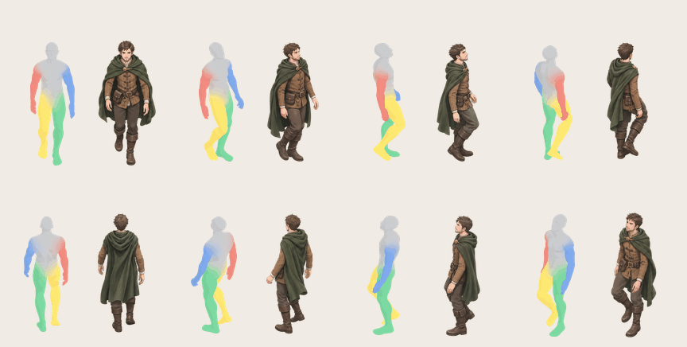

<p align="center"><b><a href="#3dモデルなしで-マネキンの上の歩き">3Dモデルなし、Tripo なし</a></b>: デザイン1枚から SpriteCast のマネキンの上に描いた8方向の歩き、約 $0.55。</p>

| | |
|---|---|
| 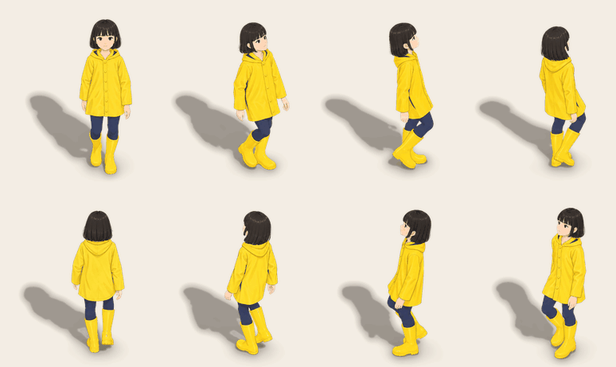 | 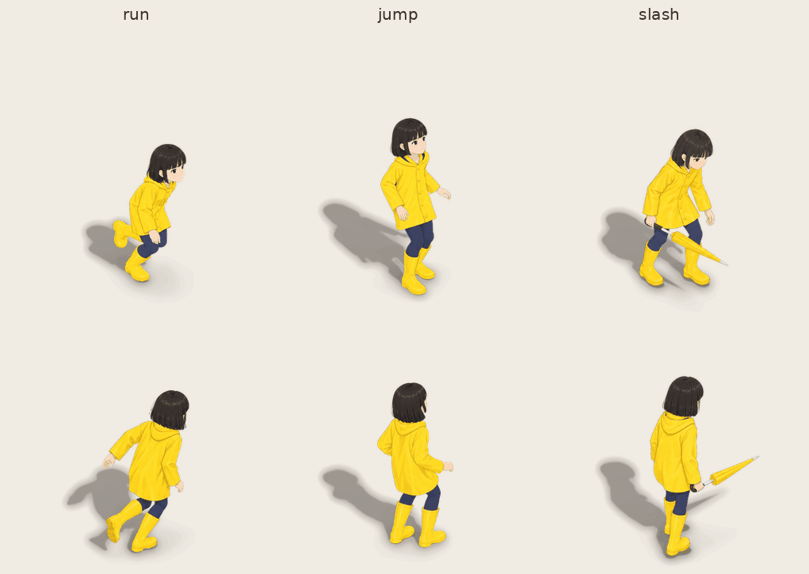 |
| **[8方向の歩行](#歩くキャラクター)**: イラスト1枚から、フレームごとの影付き | **[アクション](#アクションを増やす-走る跳ぶ斬る)**: 走る、跳ぶ、斬る、または任意の Mixamo クリップ |
|  |  |
| **[ピクセルアート](#ピクセルアート-アーケードサイズ)**: 高さ約 100 px、持つ物や投げる物も | **[四足の動物](#四足の動物)**: リグを買わずに |
| 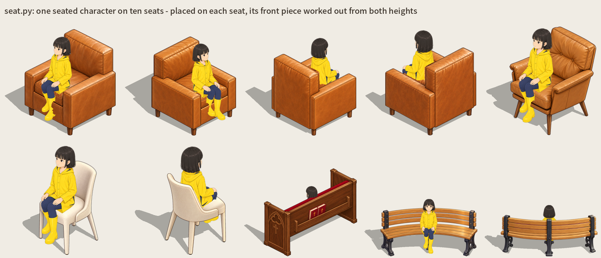 |  |
| **[座り](#座る)**: 自分のプロップの上に。手前の肘掛けは3Dで計算 | **[プロップ](#プロップと背景物)**: 実寸で、すべて1つの床に |
|  |  |
| **[3Dモデルから焼いた影](#light-shadow-wind)**: 太陽、曇り、自分で置く照明 | **[葉にふく風](#light-shadow-wind)**: 同じモデルから、枝ごとに |
| 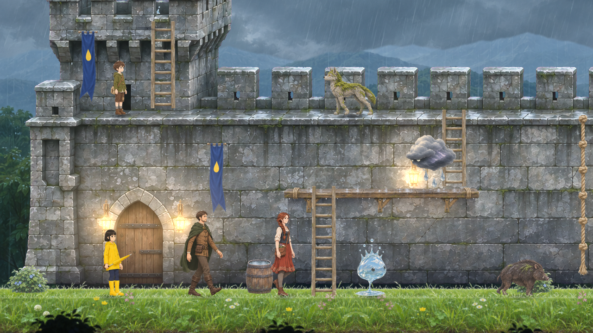 | 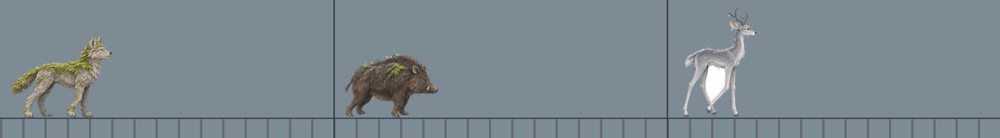 |
| **[横スクロールのゲーム](#横スクロールのゲーム-1方向だけ描きモンスターは2dで)**: 1方向だけ描き、反対側は左右反転 | **[2Dで描くモンスターと人](#横スクロールのゲーム-1方向だけ描きモンスターは2dで)**: マネキンの歩きの上に、1体ずつの3Dモデルなしで |

## 頼み方の例

- *「これが私のキャラクターです (hero.png)。8方向に歩かせてください。」*
- *「走りとジャンプを追加して。それと投げ。Mixamo のクリップはこれ (Throw.fbx)。手に雪玉を持たせて。」*
- *「うちのゲームはピクセルアートです。歩きと投げを高さ約 96 px のピクセルスプライトにしてください。」*
- *「座らせて、このアームチェアに乗せてください。」*
- *「店主の NPC を4方向で作って。茶色のカーディガンを着たおじいさん。」* (ポーズ付きの人物なら説明文だけで十分です)
- *「高さ 1.8 m の本でいっぱいのアイソメトリックの本棚を、cozy スタイルで作って。」*
- *「横スクロールのゲームを作っています。横から見た歩きと攻撃を作って。」*
- *「そこに出るオオカミ、イノシシ、町の衛兵も作って。1体ずつ3Dモデルは作らずに。」*
- *「これはうちのゲームのプロップです (props/barrel.png)。同じスタイルで合う木箱を作って。」*

## うまくいく理由

画像モデルはフレームからフレームへ体とポーズを保てません。言葉で歩きを頼むと、きれいだけど歩いていない絵が8枚出てきます。
冒頭の画像の左側が、出てきたそのままのものです:

| GPT だけ | SpriteCast |
|---|---|
| 8フレームすべてで同じ脚が前 | 脚は3Dの歩行アニメーションから |
| 腕がランダムにぴくつく | 腕が脚と逆に振れる |
| カメラが目の高さ | ゲームのカメラ (デフォルトは30°見下ろし) |
| 影なし | 3Dの体そのものの影、フレームごと |

だから SpriteCast は画像モデルに動きを頼みません。**動かすのは3D、画像モデルは描き直すだけ**です。レンダリングした各フレームを
イラストの見た目で描き直させます。描いた絵はすべてレンダーに合わせて戻し、照合します。別のポーズで描かれたフレームは
フラグが立ち、描き直せます。無理に押し込んで合わせることはしません。プロップも同じ仕組みで、リグの代わりに実寸のブロックを使います。

## 作ったゲーム

例として作った小さなゲームが2つ。どちらも1日ほどで作り、中の絵はすべて SpriteCast で作りました。SpriteCast で何が作れるかを見せるためのものです。

### Rain Girl: アイソメトリックのピクセルアート

<p align="center"><a href="https://sunghwan0112.github.io/rain-girl/"></a></p>

<p align="center"><a href="https://sunghwan0112.github.io/rain-girl/"><b>▶ ブラウザですぐ遊ぶ</b></a> &nbsp;·&nbsp; <a href="https://github.com/Sunghwan0112/rain-girl">ゲームのコード</a><br>インストールも登録もいりません。スコアを送ると下のランキングに載ります。</p>

<p align="center"><a href="https://sunghwan0112.github.io/rain-girl/"></a></p>

<p align="center"><i>Rain Girl。黄色いレインコートの少女が傘の水で炎モンスターを消し、森が燃えるのを防ぐ小さなピクセル
アクションゲーム。</i></p>

- **少女。** イラスト1枚 → Tripo モデルにリグを入れ、ゲームのカメラ(2:1、30°見下ろし)でレンダー → 傘を持った歩き、振り、立ちを斜め
  4方向(`"facings": 4`)で、各フレームを96pxのピクセルアートに描き直しました。振りで飛ぶ水は3Dでレンダーしたエフェクトを同じ方法で
  描いたもの、立ちのループは `idleclip.py` です。
- **森。** 木、半分焼けた木、焼けた木、茂み、焼け株、岩、キノコの7つの小物を、それぞれ Tripo モデルにして少女と同じ縮尺(1mが74px:
  2.4mの木で約175px)で4面からレンダーし、ピクセルアートに。スプライト28枚。ゲームは小物ごとに1面をランダムに見せ、燃えた木は
  立っていた面のまま半焼け、焼けた木へ変わります。
- **光はひとつ、手塗りの陰影なし。** 28枚すべてが3Dガイドと同じく右上から光を受けています。下はすべての小物のすべての面です。

<details><summary>ゲームの草地に並べた小物スプライト28枚</summary>


</details>

- **コンボ。** 同じセットの Mixamo モーション 2 つ(振り下ろしと回転斬り)をリグに載せ、斧の振り下ろしを弧を描く剣の斬りに直し、2 つ目が
  1 つ目の最後の姿勢から始まるようにつなぎました(`motion.py`)。4 方向のピクセルアートで描き、水は彼女の背丈の 2 倍の距離で薄れて消えます。
  振り下ろしの途中でもう一度押すと回転斬りが続き、届く範囲と同じ大きさの輪が彼女を囲みます。
- **エフェクト。** 当たったとき、火が消えるとき、飛んでくる火の玉と遮られたとき、アイテムを取ったとき、回転斬りの輪は
  [PVFX Foundry](https://nerijs.itch.io/pvfx-foundry)(CC0)のエフェクトです。SpriteCast に 253 個同梱され、`fxpack.py` で探して
  スプライトの大きさと色で書き出せます。彼女を囲む輪は真ん中で切り、奥の半分は体の後ろ、手前の半分は体の前に描きます。


<details><summary>SpriteCast に同梱されたエフェクト 253 個のうち 32 個</summary>


</details>

- さらに - ひとつのパレット、木陰で暗くなる少女、火の玉を止める遮蔽、風: [制作記](docs/guide/rain-girl.md) (英語)。

### The Castle Wall: 横スクロールのゲーム

<p align="center"><a href="https://sunghwan0112.github.io/rain-girl-castle-wall/">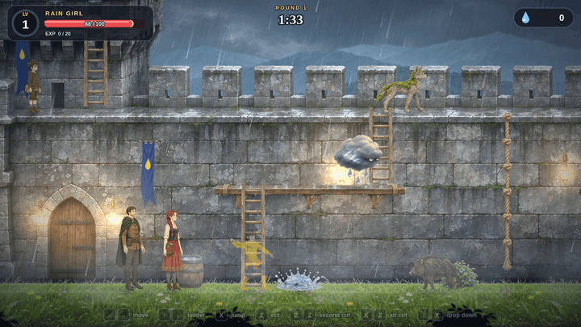</a></p>

<p align="center"><a href="https://sunghwan0112.github.io/rain-girl-castle-wall/"><b>▶ ブラウザですぐ遊ぶ</b></a> &nbsp;·&nbsp; <a href="https://github.com/Sunghwan0112/rain-girl-castle-wall">ゲームのコードと、それぞれの絵の作り方</a><br>インストールも登録もいりません。スコアを送ると下のランキングに載ります。</p>

<p align="center"><a href="https://sunghwan0112.github.io/rain-girl-castle-wall/"></a></p>

同じ少女が、描き込んだ絵の横スクロールの世界にやって来ました。雨が目覚めさせたものを城壁の上で狩ります。ラウンドを重ねるごとに
難しくなります。絵の作り方:

| | 作り方 |
|---|---|
| **主人公** - 歩き、水の付く斬り2種、ジャンプ、空中斬り、はしご、つかみ。殴られる、へたり込む | 横から見た自分の3Dモデル (`"view": "side"`)。最後の2つは立ち姿の絵から2Dで描いた |
| **モンスター5種** - 石のオオカミ、イノシシ、鹿、水たまり、雨雲 | それぞれデザイン1枚、それに合わせたマネキンの上の歩き、殴られるシート (`creature.py`) |
| **町の人3人** - 衛兵、薬草売り、少年 | 同じやり方で、髪のない男性・女性・子どものマネキンの上に |
| **マップ** - 城壁、空、遠くの丘、地面、はしご、足場 | 2Dで描いた。城壁とランタンはキャラクターと同じ視点で見た自分の3Dモデルの上に描いた |

モンスターにも町の人にも自分の3Dモデルはありません。どう描いたかは [横スクロールのゲーム](#横スクロールのゲーム-1方向だけ描きモンスターは2dで) にあります。

## 歩くキャラクター

歩きの作り方は2つあります。**SpriteCast のマネキンの上に**描けば、キャラクターの3Dモデルも Tripo もなしで8方向約 $0.55
([下](#3dモデルなしで-マネキンの上の歩き))。**自分の3Dモデルで** Tripo で作れば約 $3 で、武器を持って攻撃するキャラクターにはこちらが必要です。


キャラクターのイラストを1枚 (正面向き、まっすぐ立った、ポーズなし) 渡すと、8方向の歩行 (各8フレーム) と8方向の立ち姿が、その
イラストの見た目で得られます。動きは3Dから作ります ([理由](#うまくいく理由)):
1. イラストからターンアラウンドを描きます。
2. [Tripo](https://www.tripo3d.ai) がそれから3Dモデルを作り、リグを組み、歩行と待機のアニメーションを付けます。
3. ゲームのカメラで歩行をレンダリングします (無料)。各フレームに3Dの体そのものの影を付け、光の方向に沿って
   地面に平たく押し付けます。
4. 画像モデルがレンダーの上から描きます。1回の呼び出しで4フレーム。まず正面を描き、他の向きはすべてそれに合わせるので、
   同じ人物のままです。
5. 各フレームをレンダーに合わせて戻し、頭の大きさを安定させ、縁をきれいにします。ストリップ、フレームごとの影
   (足が影に接し、上げた足は自分の影を落とす)、アンカーが得られます。

```
$PYTHON skills/spritecast/scripts/charpipe.py turnaround hero.json --yes   # then 3d (model, rig, renders) and draw (then finish, preview by themselves)
```
デフォルトでは8方向すべてを描きます。左右対称のデザインなら `"mirror": true` を設定すると、西向きを東向きから
反転して作り (影はそれぞれ自前)、約 $0.66 安くなります。描画は $2.1 ではなく ~$1.4 です。
または `"facings": 4`：斜めの 4 方向（南東、南西、北東、北西）だけ、描く費用は約半分（歩き：約 $2 → 約 $1、ピクセルアートは約 $1.35 → 約 $0.7）。上下左右に動くゲームなら `"facings": "cardinal"` で東西南北の 4 方向だけ。どちらでもキャラクターはそのまま 8 方向に歩けます。書き出したキャラクターは 8 方向のどれに進んでも、描いてある中でいちばん近い向きを表示してそのまま保つので、まっすぐ横に歩いてもちらつきません。

リグ付きの GLB を自分で用意すれば (`"rig_glb"`)、`render` まで飛ばせます。キャラクター1体の費用: [冒頭の表](#cost)。

その他のオプション (複数の衣装、プレビュー動画、Meshy、リグ付きの例のキャラクター): [docs/guide/characters.md](docs/guide/characters.md#walking-characters) (英語)。

### 3Dモデルなしで: マネキンの上の歩き


SpriteCast には無地のマネキンが入っています。男性、女性、子ども、犬。髪のない灰色の体で、右の手足は赤、左は青です。`creature.py` が
説明に合うマネキンをゲームのカメラで歩かせてレンダーし (無料)、画像モデルがそのポーズの上にキャラクターを描きます。デザイン1枚、
そのあと1方向に1枚。Tripo もキャラクターの3Dモデルもなしで、8方向の歩きが約 $0.54 です。

```
$PYTHON skills/spritecast/scripts/creature.py mannequin guard.json   # 無料: マネキンの歩き、方向ごとのガイド。そのあと design、walk (まず1方向だけ: --only south-east)
```
- `"view": "above"`: 上から見た8方向 (または4方向)、アイソメトリックやトップダウンのゲーム用。`"view": "side"` (既定): 横スクロール用の
  1方向 ([下](#横スクロールのゲーム-1方向だけ描きモンスターは2dで))。
- `"pixel": 96`: ピクセルアートで。マネキンをスプライトのピクセルに縮め、その格子の上に描きます (1方向に2枚)。
- 上の衛兵は横から見たデザイン1枚から描きました。8方向すべて同じ人物で (マント、バックル、鍵まで)、北向きは後ろ姿です。フレーム
  ごとにアンカー (足もとの地面) と1歩で進む距離が付くので、足が滑りません。

<details><summary>ピクセルアートで: スプライトのピクセルに縮めたマネキンと、その上に描いた衛兵</summary>

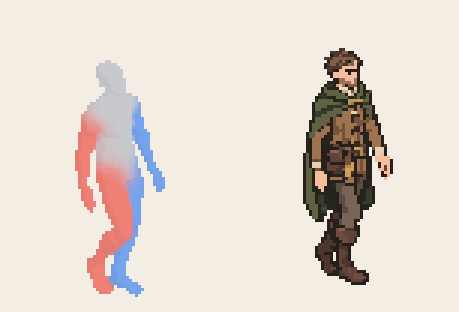

</details>

**自分の3Dモデルで作るべきとき。** マネキンの上なら歩きはよく描け、ほかの動き (ジャンプ、殴られる) も場面のシートとして描けば
だいたいうまくいきます。ただ、Rain Girl が傘を振るように武器を持って攻撃するキャラクターや、アクションがたくさん要るキャラクター
(コンボ、Mixamo のモーション、振ったときのエフェクト) は、最初から Tripo で作ることをおすすめします ([上](#歩くキャラクター))。リグが手に持った物を
すべてのフレームに描き、どのアクションも同じモデルの実際の動きから出るので、どのポーズでも一貫します。新しいアクションも同じリグに
クリップを1つ足すだけです。

### 四足の動物

Tripo の四足動物用リグはうまく歩きません (背骨がなく、肩が首からぶら下がっている) ので、動物には買ったリグを使いません。
`"kind": "animal"` にすれば3Dモデルだけ (Tripo、~30 クレジット) で十分です: メッシュから骨格を見つけ (足、
背中、頭、尻尾、向いている方向)、猫か犬の歩き方で歩かせ、人と同じ描画、フィッティング、
3Dの影を付けます。

ターンアラウンドは四本足で立った姿で、各脚が他の脚と離れ、尻尾が後ろに出ているように描きます。服は体にぴったりしたものだけ (ニットのベストはよいが、
ケープやスカーフは不可。垂れ下がる物は一番近い脚と一緒に動いてしまいます)。描く前にレンダーを確認してください: 脚が4本、頭が前、尻尾が
後ろ。Tripo のモデルに余分な脚が生えていたら、作り直すか Meshy を使ってください (`"modeler": "meshy"`)。

<details><summary>黄色いレインコートを着た茶トラ猫が8方向に歩く</summary>


</details>

猫は [`examples/tabby_cat`](examples/tabby_cat) にあります: 小さな黄色いレインコート (少女のもの) を着た茶トラで、デザイン、
ターンアラウンド、スペック、ストリップ、影、シート付き。Tripo 30 クレジットと描画代約 $2.5 (描き直しやデザインの試行込み)。
フレームはレンダーに 0.76-0.97 で合っています (北東と北西はフレームごとに `"mix"` で混ぜています。reference/character.md 参照)。

### 横スクロールのゲーム: 1方向だけ描き、モンスターは2Dで

プラットフォーマーや横から見るRPGには、`"view": "side"` でカメラを目の高さの真横に置きます。右へ歩く1方向だけを描き、反対側は
その左右反転です。8方向なら18枚かかる歩きと立ち姿が、3枚 (約 $0.33) で済みます。体はデフォルトで見る人の方へ 45° 回してあるので、両目が
見えて、体の前を横切る振りが体の後ろに隠れません (厳密な真横なら `"turn": 0`)。アクションはこれまでどおりです: 水のエフェクトが付く斬り、
ジャンプ (`"air"`)、背中を見せて登るはしご (`"face": "away"`)。

**モンスター、動物、町の人には、1体ずつの3Dモデルは要りません。** `creature.py` がゲームの絵1枚の画風でデザインを1枚描き、
SpriteCast に付属する無地の**マネキン** (灰色の犬、髪のない男性・女性・子ども。手前の手足は赤、奥は青) の歩きのポーズの上に
そのデザインを描きます。殴られる、崩れる、跳ねるなど他の動きは、4つの場面を言葉で書いた1枚のシートで描きます。1枚あたり約 $0.06 です。

- **4本足の生き物。** まず犬のマネキンを、デザインの脚の長さ、胴の厚み、首に合わせて変形します (無料)。変形しないまま描くと、
  イノシシも鹿も犬の脚の長さになりました。合わせると、それぞれの体型を保ちました。石のオオカミの8フレームは、マネキンの位置から
  3 px 以内に出ました。
- **人。** マネキンの立ち姿のとおりにデザインを描き、その歩きのポーズの上に描きます。マントの衛兵とスカートの薬草売りは、
  8フレームを通してバックル、鍵、三つ編みを保ちました。
- **ゲームでは**、歩いた距離から歩きのフレームを選びます (1歩が `step` px)。足が滑りません。

<details><summary>イノシシと鹿: デザイン、犬のマネキンそのままに描いた歩き、比率を合わせたマネキンに描いた歩き</summary>

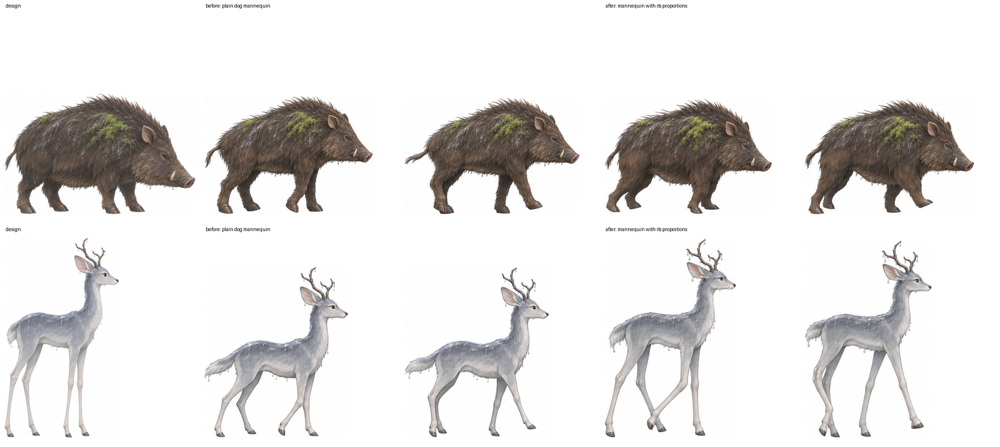


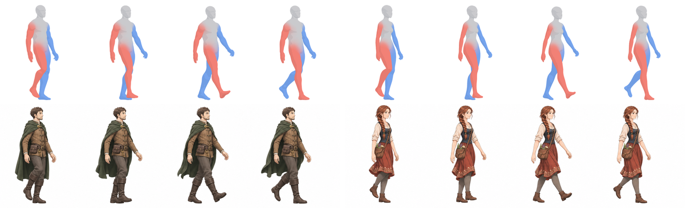

</details>

脚が横に張り出すもの (トカゲ、クモ) には、まだマネキンがありません。サンショウウオは犬の脚で立った姿になりました。

**マネキンか、自分の3Dモデルか?** ほかのキャラクターと同じです: [自分の3Dモデルで作るべきとき](#3dモデルなしで-マネキンの上の歩き)。
詳しくは [reference/creature.md](skills/spritecast/reference/creature.md)。

**横から見た背景も3Dモデルの上に描きます。** 後ろの城壁はプロップです。言葉から作った Tripo モデルを真横から水平にレンダーし
(`"camera": {"pitch": 6, "yaw": 90}`)、光を当ててから、その上に描きました。12° 上から見た灰色のブロックの上に描くと、上面が広い
床になりました。横から見たキャラクターの隣に、上から見た城壁が並んだのです。6° の灰色のブロックの上では平らに出ました (光のない
ガイドでは、画像モデルが石の立体を描く手がかりがありません)。光を当てた自分のモデルからは、持ち送り、胸壁の凸部の側面とその影が出ました。

### アクションを増やす: 走る、跳ぶ、斬る

歩行のほかに、走る、跳ぶ、何かを振ることもできます。スペックに並べます: `"actions": ["run", "jump", {"name": "slash",
"hold": "umbrella"}]`。リグはそれらのアニメーションを Tripo から受け取り (1つにつき約 10 クレジット。run、jump、slash、shoot、dive、climb、fall、
hurt、turn があります)、それぞれ歩行と同じように8方向でレンダリング、描画、仕上げされ、フレームごとの影付きの専用ストリップに
なります。斬りには手に持つ物が必要です: `"hold"` が単純な形からそれを組み立てて手に持たせるので、すべての
フレームで一緒に動きます (今は傘、ピストル、水鉄砲。右手、または `"hand": "left"`)。自分のリグ付きモデルなら、その中のどのクリップもアクションにできます。持つ物は
画像モデルにパーツごとに説明します。特に手元の端 (持ち手、柄の最初の部分) は丁寧に。そこは小さく体に重なっていて、
そうしないとモデルが推測で描いてしまう部分だからです。

**どちらを使うか: 時間を節約するなら Tripo、仕上がり重視なら Mixamo。** Tripo はダウンロードなしで一度に動きを受け取れます。歩く、走る、跳ぶのように手に何も持たない動きは Tripo で十分きれいに出ます。少し時間がかかっても仕上がりが大事なら [Mixamo](https://www.mixamo.com/#/?page=1&query=melee&type=Motion%2CMotionPack) をおすすめします (無料、Adobe アカウントが必要)。特に攻撃は。モーションキャプチャなのでより自然で、動きが数千あります。同じセットの攻撃は同じ構えで始まって終わるので、コンボにつなぎやすくなります (`motion.py link`)。ひとつダウンロードして (FBX Binary、30 fps、Without Skin) `addclip.py hero.json Move.fbx name` を実行すれば、キャラクターのリグに無料で載ります。手間もあります。Mixamo には API がないので、スキルが直接取ってくることはできません。サイトへ行って動きを自分で見て選び、ダウンロードする必要があります (検索リンクは Claude が渡します)。FBX ファイルは公開リポジトリに置かないでください。


**ほとんどは一発で出ます。** 雨の少女の歩き、走り、ジャンプは、すべてのフレームで3Dレンダーに 0.78 以上で合っていて、どれも
1回で描けました。傘での斬りはもっと難しい (細い物が体の周りを回る) です: 間違った場所に描かれた武器は自動で
描き直され、残ったものは深くかがむところで少しゆるく合います。少しだけ上体が起きたポーズで描かれますが、動きの中では問題なく見えます。
そうしたフレームは確認用に一覧が出ます。残すか描き直すかはお任せします。

**いつも持っている物を、どちらの手でも** (要望がありました)。1つのアクションではなく、スペック自体に `"hold"` を入れます。
`"hold": {"kind": "watergun", "hand": "left"}`。するとキャラクターは歩行、立ち姿、すべてのアクションでそれを持ちます。
下は左手に水鉄砲を持った例です: 上が3Dガイド、その下が描かれたフレーム。

<details><summary>左手に持った水鉄砲</summary>


</details>

- **その手に持ったまま。** 片手に物を持ったキャラクターは左右対称ではないので、別のフレームを反転して作ることは決して
  しません。反転すると物が持ち替わってしまうからです。(`"mirror": "never"` で、左右対称でないどんなキャラクターにも同じことを指定できます:
  眼帯、片袖など。) 各シートにはどちらの手か、レンダーのどこにその物があるかを伝え、描いた後はすべての
  フレームをレンダーと照合します: 上の24フレームのうち、確認用に挙がったのは1つでした。
- **手が持ち手を握る。** リグの指はまっすぐ伸びているので、その上に描くと、開いた手の横に銃が浮いた絵になります。
  そこでガイド自体で持つ手を曲げます: 持ち手を拳の中に入れ、4本の指を片側から、親指を反対側から回し、
  各指は触れるところまでだけ曲げます。太い持ち手はゆるめに握り、手が
  回らないほど太いものは細くします。
- **描く前に手を見る。** フレームの中では握りは数ピクセルなので、無料の `render` ステップで手を
  全周からクローズアップで保存し (`render/hand-walk.png`)、各指先が持ち手からどれだけ離れているかを表示します。そこで直せば費用はかかりません。
- 自分のリグ付きモデルにすでに含まれている物: `"hold": {"in_model": true, "words": "In the LEFT hand: a black pistol."}`。

上の例の描画代は約 $0.7 でした (8シート: 3方向からの歩きと1方向からの走り)。

<details>
<summary><b>別のサイズ: 同じ絵から 512、64、32 px</b></summary>

**必要などんなサイズでも** (要望がありました): フレームは高さ 256 px で出てきますが、`charpipe.py pack CHAR.json --px 64` で同じ絵から
任意の高さの別セットを作れます。256 より大きくてもシャープなままです (フレームは絵の元の精細さで保持しています)。ストリップ、影、`character.json` がそのサイズで `out-64px/` に入り、
描き直しはなく、`out/` はそのままです (スペックの `"frame_px"` でデフォルトを設定)。下は高さ 512、256 (デフォルト)、64、32 px で、それぞれ同じ大きさで表示しています (ピクセル単位で拡大)。64 では髪、レインコート、
ブーツ、傘がすべて読み取れます。32 ではポーズと色は保たれますが、顔はほぼ消えます。単純な縮小で、そのサイズ専用のものは
まだありません ([ロードマップ](#ロードマップ) 参照)。


</details>

### 振りに付くエフェクト: 水、炎、葉

振りの後に何かを空中に残せます。アクションに `"trail"` を加えると (`{"name": "slash", "hold": "umbrella", "trail": "water"}`)、
エフェクトが体の上に重ねる独立したスプライトとして得られます。**無料で、何も描き直しません**: 3Dリグは
傘の先端が各瞬間にどこにあるかを知っているので、その軌跡からエフェクトを計算します。すでにある斬りにも、
フレームに手を付けずに追加できます。

<details><summary>雨の少女の傘の斬りに8種類のエフェクト</summary>


</details>

- **実際の動きに沿う。** 画像モデルに斬りを頼むと、弧を1つ作ってそれを繰り返します。既製のエフェクトは1つの形をどの振りにも
  貼り付けたものです。ここでは帯や破片が、このキャラクターの傘がこのアクションでたどる軌跡から出て、8方向それぞれから
  見た形になり、後ろを通る部分は体と傘が隠します。動きを変えればエフェクトも変わります。
- **11種類の見た目**: `plain`、`wind`、`water`、`fire`、`drops`、`flames`、`leaves`、`greenleaves`、`petals`、`snow`、`sparkle`。色、
  量、速さは変えられ、新しい見た目はファイルにエントリを1つ足すだけです。自分の小さな画像を渡して
  散らすこともできます (`"image": "mine.png"`)。
- **破片はフレームからフレームへ飛び続ける。** 葉は1回放たれ、振りに少し運ばれ、回転し、揺れて、地面に
  落ち着きます。どのフレームでも同じ葉で、毎回新しくばらまくわけではありません。
- **水と炎はひとかたまりとして動く** (要望がありました)。水は膜として離れ、糸状に伸び、しずくに分かれ、霧を
  残します。炎は芯が白っぽい黄色、次にオレンジ、そして冷えるにつれ暗くなる赤い縁で、灰が舞い上がります。
- **水が水らしく見える。** 薄い水は淡く透けていて、深い水は濃く、明るい縁とキャラクターと同じ光源からの
  ハイライトがあります。速いしずくは進む方向に長く描かれ、いくつかは床で輪としぶきになって弾けます。
- **振りそのものだけ。** 傘を振り上げている間は何も出ません: 動きの速い区間を自動で見つけます。
- **体より多いフレーム。** 体は8回描きますが、水は24エフェクトフレーム (1つにつき3枚)、炎は16 (2枚) あり、その上で
  速く再生されます。8フレームだと、あるフレームで膜が丸ごとあったのに次ではもうしずくになっていました。これらは体のフレームの前後
  (⅓フレーム前、その瞬間、⅓フレーム後) に分かれているので、水は描かれた傘を追い越さずについていきます。
- **ピクセルアートでも**、スプライトのサイズで: 固体はくっきりした縁を保ち、霧は透けたままです。


ピクセルアートのコンボ - レインガールの振り下ろしと回転斬りを 4 方向で、水と回転斬りの輪まで(`motion.py`、`fxpack.py`。Mixamo の 2 つの動きは [ピクセルアート](#ピクセルアート-アーケードサイズ) の「レインガールのコンボのプリセット」に):


**正直に言うと:** これらは計算で作ったもので、塗ったものではないので、手描きというよりきれいな仕上がりです。軌跡は
持つ物のものなので、アクションには手に持つ物が必要です。作って確認したのは傘の斬りだけです。

### 2つのアニメーションをつなぐ: 振りへ入って、戻る

歩行は攻撃の最初のポーズで終わらず、攻撃は歩行のポーズで終わりません: 続けて再生すると体が飛びます。
3Dリグが間のフレームを作ります (要望がありました): `{"name": "ready", "between": ["walk", "slash"], "frames": 3}` と
`{"name": "recover", "between": ["slash:end", "walk"], "frames": 4}`。下はすべて描いたものです: 傘を持って歩き、
構えに沈み込み (リグから3フレーム)、水のエフェクト付きで振り、起き上がって (さらに4フレーム) 歩き続けます。

<details><summary>雨の少女が傘を持って歩き、構えに沈み込み、水しぶきと霧とともに振り、起き上がって歩き続ける</summary>


</details>

- **仕組み。** リグは両方のアニメーションを同時に、それぞれある瞬間で止めて再生し、一方からもう一方へ、加速と減速を
  付けて移ります。`"slash:end"` は攻撃の最初のポーズではなく最後のポーズから始めます。
- **レンダリングは無料、描画は他のアクションと同じ**: 3〜4フレームで1シート、約 $0.08。
- **つないだ状態で見る**: `charpipe.py loop hero.json --only walk,ready,slash,recover --facing south-east` (無料) で、完成したフレームから
  上のような GIF を作れるので、飛ぶフレームを描き直す前に見つけられます。ピクセルアートの
  セットは、[ピクセルエディター](#ピクセルアート-アーケードサイズ) で全フレームをつないだまま直せます (`--join`)。
- **1フレームだけおかしい? それだけ描く。** `charpipe.py frame hero.json --only slash --facing south-east --frame 5 --yes` (~$0.08) で
  そのフレームだけを描き直します。アクションの `"frame_words"` で、そのフレームのレンダーから読み取れないことを画像モデルに伝えます。上のフレーム 5 は
  左の拳が5回続けて傘の上に浮いていましたが、手はほとんど頭の後ろに隠れていると伝えると、正しく出ました。
- **手に持った物は手に持ったまま。** 歩行でも持っているには、歩行がそれを持つ必要があります (ここでは傘付きの、歩行の
  クリップによるアクション)。そうしないと最初の中間フレームで突然現れてしまいます。

### ピクセルアート (アーケードサイズ)

<details><summary>雨の少女が5方向に雪玉を投げ、それぞれの玉がアイソメトリックの床の上を別々の方向に飛ぶ</summary>


</details>

ピクセルで描かれたゲーム (ベルトスクロール、格闘ゲーム、アーケードのプラットフォーマー) 向けに、同じキャラクターを本物のピクセルアートにします。高さ約 100 px、
1ピクセル1色、約40色のパレット、暗いアウトライン、ぼかしなし、各フレームの3Dの影付き。塗りのフレームを縮小した
ものではなく、順序が逆です。


3Dレンダーをピクセル化してガイドにし、画像モデルがそれをピクセルアートとして描き直し、その絵を**モデルが描いたグリッドで
読み戻します**。頭は専用のグリッド線で読むので、目と口が残ります。その後レンダーに合わせてサイズと位置を決めます。

```
$PYTHON skills/spritecast/scripts/pixelart.py hero.json                        # the plan and its cost - spends nothing
$PYTHON skills/spritecast/scripts/pixelart.py hero.json --clips walk,throw --yes
```
1シート約 $0.075: 8方向すべての歩行で18シート (約 $1.35)。上の投げは5方向で14シートでした。

**1シートに何フレーム描くかは自動で計算されます。** `pixelart.py` がレンダーの大きさを測り、入るだけ並べます: 歩行は4つ、物を持つと2つ、長い振りは1つ (だから攻撃は歩行より高い)。お金を使う前にプランで見せます。

- **持つ物と投げる物。** `"hold": {"kind": "snowball", "until": "auto"}` で手に持たせ、手が一番速く動くときに
  放します。`pixel.json` にはどのフレームで、フレームのどこで、どの方向に、どの速さで放すかが入ります。エンジンで
  投射物を出すのに十分な情報です。玉、その飛行中の形、4フレームの破裂も得られます。上の画像はそのデータを再生したものです。
- **任意の Mixamo アニメーション**を、[アクションを増やす](#アクションを増やす-走る跳ぶ斬る) と同じようにリグに載せられます: 上の投げは
  `addclip.py hero.json Throw.fbx throw` で入れたものです。
- **つながるコンボ。** `motion.py` がゲームのように攻撃と攻撃をつなぎます。次の攻撃は前の攻撃が終わった姿勢から始まり、振りの瞬間はそのままです。
  載せた動きの浮いた足を地面に戻し、斧の振り下ろしを弧を描く剣の斬りに変えます。リグ上で行うので無料です - [Mixamo からゲームまでのレシピ](skills/spritecast/reference/character.md)。
- **レインガールのコンボのプリセット。** Mixamo の 2 つの動きを自分でダウンロードします。設定は [アクションを増やす](#アクションを増やす-走る跳ぶ斬る) と同じで、キーフレーム削減なし: [Standing Melee Attack Downward](https://www.mixamo.com/#/?page=1&query=Standing+Melee+Attack+Downward&type=Motion%2CMotionPack) と [Standing Melee Attack Backhand](https://www.mixamo.com/#/?page=1&query=Standing+Melee+Attack+Backhand&type=Motion%2CMotionPack)。`motion.py preset hero.json rain-girl-combo` が同じ変更を同じ値で加え、2 つのアクションをスペックに入れます。プリセットにあるのは変更だけで、動きそのものはありません - [何を変えたか](docs/guide/pixel-art.md#pixel-art-arcade-size) (英語)。
- **自分でレビューする。** 各フレームをレンダーと照合します (ポーズ、持つ物)。`--redraw` で印の付いたシートを
  描き直し、良い方の絵を残します。投げの40フレームは1回の描き直しですべて合格しました。
- **最後の仕上げにピクセルエディター。** ピクセルアートはすべてをルールで得られるわけではありません。`pixeledit.py hero.json` で全フレームを
  ブラウザで開きます: 残った白い部分をマジック消しゴムで消す、鉛筆、色の変更、選択範囲の移動、良い顔を他の
  フレームにコピー。パレットに好きな色を追加できます。フレーム自体もコピー (間に描くための中間フレーム。8フレームが9に)、
  削除、移動ができ、影とゲーム用データも追従します。編集は保存され、以後のビルドのたびに再適用されます。
  続けて再生されるアニメーションは1つにまとめて開け、ループ全体を再生しながら跳ねるところを直せます:
  `pixeledit.py hero.json --join walk,ready,slash,recover --facing south-east`。

<details><summary>ピクセルエディター</summary>


</details>

フレームの元になった3Dレンダーを横に (キー `3`)、または下に薄く表示することもできます。なので怪しい
ピクセルが本来何であるべきかを、触る前に確認できます:

<details><summary>左に雪玉を投げようとしている 64 px のキャラクターを横から見たピクセルエディター、右に同じフレームの3Dレンダー</summary>


</details>

手作業に残るのはごくわずかです。投げの40フレームでは、AI の描画が約6分、AI の切り抜きが2分。その後の
手作業はマジック消しゴムだけで、40フレーム中10フレームの残った白い点を1つずつクリックしました (131ピクセル、スプライトの
0.15 %)。顔には一切手を付けていません: パイプラインが作ったままです。ビルドは毎回これらの数字を表示します。

**より難しいセットと、手でやったこと。** 武器や傘など、手に持っている物があると、その細部を少し手で直す必要があります。
1フレームに数ピクセル、消しゴムと鉛筆だけで、絵の技術は要りません。「2つのアニメーションをつなぐ」と同じループをピクセルアートにしたもので、
4つのアニメーションをつないだ23フレームです。手で直したのは傘だけです:
傘の先端と縁をフレーム間で揃えました。キャラクターは直しておらず、残った白い点をいくつか消した程度です。合計で 51,442 ピクセル中
1,196 ピクセル (2.3 %)、絵を描かない人がエディターで数分で行いました。早く終わった理由で、ピクセルアートで一番大事なこと: 1フレームずつではなく、23フレームを続けて再生しながら見ることです。直すとは、
フレームが変わるときにピクセルが大きく変わる部分をなくすことです。直していないもの: 歩行の2フレームで、傘が3Dの傘の角度と長さから
少しずれて描かれています。

- **エディターは3Dで物がどこにあるかを表示します** (キー `4`): 持つ物を赤で、体の輪郭を青で、描いている
  フレームの上に重ねます。なので長すぎたり角度が違ったりする傘はすぐに分かります。

<details><summary>歩行フレームの上に3Dの傘を赤、3Dの体の輪郭を青で重ねたピクセルエディター</summary>


</details>

**色数。** セットは約40色で出てきます。`--colours 16` で最大16色にし (最小は8)、
`--palette` ですべてのピクセルを指定パレットの最も近い色にします: スキルに付属する15種類のパレットのどれかを名前で
(`--palette pico8`。`--palette list` で一覧表示)、または Aseprite が読める形式の自分のファイル: `.png` `.gif` `.bmp` `.pcx`、`.hex`
(Lospec)、`.gpl`、`.pal`、`.act`、`.col`、`.aseprite`。どちらも無料です: 何も描き直さず、同じ絵を別の
パレットで読み直します。プロップにも同じ2つのオプションが使えます。16色まではキャラクターはよく保たれます。8色では近い色が混ざり (紺色の脚が
黒になる)、彼女の色に近い色がないパレットではその色が変わります。残す前に結果を見てください。

<details><summary>同じ3つのスプライトを、デフォルトの43色、--colours 32、16、8、そして16色の PICO-8 パレットで</summary>


</details>

付属のパレットを同じ2つのスプライトで。黄色いコートにはパレットに黄色が必要です (`c64`、`gameboy`、
`slso8`、`sweetie16` にはありません):

<details><summary>雨の少女とラーメン屋台を15種類のパレットそれぞれで</summary>


</details>

*パレットはそれぞれの作者のものです: AAP-64 は Adigun A. Polack、Apollo は AdamCYounis、DawnBringer 16/32 は DawnBringer、Endesga 32/64
は ENDESGA、Resurrect 64 は Kerrie Lake、SLSO8 は Luis Miguel Maldonado、Sweetie 16 は GrafxKid。
[Lospec](https://lospec.com/palette-list) から取得しました。*

**サイズ。** 96 px は普通の頭身のキャラクター向けのサイズです。**64 px は小さくデザインしたキャラクターに使えます**: 約3
頭身で、専用の3Dモデルを持つもので、仕上がりは約 70 px です。それより小さいサイズは画像モデルに頼みません: そんなに
少ないマス目を守れないからです (32 px は4通り試しました)。`--px 32` は 64 で描いてそこから 32 のセットを無料で作ります。動きとフレームは同じで、
顔は粗くなります。うまく出るのは 64 です。

<details><summary>小さなキャラクターが 64 px で8方向に歩いて投げる様子と、そこから作った 32 px のセット</summary>


</details>

両方のセットが [`examples/rain_chibi`](examples/rain_chibi) にあります: 雨の少女から描き起こした3頭身のデザイン、そのターンアラウンド、
スペック、`pixel64/` (8方向の歩きと投げ、128フレーム、それぞれ影付き。手で触ったピクセルはゼロ)、そこから作った `pixel32/`。投げは `addclip.py --clear-head 55` で載せた Mixamo のクリップです。クリップと
リグはリポジトリに含まれていません。

<details><summary>同じ小さなキャラクターを5通りで</summary>


</details>

**なぜ 32 px を頼まないのか?** 画像モデル (GPT) は「ピクセル」を自分なりの
サイズで描きます。8 px のマスを頼むと 7.4 から 10.8 までばらばらに描きました。32マスでは1マスずれると目が消えます。上の画像: 一番上の行は
64 で描いたもの、赤い3行は 32 px を直接頼んだもので、それぞれ別のシートレイアウト、どれも同じ歩行です。緑の行は
64 のセットから作った 32 のセットです。詳細: [reference/pixel.md](skills/spritecast/reference/pixel.md)。

上のスプライトは [`examples/rain_girl/pixel`](examples/rain_girl/pixel) にあります: 5方向の投げ、2方向の歩き、
傘の斬りのストリップ、それらの影、飛行中の形と破裂付きの雪玉、リリースデータの入った `pixel.json`。

### ピクセルアートのプロップ: どんな物でも、どの面でも

<details><summary>ラーメン屋台を四方から見た3Dモデルと、同じ4面のピクセルアート・スプライト</summary>


</details>

物もキャラクターと同じ順序で作ります: 3Dガイドをピクセル化し、画像モデルが同じグリッドでピクセルアートとして描き直し、
その絵をそのグリッドで読み戻してガイドのサイズに合わせます。アングルはカメラのものなので、4方向に回した物は
1つの物の4枚のスプライトになります。同じ屋根、同じ車輪で、各面にはその面にあるべきものが付きます。

```
$PYTHON skills/spritecast/scripts/isoprop.py model cart.json --yes    # Tripo makes the 3D model from the description (~20 credits)
$PYTHON skills/spritecast/scripts/isoprop.py render cart.json         # free: the guide from each side ("views": [0, 90, 180, 270])
$PYTHON skills/spritecast/scripts/proppixel.py cart.json --yes        # ~$0.08 a side → out-pixel/sprite-<side>.png
```

- **面が正しく出るのは本物の3Dモデルのおかげ。** ブロックだけだと、画像モデルはどの面に何があるかが分かりません:
  アーケード筐体では4方向のうち1つで画面が違う面に出ました。上の屋台は Tripo のモデルで、4面すべてが
  最初の描画でモデルと一致しました。単純な物 (椅子、木箱) の1方向ならブロックで大丈夫です。
- **キャラクターと同じ縮尺。** `--ppm` は1メートルあたりのピクセル数です: ピクセルキャラクターのピクセル単位の高さをメートル単位の高さで割った値
  (小さなサンプルキャラクターでは 54)。これでプロップとキャラクターが同じピクセルサイズで1つの床に立ちます。
- **切り抜きの仕上げはあなたの手で。** 屋根の下やスポークの間の空間は AI の切り抜きが消します。残ったものは、キャラクターと
  同じピクセルエディターで開きます (`pixeledit.py cart.json`)。4面が4フレームになります。上の屋台はそうやって122ピクセルを仕上げました。
- 屋台は [`examples/ramen_cart`](examples/ramen_cart) にあります: スペック、Tripo のモデル、4つのガイド、
  4つのスプライト。

<a name="light-shadow-wind"></a>
### 3Dモデルから出す光・影・風

小物の4面を作ったモデルは、光がどこで遮られるか、枝がどこにあるかも知っています。だから影、床に広がる照明の光、葉にふく風を
モデルから計算します - 無料で、自分のパソコンで、描画なしで。

- **影は3Dモデルから焼きます**(無料、数秒、自動で): 地面に届く太陽の光と空の光を、物がさえぎる分だけ計算 - 近くは濃く(屋台の下、
  幹の根元のまわり)、高いところから落ちる影は淡くなります(葉の影、葉のすき間から光がもれる)。ピクセルアートらしく5段階。太陽はガイドの光そのままなので、
  小物に描かれた陰影と地面の影がそろいます。曇りの日は `--shadow overcast`(スペックに `"shadow": "overcast"` でも): 太陽なしで、
  まわりのやわらかな陰だけ。`out-pixel/shadow-<面>.png`、位置は `pixel.json` に。スプライトの下に敷きます。

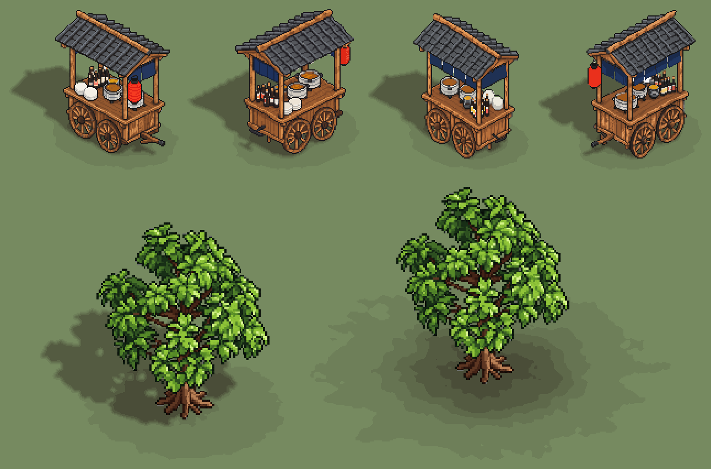

- **影の濃さ**(無料): スペックの `"shadow_strength"` か `--shadow-strength` で決めます。影をその回数だけ重ねたのと同じです。
  光のまま(1)の影は正しいけれど弱く、暗い地面では埋もれて、スプライトが地面に立たず浮いて見えます。ピクセルアートは実際より
  少し強く言う必要があるので、**ピクセルスプライトは小物もキャラクターも既定で 1.5** です(いちばん濃いところが 56% ではなく 71%)。
  明るい床で重く見えるなら 1、とても暗い地面なら 2 にしてください。ライトエディタにスライダーがあります。

<details><summary>同じ木と雨の少女を影の濃さ 1、1.5、2 で並べたもの</summary>


</details>

- **室内では、照明を好きな場所に。** `--lamp -1,2.4,-0.2 --lamp-size 0.03`(小物の足元からメートルで右、上、手前;照明そのものの
  大きさ)- 影は照明の反対側へ、照明が低いほど長く、裸電球ならくっきり、大きなシェードならやわらかく、床に広がる光の分だけ淡く
  なります。床に広がる光も出てきます - `light-<面>.png`: 照明の真下が一番明るく、小物がさえぎる所は抜け、段階はディザで
  つながります。床の上に加算(ADD)で重ねます。照明そのものもピクセルアート(`lamp.png`)で出て、
  面ごとの位置が `pixel.json` に入るので、ゲームは床、光、影、小物、照明をエディタで見たとおりに描けます。書かなければ太陽です。**透ける部分**(籐の編み目、葉、網)はモデルに描かれているだけで穴ではないので、
  `"see_through": [{"colour": "#c8955a", "open": 0.35}]` でその色の部分に光をその割合だけ通します。籐のピーコックチェア
  ([`examples/rattan_peacock_chair`](examples/rattan_peacock_chair))を6つの照明の下で:

<details><summary>籐のピーコックチェアのピクセルアートを太陽、曇り、裸電球、前と後ろの照明、高い大きな照明の下(オークの床が光で明るくなる)に置いたもの</summary>


</details>

- **光源を自分で動かす**: `lightedit.py PROP.json` で自分のパソコンにページが開きます。床をドラッグして照明を動かし、ホイールで
  高さ、スライダーで大きさ - 影と床に広がる光がその場で描き直されます。保存すると全ての面をその光で焼き、スペックに残します。
  **自分のランプで**: ランプの絵(小物と同じ縮尺の切り抜きPNG)を読み込み、光の出る所をクリックすると、ドラッグした所に立ち(小物の
  前なら前、後ろなら後ろ)、光はそこから出ます。影、光、床の光はピクセルアート(段階、ディザ)かなめらか(グラデーション、ピクセルアートでないゲーム向け: `"light_style": "smooth"`)を選べます。

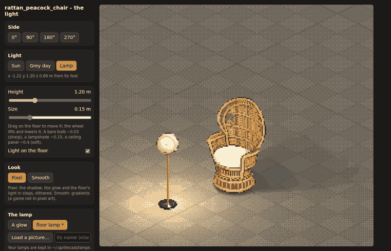

<details><summary>光源エディタでピクセルのフロアランプを籐椅子のまわりに動かしたところ</summary>


</details>

- **風のゆれも3Dモデルから** (スペックに `"sway": "leaves"`、または `propshade.py PROP.json --sway leaves`; 無料): 樹冠は一枚ではなく枝の
  集まりです。葉のピクセルごとにそこに見えるモデルの点を取り、その点を3Dの位置でまとめて(手前の枝と奥の枝は別々に)かたまりにします。
  かたまりは形を保ったまま1pxずつ動き、奥から順に描きます。幹は動きません。絵をゆがめず、フレームを手で描くこともありません。
  `sway-<面>.png`(12フレーム × 無風/そよ風/突風 - 1行をループ再生)、自分で動かすための `clumps-<面>.png` と各かたまりの3D位置、
  `preview-sway.gif` が出ます。木は [`examples/forest_tree`](examples/forest_tree) にあります。


- **どこが通れないかも同じモデルから** (無料、影と一緒に焼かれます): `solid-<side>.png` は歩いて入れない場所 - モデルを地面の近くで切って
  作った小物の足もと(木の根もと、4本脚で立つテーブル)です。`"collide": {"cover": [0.55]}` を入れると、その高さを飛ぶものが止まる場所も
  出ます。幹は火の玉を止め、その上の葉は止めません。どちらも位置と、当たり判定ポリゴン用の輪郭が付きます。そして**キャラクターが陰で
  暗くなります**: 影ごとに地面からの高さでの読み方が書いてあるので、足、腰、頭がそれぞれ太陽との間にあるものの分だけ暗くなります。
- **エンジンへ**: `export.py PROP/out-pixel` が Phaser 3 のモジュールと Godot 4 のシーンを書きます。影、照明の光、風、足もとの当たり判定
  ポリゴン、そして `shade()` / `cover()` が入っています(Phaser 3.90 と Godot 4.7 で開いて確認済み。Unity と Aseprite はまだキャラクター
  のみ)。小さな物もゆれます: キノコは傘がゆれます(`"sway": "caps"`、[`examples/forest_mushrooms`](examples/forest_mushrooms))。

<details><summary>Phaser に書き出したピクセルアートの木2本とキノコ3か所が草地にある場面</summary>

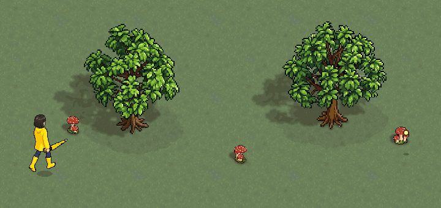

</details>

### 透けるものと動く生き物

炎、おばけ、水滴は地面が透けて見えるのが自然です。厚い真ん中より薄い先のほうがもっと透けます。プロップのスペックに `"translucent": "fire" | "ghost" | "water"` と書くと、各ピクセルの透明度が**そこでの3Dモデルの厚み**で決まります(光が媒質を通るように)。数段階に区切るのでピクセルアートのまま、目と口ははっきり残ります。`"pulse"` でアニメーションの間に薄いところが時々もっと透け、炎が点滅せずにゆらめきます。無料です。

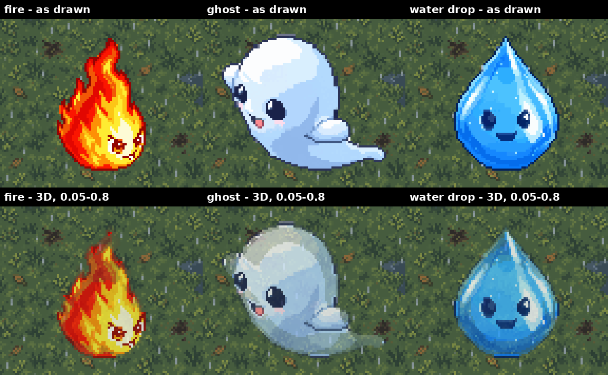

**リグなしで動くもの**(おばけの尾と小さな腕): `proprig.py` がモデルの中から骨をいくつか見つけ(尾に沿った鎖、体から出た腕)、ゲームのカメラでポーズのループをレンダーします(無料、まず確認)。`propanim.py` はそれを**1シートに4フレームずつ**ピクセルアートで描くのでフレームがそろい(1シート約 $0.08)、ポーズごとに透明度を焼き込みます。木の風と同じように Phaser と Godot へ書き出せます。

<details><summary>おばけのループ: 尾がカタツムリのように揺れ、腕が動き、薄いところが時々消えます</summary>

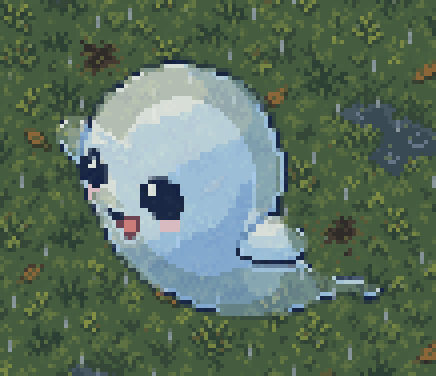

</details>

### 地面: 草原、道、水たまり

スプライトが立つ地面を、同じカメラと同じ光で作ります。**無料**で、画像モデルは描きません。`ground.py meadow GROUND.json` は**3Dの草、シダ、野の花、クローバー**(スキルに同梱: Tripo で作成、MIT)をガウス密度で植えます。均一なじゅうたんではなく、茂ったところとまばらなところができます。土の道に2本のわだちと3Dの砂利を敷き、プロップと同じ太陽で照らして(草どうしに影が落ちます)、**あなたのスプライトのパレットで**ピクセルアートにします。マップ全体が1枚の絵なのでタイルがなく、繰り返しも格子もありません。

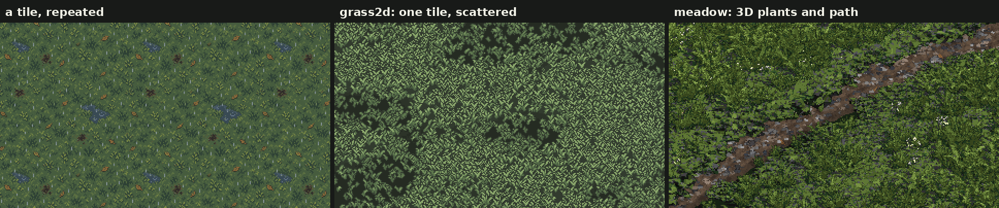

- **草の中の足。** 植物は根元の位置ごとの帯にも切り分けられます(`ground-front.png` / `.json`)。その後ろに立つものの上に帯を描けば、キャラクターの足が草の中に、木の根元も草に埋まります([Phaser のコード付きの使い方](skills/spritecast/reference/ground.md))。
- `ground.py terrain`: 3Dの高さマップによる地面のゆるやかな起伏。同じ太陽で照らし、地面の上のすべてに重ねます。
- `ground.py puddles`: 大きいものからほとんど乾いたものまで5つの水たまり(1つの形が縮むので乾き方がなめらか)。浅いくぼみの暗い水に、カメラの角度で空と木陰が映り、濡れた縁があります。
- `ground.py grass2d`: 3Dなしで、つなぎ目のない草タイル1枚の草を同じようにばらまきます(1秒)。
- **ピクセルアートでなければ?** スペックに `"style": "smooth"`(`translucent.py` / `propanim.py` は `--smooth`): 同じ地面・半透明・動くクリーチャーを、連続した光・色・アルファと柔らかい輪郭で - イラスト調のゲームに。

<details><summary>草の中の足と木の根元、水たまり</summary>

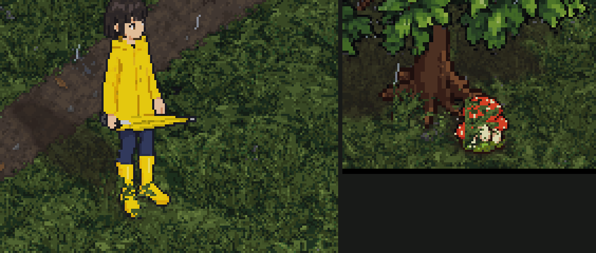

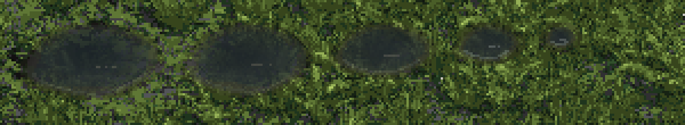

</details>

### 描画を省く: 3Dレンダーをそのままフレームに

スペックに `"draw": false` を入れると、画像モデルはフレームを描きません: 3Dモデルそのもののレンダー (トゥーンシェーディング、モデル自身のテクスチャ) が
フレームになり、同じ3Dの影とアンカーが付きます。画像モデルが描くのはターンアラウンドだけ (~$0.09) で、自分のリグ付き GLB
(`"rig_glb"`。動物ならモデル、`"model_glb"`) があれば何も描きません。その場合キャラクターの費用はターンアラウンドと3D
(Tripo 75 クレジット、動物は 30) だけで、OK は2回、`3d` が終わればすぐ完成です。代償はシャープさです: 描いた線がなく、顔が単純になり、
モデルのテクスチャがそのまま出ます (毛や服のしわがぼやける)。

<details><summary>同じ少女と猫の歩行</summary>


</details>

<details><summary>ストリップの実ピクセルでのクローズアップ</summary>


</details>

## 座る


キャラクターが歩けるようになったら、Claude に *「座らせて」* と頼んでください。3Dモデルを座った姿勢に曲げ (太ももは水平、膝を曲げ、手は
太ももの上)、8方向を無料で作ります。そのレンダーを確認したら、立ち姿と同じように描きます (2シート、約 $0.22)。彼女は
何もないところに座ります。ゲームの椅子をその下に置きます。`character.json` に `sit` ブロックが加わります: 各方向について、ファイル、**座面点**
(椅子の座面に置く点。`anchor` と同じくフレームに対する割合)、座面の高さ、影。自分の
プロップに座らせるには、`seat.py` がそのプロップの座面に彼女を置き、**彼女の手前に来るパーツ** (肘掛け、教会のベンチの背、ベンチの
背もたれ) を両者の3Dの高さから計算します。塗る必要はありません:

<details><summary>10種類の座面に座った雨の少女</summary>


</details>

座面の高さと向きを見つけ、膝が座面の端に届くまで後ろに座らせます。少しずれて座っていたら、
タッチアップページ (下記) でドラッグしてください。
詳細: [reference/sitting.md](skills/spritecast/reference/sitting.md)。

```
$PYTHON skills/spritecast/scripts/charpipe.py sit <name>.json            # free: the seated renders
$PYTHON skills/spritecast/scripts/charpipe.py sit <name>.json --draw     # ~$0.22: drawn and finished
$PYTHON skills/spritecast/scripts/seat.py <prop>.json <name>.json --height 1.3   # free: on a prop, its front piece worked out
```

## 手で直す


自動のステップでほとんどのところまで行けますが、最後の仕上げは目で見てやるのが一番です。**手で塗るのは、どの自動ステップよりも
正確です**: 上の例では、教会のベンチの背が少女全体を隠していましたが、塗って彼女を上に動かすと直りました。ダイニングチェアと
アームチェアの背は、彼女を間違った場所で切っていました。切り抜きも完璧ではありません: 腕と体の間に紙が少し残る、白い
シャツを紙と間違えて切り抜く、など。Claude に
タッチアップページを開くよう頼んでください (または `$PYTHON skills/spritecast/scripts/touchup.py <spec>.json` を実行): そのプロップや
キャラクターの完成画像がすべてブラウザで開き、塗った内容はその都度保存されます。

| 色 | 働き |
|---|---|
| 赤 | 消す: 透明にする |
| 緑 | 戻す: そのピクセルを元の絵から取ってくる (「drawing under」をオンにすると見えます) |
| 青 (プロップ) | **手前パーツ**: 物の中にいるキャラクターの手前に立つもの。アーチの手前の柱、あずまやの屋根、椅子の手前の肘掛け |
| ⬠ 多角形 (P) | 角をクリックして閉じる (ダブルクリック、Enter、または最初の角): 塗っている色で塗りつぶす、または消す |
| 🪑 (座面) | 座ったキャラクターをドラッグ (または矢印キー)。離すとその位置から座面と手前パーツを作り直す |

その後 `touchup.py <spec>.json --apply` を実行します (キャラクターのストリップは詰め直されます)。手前パーツのあるプロップには `sprite-front.png` と
`sprite.json` の `"front"` が付きます: スプライトを中にいる人の後ろに、手前パーツをその上に描いてください。`finish` は塗った内容を
自動で再適用します。塗った後に描き直された画像では、塗った内容を別の絵に重ねず、脇に保管します。

**ピクセルスプライト**にはピクセル単位の専用エディターがあります。[ピクセルアート](#ピクセルアート-アーケードサイズ) を参照してください。

## プロップと背景物


画像モデルに「アイソメトリックのアームチェア」を頼むと、少しアングルの違うきれいな絵が出てきます。もう一度頼むと、
別の違ったアングルと別のサイズで出てきます。10個を1つの床に並べると、何も揃いません。

SpriteCast はモデルに読み違えにくいガイドを渡します (読み違えたときは知らせます):
1. Claude が物を単純なブロックで**メートル単位の実寸**で組み立てます。
2. ブロックをゲームの**正確なカメラ**でレンダリングします。
3. 画像モデルはそのガイドを**アートスタイル**で描き直すだけです。
4. 絵を切り抜いて**ガイドのボックスに合わせる**ので、サイズと設置面はガイドのものになります。輪郭がガイドに
   沿わない絵はフラグが立ち、無理に合わせません。焼き込んだ影とエンジン用のアンカー点も付きます。

プロップは塗りのスタイル (`cozy` の見た目: なめらかな陰影、細いアウトライン)、または自分の画像1枚のスタイルで出てきます。

## セッションの流れ


プロップを説明します。Claude は足りないものだけを聞きます: サイズ、向き、ゲームの視点、スタイル。
ガイドを無料でレンダリングして見せます。費用を伝えて OK を待ちます。そして `sprite.png`、`shadow.png`、
`sprite.json` が得られます。

## 例

すべて [`examples/`](examples) にあり、それぞれスペックと生成したファイルが入っています (リポジトリを小さく保つため、生の絵は WebP)。

| | | |
|---|---|---|
|  |  |  |
| `reading_armchair`: 9個のブロック: 座面、背、肘掛け、脚 | `potted_monstera`: 鉢と、1つのボリュームとして与えた植物 | `arcade_cabinet`: 正面が左下を向いている |

<details><summary>4方向とトップダウン視点</summary>

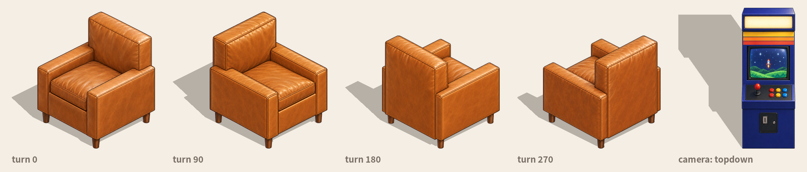

</details>
`armchair_four_ways`: `views: [0, 90, 180, 270]`。後の方向は最初の方向を参照にして描くので、同じ
椅子のままです。`arcade_cabinet_topdown`: `camera: "topdown"`。`reading_armchair_tripo`: 同じアームチェアを Tripo のモデルから (下記)。

例の3Dモデル (`reading_armchair_tripo`、歩くキャラクターたちのメッシュとリグ) は [Tripo](https://www.tripo3d.ai) API で生成しました。

## もっと細かく: まず3Dモデルを作る (Tripo)

<details><summary>ガイドとしてのブロックと Tripo モデルの比較</summary>


</details>

大事なのが物の位置と大きさなら、ブロックで十分です。もっと細部 (曲がった肘掛け、先細りの脚、ボタン、
彫刻) が欲しいなら、まず [Tripo](https://www.tripo3d.ai) に説明文から本物の3Dモデルを作らせてください。高さはブロックが示す通りに作られ、
プロポーションはモデル自身のものを保ちます (そうしてできた設置面は `sprite.json` に書き込まれます。`"shape": "box"` にすると
ブロックのボックスに押し込みます)。そしてそれがガイドになります。画像モデルは本物の形の上に描き、3Dの
影もモデル自身のものになります。

```
$PYTHON skills/spritecast/scripts/isoprop.py model  armchair.json --yes   # Tripo text-to-model (~20-40 Tripo credits, ~2 min); the spec now uses it
$PYTHON skills/spritecast/scripts/isoprop.py yaws   armchair.json         # free: the model turned four ways; set "model": {"yaw": ...} to the right one
$PYTHON skills/spritecast/scripts/isoprop.py render armchair.json         # then draw, finish as usual
```
`TRIPO_API_KEY` が必要です。ブロックは `blocks_draft` としてスペックに残ります。

## ポーズ付きキャラクター (説明文から)

<details><summary>マネキンのガイドと、4方向の2人のキャラクター</summary>


</details>

立っているだけの NPC にはイラストもリグも要りません: プロップと同じように動作します。Claude が素のマネキンをその人物の実際の身長でポーズさせ、各方向 (4または
8) でレンダリングします。画像モデルが説明通りの服を着せます。最初の方向を先に描き、他はそれに合わせるので、同じ人物のままです。

```json
{ "name": "barista",
  "character": { "body": "woman", "height": 1.63, "build": "slim", "directions": ["south-east", "south-west", "north-east", "north-west"] },
  "description": "a cheerful young café barista: a short dark-brown bob, a cream cable-knit sweater under a forest-green apron, ..." }
```

`"body"` はポーズを取らせる無地のマネキンです: `"man"`、`"woman"`、`"child"`。髪のない3体が SpriteCast に付属します。(0.29 より前はブロックで作った人形で、上の2人はその上に描いたものです。)

アンカーは両足の間です。最初の方向は約 $0.08、それ以外は1方向につき $0.09 です。

<details>
<summary><b>ポーズ、自分で決める角度、1方向だけの描き直し</b></summary>

**ポーズ。** マネキンには関節があります。`"pose"` は `stand` (デフォルト)、`wave`、`point`、`hold` (前で両手を合わせる: カップ、
トレイ、本)、`arms-crossed`、`walk` (歩いている途中) のどれかです。それに合うものを説明してください (「手を振って挨拶している」「コーヒーカップを持っている」)。または角度を自分で指定することもでき、Claude が
調整して (「腕をもっと上げて」) 無料のレンダーで確認できます:

```json
"pose": { "base": "stand", "arm": { "left": [[150, 10], [170, 10]], "right": [[150, 10], [170, 10]] } }
```
各手足は上と下の2パーツです (それぞれ `[out, forward]` の度数): 横に開いてから、前に振ります。`left` と
`right` は人物自身から見た左右です。

手のひらの向きも指定できます (`"palm": {"left": "front"}`。手を振るときは開いた手が前を向きます)。また、腕が体やもう一方の腕を突き抜けることはありません。ポーズを決めたあと、重なった部分を押し離すので、腕組みは片方の腕がもう片方の上に重なります。

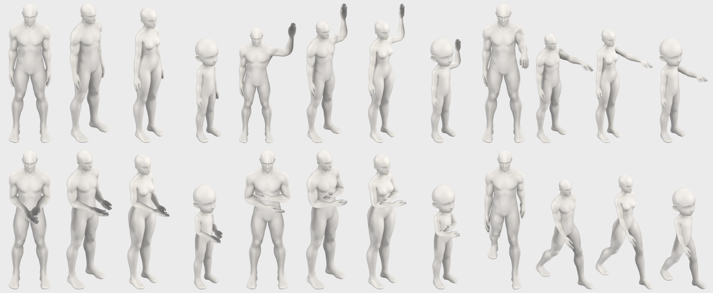

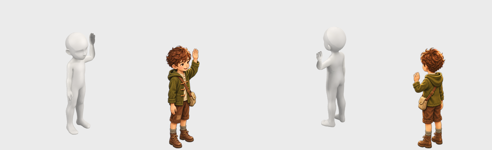

**1枚ずつの絵。** これらのポーズ付き人物は1方向につき1枚の絵です。歩きについては [歩くキャラクター](#歩くキャラクター) を参照してください。
すべての方向を自分の目で確認してください (輪郭チェックでは頭が逆を向いていても分かりません)。1つを描き直すには
`draw <spec> --yes --again --only north-west`。

</details>

## 絵に合った影

3Dガイドの影は、家具のような硬い物には正確です。しかし絵にはブロックにないものがあります: 髪、コートのフード、
鉢からあふれる葉。

<details>
<summary><b>影の計算方法</b></summary>

そこで SpriteCast はガイドの**高さマップ**もレンダリングします: 各ピクセルが床からどれだけ高いか。h メートルの高さにある点は、
奥行きに関係なく、画面上で一定の距離 (h に光のオフセットを掛けたもの) だけ離れた位置に影を落とします。なので絵の各ピクセルは
その下にあるガイドの高さ、またはガイドからはみ出した髪や葉なら最も近いガイドのピクセルの高さを取り、その距離だけ動かされます。

形は絵のものです。始まる位置は3Dモデルのものです: 各足がそれぞれの影を始め、鉢の影はその底から
始まります。正確である必要があるのは床に接する部分だけです。それより上 (物の高さの 10 % から 35 %) では、高さが画面から読み取った
なめらかな高さに徐々に移るので、髪、帽子、葉はガイドの硬い角ではなく自然な影を落とします。立っている部分
(12 cm までのガイド: 靴、鉢の底) にはガイド自身の3Dの影を加えるので、影は本物と同じように物に接します:
光と反対側に、決して手前には出ません。ポーズ付きの人物と `loose` の物にはこれが付きます。硬いプロップは3Dの
影のまま、歩くキャラクターは3Dの体そのものの影を落とします (前述)。`"shadow": "drawn" | "guide"` で選べます。

</details>

<details><summary>ブロックからの影と絵からの影</summary>

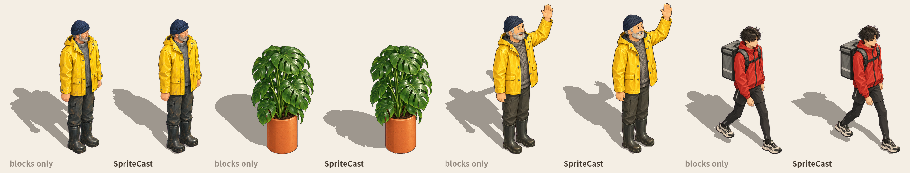

</details>

**歩くキャラクターの影は、光が落ちるとおりです** (0.20から): ポーズをとった3Dの体を、太陽の円盤16方向と空48方向に沿って地面に押しつけ、
それぞれが隠した分を足し合わせます。[小物の焼いた影](#light-shadow-wind)と同じ計算です。だから足もとと体の下は濃く、遠い縁は淡く、
フレームごとのポーズで変わります。影のストリップは character.json の `shadow_alpha` (0.56) で表示し、ピクセルセットは5段階になります。
スペックに `"shadow": "flat"` を入れると、以前の1つの硬い形になります。

<details><summary>雨の少女が歩き、走り、跳ぶ姿とその影</summary>


</details>

## カメラ

2:1 アイソメトリック (既定、30° 見下ろし)、真のアイソメトリック、3/4 トップダウン、正面、または `{"pitch": 40, "yaw": 30}` で好きな角度 - [表](docs/guide/props.md#cameras) (英語)。

## エンジンに組み込む

`export.py <name>/out` (無料) が **Godot 4、Unity、Phaser 3、Aseprite** 用のファイルをそのまま作ります: 体、影、振りのエフェクトが名前で再生されます (`play("walk", "south-east")`)。プロップは影、光、風、当たり判定ごと Phaser と Godot へ。`sprite.json` / `character.json` の数値を自分で読んでも構いません。**[docs/guide/engines.md](docs/guide/engines.md)** (英語) - 仕組み、よくあるエラー、何をどこへ送るかも。

## インストール

ターミナルで:
```
claude plugin marketplace add Sunghwan0112/spritecast
claude plugin install spritecast@spritecast
```
または Claude Code の中で: `/plugin marketplace add Sunghwan0112/spritecast`、続けて `/plugin install spritecast@spritecast`。

**他に必要なもの**は Python 3.9+ とブラウザ (Chrome、または Edge。どの Windows にも入っています) だけです。初回、Claude がセットアップ
チェック (`doctor.py --fix`) を実行します: `~/.cache/spritecast/` に専用の venv を作っていくつかのパッケージを入れ (約 10 秒)、あなたの Python には
手を付けず、それぞれが何のためのものかを伝えます。手で入れるものはありません。

<details>
<summary><b>スクリプトを自分で実行する</b></summary>

**スクリプトを自分で実行する。** Claude が代わりに実行します。このリポジトリのクローンから手で実行するには、
`doctor.py` が最後の行に表示する Python (`PYTHON=...`) を使ってください。`--fix` の後は `~/.cache/spritecast/venv/bin/python` です (Windows:
`%USERPROFILE%\.cache\spritecast\venv\Scripts\python.exe`)。普通の `python` にはパッケージが入っていないことがあります (`No module named ...`)。以下のコマンドでは
これを `$PYTHON` と書きます:
```bash
python3 skills/spritecast/scripts/doctor.py --fix
PYTHON=$(python3 skills/spritecast/scripts/doctor.py | sed -n 's/^PYTHON=//p')
$PYTHON skills/spritecast/scripts/isoprop.py --help
```
Windows の PowerShell では:
```powershell
python skills/spritecast/scripts/doctor.py --fix
$PYTHON = "$env:USERPROFILE\.cache\spritecast\venv\Scripts\python.exe"
& $PYTHON skills/spritecast/scripts/isoprop.py --help
```
その場合、以下の `$PYTHON ...` コマンドは `& $PYTHON ...` として実行してください。

</details>

| 何 | 用途 | 必要? |
|---|---|---|
| Python 3.9+ | スクリプトの実行 | はい |
| numpy, pillow, scipy | 切り抜き、フィッティング、影 | はい (自動でセットアップ) |
| playwright + Chrome or Edge | 3Dガイドを手元のコンピューターでレンダリング (無料) | はい (自動でセットアップ。手持ちのブラウザを使用) |
| onnxruntime + a 224 MB model | キャラクターのみ: 白い紙の上の白い靴を残す AI 切り抜き | キャラクター (初回に1回、自動で取得) |
| `OPENAI_API_KEY` | 描画 | 描画する場合 |
| `TRIPO_API_KEY` | 3Dモデル: 歩くキャラクターのモデル (リグと歩行付き)、またはより細かく作るプロップのモデル | 歩くキャラクターを作る場合。ブロックから作るプロップ、ポーズ付きキャラクター、`creature.py` には不要 |

**まずは無料で、キーなしで試す:** Claude に *「SpriteCast を試して」* と頼んでください。例の1つのガイドを手元のコンピューターでレンダリングし、
例に付属の絵で仕上げるので (`isoprop.py try`)、何かにお金を払う前に全工程を見られます。

<details>
<summary><b>キー: 置き場所と OpenAI の認証</b></summary>

キーは**プラグインの設定に**入れます。SpriteCast を有効にすると Claude Code が尋ねてきます (後で変えるには `/plugin` → SpriteCast → configure):
OpenAI のキーと、歩くキャラクターを作るなら Tripo のキー。Tripo のキーは Tripo の API プラットフォームで取得し、そこで API クレジットを購入します
(キャラクター1体 75、動物 30)。これらはシステムの認証情報ストアにマスクされて保存され、セッション開始時に SpriteCast のスクリプトに渡されます。設定にキーがない場合は、
環境変数に入っているキーもそのまま使えます:

```bash
export OPENAI_API_KEY=sk-...          # macOS / Linux (add it to ~/.zshrc or ~/.bashrc to keep it)
```
```powershell
setx OPENAI_API_KEY "sk-..."          # Windows (then open a new terminal)
```
Windows では、Claude Code がコマンドを Git Bash で実行する場合 (Git が入っていればそれがデフォルト) にのみ、設定がスクリプトに届きます。
PowerShell では環境変数を使ってください。どちらの場合も、キーの設定や変更は Claude Code を起動する前にしてください。起動中に設定したキーは
再起動後に初めて認識されます。キーはあなたのコンピューターから出ません。送られるのは OpenAI だけです。

OpenAI は、キーで画像モデルを使う前に組織の認証を求めることがあります (platform.openai.com → Settings →
Organization)。最初の描画の前に一度済ませてください。

</details>

描画 (OpenAI) と 3D モデル (Tripo、選べば Meshy) 以外はすべて自分のコンピューターで動きます。[何をどこへ送り、何を取得するか](docs/guide/engines.md#what-it-sends-and-fetches) (英語)。

## ロードマップ

次に予定しているもの、おおよそこの順番です (日付はなし。フィードバック次第で変わります):
- **座面に合わせた姿勢、乗り物**: 座面ごとの姿勢、カートや乗り物に乗るキャラクター。
- **回転する物体**: 8 方向の間で飛ばずになめらかに回る乗り物。
- **夜バージョン**: 光る部分 (窓、電球、ネオン) のマスク。
- **通り抜けられるプロップを自動で**: 前景パーツを 3D ガイドから算出 (今は手直しページで塗ります)。
- **持てる物を増やす** (剣、杖) と、持ち物のないエフェクト (キック、足元の水しぶき)。
- **小さなスプライト**: 通常のデザインから小さなデザインを一度に、手直し不要の 32px の顔。
- **ピクセルセットのエンジン書き出し。**

各バージョンで何が変わったかは [CHANGELOG.md](CHANGELOG.md) を参照してください。

## フィードバック

次に何をやるかはフィードバックで決まり、それによって変わったものは変更履歴に記載しています。
- **何かが壊れた**: バグ用フォームで [issue](https://github.com/Sunghwan0112/spritecast/issues/new/choose) を開いてください。OS、Python のバージョン、
  コマンド、メッセージがあると一番助かります。
- **アイデアや足りない機能**: [issues](https://github.com/Sunghwan0112/spritecast/issues/new/choose) の機能要望フォームで。
- **作ったものを見せる、やり方を聞く**: [Discussions](https://github.com/Sunghwan0112/spritecast/discussions)。

## 注意事項
- 出力物はあなたのものです。
- 実在のブランド、ロゴ、既存ゲームのキャラクターは説明文に入れないでください。
- 存命のアーティストの作品を、本人の許可なくスタイル画像として使わないでください。
- キャラクターの似姿に使う `photo` は、同意した人のものだけにしてください。
- 硬いプロップはブロックの3Dの影、ポーズ付きの人物と `loose` の物は絵そのものの形の影 (「絵に合った影」参照)、
  歩くキャラクターは3Dの体の影が付きます。
- 設定: `SPRITECAST_MODEL` (デフォルトは `gpt-image-2.6-sunburst`。`gpt-image-2.5-sunburst` にすると一つ前のモデルで描きます) と `SPRITECAST_QUALITY` (`low` | `medium` | `high`)。

## よくある質問
- **費用は?** 冒頭近くの [項目ごとの費用](#cost) を見てください。
- **どのキーが必要?** 描画には `OPENAI_API_KEY`、歩くキャラクターと動物には `TRIPO_API_KEY` (Meshy は任意)。置き場所と
  OpenAI の認証: [キー](#インストール)。
- **これって AI アートでは?** はい。塗るのは画像モデルで、サイズ、カメラアングル、
  歩行、影は3Dから来ます ([うまくいく理由](#うまくいく理由))。自分の絵をスタイルとして渡すこともできますし、`"draw": false` にして歩く
  キャラクターのフレームを画像モデルに描かせないこともできます: 3Dレンダーがそのままフレームになります。ターンアラウンドは描きますが、自分のリグ付きモデルを持ち込めばそれも不要です
  ([描画を省く](#描画を省く-3dレンダーをそのままフレームに))。
- **ピクセルアートを1フレームずつ描くのですか?** いいえ。画像モデルが 3D レンダーをもとに描き、後処理は自動です。1シートに何フレーム入れるかもレンダーの大きさから計算されます。残るのは [ピクセルエディター](#ピクセルアート-アーケードサイズ) でフレームあたり数ピクセルです。
- **できないことは?** 歩くキャラクターは正面向きでまっすぐ立ったイラストから始めます。ピクセルアートは 96 px と、小さく
  デザインしたキャラクター向けの 64 px で使えます。32 px のセットは 64 から作り、顔は粗くなります
  ([ロードマップ](#ロードマップ))。ポーズ付きの1枚絵 (手を振る、指差す、持つ…) は説明文だけで作れます。ラグのような大きく平たい物は、トップダウンで描いて床に斜めに貼る方が向いています
  ([tips](skills/spritecast/reference/tips.md))。結果は自分の目で確認してください: 輪郭チェックでは頭が逆を向いていても分かりません。
- **どのエンジン?** PNG を扱えるものなら何でも: スプライト、その影、JSON のアンカーが得られます。Phaser、Godot、Unity については
  [エンジンに組み込む](#エンジンに組み込む) を参照してください。

## ライセンス
MIT。コードと例 (画像、ストリップ、雨の少女のリグ付きモデルも含む) が対象です。three.js (`skills/spritecast/scripts/vendor/three` に同梱) は MIT、© three.js authors。 `skills/spritecast/effects/pvfx` のエフェクトは Pixel VFX Studio の PVFX Foundry で、CC0 1.0 です (同じ場所の LICENSE.txt)。
