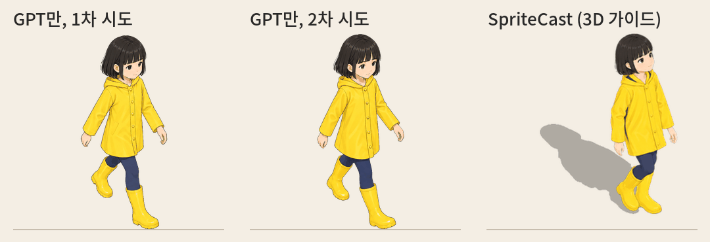

# SpriteCast

**Claude Code용 아이소메트릭 스프라이트 생성기:** 게임 소품과 인물, 8방향 걷기를 실제 크기와 정확한 카메라 각도로, 원하는 그림체로 그려 줘요.

[English](README.md)


## 무엇을 하나요

이미지 모델에 "아이소메트릭 안락의자"를 그려 달라고 하면 예쁘긴 한데 각도가 조금씩 틀려요. 다시 그리면 또 다른 각도, 다른 크기로 나와요.
열 개를 한 바닥에 놓으면 하나도 맞지 않아요.

걷는 캐릭터는 더 심해요. 아래는 GPT만으로 그린 것(같은 모델, 같은 캐릭터 시트, 걸음을 프레임마다 글로 지시)과 SpriteCast를 나란히 놓은
거예요. GPT의 프레임은 한 장씩 보면 예쁘지만 걷지 않아요: 여덟 프레임 모두 같은 다리가 앞에 있고(다리를 안 바꿔요),
팔은 다리와 반대로 흔들리지 않고 제멋대로 움찔거리고, 게임의 30° 내려다보는 시점이 아니라
눈높이에서 봤고, 그림자도 없어요. 두 번 시도한 걸 나온 그대로 보여 줘요.



SpriteCast는 모델이 잘못 읽을 수 없는 가이드를 줘요.
1. Claude가 물건을 **실제 크기(미터)**의 블록으로 짜요.
2. 블록을 게임의 **정확한 카메라**로 렌더해요.
3. 이미지 모델은 그 가이드를 **원하는 그림체**로 다시 그리기만 해요.
4. 그린 그림을 오려서 **가이드 위에 다시 맞춰 놓아요.** 그래서 각도, 크기, 바닥 차지 면적이 가이드와 정확히 같아요. 그림자와 엔진용
   앵커도 같이 나와요.

**그래서 좋은 점:**
- **각도와 크기가 맞아요.** 예시 그림들은 가이드에서 1% 정도만 벗어나요(윤곽 일치 97–99%). 몇 달 간격으로 만든 소품도 한 바닥에 나란히
  맞아요.
- **그림자가 자연스러워요.** 모든 소품이 빛 하나를 함께 써서 그림자가 같은 방향으로 떨어져요. 단단한 소품은 3D 가이드의 정확한 그림자를
  받아요. 인물과 식물은 그림 모양 그대로의 그림자(모자, 머리카락, 잎)를 받는데, 위치는 3D 모델이 정해서 양쪽 발과 화분 바닥에서 정확히
  시작해요. 대충 칠한 그림자도, 각진 마네킹 그림자도 아니에요.
- **스스로 검사해요.** 그린 뒤 가이드와 비교해서, 모델이 다른 각도로 그렸으면 억지로 늘리거나 줄이지 않아요. 대신 경고를 띄우고, Claude가
  고칠 방법을 제안한 뒤 다시 그릴지 물어봐요.
- **내 게임 시점, 내 그림체.** 2:1 아이소메트릭, 정아이소메트릭, 3/4 탑다운, 정면, 아무 각도. 한 물건의 네 방향. 기본 `cozy` 스타일이나
  내 그림 한 장.

## 사용 흐름


소품을 설명하면 Claude는 빠진 것만 물어봐요(크기, 방향, 게임 시점, 그림체). 그다음 가이드를 무료로 렌더해서 보여 주고, 비용을 말한 뒤
승인을 기다려요. 결과로 `sprite.png`, `shadow.png`, `sprite.json`을 받아요.

## 설치

터미널에서:
```
claude plugin marketplace add Sunghwan0112/spritecast
claude plugin install spritecast@spritecast
```
Claude Code 안에서 할 수도 있어요: `/plugin marketplace add Sunghwan0112/spritecast` 다음 `/plugin install spritecast@spritecast`.

**함께 필요한 건** Python 3.9 이상과 브라우저(Chrome, 또는 Edge - 윈도우에는 늘 있어요)뿐이에요. 처음 쓸 때 Claude가 설치 점검
(`doctor.py --fix`)을 돌려요: `~/.cache/spritecast/`에 전용 가상환경을 만들어 몇 가지 패키지를 넣고(10초쯤), 원래 Python은 건드리지
않고, 각각 무엇에 쓰는지 알려 줘요. 손으로 설치할 건 없어요.

| 무엇 | 하는 일 | 꼭 필요? |
|---|---|---|
| Python 3.9 이상 | 스크립트 실행 | 네 |
| numpy, pillow, scipy | 오려내기, 맞추기, 그림자 | 네 (자동 설치) |
| playwright + Chrome 또는 Edge | 3D 가이드를 내 컴퓨터에서 렌더 (무료) | 네 (자동 설치, 있는 브라우저를 씀) |
| onnxruntime + 224 MB 모델 | 캐릭터만: 흰 종이 위 흰 신발도 남기는 AI 오려내기 | 캐릭터 (처음 한 번 저절로 받음) |
| `OPENAI_API_KEY` | 그리기, 소품 하나 약 $0.07 | 그릴 때 |
| `TRIPO_API_KEY` | 캐릭터: 3D 모델, 리그, 걷기 | 걷는 캐릭터 |

**먼저 무료로, 키 없이 해 보기:** Claude에게 *"SpriteCast 체험해 줘"*라고 하면 예시 하나의 가이드를 내 컴퓨터에서 렌더하고, 예시에
들어 있는 그림으로 마무리해서(`isoprop.py try`) 돈을 쓰기 전에 전 과정을 볼 수 있어요.

키:

```bash
export OPENAI_API_KEY=sk-...          # macOS / Linux (계속 쓰려면 ~/.zshrc 나 ~/.bashrc 에 추가)
```
```powershell
setx OPENAI_API_KEY "sk-..."          # Windows (설정 후 새 터미널을 열어요)
```
키는 내 컴퓨터에만 있고 OpenAI로만 보내져요. 그림 한 장마다 OpenAI에 약 $0.07를 내요.

## 이렇게 부탁해 보세요

- *"아이소메트릭 책장 만들어 줘. 높이 1.8m, 책 가득, cozy 스타일로."*
- *"우리 게임은 3/4 탑다운이야. 줄무늬 차양이 있는 나무 시장 가판대 만들어 줘."*
- *"이 소파 네 방향 다 만들어 줘."* (`views`)
- *"상점 주인 NPC 만들어 줘. 갈색 카디건 입은 할아버지, 네 방향으로."*
- *"손 흔드는 거리 악사, 남동쪽 방향으로."*
- *"이건 우리 게임 소품이야(props/barrel.png). 같은 그림체로 나무 상자 만들어 줘."*

## 예시

모두 [`examples/`](examples)에 있고, 사양 파일과 만들어진 파일이 들어 있어요(원본 그림은 저장소를 가볍게 하려고 WebP로).

| | | |
|---|---|---|
|  |  |  |
| `reading_armchair`: 블록 9개(좌석, 등받이, 팔걸이, 다리) | `potted_monstera`: 화분, 그리고 식물은 덩어리 하나로 | `arcade_cabinet`: 정면이 왼쪽 아래를 향함 |


`armchair_four_ways`: `views: [0, 90, 180, 270]`. 두 번째 방향부터는 첫 그림을 레퍼런스로 그려서 같은 의자로 이어져요.
`arcade_cabinet_topdown`: `camera: "topdown"`. `reading_armchair_tripo`: 같은 안락의자를 Tripo 모델로(아래).

예제의 3D 모델(`reading_armchair_tripo`, 걷는 캐릭터들의 모델과 리그)은 [Tripo](https://www.tripo3d.ai) API로 만들었어요.

## 더 정교하게: 3D 모델을 먼저 (Tripo)


배치와 크기가 중요하면 블록으로 충분해요. 디테일(곡선 팔걸이, 가늘어지는 다리, 단추, 조각)을 더 살리고 싶으면
[Tripo](https://www.tripo3d.ai)로 설명에서 진짜 3D 모델을 먼저 만들어요. 그 모델을 블록과 같은 실제 크기 상자에 맞춰 넣어서 가이드로
써요. 그래서 배치는 그대로이고, 이미지 모델은 실제 형태 위에 그리고, 3D 그림자도 모델 자신의 것이 돼요.

```
python isoprop.py model armchair.json --yes   # Tripo로 3D 모델 만들기 (Tripo 크레딧 약 20, 약 2분). 사양이 이 모델을 쓰게 바뀌어요
python isoprop.py yaws  armchair.json         # 무료: 모델을 네 방향으로 돌려 보여 줘요. 맞는 방향을 "model": {"yaw": ...}에 적어요
python isoprop.py render armchair.json        # 그다음은 평소처럼 draw, finish
```
`TRIPO_API_KEY`가 필요해요. 블록은 사양에 `blocks_draft`로 남아요.

## 인물


서 있는 인물도 같은 방식이에요. Claude가 실제 키의 마네킹을 세워서 방향마다(4 또는 8방향) 렌더하면, 이미지 모델이 설명대로 옷을 입혀
그려요. 첫 방향을 먼저 그리고 나머지는 그 그림을 따라 그려서 같은 사람으로 이어져요.

```json
{ "name": "barista",
  "character": { "height": 1.63, "build": "slim", "directions": ["south-east", "south-west", "north-east", "north-west"] },
  "description": "a cheerful young café barista: a short dark-brown bob, a cream cable-knit sweater under a forest-green apron, ..." }
```

앵커는 두 발 사이예요. 첫 방향은 약 $0.07, 나머지는 방향마다 약 $0.08예요.

**자세.** 마네킹에 관절이 있어서 자세를 고를 수 있어요. `"pose"`는 다음 중 하나예요.
- `stand` (기본, 차렷)
- `wave` (손 흔들기)
- `point` (가리키기)
- `hold` (두 손을 앞에 모음: 컵, 쟁반, 책)
- `arms-crossed` (팔짱)
- `walk` (걷는 중)

설명에도 맞춰 적어 주세요("손 흔들며 인사", "커피잔을 두 손으로 들고"). 각도를 직접 적을 수도 있어요. 그러면 Claude가
"팔을 더 높이" 같은 요청을 숫자로 바꾸고, 무료 렌더로 확인하면서 고쳐 줘요.

```json
"pose": { "base": "stand", "arm": { "left": [[150, 10], [170, 10]], "right": [[150, 10], [170, 10]] } }
```
팔다리마다 위·아래 두 마디가 있고, 각 마디는 `[옆으로, 앞으로]` 각도예요. 먼저 옆으로 벌리고 그다음 앞으로 들어요. `left`, `right`는
캐릭터 자신의 왼쪽과 오른쪽이에요.


**방향마다 한 장짜리 그림이에요.** 걷는 캐릭터는 [걷는 캐릭터](#걷는-캐릭터)를 보세요. 방향마다 직접 확인하세요. 한 번은 뒷모습인데 머리만 뒤를 보고 몸은 앞을 향한 그림이 나왔어요. 지금은 프롬프트로 막았지만, 윤곽 검사로는
잡히지 않는 문제예요. 한 방향만 다시 그리려면 `draw <spec> --yes --again --only north-west`.

## 그림에 맞는 그림자

3D 가이드에서 계산한 그림자는 가구처럼 단단한 물건에는 정확해요. 그런데 완성 그림에는 블록에 없던 것들이 있어요. 머리카락, 코트 모자,
화분 밖으로 뻗은 잎 같은 거예요.

그래서 가이드의 **높이 지도**를 같이 렌더해요. 픽셀마다 바닥에서 몇 m 위에 있는지 기록한 거예요. 높이가 h인 점의 그림자는 깊이와
상관없이 화면에서 "h × 빛의 이동량"만큼 떨어진 곳에 떨어져요. 그래서 그림의 각 픽셀이 그 아래 가이드의 높이를 가져와서 그만큼
옮겨져요. 가이드 밖으로 나간 머리카락이나 잎은 가장 가까운 가이드 지점의 높이를 써요.

모양은 그림 그대로이고, 시작점은 3D 모델이 정해요. 양쪽 발이 각자 자기 그림자를 시작하고, 화분 그림자는 화분 바닥에서 시작해요.
정확해야 하는 건 바닥에 닿는 부분뿐이라, 위로 갈수록(물체 높이의 10%에서 35%까지) 화면에서 읽은 부드러운 높이로 서서히 넘어가요. 그래서
머리카락, 모자, 잎의 그림자가 마네킹의 각진 모양이 아니라 자연스럽게 나와요. 바닥에 닿는 부분(블록의
아래 12cm, 즉 신발이나 화분 바닥)에는 가이드의 3D 그림자를 더해요. 그래서 그림자가 실제처럼 빛 반대쪽에서만 물체에 붙고, 앞쪽으로는 생기지
않아요. 인물과
`loose` 물건은 이 방식을 쓰고, 단단한 소품은 3D 그림자를 써요. `"shadow": "drawn" | "guide"`로 직접 고를 수도 있어요.


## 걷는 캐릭터


캐릭터 일러스트 한 장(정면을 보고 똑바로 선, 포즈 없는 그림)을 주면 그 그림체로 8방향 걷기(방향마다 8프레임)와 서 있는 8방향이 나와요. 이미지 모델은 프레임마다 몸과 자세를
일정하게 유지하지 못해서, 움직임은 3D에서 가져와요.
1. 일러스트로 턴어라운드를 그려요.
2. [Tripo](https://www.tripo3d.ai)가 턴어라운드로 3D 모델을 만들어요.
3. Tripo가 리그를 달고 걷기와 서 있기 동작을 입혀요.
4. 게임 카메라로 걷기를 렌더해요(무료). 프레임마다 3D 몸을 빛 방향으로 바닥에 눌러 붙인 그림자도 같이 렌더해요.
5. 이미지 모델이 렌더 위에 4프레임씩 그려요. 정면을 먼저 그리고 다른 방향은 모두 그걸 따라 그려서 같은 사람으로 유지돼요.
6. 각 프레임을 렌더에 다시 맞추고(상체는 방향마다 한 크기, 다리는 렌더의 발까지), 머리 크기를 고르게 하고, 가장자리를 정리해요.
   결과는 스트립, 프레임마다 그림자(발이 그림자에 닿고, 든 발은 따로 그림자가 생겨요), 앵커예요.

```
python skills/spritecast/scripts/charpipe.py turnaround hero.json --yes   # 그다음 3d(모델, 리그, 렌더), draw(마무리, 미리보기까지 저절로)
```
기본으로 8방향을 다 그려요. 두 번 다시 그려도 점수가 낮은 방향만 짝 방향을 뒤집은 그림과 프레임마다 섞어요. 좌우가 같은 디자인은
`"mirror": true`로 서쪽 방향들을 동쪽에서 뒤집어 만들 수 있어요(그림자는 방향마다 자기 렌더에서). 약 $0.66 덜 들어요.

캐릭터 하나에 약 $2.2(OpenAI, `"mirror": true`면 약 $1.5), Tripo 75크레딧(약 $0.75, 동물은 30)이 들어요. 계정은 둘뿐이에요: `OPENAI_API_KEY`, `TRIPO_API_KEY`.
리그된 GLB가 있으면(`"rig_glb"`) 바로 `render`부터 하면 돼요.

`preview`는 `walk-all.mp4`(8방향이 한꺼번에 걷는 영상, ffmpeg가 있으면)도 만들어요. 머리가 커졌다 작아지거나 프레임이 튀는 게 가장 빨리
보여요. 같은 사람의 여러 옷은 `charpipe.py facecheck REF.json --with A.json,B.json`(선택, `mediapipe` 필요)으로 키 대비 얼굴 크기를
방향별로 얼굴 랜드마크로 비교해요(머리숱은 윤곽 측정을 속여요). `--apply`면 `finish`가 쓸 보정값을 적어요. 게임의 다른 캐릭터들이
신발 바닥에 서 있으면 `"anchor": "soles"`로 기준점을 신발 바닥에 둬요.

**만든 사람의 방식: 모델은 Meshy, 리그는 Tripo.** 이 플러그인이 나온 게임의 주인공들이 이렇게 만들어졌어요. `"modeler": "meshy"`(와 `MESHY_API_KEY`)를 주면
`model` 단계가 [Meshy](https://www.meshy.ai)로 만들고(약 30 Meshy 크레딧), `rig`는 그대로 Tripo가 해요. 둘 다 돼요. Tripo는 모델마다
보는 방향을 제멋대로 정하고(하나는 옆, 하나는 뒤 - "얼굴이 검게" 보인 건 뒤통수였어요), 가끔 색 없이 보내요. 둘 다 자동으로 고쳐요:
발 방향을 보고 정면으로 돌리고, 회색이면 색을 다시 입혀요. Meshy 모델은 매번 정면을 보고 색도 입혀져 왔어요.

 자세한 내용과 요령은 [reference/character.md](skills/spritecast/reference/character.md)에
있어요. 위 여자아이 예시는 [`examples/rain_girl`](examples/rain_girl)에 있어요(일러스트, 턴어라운드, 사양, 스트립, 그림자, `character.json`, 전체 시트).
Tripo만으로 만들었고 그리기 약 $1.7, Tripo 85크레딧이 들었어요.

### 네발 동물

동물은 보통의 3D 방식이 잘 안 되는 곳이에요. Tripo의 네발 동물 리그는 고양이의 다리 관절 위치는 맞췄지만 등뼈가 없었고, 뒷다리
허벅지를 "Spine"이라 이름 붙였고, 어깨가 목에 매달려 있었고, 한 번은 발이 다섯 개 생겼어요. 동물용 동작도 걷기 하나뿐이고 서 있는
동작은 없어요. 이런 리그로는 위에 아무리 잘 그려도 걸음이 어색해요.

그래서 동물은 **리그를 사지 않아요.** 사양에 `"kind": "animal"`을 쓰면 3D 모델(Tripo, 약 30크레딧)만 있으면 돼요.
- **뼈대를 모델 모양에서 찾아요**: 바닥에 닿는 네 발, 그 사이의 배, 위쪽을 따라 등, 앞쪽 위로 머리, 뒤로 꼬리. 어느 쪽을 보는지도
  모양으로 알아내요(머리 쪽 끝이 넓어요).
- **동물처럼 걸어요**: 고양이나 개의 걸음 순서(왼뒷발, 왼앞발, 오른뒷발, 오른앞발), 앞으로 내딛는 발은 들고 다리를 접고, 등이
  흔들리고, 머리는 흔들리지 않고, 꼬리는 들고 한 걸음에 한 번 흔들어요.
- 그다음 그리기, 맞추기, 3D 그림자는 사람과 같아요.

턴어라운드는 네 다리로 서서 다리가 서로 겹치지 않게, 꼬리는 뒤로 빼서 그려요. 옷은 몸에 붙는 것만(니트 조끼는 되고, 망토나 목도리는
안 돼요 - 늘어진 건 가까운 다리를 따라 움직여요). 그리기 전에 렌더를 확인하세요: 다리 넷, 머리는 앞, 꼬리는 뒤. Tripo 모델에 다리가
하나 더 생기면 다시 만들거나 Meshy(`"modeler": "meshy"`)로 만들어요.


고양이는 [`examples/tabby_cat`](examples/tabby_cat)에 있어요. 여자아이와 같은 노란 비옷을 입은 치즈 고양이예요(디자인, 턴어라운드, 사양,
스트립, 그림자, 시트). Tripo 30크레딧, 다시 그리기와 디자인 시도까지 그리기 약 $2.5가 들었어요. 규칙이 실제로 어떻게 돌았는지:
- Tripo 모델은 다리 넷, 색 입힌 채로, 옆을 보고 왔어요(자동으로 돌려요). 뼈대는 모양에서 30개를 찾았어요.
- 프레임마다 렌더와 겹치는 정도를 점수로 매겨요. 0.75 미만이 있는 시트 6장을 다시 그렸더니 5장이 좋아졌고(west 5-8 0.75 → 0.89),
  1장은 나빠져서 원래 걸로 되돌렸어요. north-east 5-8은 두 번 다시 그려도 0.68이었어요(모델이 계속 머리를 다르게 돌렸어요). 그래서
  짝과 프레임마다 섞었어요(`"mix": ["north-east"]`): north-east와 north-west의 각 프레임을 자기 그림과 짝을 뒤집은 그림(반 걸음 밀어서)
  중 자기 렌더와 더 잘 맞는 쪽으로 골라요. 둘 다 자기 1-4번과 짝의 1-4번을 뒤집어 5-8번으로 썼어요: north-east 0.87-0.92, north-west
  0.85-0.93이고, 어느 한쪽만 쓸 때보다 걸음이 자연스러워요. 최종 점수는 모든 방향 0.76-0.97이에요.

### 그리기 건너뛰기: 3D 렌더를 그대로 프레임으로

사양에 `"draw": false`를 쓰면 이미지 모델을 아예 안 써요. 3D 모델 자체의 렌더(툰 셰이딩, 모델 자체 텍스처)가 프레임이 되고, 3D 그림자와
앵커는 똑같이 나와요. 캐릭터 하나에 턴어라운드(약 $0.09)와 3D(Tripo 75크레딧, 동물 30)만 들고, 확인은 두 번, `3d`가 끝나면 바로
완성이에요. 대신 선명도가 떨어져요: 그린 선이 없고, 얼굴이 단순하고, 모델 텍스처가 그대로라 털과 주름이 흐려요.


## 카메라

| `camera` | 내려다보는 각도 | 어떤 게임에 |
|---|---|---|
| `"iso-2:1"` (기본) | 30°, 45° 회전 | 대부분의 아이소메트릭 게임. 바닥 타일이 가로 2 : 세로 1 |
| `"isometric"` | 35.26°, 45° 회전 | 정아이소메트릭(세 축이 120°) |
| `"topdown"` | 50°, 정면 | 3/4 탑다운 RPG |
| `"front"` | 12°, 정면 | 횡스크롤 |
| `{"pitch": 40, "yaw": 30}` | 아무 각도 | 직접 지정 |

`"light": "left"`로 바꾸면 빛과 그림자가 반대쪽으로 가요.

## 엔진에 넣는 법

`sprite.json`에 소품이 땅에 닿는 지점이 적혀 있어요.

```json
"sprite": { "file": "sprite.png", "size": [299, 357], "anchor": [0.4993, 0.9966], "anchor_px": [149.3, 355.8] },
"shadow": { "file": "shadow.png", "offset_px": [-66, 116] },
"px_per_m": 256
```

- **anchor**: 바닥 차지 면적의 앞 모서리예요. 정면 시점에서는 앞쪽 변의 가운데예요. 이 점을 소품이 놓일 타일 위에 맞춰요.
- **shadow**: `shadow.png`를 스프라이트 왼쪽 위 모서리에서 `offset_px`만큼 떨어진 곳에 놓아요. 불투명도는 30% 정도로, 모든
  스프라이트 아래에 그려요.
- **scale**: 모두 1m당 `px_per_m` 픽셀로 그려져 있어요. 타일이 1m이고 가로 `T`픽셀인 2:1 맵이면 `T / 1.414 / px_per_m` 배로
  줄이면 돼요.

| 엔진 | 방법 |
|---|---|
| Phaser | `this.add.image(x, y, 'armchair').setOrigin(anchor[0], anchor[1])` |
| Godot 4 | `Sprite2D`: `centered = false`, `offset = -anchor_px` |
| Unity | Sprite Editor → Pivot: Custom, `(anchor[0], 1 - anchor[1])` |

## 작동 방식

| 단계 | 내용 | 비용 |
|---|---|---|
| 사양 | Claude가 `<name>.json`을 써요: 바닥 크기, 미터 단위 블록, 완성품 설명 | 무료 |
| `render` | 헤드리스 Chrome에서 three.js로 가이드, 그림자, 모델 입력을 만들어요 | 무료 |
| `draw` | OpenAI 이미지(기본 `gpt-image-2.5-sunburst`)가 가이드를 내 그림체로 다시 그려요 | 약 $0.07 |
| `finish` | 배경을 부드럽게 빼고, 가이드 영역에 맞추고, 그림자를 굽고, 앵커를 재요 | 무료 |
| `preview` | 1m 격자 바닥 위에 놓아 봐요 | 무료 |

직접 실행할 수도 있어요: `python skills/spritecast/scripts/isoprop.py render|draw|finish|preview examples/reading_armchair.json`.
`draw`는 `--yes`를 붙이기 전까지 비용만 보여 줘요. 사양 형식은 [reference/spec.md](skills/spritecast/reference/spec.md), 좋은
가이드를 짜는 요령은 [reference/tips.md](skills/spritecast/reference/tips.md)에 있어요.

## 문제가 생기면

| 문제 | 해결 |
|---|---|
| `No module named ...` | `python skills/spritecast/scripts/doctor.py --fix` (Claude가 대신 돌려요) |
| 브라우저 없음 | Chrome 설치, 또는 `doctor.py --fix --browser` (Playwright의 Chromium, ~150 MB) |
| `this Python cannot make a venv` | Debian/Ubuntu: `sudo apt install python3-venv`, 또는 다른 Python(python.org, conda) |
| `draw: set OPENAI_API_KEY` | 키를 설정하고(위) Claude Code를 다시 켜요 |
| `HTTP 401` / `403` | 키가 틀렸거나, OpenAI가 이미지 모델을 쓰기 전에 조직 인증을 요구해요(platform.openai.com → Settings → Organization) |
| `finish: WARNING - the drawing does not follow the guide` | 모델이 다른 각도나 모양으로 그렸어요. 이 카메라에서 보이는 모습을 설명에 적고, 가이드를 확인한 뒤 `--again`으로 다시 그려요. 식물처럼 가이드 밖으로 삐져나와도 되는 건 `"loose": true` |
| 그림에 없던 게 추가됨 | 설명에 들어가면 안 되는 걸 적고("러그 없이, 로고 없이") 다시 그려요 |
| 모양이 틀림 | 블록을 고쳐요. 그림은 가이드를 따라가요 |

## 무엇을 보내고 받나요

아래 단계를 빼면 전부 내 컴퓨터에서 돌아가요. 돈이 드는 단계는 비용을 먼저 알려 주고 OK를 기다려요.

| 언제 | 어디로 | 무엇을 |
|---|---|---|
| `draw` | OpenAI (`api.openai.com`) | 가이드 그림, 그림체 그림, 설명 글, 그리고 `OPENAI_API_KEY` |
| 캐릭터: `turnaround`, `draw` | OpenAI | 일러스트, 턴어라운드, 3D 렌더, 같은 키 |
| 캐릭터: `3d` | Tripo (`openapi.tripo3d.ai`) | 턴어라운드 네 면, `TRIPO_API_KEY`. 모델과 리그, 걷기가 돌아와요 |
| `model` (소품, 선택) | Tripo | 설명 글 |
| 캐릭터, `"modeler": "meshy"` (선택) | Meshy (`api.meshy.ai`) | 네 면, `MESHY_API_KEY` |

키는 환경변수에서만 읽고, 각자 자기 서비스로만 보내고, 파일에 쓰거나 화면에 찍지 않아요. 내려받는 것:

| 무엇 | 어디서 | 언제 |
|---|---|---|
| numpy, pillow, scipy, playwright, onnxruntime | PyPI, 전용 가상환경(`~/.cache/spritecast/venv`)으로 | `doctor.py --fix`, 한 번 |
| Chromium (~150 MB) | Playwright 서버 | Chrome이나 Edge가 없을 때만, 물어본 뒤에 |
| 오려내기 모델 BiRefNet lite (224 MB, MIT) | [rembg의 GitHub 릴리스](https://github.com/danielgatis/rembg/releases/tag/v0.0.0), md5 확인 | 캐릭터, 첫 `finish` 때 |

렌더는 내 컴퓨터의 헤드리스 브라우저에서 돌고 인터넷에서 아무것도 불러오지 않아요. three.js는 플러그인에 들어 있어요
(`skills/spritecast/scripts/vendor/three/`, MIT).

## 참고
- 만든 결과물은 사용자 것이에요.
- 실제 브랜드, 로고, 기존 게임 캐릭터는 설명에 넣지 마세요.
- 단단한 소품은 블록의 3D 그림자, 인물과 `loose` 물건은 그림 모양 그대로의 그림자를 받아요(그림자 항목 참고).
- 설정: `SPRITECAST_MODEL`, `SPRITECAST_QUALITY` (`low` | `medium` | `high`).

## 라이선스
MIT. 동봉한 three.js(`scripts/vendor/three`)도 MIT이고 © three.js authors예요.
