<h1 align="center">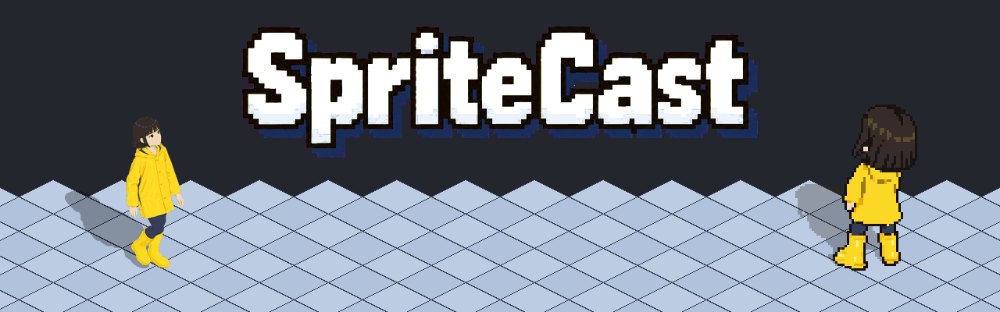</h1>

<p align="center"><b>One illustration in. A game character out.</b><br>
An isometric sprite generator for Claude Code: 8-direction walks, actions and pixel art<br>
at your game's camera angle, with a 3D shadow under every frame - and the props to stand beside them.</p>

<p align="center">
<a href="#what-you-can-make">What you can make</a> ·
<a href="#walking-characters">Characters</a> ·
<a href="#pixel-art-arcade-size">Pixel art</a> ·
<a href="#props-and-scenery">Props</a> ·
<a href="#install">Install</a> ·
<a href="#faq">FAQ</a> ·
<a href="README.ko.md">한국어</a>
</p>

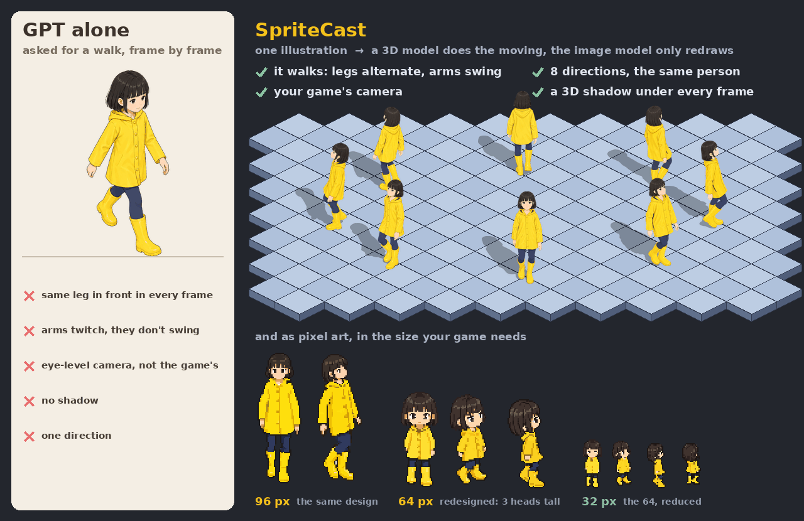

<p align="center"><i>The same image model, the same character sheet. Left: GPT asked for a walk, as it came out. Right: what the 3D adds.</i></p>

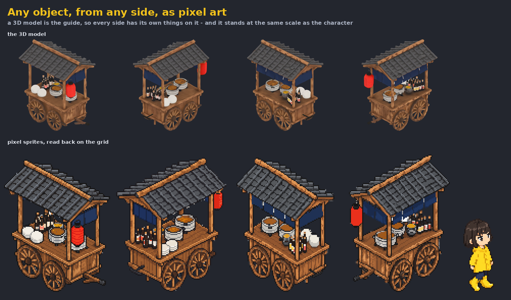

<p align="center"><i>And things, not only people: any object as pixel art, from any side, at the character's scale. <a href="#pixel-art-props-any-object-any-side">How</a>.</i></p>

```
claude plugin marketplace add Sunghwan0112/spritecast
claude plugin install spritecast@spritecast
```

Then just ask: *"Here's my character (hero.png). Make her walk in 8 directions."*
**To try it free, with no key**, ask Claude to *"try SpriteCast"*.

An image model (OpenAI's, with your own key) does the drawing. The body, the motion, the angle and the shadow come from 3D - so
every frame is the same person, and she actually walks.

| | you give | you get | you pay |
|---|---|---|---|
| **A walking character** | one illustration | a walk in 8 facings, standing views, a shadow per frame | about $2.2 + 75 Tripo credits |
| **More actions** | a name, or a Mixamo FBX | run, jump, slash, throw... in 8 facings | about 10 Tripo credits each (an FBX: none) + the drawing |
| **Pixel art** | a character that walks | pixel sprites about 100 px tall | about $0.075 a sheet (a walk, 8 facings: ~$1.35) |
| **An animal** | one illustration | a four-legged walk in 8 facings | 30 Tripo credits + the drawing |
| **Sitting** | a character that walks | seated in 8 facings, placed on your props | about $0.22 |
| **A prop, or a posed NPC** | a description | a sprite, its shadow, its anchor | about $0.07 (+ $0.08 a further facing) |
| **A pixel-art prop** | a description | pixel sprites from every side, at the pixel character's scale | about 20 Tripo credits + $0.08 a side |

Free and MIT. You pay OpenAI and Tripo directly; every paid step shows its cost and waits for your OK.

## What you can make

| | |
|---|---|
| 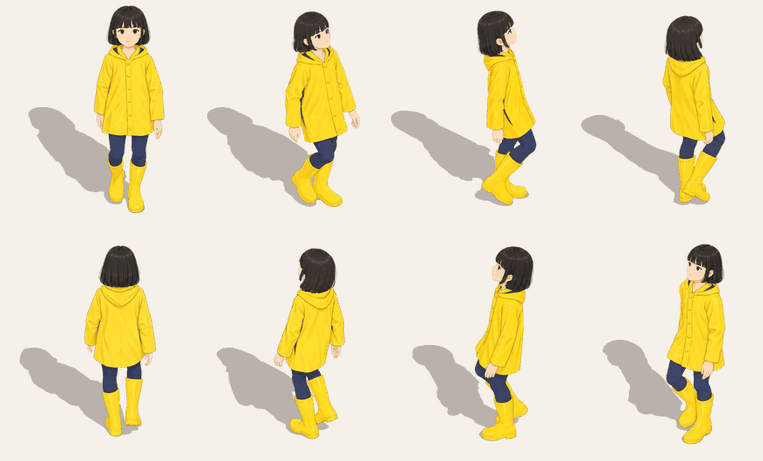 | 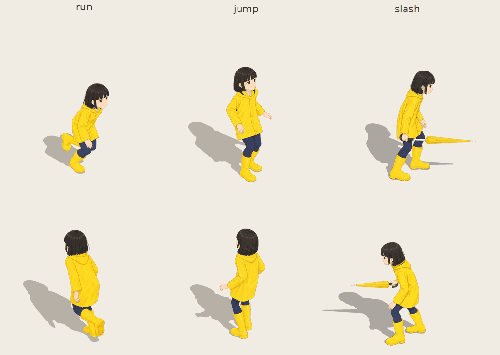 |
| **[A walk in 8 facings](#walking-characters)** from one illustration, a shadow per frame | **[Actions](#more-actions-run-jump-slash)**: run, jump, slash - or any Mixamo clip |
| 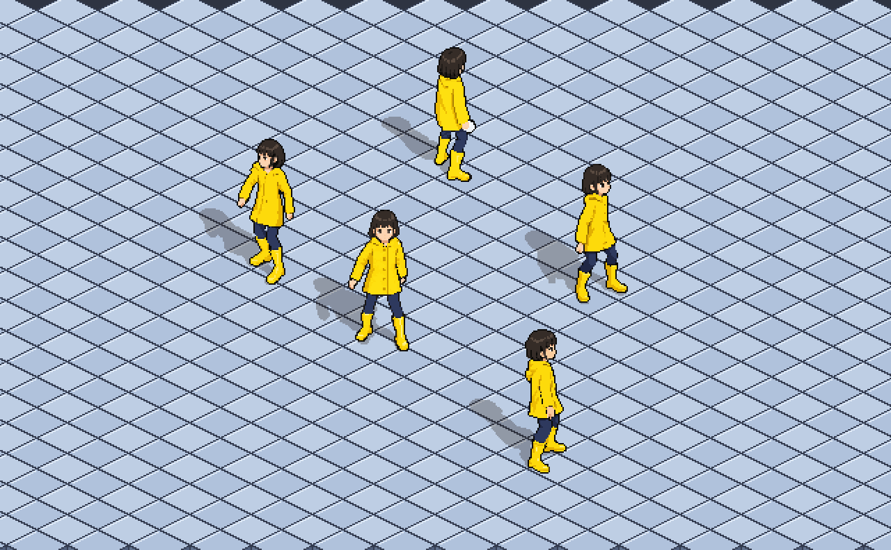 | 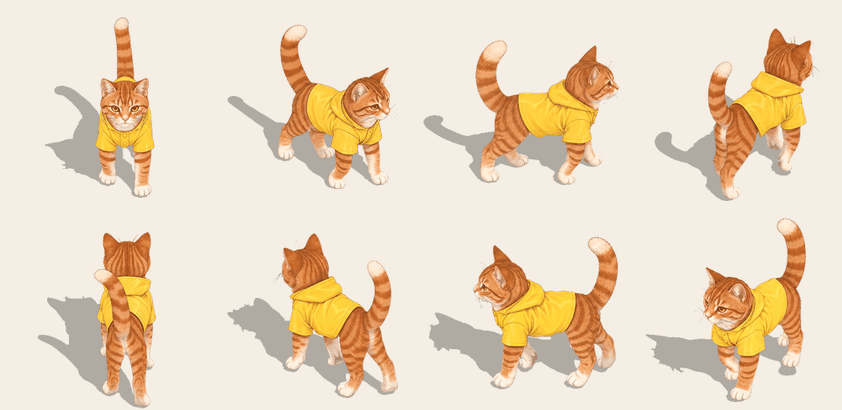 |
| **[Pixel art](#pixel-art-arcade-size)**, about 100 px tall, with things that are held and thrown | **[Four-legged animals](#four-legged-animals)**, with no bought rig |
| 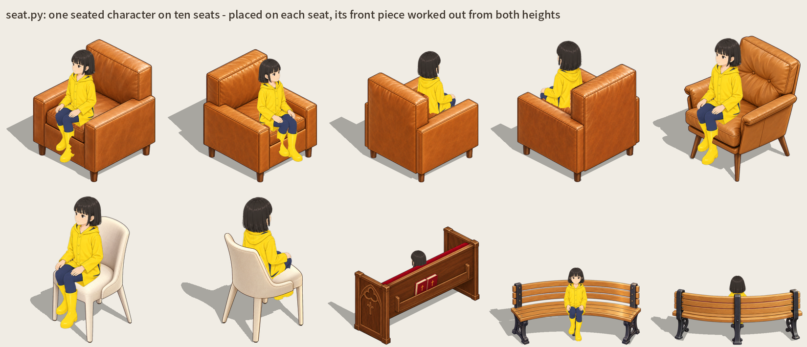 | 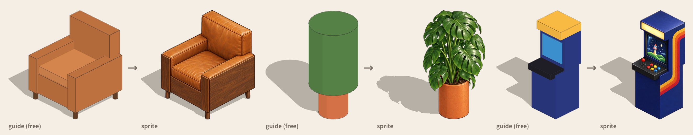 |
| **[Sitting](#sitting)** on your props, the armrest in front of her worked out in 3D | **[Props](#props-and-scenery)** at their real size, all on one floor |

## Things to ask for

- *"Here's my character (hero.png). Make her walk in 8 directions."*
- *"Add a run and a jump. And a throw - here's a Mixamo clip (Throw.fbx); put a snowball in her hand."*
- *"Our game is pixel art. Make her walk and throw as pixel sprites, about 96 px tall."*
- *"Make her sit, and put her on this armchair."*
- *"Make a shopkeeper NPC, an old man in a brown cardigan, in four directions."* (a posed figure: a description is enough)
- *"Make an isometric bookshelf, 1.8 m tall, full of books, in the cozy style."*
- *"Here's a prop from my game (props/barrel.png). Make a matching crate in that style."*

## Why it works

An image model can't keep a body and a pose from one frame to the next. Asked for a walk in words, it gives eight nice drawings
that don't walk - the left of the picture at the top, as it came out:

| GPT alone | SpriteCast |
|---|---|
| the same leg in front in all eight frames | the legs come from a 3D walk |
| the arms twitch at random | the arms swing against the legs |
| the camera at eye level | your game's camera (30° down by default) |
| no shadow | the 3D body's own shadow, frame by frame |

So SpriteCast never asks it to. **3D does the moving; the image model only redraws** each rendered frame in your illustration's
look. Every drawing is then fitted back onto its render and checked against it: a frame drawn in another pose is flagged and can
be redrawn, never squeezed to fit. Props work the same way, with blocks at real size in place of the rig.

**What you get from that:**
- **The angle and size are right.** The solid props in the examples land on their guide at 95–99 % outline overlap; the plant,
  drawn loosely on purpose, at 87 %, and the dressed figures at 69–88 % (clothes and hair go past the plain mannequin). Walking
  characters are scored frame by frame (below). The camera and the scale are fixed, so props made at different times line up on one floor.
- **Shadows that look right.** One light shared by every prop, so every shadow falls the same way. Solid props cast the 3D
  guide's own shadow. Posed figures and plants cast a shadow in the drawing's own shape (the hood, the hair, the leaves), placed by
  the 3D model, so a foot or a pot's base starts its shadow where it stands. Walking characters cast their 3D body's own shadow,
  frame by frame. Not a painted blob, not a blocky mannequin.
- **It checks itself.** After drawing, the result is compared with its guide. If the model drew another angle, nothing is squeezed to
  fit: you get a warning, and Claude suggests a fix before drawing again.
- **Your game's view and your style.** 2:1 isometric, true isometric, 3/4 top-down, front or any angle; all four facings of one
  object; the bundled `cozy` style or one picture of your own.

## Walking characters


Give it one illustration of a character (facing front, standing straight, no pose) and you get a walk in 8 facings (8 frames each) and 8 standing views, in that
illustration's look. An image model can't keep a body and a pose from frame to frame, so the motion comes from 3D:
1. A turnaround is drawn from the illustration.
2. [Tripo](https://www.tripo3d.ai) makes the 3D model from it, rigs it and gives it a walk and an idle.
3. The walk is rendered with the game's camera (free), each frame with the 3D body's own shadow, pressed flat onto the ground
   along the light.
4. The image model draws over the renders, 4 frames a call. The front is drawn first and every other facing follows it, so it
   stays the same person.
5. Every frame is fitted back onto its render, the head sizes steadied and the edges cleaned. You get strips, a shadow per frame
   (the feet touch it, a lifted foot casts its own) and an anchor.

```
$PYTHON skills/spritecast/scripts/charpipe.py turnaround hero.json --yes   # then 3d (model, rig, renders) and draw (then finish, preview by themselves)
```
All eight facings are drawn by default. A design that is the same on both sides can set `"mirror": true` to flip the west facings
from the east ones (each keeping its own shadow), about $0.66 less.

Cost per character: about $2.2 (OpenAI; ~$1.5 with `"mirror": true`) and 75 Tripo credits (~$0.75; an animal 30). Or bring your
own rigged GLB (`"rig_glb"`) and skip to `render`.

<details>
<summary><b>More: the preview video, Meshy, and the example character with her rig</b></summary>

`preview` also makes `walk-all.mp4` (every facing walking at once, with ffmpeg): the quickest way to see a head that grows and
shrinks or a frame that jumps. Tripo sometimes sends a model back turned sideways or uncoloured; both are fixed for you.
`"modeler": "meshy"` (and `MESHY_API_KEY`) has [Meshy](https://www.meshy.ai) make the model instead (~30 Meshy credits); the rig
is still Tripo's.

More options (several outfits, anchoring on the soles) and lessons:
[reference/character.md](skills/spritecast/reference/character.md). The girl above is in
[`examples/rain_girl`](examples/rain_girl): her illustration, turnaround, spec, strips, shadows, `character.json` and the sheet.
She was made with Tripo alone: about $1.7 of drawing and 85 Tripo credits. Her rigged model is there too (`rig.glb`, with its walk,
run, jump and slash, MIT like the rest of the repo), so you can try the whole 3D side with no keys and nothing paid: copy the folder,
add `"draw": false` to the spec and run `charpipe.py render rain_girl.json` then `finish` - the strips, shadows and anchors come
from the 3D model itself. Her spec also shows what `"notes"` is for: the 3D render had dark streaks down the raincoat's sides and
inside the arms, and one line in `notes` ("no dark line, stripe or seam on it anywhere... leave them out") had them drawn out of
every frame - a flaw in the model fixed in the drawing, not in 3D.

</details>

### Four-legged animals

Tripo's rig for four-legged animals walks badly (no backbone, the shoulders hung off the neck), so an animal gets no bought rig.
With `"kind": "animal"` the 3D model alone (Tripo, ~30 credits) is enough: its skeleton is found from the mesh (the feet, the
back, the head, the tail, and which way it faces), it walks in a cat's or a dog's gait, and it gets the same drawing, fitting and
3D shadows as a person.

The turnaround is drawn on all four legs, each leg clear of the others, the tail out behind; clothes only snug ones (a knit vest, not a
cape or a scarf - anything hanging moves with the nearest leg). Check the renders before drawing: four legs, the head forward, the tail
behind. If Tripo's model grows an extra leg, make it again or use Meshy (`"modeler": "meshy"`).


The cat is in [`examples/tabby_cat`](examples/tabby_cat): an orange tabby in a little yellow raincoat (the girl's), its design,
turnaround, spec, strips, shadows and sheet - 30 Tripo credits and about $2.5 of drawing, redraws and design tries included. Its
frames fit their renders at 0.76-0.97 (north-east and north-west mixed frame by frame with `"mix"`, see reference/character.md).

### More actions: run, jump, slash

Beside the walk, a character can run, jump or swing something. List them in the spec, `"actions": ["run", "jump", {"name": "slash",
"hold": "umbrella"}]`: the rig gets those animations from Tripo (about 10 credits each; run, jump, slash, shoot, dive, climb, fall,
hurt and turn are there), and each is rendered, drawn and finished in 8 facings like the walk, into its own strips with a shadow per
frame. A slash needs something in the hand: `"hold"` builds it from simple shapes and puts it in the right hand, so it moves with
every frame (a closed umbrella for now). With your own rigged model, any clip in it can be an action. A held thing is described to the
image model part by part - most carefully the end at the hand (the handle, the first stretch of the shaft), which is small and against
the body and is where it guesses otherwise.


**Most of it comes out in one go.** The rain girl's walk, run and jump fit their 3D renders at 0.78 or better in every frame, all
drawn once. The umbrella slash is harder (a thin thing that swings round the body): a weapon drawn in the wrong place is redrawn by
itself, and what is left fits a little looser where she bends deep - a pose drawn a touch more upright, which reads fine in motion.
Those frames are listed for you to look at; keep them or redraw them.

<details>
<summary><b>Other sizes: 512, 64 and 32 px from the same drawings</b></summary>

**Any size you need** (you asked): frames come out 256 px tall, and `charpipe.py pack CHAR.json --px 64` makes another set at
any height from the same drawings - larger than 256 stays sharp too, the frames are kept at the drawings' own detail - strips, shadows and `character.json` at that size, in `out-64px/`, with
nothing redrawn and `out/` left as it is (`"frame_px"` in the spec sets the default). Below, 512, 256 (the default), 64 and 32 px tall, each shown at the same size (enlarged pixel for pixel). At 64 the hair, raincoat,
boots and umbrella all read; at 32 the pose and colours hold, but the face is mostly gone - a plain resize, nothing made for that size
yet (see the [Roadmap](#roadmap)).

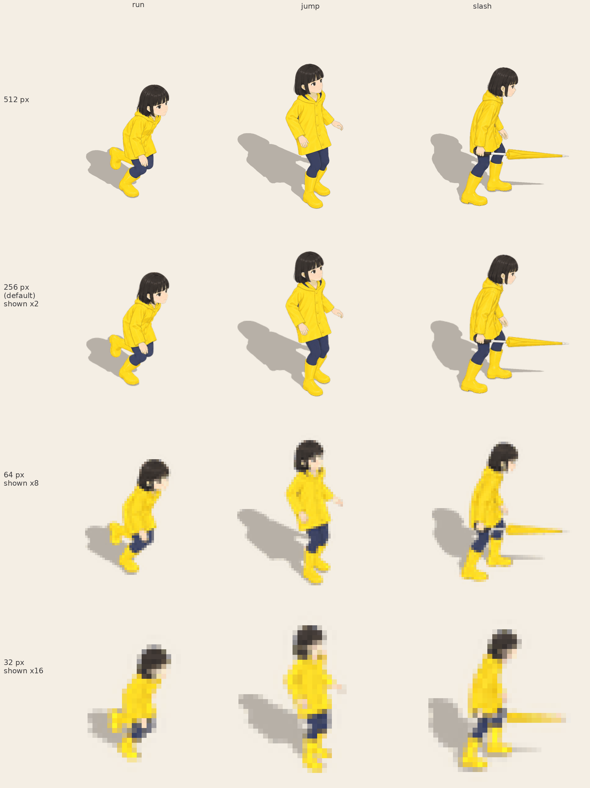

</details>

### Pixel art (arcade size)


For a game drawn in pixels - a belt-scroller, a fighter, an arcade platformer - the same character as real pixel art, about 100 px
tall: one colour a pixel, a palette of about 40, a dark outline, no blur, and each frame's 3D shadow. Not a resize of the painted
frames: the order is the other way round.

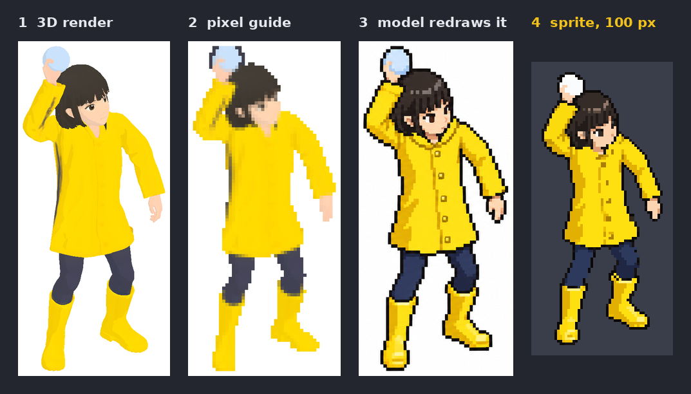

The 3D render is pixelized into a guide, the image model redraws it as pixel art, and the drawing is **read back on the grid the
model drew it on** - the head on grid lines of its own, so the eyes and mouth survive - then sized and placed by the render.

```
$PYTHON skills/spritecast/scripts/pixelart.py hero.json                        # the plan and its cost - spends nothing
$PYTHON skills/spritecast/scripts/pixelart.py hero.json --clips walk,throw --yes
```
About $0.075 a sheet: a walk in all eight facings is 18 sheets (about $1.35); the throw above, five facings, was 14.

- **Things held and thrown.** `"hold": {"kind": "snowball", "until": "auto"}` puts it in the hand and lets it go when the hand
  moves fastest. `pixel.json` then says which frame, where in the frame, which way and how fast - enough for your engine to spawn
  the projectile - and you get the ball, its flight shape and a 4-frame burst. The picture above is that data played back.
- **Any Mixamo animation.** `addclip.py hero.json Throw.fbx throw` carries an FBX clip onto the character's rig, free. The throw
  above came in that way.
- **It reviews itself.** Every frame is checked against its render (the pose, the held thing); `--redraw` draws the marked sheets
  again and keeps the better drawing. The throw's 40 frames all passed after one redraw.
- **Then a pixel editor for the last bit.** Pixel art is not all to be had by rule. `pixeledit.py hero.json` opens every frame in
  the browser: magic-erase a patch of left-over white, pencil, change a colour, move a selection, copy a good face into the other
  frames. The edits are kept and laid on again by every later build.

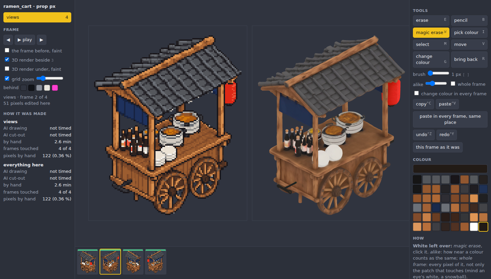

And the 3D render the frame was drawn from can be shown beside it (key `3`) or faint under it - so you can see what a doubtful
pixel is meant to be before you touch it:

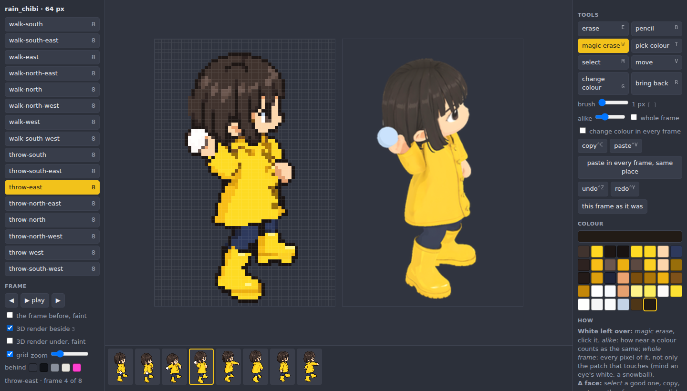

How much is left to the hand: very little. For the 40 throw frames, about 6 minutes of AI drawing and 2 of AI cut-out; then the only
hand work was the magic eraser - a click on each speck of left-over white, in 10 of the 40 frames (131 pixels, 0.15 % of the
sprites). No face was touched: they are as the pipeline made them. The build prints those numbers every time.

**Sizes.** 96 px is the size for a character of ordinary proportions. **64 px works for a character designed small** - about three
heads tall, with its own 3D model - and comes out about 70 px. Under that, the image model is never asked: it does not keep to so
few squares (32 px was tried four ways). `--px 32` draws at 64 and makes the 32 set from it, free - the same motion and frames, with
rougher faces. 64 is the one that comes out well.

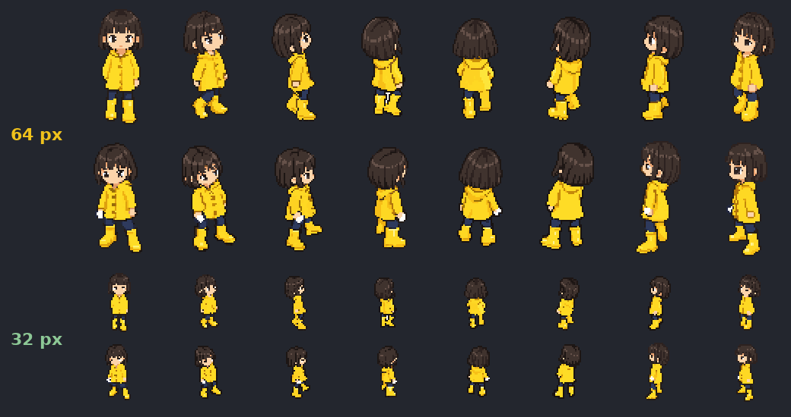

Both sets are in [`examples/rain_chibi`](examples/rain_chibi): the three-heads design drawn from the rain girl, its turnaround, the
spec, `pixel64/` (walk and throw in eight facings, 128 frames, each with its shadow; no pixel was touched by hand) and `pixel32/` made from it. Her throw is a Mixamo clip put on with `addclip.py --clear-head 55`; the clip and the
rig are not in the repo.

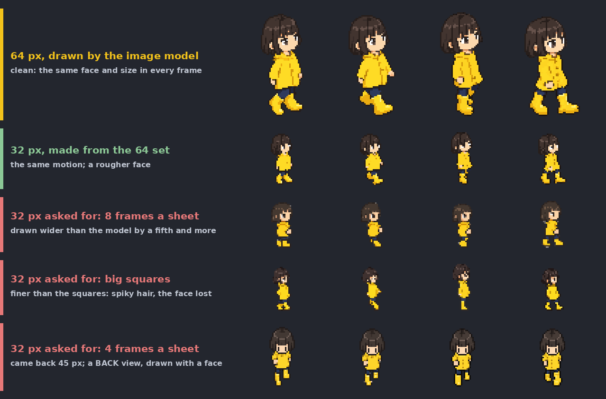

**Why not ask for 32 px?** The image model (GPT) does not do small pixel art well under 64. It draws its "pixels" at a size of its
own - asked for 8-px squares it drew anything from 7.4 to 10.8 - and at 32 squares one square off is an eye gone. Above: the top row
is what it draws at 64; the three red rows are 32 px asked for directly, each a different sheet layout, all of the same walk. So the
skill asks for 64 and makes 32 from that (the green row). The details: [reference/pixel.md](skills/spritecast/reference/pixel.md).

The sprites above are in [`examples/rain_girl/pixel`](examples/rain_girl/pixel): the throw in five facings, a walk in two and the
umbrella slash as strips, their shadows, the snowball with its flight shape and burst, and `pixel.json` with the release data.

### Pixel-art props: any object, any side


The same way round as a character, for a thing: its 3D guide is pixelized, the image model redraws it as pixel art on the same grid,
and the drawing is read back on that grid and brought to the guide's size. The angle is the camera's, so a thing turned four ways is
four sprites of ONE thing - the same roof, the same wheels, each side with what belongs on it.

```
$PYTHON skills/spritecast/scripts/isoprop.py model cart.json --yes    # Tripo makes the 3D model from the description (~20 credits)
$PYTHON skills/spritecast/scripts/isoprop.py render cart.json         # free: the guide from each side ("views": [0, 90, 180, 270])
$PYTHON skills/spritecast/scripts/proppixel.py cart.json --yes        # ~$0.08 a side → out-pixel/sprite-<side>.png
```

- **A real 3D model is what makes the sides come out right.** From blocks alone the image model cannot tell which face has what on it:
  an arcade cabinet came out with its screen on the wrong face in one view of four. The cart above is a Tripo model; all four sides
  matched it on the first drawing. One view of a simple thing (a chair, a crate) is fine from blocks.
- **The same scale as the character.** `--ppm` is pixels per metre: the pixel character's height in pixels over its height in metres
  (54 for the small example character), so the prop and the character stand on one floor in the same size of pixel.
- **The cut-out is yours to finish.** The air under a roof and between spokes is cleared by the AI cut-out; what it leaves, open in the
  same pixel editor as the characters (`pixeledit.py cart.json`): the four sides are four frames, the 3D render can be shown beside
  or under the sprite, and what you erase is kept. The cart above had 122 pixels finished that way.
- No pixel shadow for props yet. The cart is in [`examples/ramen_cart`](examples/ramen_cart): the spec, the Tripo model, the four guides
  and the four sprites.

### Skipping the drawing: the 3D renders as the frames

With `"draw": false` in the spec, no image model draws the frames: the 3D model's own renders (toon-shaded, its own texture) are
the frames, with the same 3D shadows and anchors. The image model draws only the turnaround (~$0.09); with your own rigged GLB
(`"rig_glb"`; an animal: its model, `"model_glb"`) it draws nothing at all. A character then costs the turnaround and the 3D
(75 Tripo credits, an animal 30) - two OKs, done as soon as `3d` is. The trade-off is sharpness: no drawn lines, a simpler face,
the model's texture as it came (blurrier fur and folds).


## Sitting

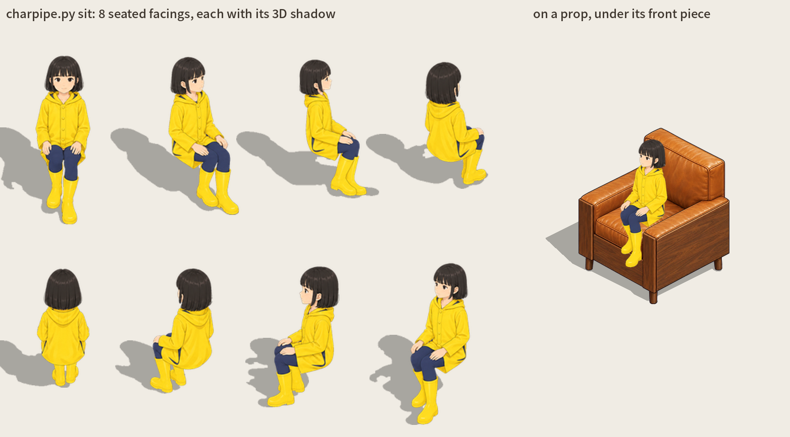

Once a character walks, ask Claude to *"make her sit"*. Her 3D model is bent into sitting (thighs level, knees bent, hands on the
thighs) in 8 facings for free; you look at those renders, then they are drawn like the standing views (two sheets, about $0.22). She
sits on nothing - your game's chair goes under her. `character.json` gets a `sit` block: for each facing the file, the **seat point**
(put it on the chair's seat; a fraction of the frame, like `anchor`), the seat's height and the shadow. To put her on one of
your props, `seat.py` places her on its seat and works out the prop's **front piece for her** (an armrest, a pew's back, a bench's
backrest) from both of their 3D heights - no painting:


It finds the seat's height and which way it faces, and sits her back until her knees reach the seat's edge. If she sits a little off,
drag her on the touch-up page (below): letting go works the front piece out again from there.
The details: [reference/sitting.md](skills/spritecast/reference/sitting.md).

```
$PYTHON skills/spritecast/scripts/charpipe.py sit <name>.json            # free: the seated renders
$PYTHON skills/spritecast/scripts/charpipe.py sit <name>.json --draw     # ~$0.22: drawn and finished
$PYTHON skills/spritecast/scripts/seat.py <prop>.json <name>.json --height 1.3   # free: on a prop, its front piece worked out
```

## Fixing things by hand

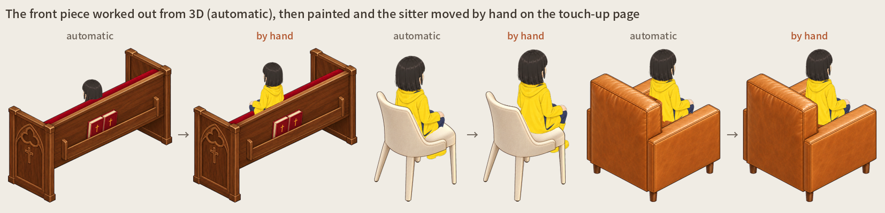

The automatic steps get you most of the way; the last bit is best done by eye. **Painting by hand is more accurate than any of the
automatic steps**: above, the pew's back hid the whole girl until it was painted and she was moved up, and the dining chair's and the
armchair's backs cut her in the wrong places. Cut-outs are not perfect either: a little paper left between an arm and the body, a white
shirt the cut-out took for the paper. Ask Claude to
open the touch-up page (or run `$PYTHON skills/spritecast/scripts/touchup.py <spec>.json`): every finished picture of that prop or
character, painted in the browser and saved as you go.

| colour | does |
|---|---|
| red | clears: made see-through |
| green | brings back: those pixels taken from the drawing itself (turn on "drawing under" to see it) |
| blue (props) | the **front piece**: what stands in front of a character inside the thing - an arch's near posts, a gazebo's roof, a chair's near armrest |
| ⬠ polygon (P) | click the corners and close it (double-click, Enter, or the first corner): filled in the colour you are painting, or erased |
| 🪑 (a seat) | drag the seated character (or the arrow keys); letting go re-makes the seat and its front piece from there |

Then `touchup.py <spec>.json --apply` (a character's strips are packed again). A prop with a front piece gets `sprite-front.png` and
`"front"` in `sprite.json`: draw the sprite behind whoever stands in it and the front piece over them. `finish` lays the paintings on
again by itself; a picture drawn again since it was painted keeps its painting aside instead of laying it on a different drawing.

**Pixel sprites** have an editor of their own, pixel by pixel - see [Pixel art](#pixel-art-arcade-size).

## Props and scenery


Ask an image model for "an isometric armchair" and you get a nice picture at a slightly wrong angle. Ask again and you get a
different wrong angle and a different size. Put ten of them on one floor and nothing lines up.

SpriteCast gives the model a guide that is hard to misread (and when it does misread, you're told):
1. Claude builds the object from simple blocks at its **real size in metres**.
2. The blocks are rendered with your game's **exact camera**.
3. The image model only redraws that guide in your **art style**.
4. The drawing is cut out and **fitted to the guide's box**, so its size and footprint are the guide's; a drawing whose outline
   doesn't follow the guide is flagged, not forced. It also gets a baked shadow and an anchor point for your engine.

The props come out painted (the `cozy` look: smooth shading, fine outlines), or in the style of one picture of your own.

## How a session goes

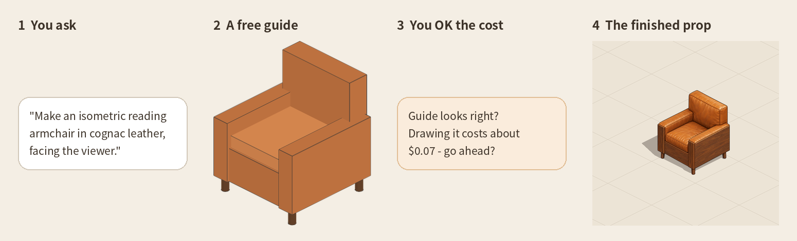

You describe the prop. Claude asks only for what's missing: the size, the facing, your game's view, your style. It renders the
guide for free and shows it to you. It tells you the cost and waits for your OK. Then you get `sprite.png`, `shadow.png` and
`sprite.json`.

## Examples

All in [`examples/`](examples), each with its spec and the files it produced (the raw drawings as WebP, to keep the repo small).

| | | |
|---|---|---|
| 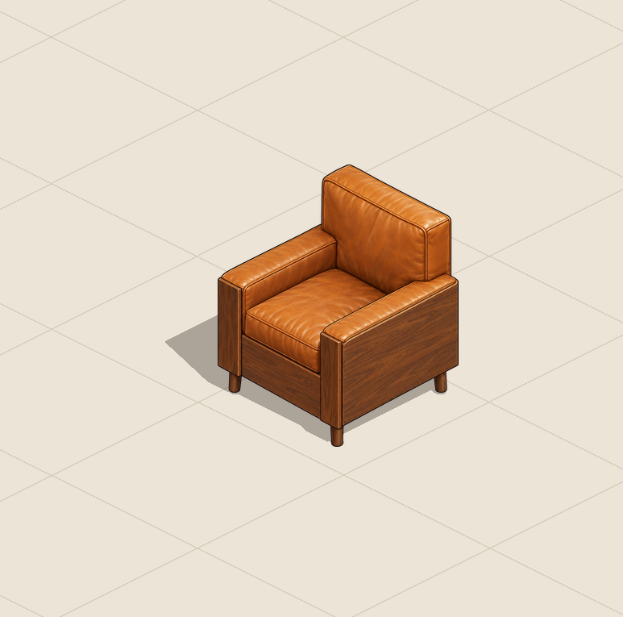 | 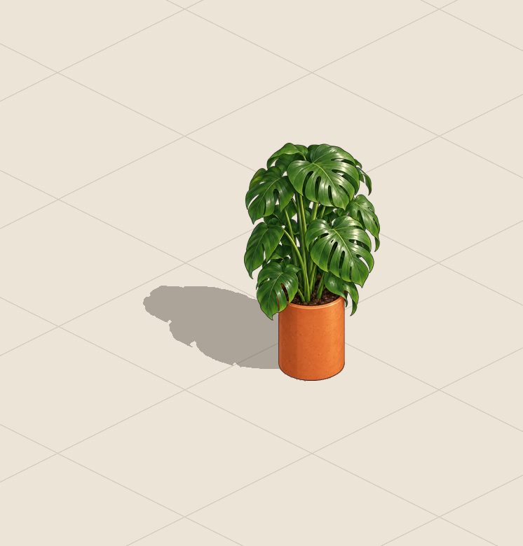 | 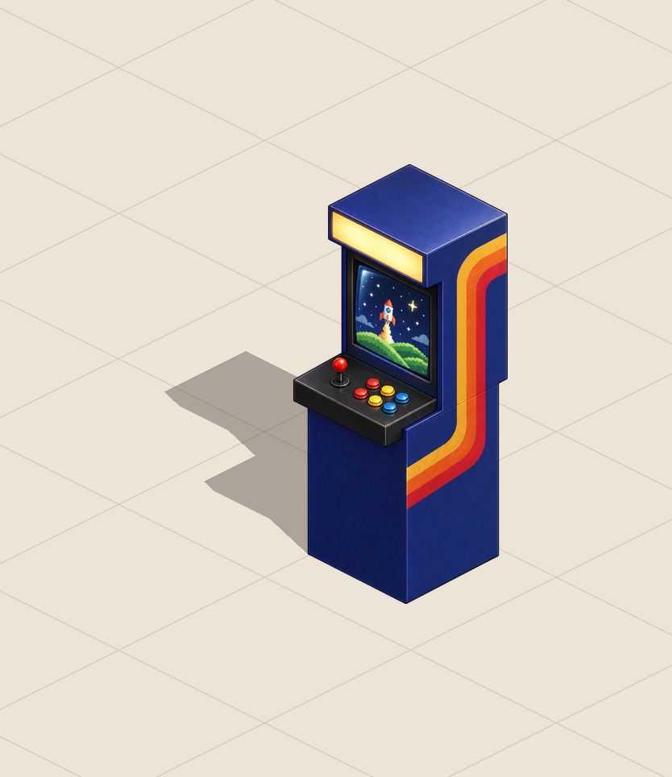 |
| `reading_armchair`: 9 blocks: seat, back, arms, legs | `potted_monstera`: a pot, and the plant given as one volume | `arcade_cabinet`: its front faces down-left |

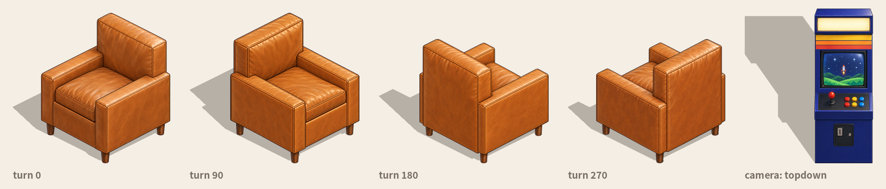
`armchair_four_ways`: `views: [0, 90, 180, 270]`. The later views are drawn with the first one as a reference, so it stays the same
chair. `arcade_cabinet_topdown`: `camera: "topdown"`. `reading_armchair_tripo`: the same armchair from a Tripo model (below).

The examples' 3D models (`reading_armchair_tripo`, and the walking characters' meshes and rigs) were generated with the [Tripo](https://www.tripo3d.ai) API.

## More detail: a 3D model first (Tripo)

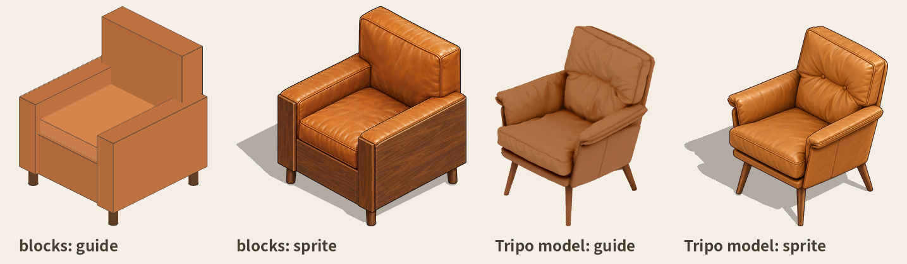

Blocks are enough when what matters is where things stand and how big they are. For more detail (curved arms, tapered legs, buttons,
carving), let [Tripo](https://www.tripo3d.ai) make a real 3D model from the description first. It is made as tall as the blocks say and
keeps its own proportions (the footprint it then covers is written to `sprite.json`; `"shape": "box"` presses it into the blocks' box
instead), and it becomes the guide. The image model then draws over a real shape, and the 3D
shadow is the model's own.

```
$PYTHON skills/spritecast/scripts/isoprop.py model  armchair.json --yes   # Tripo text-to-model (~20-40 Tripo credits, ~2 min); the spec now uses it
$PYTHON skills/spritecast/scripts/isoprop.py yaws   armchair.json         # free: the model turned four ways; set "model": {"yaw": ...} to the right one
$PYTHON skills/spritecast/scripts/isoprop.py render armchair.json         # then draw, finish as usual
```
Needs `TRIPO_API_KEY`. The blocks stay in the spec as `blocks_draft`.

## Posed characters (from a description)

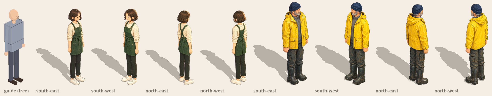

An NPC that only stands needs no illustration and no rig: it works like a prop. Claude poses a plain mannequin at the person's real height and renders it in each facing (4 or
8). The image model dresses it as you describe. The first facing is drawn first and the others follow it, so it stays the same person.

```json
{ "name": "barista",
  "character": { "height": 1.63, "build": "slim", "directions": ["south-east", "south-west", "north-east", "north-west"] },
  "description": "a cheerful young café barista: a short dark-brown bob, a cream cable-knit sweater under a forest-green apron, ..." }
```

The anchor is between the feet. About $0.07 for the first facing and $0.08 for each of the others.

<details>
<summary><b>Poses, your own angles, and redrawing one facing</b></summary>

**Poses.** The mannequin has joints. `"pose"` is one of `stand` (default), `wave`, `point`, `hold` (hands together in front: a cup,
a tray, a book), `arms-crossed` or `walk` (mid-stride). Describe what goes with it ("waving hello", "holding a coffee cup"). Or give the angles yourself, and Claude can adjust them
for you ("raise the arm higher") and check them in the free render:

```json
"pose": { "base": "stand", "arm": { "left": [[150, 10], [170, 10]], "right": [[150, 10], [170, 10]] } }
```
Each limb is two parts, upper and lower (`[out, forward]` degrees each): turned out to its side, then swung forward. `left` and
`right` are the figure's own.

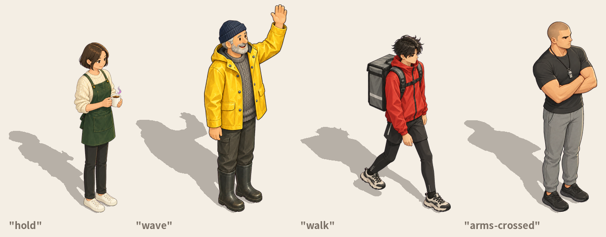

**Single pictures.** These posed figures are one picture per facing; for a walk, see [Walking characters](#walking-characters).
Look at every facing yourself (the outline check can't see a head turned the wrong way); redraw one with
`draw <spec> --yes --again --only north-west`.

</details>

## Shadows that match the drawing

The 3D guide's shadow is right for solid things like furniture. But a drawing has things the blocks don't: hair, a coat's hood,
leaves spilling out of a pot.

<details>
<summary><b>How the shadow is worked out</b></summary>

So SpriteCast also renders a **height map** of the guide: how high above the floor every pixel is. A point h metres up casts its
shadow a fixed step away on screen (h times the light's offset), whatever its depth. So each pixel of the drawing takes the height of
the guide under it, or of the nearest guide pixel for hair or leaves past the guide, and is moved by that step.

The shape is the drawing's. Where it starts is the 3D model's: each foot starts its own shadow, and a pot's shadow starts at its
base. Only what touches the floor has to be exact. Higher up (from 10 % to 35 % of the object's height) the height eases into a
smooth one read off the screen, so hair, hats and leaves cast a natural shadow instead of the mannequin's corners. Where it stands
(the blocks up to 12 cm: shoes, a pot's base) the guide's own 3D shadow is added, so the shadow meets the object as a real one
would: on the side away from the light, never in front of it. Posed figures and `loose` things get it; solid props keep the 3D
shadow, and walking characters cast their 3D body's own (above). Choose with `"shadow": "drawn" | "guide"`.

</details>

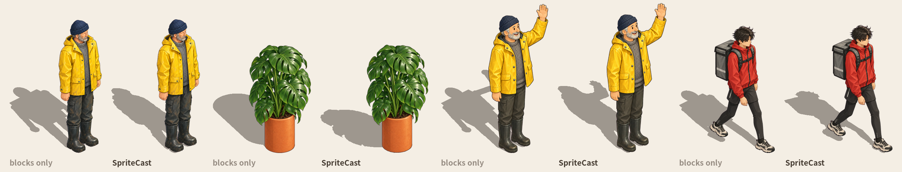

## Cameras

| `camera` | looks down | for |
|---|---|---|
| `"iso-2:1"` (default) | 30°, turned 45° | most isometric games; floor tiles twice as wide as tall |
| `"isometric"` | 35.26°, turned 45° | true isometric (120° between the axes) |
| `"topdown"` | 50°, square on | 3/4 top-down RPGs |
| `"front"` | 12°, square on | side-scrollers |
| `{"pitch": 40, "yaw": 30}` | anything | your own angle |

`"light": "left"` mirrors the light and the shadow.

Walking characters take `"pitch"` alone, not `camera`: 30 (default, 2:1), 35.26 (true isometric), 50 (3/4 top-down), 12 (front);
their 8 facings are 45° apart. `camera` covers props and posed figures.

## Putting it in your engine

`sprite.json` tells you where the prop touches the ground:

```json
"sprite": { "file": "sprite.png", "size": [299, 357], "anchor": [0.4993, 0.9966], "anchor_px": [149.3, 355.8] },
"shadow": { "file": "shadow.png", "offset_px": [-66, 116] },
"px_per_m": 256
```

- **anchor**: the footprint's front corner on the ground (the middle of its front edge in the square-on views). Put that point on
  the tile where the prop stands.
- **shadow**: draw `shadow.png` at `offset_px` from the sprite's top-left corner, at about 30 % opacity, under all sprites.
- **scale**: everything is drawn at `px_per_m` pixels per metre. For a 2:1 map whose tiles are 1 m and `T` px wide, scale by
  `T / 1.414 / px_per_m`.

| engine | how |
|---|---|
| Phaser | `this.add.image(x, y, 'armchair').setOrigin(anchor[0], anchor[1])` |
| Godot 4 | `Sprite2D`: `centered = false`, `offset = -anchor_px` |
| Unity | Sprite Editor → Pivot: Custom, `(anchor[0], 1 - anchor[1])` |

**Walking characters.** `character.json` gives `frame` (`[w, h]` in px), `anchor` (between the feet, as a fraction of the frame)
and `fps`. Each `walk-<facing>.png` is a strip of 8 frames side by side, and each `idle-<facing>.png` one frame. Shadow `i` of a
facing, `shadows.walk[facing][i]`, is drawn at its `offset` from frame `i`'s top-left corner, at about 30 % under everything.
There is no `px_per_m`: scale the frames to the height you want your character to stand. In Phaser, with `rain_girl`'s numbers:

```js
this.load.spritesheet('girl-se', 'walk-south-east.png', { frameWidth: 165, frameHeight: 256 });
this.anims.create({ key: 'walk-se', frames: this.anims.generateFrameNumbers('girl-se'), frameRate: 6.76, repeat: -1 });
this.add.sprite(x, y, 'girl-se').setOrigin(0.4926, 0.8839).play('walk-se');
```
The full format: [reference/character.md](skills/spritecast/reference/character.md#output-nameout).

## Install

In a terminal:
```
claude plugin marketplace add Sunghwan0112/spritecast
claude plugin install spritecast@spritecast
```
or inside Claude Code: `/plugin marketplace add Sunghwan0112/spritecast`, then `/plugin install spritecast@spritecast`.

**You also need** only Python 3.9+ and a browser (Chrome, or Edge - every Windows has it). The first time, Claude runs the setup
check (`doctor.py --fix`): it makes its own venv in `~/.cache/spritecast/` with the few packages (about 10 s), leaves your Python
alone, and tells you what each thing is for. Nothing to install by hand.

<details>
<summary><b>Running the scripts yourself</b></summary>

**Running the scripts yourself.** Claude runs them for you. To run them by hand from a clone of this repo, use the Python that
`doctor.py` prints on its last line (`PYTHON=...`); after `--fix` it is `~/.cache/spritecast/venv/bin/python` (Windows:
`%USERPROFILE%\.cache\spritecast\venv\Scripts\python.exe`). A plain `python` may not have the packages (`No module named ...`). The commands below
write it as `$PYTHON`:
```bash
python3 skills/spritecast/scripts/doctor.py --fix
PYTHON=$(python3 skills/spritecast/scripts/doctor.py | sed -n 's/^PYTHON=//p')
$PYTHON skills/spritecast/scripts/isoprop.py --help
```
On Windows, in PowerShell:
```powershell
python skills/spritecast/scripts/doctor.py --fix
$PYTHON = "$env:USERPROFILE\.cache\spritecast\venv\Scripts\python.exe"
& $PYTHON skills/spritecast/scripts/isoprop.py --help
```
There, run the `$PYTHON ...` commands below as `& $PYTHON ...`.

</details>

| what | for | needed? |
|---|---|---|
| Python 3.9+ | runs the scripts | yes |
| numpy, pillow, scipy | cutting out, fitting, shadows | yes (set up for you) |
| playwright + Chrome or Edge | renders the 3D guide on your computer (free) | yes (set up for you; a browser you have is used) |
| onnxruntime + a 224 MB model | characters only: the AI cut-out that keeps white shoes on white paper | characters (fetched once, by itself) |
| `OPENAI_API_KEY` | drawing, about $0.07 a prop | to draw |
| `TRIPO_API_KEY` | characters: the 3D model, its rig and walk | for walking characters |

**Try it first, free, no key:** ask Claude to *"try SpriteCast"*. It renders one of the examples' guides on your computer and
finishes it with the drawing that came with the example (`isoprop.py try`), so you see the whole way before paying for anything.

<details>
<summary><b>Keys: where they go, and OpenAI's verification</b></summary>

Keys: **in the plugin's settings.** When you enable SpriteCast, Claude Code asks for them (`/plugin` → SpriteCast → configure,
to change them later): the OpenAI key, and the Tripo key if you make walking characters. They are kept in your system's credential
store, masked, and handed to SpriteCast's scripts when a session starts (restart Claude Code after changing one). A key already in your
environment still works when the settings have none:

```bash
export OPENAI_API_KEY=sk-...          # macOS / Linux (add it to ~/.zshrc or ~/.bashrc to keep it)
```
```powershell
setx OPENAI_API_KEY "sk-..."          # Windows (then open a new terminal)
```
On Windows the settings reach the scripts only when Claude Code runs its commands in Git Bash (its default when Git is installed); in
PowerShell use the environment. Your key stays on your computer. It is only sent to OpenAI, and you pay OpenAI for each drawing (about $0.07).

OpenAI may ask you to verify your organisation before a key can use image models (platform.openai.com → Settings →
Organization): do it once before your first drawing. Set the key before you start Claude Code; a key set while it runs is seen
only after a restart. Walking characters also need `TRIPO_API_KEY`, from Tripo's API platform, where API credits are bought
(75 a character, 30 an animal).

</details>

## How it works

| step | what | cost |
|---|---|---|
| spec | Claude writes `<name>.json`: footprint, blocks in metres, a description of the finished object | free |
| `render` | three.js in headless Chrome: the guide, its shadow and the model's input | free |
| `draw` | OpenAI Images (`gpt-image-2.5-sunburst` by default): the guide redrawn in your style | ~$0.07 |
| `finish` | magenta keyed out softly, fitted back onto the guide's box, shadow baked, anchor measured | free |
| `preview` | the sprite on a 1 m floor grid | free |

You can run the steps yourself too:
`$PYTHON skills/spritecast/scripts/isoprop.py render|draw|finish|preview examples/reading_armchair.json` (`$PYTHON`: see
[Install](#install)). `draw` only prints the cost
until you add `--yes`. The spec format is in [reference/spec.md](skills/spritecast/reference/spec.md). Tips for good guides are in
[reference/tips.md](skills/spritecast/reference/tips.md).

## If something goes wrong

| problem | fix |
|---|---|
| `No module named ...` | run the script with the `PYTHON=` that `python3 skills/spritecast/scripts/doctor.py` prints (`--fix` first if it says not ready; Claude does this for you) |
| no browser | install Chrome, or `doctor.py --fix --browser` (Playwright's Chromium, ~150 MB) |
| `this Python cannot make a venv` | Debian/Ubuntu: `sudo apt install python3-venv`, or use another Python (python.org, conda) |
| `draw: set OPENAI_API_KEY` | give the key in the plugin's settings (`/plugin` → SpriteCast), or set it in the environment (above), and restart Claude Code |
| `HTTP 401` / `403` | the key is wrong, or OpenAI wants your organisation verified before it allows image models (platform.openai.com → Settings → Organization) |
| `finish: WARNING - the drawing does not follow the guide` | the model drew another angle or shape: make the description say what is seen from this camera, check the guide, draw again with `--again`. For plants and other loose shapes that may spill past their guide, set `"loose": true` |
| the drawing added things | say what must NOT be there in the description ("no rug, no logos"), then draw again |
| the shape is off | fix the blocks: the drawing follows the guide |

## What it sends and fetches

<details>
<summary><b>What is sent where, and what is downloaded</b></summary>

Everything runs on your computer except the steps below. Each paid step prints its cost and waits for your OK first.

| when | sent to | what |
|---|---|---|
| `draw` | OpenAI (`api.openai.com`) | the guide picture, your style picture and the text description, with your `OPENAI_API_KEY` |
| characters: `turnaround`, `draw` | OpenAI | the illustration, the turnaround and the 3D renders, with the same key |
| characters: `3d` | Tripo (`openapi.tripo3d.ai`) | the four turnaround views, with your `TRIPO_API_KEY`; the model, its rig and walk come back |
| `model` (props, optional) | Tripo | the text description |
| characters, `"modeler": "meshy"` (optional) | Meshy (`api.meshy.ai`) | the four views, with your `MESHY_API_KEY` |

The keys are read from your environment only, sent only to their own service, and never written to a file or printed. What is downloaded:

| what | from | when |
|---|---|---|
| numpy, pillow, scipy, playwright, onnxruntime | PyPI, into its own venv (`~/.cache/spritecast/venv`) | `doctor.py --fix`, once |
| Chromium (~150 MB) | Playwright's servers | only if there is no Chrome or Edge, and only after you say yes |
| the cut-out model, BiRefNet lite (224 MB, MIT), or the full one (973 MB) with `SPRITECAST_KEY_MODEL=general` | [rembg's GitHub release](https://github.com/danielgatis/rembg/releases/tag/v0.0.0), its md5 checked | characters, the first `finish` |
| MediaPipe Face Landmarker (3.7 MB, Apache-2.0); `mediapipe` itself is a separate `pip install` | Google (`storage.googleapis.com/mediapipe-models`) | only `facecheck` (optional), the first time |

The renders run in a headless browser on your computer with nothing loaded from the internet: three.js is bundled
(`skills/spritecast/scripts/vendor/three/`, MIT).

</details>

## Roadmap

What is planned next, roughly in this order (no dates - it moves with feedback):
- **Seat-fitted poses, and riding** (sitting itself is done - see Sitting): a pose shaped to each seat (leaning back on a deep sofa, feet
  on a ride's footrest) instead of one seated pose for every chair, and characters riding in carts and vehicles.
- **Turning objects**: a vehicle or a ride rotated through many angles, so it turns smoothly instead of snapping between 8 facings.
- **Night versions**: a mask of what gives light (windows, bulbs, neon), so your engine can light just those parts after dark.
- **Walk-through props, automatic**: the front piece worked out from the 3D guide (today it is painted by hand on the touch-up page).
- **More actions and things to hold**: run, jump and slash are in, and any Mixamo clip can be added (a throw, with a snowball that is let go); next, more held things (a sword, a staff) and an idle breath.
- **Small sprites**: pixel art at 96 px, and at 64 px for a character designed small, is in (see Pixel art); a 32-px set is made from
  the 64 one. Next: making the small design from the ordinary one in one step, and a face at 32 px that needs no hand.
- **Engine exports**: sprite sheets with Godot, Unity and Aseprite files ready to import.

See [CHANGELOG.md](CHANGELOG.md) for what each version changed.

## Feedback

Feedback decides what comes next, and what changed because of it is marked in the changelog.
- **Something broke**: open an [issue](https://github.com/Sunghwan0112/spritecast/issues/new/choose) with the bug form - your OS, Python version,
  the command and the message help most.
- **An idea or a missing feature**: the feature form in [issues](https://github.com/Sunghwan0112/spritecast/issues/new/choose).
- **Show what you made, or ask how**: [Discussions](https://github.com/Sunghwan0112/spritecast/discussions).

## Notes
- The output is yours.
- Leave real brands, logos and characters from existing games out of descriptions.
- Don't use a living artist's work as your style picture without their permission.
- A `photo` for a character's likeness: only of someone who agreed to it.
- Solid props get the 3D shadow of their blocks; posed figures and `loose` things a shadow in the drawing's own shape (see Shadows);
  walking characters their 3D body's.
- Settings: `SPRITECAST_MODEL` and `SPRITECAST_QUALITY` (`low` | `medium` | `high`).

## FAQ
- **What does it cost?** The guides, finishing and the `try` are free. About $0.07 a prop, $0.08 for each further facing; a walking
  character about $2.2 of drawing (~$1.5 with `"mirror": true`) and 75 Tripo credits (an animal 30). Each paid step shows its cost
  and waits for your OK. The plugin is free; you pay OpenAI and Tripo directly, nothing goes to the author.
- **Which keys do I need?** `OPENAI_API_KEY` to draw, `TRIPO_API_KEY` for walking characters and animals (Meshy optional). OpenAI may
  ask you to verify your organisation first. See [Keys](#install).
- **Isn't this AI art?** Yes: an image model does the painting. What SpriteCast adds is the geometry: the size, the camera angle, the
  walk and the shadows come from 3D. You can give your own art as the style, or set `"draw": false` so no image model draws a walking
  character's frames: the 3D renders are the frames. The turnaround is still drawn, unless you bring your own rigged model
  ([Skipping the drawing](#skipping-the-drawing-the-3d-renders-as-the-frames)).
- **What doesn't it do?** Walking characters start from an illustration facing front, standing straight. Pixel art works at 96 px, and at 64 px for a character
  designed small; a 32-px set is made from the 64 one, with rougher faces
  ([Roadmap](#roadmap)). Posed single pictures (wave, point, hold...) need only a description. Big flat things like rugs are better drawn top-down and skewed onto the floor
  ([tips](skills/spritecast/reference/tips.md)). Look at the results yourself: the outline check can't see a head turned the wrong way.
- **Which engine?** Any that takes PNGs: you get the sprite, its shadow and the anchor in JSON. See
  [Putting it in your engine](#putting-it-in-your-engine) for Phaser, Godot and Unity.

## License
MIT - the code and the examples (pictures, strips and the rain girl's rigged model alike). three.js (bundled in `skills/spritecast/scripts/vendor/three`) is MIT, © three.js authors.
