<h1 align="center"></h1>

<p align="center"><b>One illustration in. A game character out.</b><br>
A 2D sprite generator for Claude Code, isometric or side-scrolling: 8-direction walks, actions and pixel art<br>
at your game's camera angle, a 3D shadow under every frame, the props to stand beside them -<br>
and a side-scroller's monsters and townspeople, drawn on a mannequin's walk.</p>

<p align="center"><a href="https://github.com/Sunghwan0112/spritecast/stargazers"></a></p>

<p align="center">
<a href="#what-you-can-make">What you can make</a> ·
<a href="#walking-characters">Characters</a> ·
<a href="#a-side-scrolling-game-one-facing-and-monsters-drawn-in-2d">Side-scrollers</a> ·
<a href="#pixel-art-arcade-size">Pixel art</a> ·
<a href="#props-and-scenery">Props</a> ·
<a href="#install">Install</a> ·
<a href="#faq">FAQ</a> ·
<a href="README.ko.md">한국어</a> · <a href="README.zh-CN.md">简体中文</a> · <a href="README.ja.md">日本語</a> · <a href="README.es.md">Español</a> · <a href="README.pt-BR.md">Português</a>
</p>


<p align="center"><i>The same image model, the same character sheet. Left: GPT asked for a walk, as it came out. Right: what the 3D adds.<br>Bottom: a side-scroller's creatures and people, each beside the plain mannequin whose walk it was drawn on.</i></p>

```
claude plugin marketplace add Sunghwan0112/spritecast
claude plugin install spritecast@spritecast
```

Then just ask: *"Here's my character (hero.png). Make her walk in 8 directions."*
**To try it free, with no key**, ask Claude to *"try SpriteCast"*.

An image model (OpenAI's, with your own key) does the drawing. The body, the motion, the angle and the shadow come from 3D - so
every frame is the same person, and she actually walks.

**Everything at one angle.** What makes an isometric game look AI-made is rarely one bad sprite - it is things seen from different cameras side by side: a character drawn from above, standing on a square tile laid flat, beside a front-on heart and potion from an icon pack. Draw everything at the same iso view and in the same light - the character, the trees and the ground, and also the heart and the potion she picks up, each from its own 3D model with its shadow - and the game stops looking pasted together. (What sits on the screen, like her hearts at the top, can stay front-on - drawn from the same 3D heart.)


<a name="cost"></a>Free and MIT: you pay OpenAI and Tripo directly (1 Tripo credit = $0.01), nothing goes to the author, and every paid step shows its cost and waits for your OK. A walking character is about **$3**, a prop a few cents, a side-scroller's monster about **$0.18** - and the 3D guides, the finishing, the ground (a meadow, a path, puddles), the 3D shadows, see-through things, creatures' poses, the wind, the export to Phaser and Godot and the try cost nothing.

<details><summary>what each one costs</summary>

| | you give | you get | about |
|---|---|---|---|
| **A walking character** | one illustration | a walk in 8 facings, standing views, a shadow per frame | **$2.9** (drawing $2.1 + Tripo $0.75) |
| **Another action** | a name (Tripo: quick), or a Mixamo FBX (more natural) | run, jump, slash, throw... in 8 facings | **$0.8-1.5** an action (drawing $0.7-1.4 + Tripo $0.10; an FBX: free) |
| **Pixel art** | a character that walks | pixel sprites about 100 px tall | **$1.35** a walk in 8 facings ($0.075 a sheet) |
| **An animal** | one illustration | a four-legged walk in 8 facings | **$2.8** (drawing $2.5 + Tripo $0.30) |
| **A side-scroller's hero** | one illustration | a walk and standing seen from the side (one facing drawn, the other its mirror), her actions | **$1.1** (drawing $0.33 + Tripo $0.75), each action ~$0.3 |
| **A side-scroller's monster or townsperson** | a description and a picture from your game | a design, a walk drawn on a mannequin's poses, a sheet of four moments (struck, falling apart) | **$0.18** ($0.06 a picture; no 3D model of it) |
| **Sitting** | a character that walks | seated in 8 facings, placed on your props | **$0.22** (four facings: $0.11) |
| **A prop, or a posed NPC** | a description | a sprite, its shadow, its anchor | **$0.08** (+ $0.09 a further facing) |
| **A pixel-art prop** | a description | pixel sprites from every side, at the pixel character's scale | **$0.28** for one side (Tripo $0.20 + $0.08 a side) |

These are the figures each script prints before it spends; the bills have come in a little under (a prop's drawing: $0.068).

</details>

**No API key? Draw in the ChatGPT app by hand.** `pixelart.py CHAR.json --manual` (or `SPRITECAST_DRAW=manual` for any step) calls no API and costs nothing: each sheet becomes a job on a local page (127.0.0.1:8790) that shows what to send. In a new ChatGPT chat (the free plan works, within its limits) you send two messages: first the reference pictures, which it only answers "ready" to, then the guide with the prompt. Save the answer, and it is taken from your Downloads folder by itself. Tried on Rain Girl's walk: with the guide alone, the same character in all 8 frames; with the references sent first (3 frames), the coat's buttons came out too. Still a little plainer than through the API, and a frame or two may need drawing again.

## What you can make

| | |
|---|---|
|  |  |
| **[A walk in 8 facings](docs/guide/characters.md#walking-characters)** from one illustration, a shadow per frame | **[Actions](docs/guide/characters.md#more-actions-run-jump-slash)**: run, jump, slash - or any Mixamo clip |
|  |  |
| **[Pixel art](docs/guide/pixel-art.md)**, about 100 px tall, with things that are held and thrown | **[Four-legged animals](docs/guide/characters.md#four-legged-animals)**, with no bought rig |
|  |  |
| **[Sitting](docs/guide/characters.md#sitting)** on your props, the armrest in front of her worked out in 3D | **[Pixel-art props](docs/guide/pixel-art.md#pixel-art-props-any-object-any-side)** from any side, at the character's scale |
| 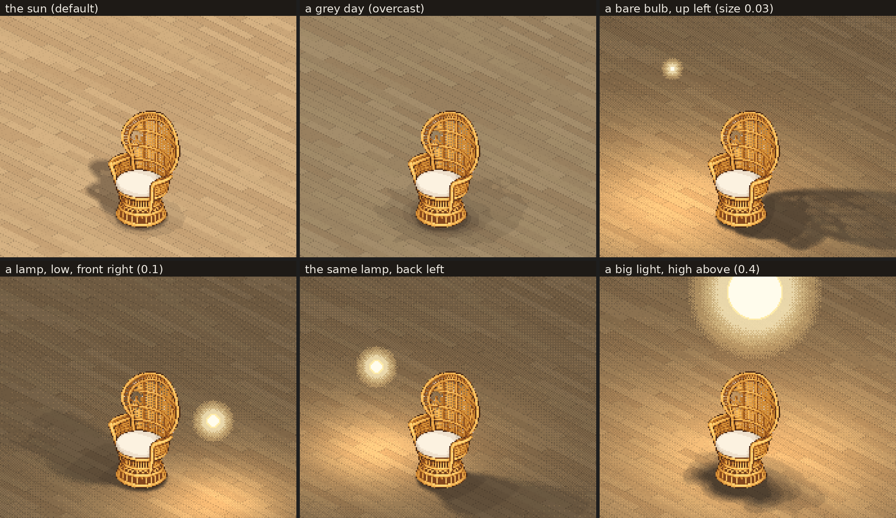 |  |
| **[Shadows baked from the 3D model](docs/guide/pixel-art.md#light-shadow-wind)**: the sun, a grey day, or a lamp you place | **[Wind in the leaves](docs/guide/pixel-art.md#light-shadow-wind)**, bough by bough, from the same model |
| 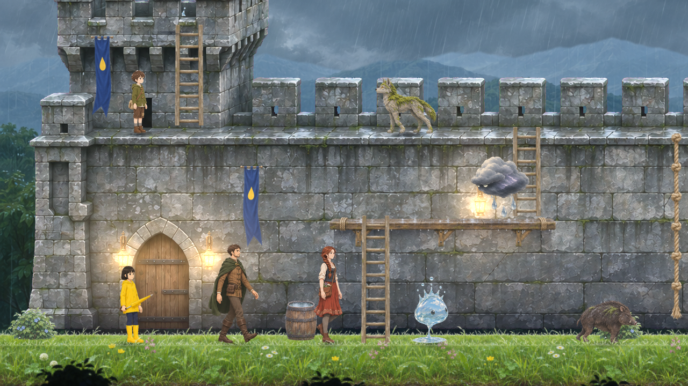 | 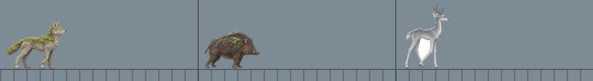 |
| **[A side-scrolling game](#a-side-scrolling-game-one-facing-and-monsters-drawn-in-2d)**: one facing drawn, the other its mirror | **[Monsters and people drawn in 2D](#a-side-scrolling-game-one-facing-and-monsters-drawn-in-2d)** on a mannequin's walk, no 3D model each |

## Things to ask for

- *"Here's my character (hero.png). Make her walk in 8 directions."*
- *"Add a run and a jump. And a throw - here's a Mixamo clip (Throw.fbx); put a snowball in her hand."*
- *"Our game is pixel art. Make her walk and throw as pixel sprites, about 96 px tall."*
- *"Make her sit, and put her on this armchair."*
- *"Make a shopkeeper NPC, an old man in a brown cardigan, in four directions."* (a posed figure: a description is enough)
- *"Make an isometric bookshelf, 1.8 m tall, full of books, in the cozy style."*
- *"We're making a side-scroller. Make her walk and attack seen from the side."*
- *"Make a wolf, a boar and a town guard for it - no 3D model for each."*

## Why it works

An image model can't keep a body and a pose from one frame to the next. Asked for a walk in words, it gives eight nice drawings
that don't walk:

| GPT alone | SpriteCast |
|---|---|
| the same leg in front in all eight frames | the legs come from a 3D walk |
| the arms twitch at random | the arms swing against the legs |
| the camera at eye level | your game's camera (30° down by default) |
| no shadow | the 3D body's own shadow, frame by frame |

So SpriteCast never asks it to. **3D does the moving; the image model only redraws** each rendered frame in your illustration's
look. Every drawing is fitted back onto its render and checked against it: a frame drawn in another pose is flagged and can be
redrawn, never squeezed to fit. Props work the same way, with blocks at real size in place of the rig - so props made at different
times line up on one floor, all lit by the same light.

## Made with it

Two small games made as examples, each in about a day, with every picture from SpriteCast - to show what you can build with it.

### Rain Girl: isometric pixel art

<p align="center"><a href="https://sunghwan0112.github.io/rain-girl/"></a></p>

<p align="center"><a href="https://sunghwan0112.github.io/rain-girl/"><b>▶ Play it in your browser</b></a> &nbsp;·&nbsp; <a href="https://github.com/Sunghwan0112/rain-girl">the game's code</a><br>No install, no account. Post your score and you are on the board below.</p>

<p align="center"><a href="https://sunghwan0112.github.io/rain-girl/"></a></p>

<p align="center"><i>Rain Girl, a small pixel action game: a girl in a yellow raincoat puts out fire monsters with her umbrella's
water before the forest burns.</i></p>

- **The girl.** One illustration; a Tripo model, rigged and rendered at the game's camera (2:1, 30° down): a walk with her umbrella,
  the swing and standing, in the four diagonal facings (`"facings": 4`), every frame redrawn as 96 px pixel art. The water she throws
  is the swing's effect, rendered in 3D and drawn the same way; the standing loop is `idleclip.py`.
- **The forest.** Seven props - a tree, a half-burnt tree, a burnt tree, a bush, a burnt stump, a rock, mushrooms - each a Tripo model
  rendered from four sides at the girl's scale (74 px a metre: a 2.4 m tree is about 175 px tall) and drawn as pixel art: 28 sprites.
  The game shows each prop from one side at random; a tree that burns goes half-burnt, then burnt, from the side it stood.
- **One light, no shading by hand.** All 28 are lit from the upper right, as their 3D guides were. Below, every side of every prop:

<details><summary>the 28 prop sprites on the game's grass</summary>


</details>

- **The combo.** Two Mixamo moves of one set - a downward cut, a spinning backhand - carried onto her rig, the axe's chop made a
  sword's cut on an arc, the second started from the first's last pose (`motion.py`), drawn as pixel art in four facings, with water
  that fades out at twice her height. Press again during the cut and the backhand follows: a ring round her as wide as it reaches.
- **The effects.** Hits, fires put out, fireballs in flight and on cover, pickups and the backhand's rings are effects from
  [PVFX Foundry](https://nerijs.itch.io/pvfx-foundry) (CC0), which now comes with SpriteCast: 253 of them, `fxpack.py` to find one and
  write it out at your sprites' size and in their colours. A ring round her is cut at its middle - the far half behind her, the near half in front.


<details><summary>32 of the 253 effects that come with SpriteCast</summary>


</details>

- More - one palette, her shade under the trees, the cover that stops a fireball, the wind: [how it was made](docs/guide/rain-girl.md).

### The Castle Wall: a side-scroller

<p align="center"><a href="https://sunghwan0112.github.io/rain-girl-castle-wall/"></a></p>

<p align="center"><a href="https://sunghwan0112.github.io/rain-girl-castle-wall/"><b>▶ Play it in your browser</b></a> &nbsp;·&nbsp; <a href="https://github.com/Sunghwan0112/rain-girl-castle-wall">the game's code, and how each picture was made</a><br>No install, no account. Post your score and you are on the board below.</p>

<p align="center"><a href="https://sunghwan0112.github.io/rain-girl-castle-wall/"></a></p>

The same girl in a painted, side-scrolling world: she hunts what the rain has woken on a castle wall, round after round, each
harder than the last. How its pictures were made:

| | how |
|---|---|
| **The heroine** - walk, two cuts with water, a jump, a cut from the air, a ladder, a grab; struck, worn out | her own 3D model seen from the side (`"view": "side"`); the last two drawn in 2D from her standing picture |
| **Five monsters** - a stone wolf, a boar, a stag, a puddle, a storm cloud | one design each, a walk on the mannequin fitted to it, a sheet for being struck (`creature.py`) |
| **Three townspeople** - a guard, a herbalist, a boy | the same, on the bald man, woman and child |
| **The board** - the castle wall, sky, far hills, ground, ladders, ledges | painted in 2D; the wall and the lanterns drawn over their own 3D models, seen as the characters are |

No monster or townsperson has a 3D model of its own - how they were drawn: [A side-scrolling game](#a-side-scrolling-game-one-facing-and-monsters-drawn-in-2d).

## Walking characters


Give it one illustration of a character (facing front, standing straight, no pose) and you get a walk in 8 facings (8 frames each) and 8 standing views, in that
illustration's look. The motion comes from 3D ([why](#why-it-works)):
1. A turnaround is drawn from the illustration.
2. [Tripo](https://www.tripo3d.ai) makes the 3D model from it, rigs it and gives it a walk and an idle.
3. The walk is rendered with the game's camera (free), each frame with the 3D body's own shadow, pressed flat onto the ground
   along the light.
4. The image model draws over the renders, 4 frames a call. The front is drawn first and every other facing follows it, so it
   stays the same person.
5. Every frame is fitted back onto its render, the head sizes steadied and the edges cleaned. You get strips, a shadow per frame
   (the feet touch it, a lifted foot casts its own) and an anchor.

```
$PYTHON skills/spritecast/scripts/charpipe.py turnaround hero.json --yes   # then 3d (model, rig, renders) and draw (then finish, preview by themselves)
```
All eight facings are drawn by default. A design that is the same on both sides can set `"mirror": true` to flip the west facings
from the east ones (each keeping its own shadow): about $0.66 less, ~$1.4 of drawing instead of $2.1.
Or `"facings": 4`: the four diagonals only (south-east, south-west, north-east, north-west), about half the drawing (a walk ~$1 instead of ~$2; pixel art ~$0.7 instead of ~$1.35) - or `"facings": "cardinal"`: south, east, north and west only, for a game that moves up, down, left and right. Either way the character still walks in all eight directions: the exported character shows the nearest of them for any of the eight, keeping the one shown last between two, so walking straight across does not flicker.

With your own rigged GLB (`"rig_glb"`), skip to `render`. What a character costs: [the table at the top](#cost).
More options (several outfits, the preview video, Meshy, the example character with her rig): [docs/guide/characters.md](docs/guide/characters.md#walking-characters).

### Four-legged animals

Tripo's rig for four-legged animals walks badly (no backbone, the shoulders hung off the neck), so an animal gets no bought rig.
With `"kind": "animal"` the 3D model alone (Tripo, ~30 credits) is enough: its skeleton is found from the mesh (the feet, the
back, the head, the tail, and which way it faces), it walks in a cat's or a dog's gait, and it gets the same drawing, fitting and
3D shadows as a person.

The turnaround is drawn on all four legs, each leg clear of the others, the tail out behind; clothes only snug ones (a knit vest, not a
cape or a scarf - anything hanging moves with the nearest leg). Check the renders before drawing: four legs, the head forward, the tail
behind. If Tripo's model grows an extra leg, make it again or use Meshy (`"modeler": "meshy"`).

<details><summary>an orange tabby in a yellow raincoat walking in 8 facings</summary>


</details>

The cat is in [`examples/tabby_cat`](examples/tabby_cat): an orange tabby in a little yellow raincoat (the girl's), its design,
turnaround, spec, strips, shadows and sheet - 30 Tripo credits and about $2.5 of drawing, redraws and design tries included. Its
frames fit their renders at 0.76-0.97 (north-east and north-west mixed frame by frame with `"mix"`, see reference/character.md).

### A side-scrolling game: one facing, and monsters drawn in 2D

For a platformer or a side-view RPG, `"view": "side"` puts the camera level, straight from the side. ONE facing is drawn - walking
right - and the other is its mirror: a walk and the standing view are 3 sheets (~$0.33) where eight facings take 18. The body is
turned 45° toward the viewer by default, so both eyes show and a swing across the body is not hidden behind it (`"turn": 0` for a
strict profile). Actions work as before:
a cut with its water, a jump (`"air"`), a ladder climbed with her back to us (`"face": "away"`).

**Monsters, animals and townspeople need no 3D model each.** `creature.py` draws one design in the look of a picture of your game,
then its walk on the poses of a plain **mannequin** that comes with SpriteCast - a grey dog, or a bald man, woman or child, the
near limbs red and the far ones blue - and anything else it does (struck, falling apart, a hop) as a sheet of four moments said in
words. About $0.06 a picture.

- **A four-legged creature.** The dog mannequin is first stretched to the design's own leg length, body depth and neck (free).
  Drawn on the dog as it was, a boar and a stag both came out with a dog's legs; fitted, each kept its build. A stone wolf's 8
  frames came out within 3 px of the mannequin's places.
- **A person.** The design is drawn standing as the mannequin stands, then walking on its poses. A cloaked guard and a herbalist
  in a skirt kept their buckles, keys and braid through all 8 frames.
- **In the game** the walk's frame is read off the distance walked (`step` px a whole step), so paws and feet do not slide.

<details><summary>a boar and a stag: the design, the walk drawn on the dog as it was, and on the dog given their proportions</summary>

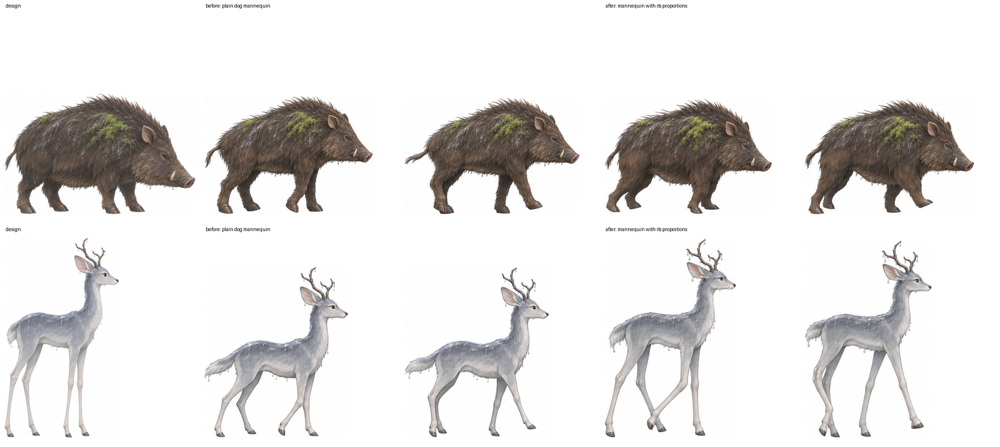


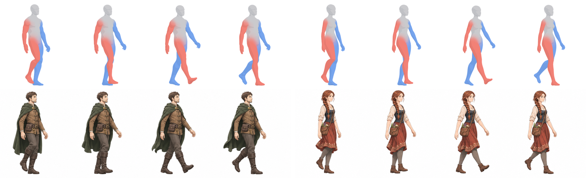

</details>

What stands with its legs out to the sides (a lizard, a spider) has no mannequin yet: a salamander came out standing on dog legs.
The game's main character, with many actions and a thing in her hand, is still made from her own 3D model. Details:
[reference/creature.md](skills/spritecast/reference/creature.md).

**Scenery seen from the side is drawn over a 3D model too.** The castle wall behind them is a prop: a Tripo model made from words,
rendered level from the side (`"camera": {"pitch": 6, "yaw": 90}`) and lit, then drawn over. Drawn over grey blocks seen from 12°
above, its tops were wide floors - seen from above beside characters seen from the side; over grey blocks at 6° it came out flat (a
guide with no light gives the image model nothing to model the stone by). From its own lit model it has the corbels, the merlons'
sides and their shadows.

### More actions: run, jump, slash

Beside the walk, a character can run, jump or swing something. List them in the spec, `"actions": ["run", "jump", {"name": "slash",
"hold": "umbrella"}]`: the rig gets those animations from Tripo (about 10 credits each; run, jump, slash, shoot, dive, climb, fall,
hurt and turn are there), and each is rendered, drawn and finished in 8 facings like the walk, into its own strips with a shadow per
frame. A slash needs something in the hand: `"hold"` builds it from simple shapes and puts it in the hand, so it moves with
every frame (an umbrella, a pistol or a water pistol for now; the right hand, or `"hand": "left"`). With your own rigged model, any clip in it can be an action. A held thing is described to the
image model part by part - most carefully the end at the hand (the handle, the first stretch of the shaft), which is small and against
the body and is where it guesses otherwise.

**Which to use: Tripo to save time, Mixamo when the result matters.** Tripo gives the moves in one step, with nothing to download - and a walk, a run, a jump (nothing in the hands) come out fine from it. When the result matters more than the time, we recommend [Mixamo](https://www.mixamo.com/#/?page=1&query=melee&type=Motion%2CMotionPack) (free, with an Adobe account), attacks above all: motion-captured moves look more natural, there are thousands, and the attacks of one set start and end in the same stance, so they join into combos (`motion.py link`). It takes a little longer: download one (FBX Binary, 30 fps, Without Skin) and `addclip.py hero.json Move.fbx name` carries it onto the character's rig, free. The catch: Mixamo has no API, so SpriteCast cannot fetch from it - you go to the site, look through the moves and download them yourself; Claude gives you the search link. Never put the FBX files in a public repository.


**Most of it comes out in one go.** The rain girl's walk, run and jump fit their 3D renders at 0.78 or better in every frame, all
drawn once. The umbrella slash is harder (a thin thing that swings round the body): a weapon drawn in the wrong place is redrawn by
itself, and what is left fits a little looser where she bends deep - a pose drawn a touch more upright, which reads fine in motion.
Those frames are listed for you to look at; keep them or redraw them.

**Something carried all the time, in either hand** (you asked). Put `"hold"` in the spec itself instead of in one action -
`"hold": {"kind": "watergun", "hand": "left"}` - and the character has it through the walk, the standing views and every action.
Below, a water pistol in the left hand: the 3D guide above, the drawn frames under it.

<details><summary>a water pistol carried in the left hand</summary>


</details>

- **It stays in that hand.** A character with a thing in one hand is not the same on both sides, so no frame is ever made by
  flipping another - flipped, the thing would change hands. (`"mirror": "never"` asks for the same for any character that is not
  symmetrical: an eye patch, one sleeve.) Each sheet is told which hand and where its render has the thing, and afterwards every
  frame is checked against its render: of the 24 frames above, one was named for you to look at.
- **The hand closes on the handle.** A rig's fingers are out straight, and a drawing over that has an open hand beside a floating
  gun. So the guide bends the holding hand itself: the handle goes into the fist, the four fingers come round one side of it and
  the thumb round the other, each finger bent only until it touches. A thick handle gets a looser hand; one too thick to get a
  hand round is made thinner.
- **Look at the hand before anything is drawn.** In a frame the grip is a few pixels, so the free `render` step also saves the hand
  from all round, close up (`render/hand-walk.png`), and prints how far each fingertip is off the handle. Fix it there, at no cost.
- A thing that is already part of your own rigged model: `"hold": {"in_model": true, "words": "In the LEFT hand: a black pistol."}`.

The example above cost about $0.7 to draw (8 sheets: the walk from three sides and the run from one).

<details>
<summary><b>Other sizes: 512, 64 and 32 px from the same drawings</b></summary>

**Any size you need** (you asked): frames come out 256 px tall, and `charpipe.py pack CHAR.json --px 64` makes another set at
any height from the same drawings - larger than 256 stays sharp too, the frames are kept at the drawings' own detail - strips, shadows and `character.json` at that size, in `out-64px/`, with
nothing redrawn and `out/` left as it is (`"frame_px"` in the spec sets the default). Below, 512, 256 (the default), 64 and 32 px tall, each shown at the same size (enlarged pixel for pixel). At 64 the hair, raincoat,
boots and umbrella all read; at 32 the pose and colours hold, but the face is mostly gone - a plain resize, nothing made for that size
yet (see the [Roadmap](#roadmap)).

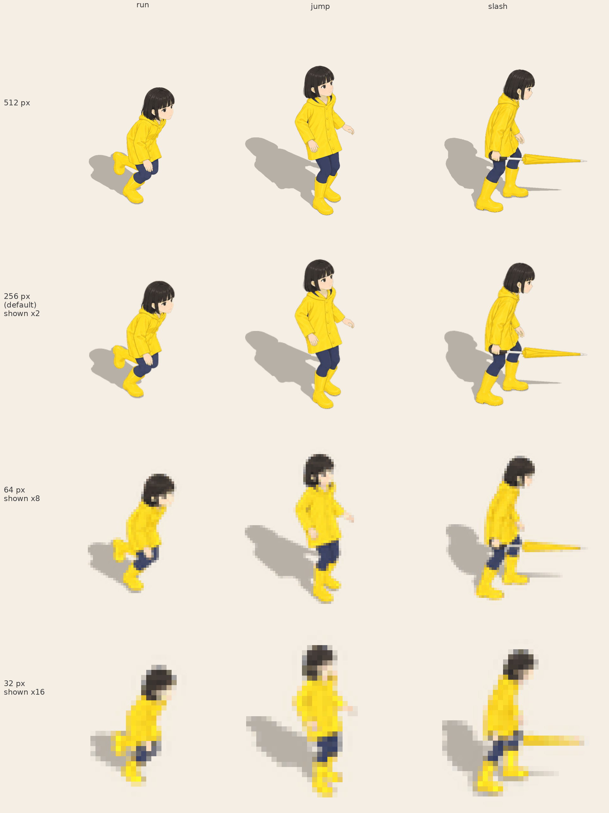

</details>

### Effects on a swing: water, fire, leaves

A swing can leave something in the air. Add `"trail"` to the action - `{"name": "slash", "hold": "umbrella", "trail": "water"}` - and
you get the effect as a sprite of its own, laid over the body. **It is free and nothing is drawn again**: the 3D rig knows where the
umbrella's tip is at every moment, so the effect is worked out from that path. A slash you already have gets one without touching
its frames.

<details><summary>the rain girl's umbrella slash with eight effects</summary>


</details>

- **It follows the real motion.** An image model asked for a slash invents one arc and repeats it; a stock effect is one shape pasted
  on every swing. Here the band and the pieces come off the path this character's umbrella takes in this action, seen from each
  of the 8 facings, and the body and the umbrella hide the part that passes behind them. Change the motion and the effect changes.
- **Eleven looks**: `plain`, `wind`, `water`, `fire`, `drops`, `flames`, `leaves`, `greenleaves`, `petals`, `snow`, `sparkle`. Colours,
  amounts and speeds can be changed, a new look is one more entry in a file, and you can give your own little pictures to be
  scattered (`"image": "mine.png"`).
- **Pieces fly on from frame to frame.** A leaf is let go once, is carried a little by the swing, turns, sways and settles on the
  ground - the same leaf in every frame, not a new scatter each time.
- **Water and fire move as one body** (you asked). Water comes off as a sheet, stretches into strings, breaks into drops and leaves
  mist; flame is white-yellow at its heart, orange, then a red rim that darkens as it cools, with ash drifting up.
- **Water looks like water.** Thin water is pale and see-through, deep water darker, with a bright rim and a highlight from the
  same light as the character; fast drops are drawn long along their way, and a few burst on the floor in a ring and a splash.
- **Only the swing itself.** Nothing comes off while the umbrella is being raised: the fast stretch of the motion is found by itself.
- **More frames than the body.** The body is drawn 8 times, but water has 24 effect frames (three to each) and fire 16 (two), played
  faster over them - at 8 the sheet was whole in one frame and already drops in the next. They sit around each body frame
  (a third of a frame before it, on it, a third after), so the water stays with the drawn umbrella instead of running ahead of it.
- **In pixel art too**, at the sprite's size: solid things keep hard edges, mist stays see-through.


A combo in pixel art - Rain Girl's downward cut and spinning backhand in four facings, with their water and the backhand's ring (`motion.py`, `fxpack.py`; the two Mixamo moves: "Rain Girl's combo as a preset" under [Pixel art](#pixel-art-arcade-size)):


**Honestly:** these are worked out, not painted, so they are clean rather than hand-drawn. The path
is the held thing's, so an action needs something in the hand. Made and looked at on the umbrella slash only.

### Joining two animations: into a swing and back out

A walk does not end in an attack's first pose, and an attack does not end in the walk's: played one after the other, the body jumps.
The 3D rig makes the frames between (you asked): `{"name": "ready", "between": ["walk", "slash"], "frames": 3}` and
`{"name": "recover", "between": ["slash:end", "walk"], "frames": 4}`. Below, all drawn: she walks with her umbrella, goes down into
the stance (3 frames from the rig), swings with the water effect, comes back up (4 more) and walks on.

<details><summary>the rain girl walking with her umbrella, going down into a stance, swi…</summary>


</details>

- **How.** The rig plays both animations at once, each stopped at one moment, and goes from the one to the other, easing in and
  out. `"slash:end"` starts from an attack's last pose instead of its first.
- **Free to render, drawn like any action** - one sheet for three or four frames, about $0.08.
- **Look at them joined**: `charpipe.py loop hero.json --only walk,ready,slash,recover --facing south-east` (free) makes a GIF like the
  one above from the finished frames, so a frame that jumps is seen before anything is drawn again. A pixel set
  can be fixed that way too, all the frames end to end in the [pixel editor](#pixel-art-arcade-size) (`--join`).
- **One frame wrong? Draw it alone.** `charpipe.py frame hero.json --only slash --facing south-east --frame 5 --yes` (~$0.08) draws
  just that frame again; `"frame_words"` in the action tells the image model what that frame's render cannot. Frame 5 above had the
  left fist floating over the umbrella five times running; told the hand is mostly hidden behind her head, it came out right.
- **The thing in the hand stays in the hand.** For it to be there in the walk too, the walk carries it (here an action on the walk's
  clip with the umbrella); otherwise it would appear from nowhere in the first in-between.

### Pixel art (arcade size)

<details><summary>five facings of the rain girl throwing a snowball, each ball flying it…</summary>


</details>

For a game drawn in pixels - a belt-scroller, a fighter, an arcade platformer - the same character as real pixel art, about 100 px
tall: one colour a pixel, a palette of about 40, a dark outline, no blur, and each frame's 3D shadow. Not a resize of the painted
frames: the order is the other way round.


The 3D render is pixelized into a guide, the image model redraws it as pixel art, and the drawing is **read back on the grid the
model drew it on** - the head on grid lines of its own, so the eyes and mouth survive - then sized and placed by the render.

```
$PYTHON skills/spritecast/scripts/pixelart.py hero.json                        # the plan and its cost - spends nothing
$PYTHON skills/spritecast/scripts/pixelart.py hero.json --clips walk,throw --yes
```
About $0.075 a sheet: a walk in all eight facings is 18 sheets (about $1.35); the throw above, five facings, was 14.

**How many frames go on a sheet is worked out, not chosen:** `pixelart.py` measures the renders and fits as many as have room - four for a walk, two when something is held, one for a long swing (so an attack costs more than a walk); the plan shows it before anything is spent.

- **Things held and thrown.** `"hold": {"kind": "snowball", "until": "auto"}` puts it in the hand and lets it go when the hand
  moves fastest. `pixel.json` then says which frame, where in the frame, which way and how fast - enough for your engine to spawn
  the projectile - and you get the ball, its flight shape and a 4-frame burst. The picture above is that data played back.
- **Any Mixamo animation**, carried onto the rig as under [More actions](#more-actions-run-jump-slash): the throw above came in
  with `addclip.py hero.json Throw.fbx throw`.
- **Combos that join.** `motion.py` links one attack to the next the way games do - the second starts from the pose the first ends in, its
  stroke untouched - puts carried feet back on the ground, and turns an axe chop into a sword cut on an arc. Free, on the rig - [the recipe, Mixamo to the game](skills/spritecast/reference/character.md).
- **Rain Girl's combo as a preset.** Download the two Mixamo moves yourself, with the settings under [More actions](#more-actions-run-jump-slash)
  and no keyframe reduction:
  [Standing Melee Attack Downward](https://www.mixamo.com/#/?page=1&query=Standing+Melee+Attack+Downward&type=Motion%2CMotionPack) and [Standing Melee Attack Backhand](https://www.mixamo.com/#/?page=1&query=Standing+Melee+Attack+Backhand&type=Motion%2CMotionPack).
  `motion.py preset hero.json rain-girl-combo` makes the same changes to them and puts the two actions in
  the spec. The preset keeps only the changes, never the moves - [what was changed](docs/guide/pixel-art.md#pixel-art-arcade-size).
- **It reviews itself.** Every frame is checked against its render (the pose, the held thing); `--redraw` draws the marked sheets
  again and keeps the better drawing. The throw's 40 frames all passed after one redraw.
- **Then a pixel editor for the last bit.** Pixel art is not all to be had by rule. `pixeledit.py hero.json` opens every frame in
  the browser: magic-erase a patch of left-over white, pencil, change a colour, move a selection, copy a good face into the other
  frames. Add any colour to the palette; and the frames themselves can be copied (an in-between to draw on - 8 frames made 9),
  deleted and moved: the shadow and the game's data follow. The edits are kept and laid on again by every later build.
  Animations played one after another can be opened as one, to play the whole loop and fix it where it jumps:
  `pixeledit.py hero.json --join walk,ready,slash,recover --facing south-east`.

<details><summary>the pixel editor</summary>


</details>

And the 3D render the frame was drawn from can be shown beside it (key `3`) or faint under it - so you can see what a doubtful
pixel is meant to be before you touch it:

<details><summary>the pixel editor with a 64 px character about to throw a snowball, see…</summary>

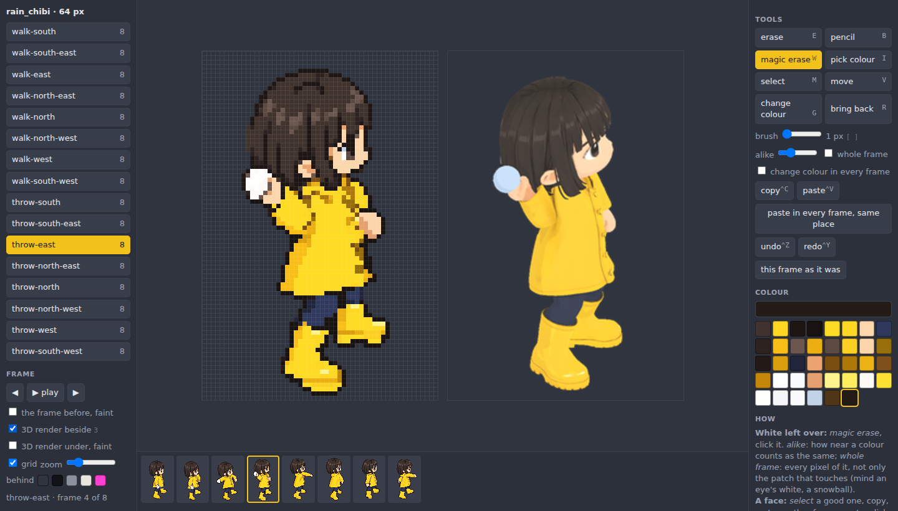

</details>

How much is left to the hand: very little. For the 40 throw frames, about 6 minutes of AI drawing and 2 of AI cut-out; then the only
hand work was the magic eraser - a click on each speck of left-over white, in 10 of the 40 frames (131 pixels, 0.15 % of the
sprites). No face was touched: they are as the pipeline made them. The build prints those numbers every time.

**A harder set, and what the hand did.** With something held - a weapon, an umbrella - its details need a little fixing by hand:
a few pixels a frame, with an eraser and a pencil, no drawing skill. The same loop as the one under "Joining two animations", in pixel
art - four animations joined, 23 frames.
Only the umbrella was fixed by hand: its tip and edge made the same from frame to frame. The character was not; a few left-over white
specks were erased, nothing more. In all 1,196 pixels of 51,442 (2.3 %), by someone who does not draw, in a few minutes. What made it quick, and what matters most in pixel art: looking at all 23 frames in a row, playing, not one at a time - a fix is
making sure no part's pixels change a lot from one frame to the next. Not fixed: in two walk frames
the umbrella is drawn a little off the 3D one's angle and length.


- **The editor shows where the 3D has things** (key `4`): the held thing in red and the body's outline in blue, over the frame you
  are drawing - so an umbrella drawn too long or at the wrong angle is seen at once.

<details><summary>the pixel editor with the 3D umbrella laid in red and the 3D body's ou…</summary>


</details>

**How many colours.** A set comes out with about 40 colours. `--colours 16` gives it 16 at most (8 is the least), and
`--palette` gives every pixel its nearest colour in a set palette: one of the 15 that come with the skill, by name
(`--palette pico8`; `--palette list` shows them), or your own file in what Aseprite reads - `.png` `.gif` `.bmp` `.pcx`, `.hex`
(Lospec), `.gpl`, `.pal`, `.act`, `.col`, `.aseprite`. Both are free: nothing is drawn again, the same drawings are read with
another palette. Props take the same two options. Down to 16 the character holds up well; at 8 close colours merge (her navy legs
go black), and a palette with nothing near one of her colours will change that colour - look at the result before you keep it.

<details><summary>the same three sprites with the default 43 colours, with --colours 32,…</summary>

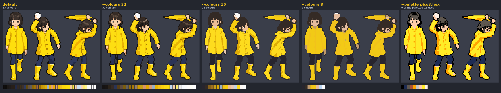

</details>

The palettes that come with it, on the same two sprites - a yellow coat needs a yellow in the palette (`c64`, `gameboy`,
`slso8` and `sweetie16` have none):

<details><summary>the rain girl and the ramen cart in each of the 15 palettes</summary>


</details>

*The palettes are their authors': AAP-64 by Adigun A. Polack, Apollo by AdamCYounis, DawnBringer 16/32 by DawnBringer, Endesga 32/64
by ENDESGA, Resurrect 64 by Kerrie Lake, SLSO8 by Luis Miguel Maldonado, Sweetie 16 by GrafxKid - taken from
[Lospec](https://lospec.com/palette-list).*

**Sizes.** 96 px is the size for a character of ordinary proportions. **64 px works for a character designed small** - about three
heads tall, with its own 3D model - and comes out about 70 px. Under that, the image model is never asked: it does not keep to so
few squares (32 px was tried four ways). `--px 32` draws at 64 and makes the 32 set from it, free - the same motion and frames, with
rougher faces. 64 is the one that comes out well.

<details><summary>the small character walking and throwing in eight facings at 64 px, an…</summary>

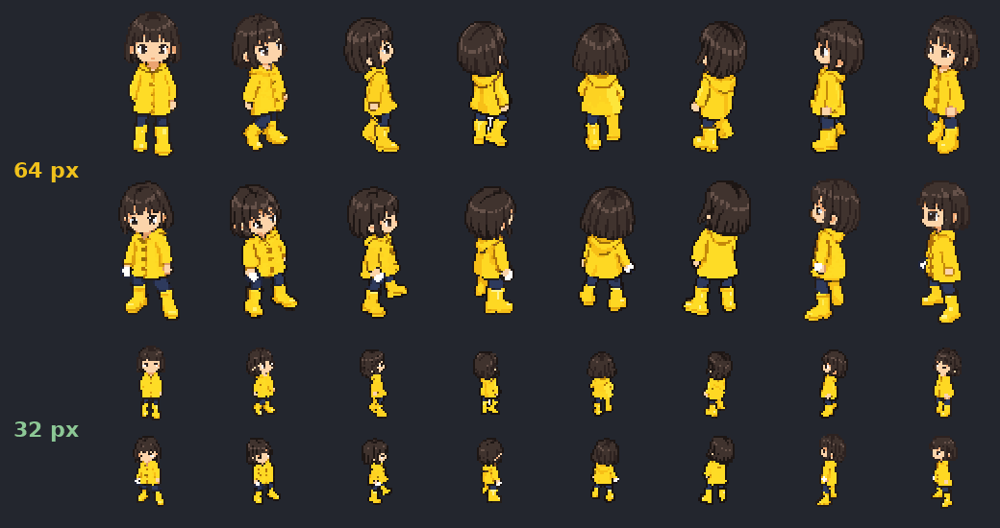

</details>

Both sets are in [`examples/rain_chibi`](examples/rain_chibi): the three-heads design drawn from the rain girl, its turnaround, the
spec, `pixel64/` (walk and throw in eight facings, 128 frames, each with its shadow; no pixel was touched by hand) and `pixel32/` made from it. Her throw is a Mixamo clip put on with `addclip.py --clear-head 55`; the clip and the
rig are not in the repo.

<details><summary>the same small character five ways</summary>


</details>

**Why not ask for 32 px?** The image model (GPT) draws its "pixels" at a size of its
own - asked for 8-px squares it drew anything from 7.4 to 10.8 - and at 32 squares one square off is an eye gone. Above: the top row
is what it draws at 64; the three red rows are 32 px asked for directly, each a different sheet layout, all of the same walk; the
green row is the 32 set made from the 64 one. The details: [reference/pixel.md](skills/spritecast/reference/pixel.md).

The sprites above are in [`examples/rain_girl/pixel`](examples/rain_girl/pixel): the throw in five facings, a walk in two and the
umbrella slash as strips, their shadows, the snowball with its flight shape and burst, and `pixel.json` with the release data.

### Pixel-art props: any object, any side

<details><summary>a ramen street cart as a 3D model from four sides, and the same four s…</summary>


</details>

The same way round as a character, for a thing: its 3D guide is pixelized, the image model redraws it as pixel art on the same grid,
and the drawing is read back on that grid and brought to the guide's size. The angle is the camera's, so a thing turned four ways is
four sprites of ONE thing - the same roof, the same wheels, each side with what belongs on it.

```
$PYTHON skills/spritecast/scripts/isoprop.py model cart.json --yes    # Tripo makes the 3D model from the description (~20 credits)
$PYTHON skills/spritecast/scripts/isoprop.py render cart.json         # free: the guide from each side ("views": [0, 90, 180, 270])
$PYTHON skills/spritecast/scripts/proppixel.py cart.json --yes        # ~$0.08 a side → out-pixel/sprite-<side>.png
```

- **A real 3D model is what makes the sides come out right.** From blocks alone the image model cannot tell which face has what on it:
  an arcade cabinet came out with its screen on the wrong face in one view of four. The cart above is a Tripo model; all four sides
  matched it on the first drawing. One view of a simple thing (a chair, a crate) is fine from blocks.
- **The same scale as the character.** `--ppm` is pixels per metre: the pixel character's height in pixels over its height in metres
  (54 for the small example character), so the prop and the character stand on one floor in the same size of pixel.
- **The cut-out is yours to finish.** The air under a roof and between spokes is cleared by the AI cut-out; what it leaves, open in the
  same pixel editor as the characters (`pixeledit.py cart.json`), the four sides as four frames. The cart above had 122 pixels finished that way.
- The cart is in [`examples/ramen_cart`](examples/ramen_cart): the spec, the Tripo model, the four guides
  and the four sprites.

<a name="light-shadow-wind"></a>
### Light, shadow and wind from the 3D model

The model that gave a prop its sides also knows where its light is blocked and where its boughs are. So its shadow, a lamp's light
on the floor and the wind in its leaves are worked out from it - free, on your computer, with no drawing.

- **Its shadow, baked from its 3D model** (free, a few seconds, done by itself): the sun's light and the sky's on the ground, each
  as much as the thing leaves open - so it is deep close by (under the cart, round a trunk's foot) and paler where it falls
  from high up (a crown's, the light coming through between its leaves), in five steps of pixel art. The sun is the guide's own light, so the shade drawn on the prop and the shadow
  on the ground agree. `--shadow overcast` (or `"shadow": "overcast"` in the spec) for a grey day: no sun, only the soft dark round it.
  `out-pixel/shadow-<side>.png` and where it sits in `pixel.json`; draw it under the sprite.


- **How deep the shadow is** (free): `"shadow_strength"` in the spec, or `--shadow-strength` - the shadow as if laid that many times
  over itself. As the light gives it (1) a shadow is right but quiet: on dark ground it is lost, and the sprite seems to float over the
  ground instead of standing on it. Pixel art says things a little louder than they are, so **pixel sprites get 1.5 by default**, props
  and characters alike (71 % at its deepest instead of 56 %). On a light floor where that looks heavy ask for 1; on very dark ground, 2.
  The light editor has a slider for it.

<details><summary>the same tree and the rain girl with their shadows at strength 1, 1.5 …</summary>


</details>

- **Indoors, a lamp where you put it.** `--lamp -1,2.4,-0.2 --lamp-size 0.03` (metres from the prop's foot: right, up, towards the
  viewer; the lamp's own size) - the shadow falls away from it, longer the lower it hangs, sharp from a bare bulb and soft from a big
  shade, and fades as its light does across the floor. Its light on the floor comes too - `light-<side>.png`, brightest under it, the
  thing's shadow cut out, dithered in steps - to lay on the floor with ADD - and the lamp itself as pixel art (`lamp.png`) with where it is in each side's
  pixels in `pixel.json`, so a game draws the floor, its light, the shadow, the prop and the lamp right where the editor showed them. Leave it out and the sun is used. **See-through parts** (a wicker weave, leaves,
  a net) are painted on a model, not cut: `"see_through": [{"colour": "#c8955a", "open": 0.35}]` lets the parts of that colour pass
  that share of the light. A rattan peacock chair ([`examples/rattan_peacock_chair`](examples/rattan_peacock_chair)) under six lights:

<details><summary>a rattan peacock chair as pixel art under the sun, on a grey day, unde…</summary>


</details>

- **Move the light yourself**: `lightedit.py PROP.json` opens a page on your computer: drag the lamp across the floor, lift it with
  the wheel, size it - the shadow and the lamp's light on the floor are redrawn as you go; Save bakes every side with it and keeps it in the spec.
  **Your own lamp**: load a picture of it (a cut-out PNG at the prop's scale), click where its light comes from - it stands where you
  drag it, in front of or behind the prop as it should, and its light comes from there. The shadow, the glow and the floor's light come
  as pixel art (steps, dithered) or smooth (gradients, for a game in another style: `"light_style": "smooth"`). Below: a pixel floor lamp (`examples/lamps/floor_lamp/out-pixel/sprite.png`) in front, behind, and smooth.


<details><summary>a pixel-art floor lamp moved round the rattan chair in the light editor</summary>


</details>

- **The wind in it, from its 3D model** (`"sway": "leaves"` in the spec, or `propshade.py PROP.json --sway leaves`; free): a crown is
  boughs, not one sheet. Each leaf pixel takes the model's point it shows, the points are grouped by where they are in 3D - the near
  boughs apart from those behind them - and every clump moves whole, a pixel at a time, far ones laid first; the trunk stands. No
  warping, no hand-drawn frames. You get `sway-<side>.png` (12 frames x still air / breeze / gust - play a row as a loop),
  `clumps-<side>.png` with each clump's place in 3D to move them yourself, and `preview-sway.gif`. The tree is in
  [`examples/forest_tree`](examples/forest_tree); its leaves also let light through its shadow.


- **Where it is in the way, from the same model** (free, baked with the shadow): `solid-<side>.png` is where a walker cannot stand -
  the prop's footprint, cut from the model near the ground (a trunk's foot, a table by its four legs) - and `"collide": {"cover": [0.55]}`
  adds what stops a thing flying at that height: a trunk stops a fireball, the crown above it does not. Each comes with its place and
  an outline for a collision polygon. And **a character darkens in its shade**: every shadow says how to read it for a point above the
  ground, so her feet, middle and head each take what stands between them and the sun.
- **Into your engine**: `export.py PROP/out-pixel` writes a Phaser 3 module and a Godot 4 scene - the shadow, a lamp's light, the wind,
  the footprint as a collision polygon, and `shade()` / `cover()` to ask (opened and checked in Phaser 3.90 and Godot 4.7; Unity and
  Aseprite are for characters only so far). A small thing sways too: mushrooms nod at the cap (`"sway": "caps"`,
  [`examples/forest_mushrooms`](examples/forest_mushrooms)).

<details><summary>two pixel-art trees and three patches of mushrooms exported to Phaser,…</summary>


</details>

### See-through things and creatures that move

A flame, a ghost, a drop of water should let the ground show through - more at a thin tip than in the thick of it. With `"translucent":
"fire" | "ghost" | "water"` in a prop's spec, each pixel's alpha comes from **how thick its own 3D model is there** (a ray through it,
light passing as through a medium), in a few fixed steps so it stays pixel art; eyes and a mouth keep the most. A `"pulse"` lets the
thin parts fade now and then over an animation, so a flame wavers instead of blinking. Free.


**Something that moves without a rig** - a ghost's tail, its little arms: `proprig.py` finds a few bones in the model itself (a chain
along the tail, the arms where they stick out of the body) and renders a loop of poses at your camera (free; look at them first);
`propanim.py` draws them as pixel art **four frames to a sheet**, so they match (~$0.08 a sheet), and bakes the alpha pose by pose.
Exported to Phaser and Godot like the wind in a tree.

<details><summary>the ghost's loop: the tail sways like a snail's, the arms swing, the thin parts fade now and then</summary>

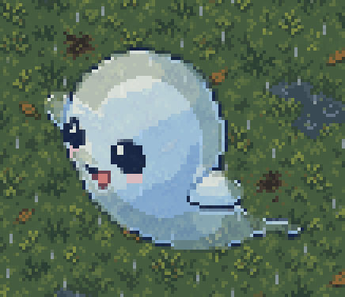

</details>

### The ground: a meadow, a path, puddles

The ground your sprites stand on, at the same camera and in the same light - **free**, nothing drawn by an image model:
`ground.py meadow GROUND.json` plants a meadow of **3D grass, ferns, wildflowers and clover** (they come with the skill: made with Tripo,
MIT) by a Gaussian density - thick patches and thin, not an even carpet - with a path of earth, two wheel ruts and 3D gravel through it,
lights it with the props' sun (every plant's shadow on the others), and turns it into pixel art **in your own sprites' palette**. One
picture of the whole map: no tile, so no repeat and no grid.


- **Feet in the grass.** The plants also come cut into strips by their roots (`ground-front.png` / `.json`): draw a strip over whoever
  stands behind it and your character's feet are in the grass, a tree's foot stands in it ([how, with Phaser code](skills/spritecast/reference/ground.md)).
- `ground.py terrain`: the ground's gentle rise and fall from a 3D height map, lit by the same sun, laid over everything on the ground.
- `ground.py puddles`: five puddles, big to nearly dry (one shape shrinking, so drying is smooth) - a shallow hollow of dark water with
  the sky and the trees' shade in it at the camera's angle, and a wet rim.
- `ground.py grass2d`: no 3D - one seamless grass tile's tufts cut out and scattered the same way (a second).
- **Not pixel art?** `"style": "smooth"` in the spec (and `--smooth` for `translucent.py` / `propanim.py`): the same ground, see-through and moving creatures with continuous light, colour and alpha, soft edges - for an illustrated game.

<details><summary>her feet and a tree's foot in the grass; the puddles</summary>

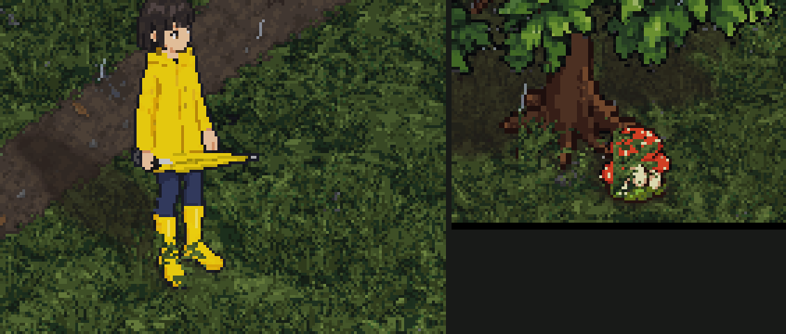

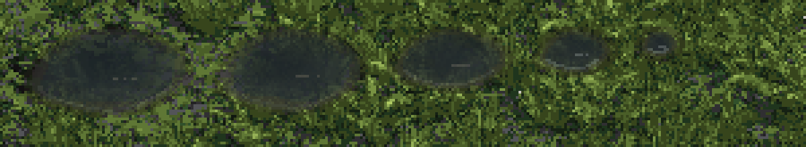

</details>

### Skipping the drawing: the 3D renders as the frames

With `"draw": false` in the spec, no image model draws the frames: the 3D model's own renders (toon-shaded, its own texture) are
the frames, with the same 3D shadows and anchors. The image model draws only the turnaround (~$0.09); with your own rigged GLB
(`"rig_glb"`; an animal: its model, `"model_glb"`) it draws nothing at all. A character then costs the turnaround and the 3D
(75 Tripo credits, an animal 30) - two OKs, done as soon as `3d` is. The trade-off is sharpness: no drawn lines, a simpler face,
the model's texture as it came (blurrier fur and folds).

<details><summary>the same girl and cat walking</summary>

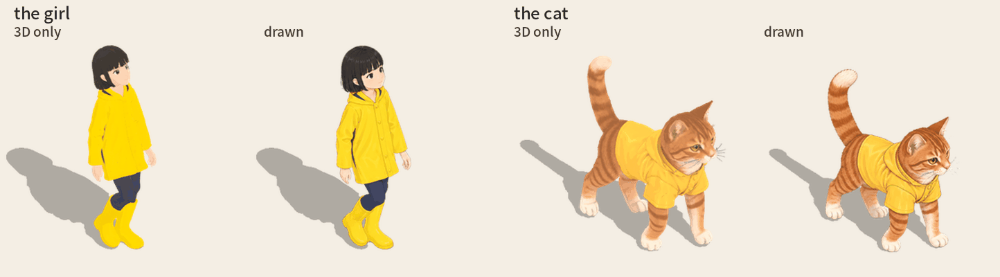

</details>

<details><summary>close-up at the strips' own pixels</summary>

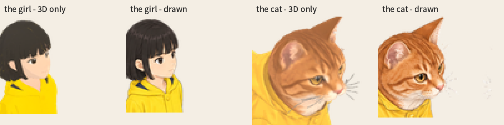

</details>

## Sitting


Once a character walks, ask Claude to *"make her sit"*. Her 3D model is bent into sitting (thighs level, knees bent, hands on the
thighs) in 8 facings for free; you look at those renders, then they are drawn like the standing views (two sheets, about $0.22). She
sits on nothing - your game's chair goes under her. `character.json` gets a `sit` block: for each facing the file, the **seat point**
(put it on the chair's seat; a fraction of the frame, like `anchor`), the seat's height and the shadow. To put her on one of
your props, `seat.py` places her on its seat and works out the prop's **front piece for her** (an armrest, a pew's back, a bench's
backrest) from both of their 3D heights - no painting:

<details><summary>The rain girl seated on ten seats</summary>


</details>

It finds the seat's height and which way it faces, and sits her back until her knees reach the seat's edge. If she sits a little off,
drag her on the touch-up page (below).
The details: [reference/sitting.md](skills/spritecast/reference/sitting.md).

```
$PYTHON skills/spritecast/scripts/charpipe.py sit <name>.json            # free: the seated renders
$PYTHON skills/spritecast/scripts/charpipe.py sit <name>.json --draw     # ~$0.22: drawn and finished
$PYTHON skills/spritecast/scripts/seat.py <prop>.json <name>.json --height 1.3   # free: on a prop, its front piece worked out
```

## Fixing things by hand

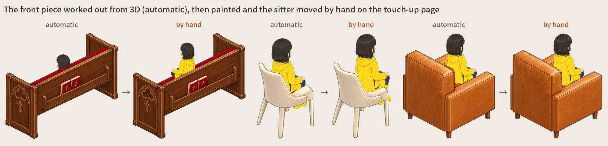

The automatic steps get you most of the way; the last bit is best done by eye. **Painting by hand is more accurate than any of the
automatic steps**: above, the pew's back hid the whole girl until it was painted and she was moved up, and the dining chair's and the
armchair's backs cut her in the wrong places. Cut-outs are not perfect either: a little paper left between an arm and the body, a white
shirt the cut-out took for the paper. Ask Claude to
open the touch-up page (or run `$PYTHON skills/spritecast/scripts/touchup.py <spec>.json`): every finished picture of that prop or
character, painted in the browser and saved as you go.

| colour | does |
|---|---|
| red | clears: made see-through |
| green | brings back: those pixels taken from the drawing itself (turn on "drawing under" to see it) |
| blue (props) | the **front piece**: what stands in front of a character inside the thing - an arch's near posts, a gazebo's roof, a chair's near armrest |
| ⬠ polygon (P) | click the corners and close it (double-click, Enter, or the first corner): filled in the colour you are painting, or erased |
| 🪑 (a seat) | drag the seated character (or the arrow keys); letting go re-makes the seat and its front piece from there |

Then `touchup.py <spec>.json --apply` (a character's strips are packed again). A prop with a front piece gets `sprite-front.png` and
`"front"` in `sprite.json`: draw the sprite behind whoever stands in it and the front piece over them. `finish` lays the paintings on
again by itself; a picture drawn again since it was painted keeps its painting aside instead of laying it on a different drawing.

**Pixel sprites** have an editor of their own, pixel by pixel - see [Pixel art](#pixel-art-arcade-size).

## Props and scenery


Ask an image model for "an isometric armchair" and you get a nice picture at a slightly wrong angle. Ask again and you get a
different wrong angle and a different size. Put ten of them on one floor and nothing lines up.

SpriteCast gives the model a guide that is hard to misread (and when it does misread, you're told):
1. Claude builds the object from simple blocks at its **real size in metres**.
2. The blocks are rendered with your game's **exact camera**.
3. The image model only redraws that guide in your **art style**.
4. The drawing is cut out and **fitted to the guide's box**, so its size and footprint are the guide's; a drawing whose outline
   doesn't follow the guide is flagged, not forced. It also gets a baked shadow and an anchor point for your engine.

The props come out painted (the `cozy` look: smooth shading, fine outlines), or in the style of one picture of your own.

## How a session goes


You describe the prop. Claude asks only for what's missing: the size, the facing, your game's view, your style. It renders the
guide for free and shows it to you. It tells you the cost and waits for your OK. Then you get `sprite.png`, `shadow.png` and
`sprite.json`.

## Examples

All in [`examples/`](examples), each with its spec and the files it produced (the raw drawings as WebP, to keep the repo small).

| | | |
|---|---|---|
|  |  |  |
| `reading_armchair`: 9 blocks: seat, back, arms, legs | `potted_monstera`: a pot, and the plant given as one volume | `arcade_cabinet`: its front faces down-left |

<details><summary>four facings and a top-down view</summary>


</details>
`armchair_four_ways`: `views: [0, 90, 180, 270]`. The later views are drawn with the first one as a reference, so it stays the same
chair. `arcade_cabinet_topdown`: `camera: "topdown"`. `reading_armchair_tripo`: the same armchair from a Tripo model (below).

The examples' 3D models (`reading_armchair_tripo`, and the walking characters' meshes and rigs) were generated with the [Tripo](https://www.tripo3d.ai) API.

## More detail: a 3D model first (Tripo)

<details><summary>blocks vs a Tripo model as the guide</summary>

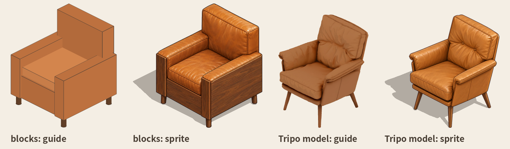

</details>

Blocks are enough when what matters is where things stand and how big they are. For more detail (curved arms, tapered legs, buttons,
carving), let [Tripo](https://www.tripo3d.ai) make a real 3D model from the description first. It is made as tall as the blocks say and
keeps its own proportions (the footprint it then covers is written to `sprite.json`; `"shape": "box"` presses it into the blocks' box
instead), and it becomes the guide. The image model then draws over a real shape, and the 3D
shadow is the model's own.

```
$PYTHON skills/spritecast/scripts/isoprop.py model  armchair.json --yes   # Tripo text-to-model (~20-40 Tripo credits, ~2 min); the spec now uses it
$PYTHON skills/spritecast/scripts/isoprop.py yaws   armchair.json         # free: the model turned four ways; set "model": {"yaw": ...} to the right one
$PYTHON skills/spritecast/scripts/isoprop.py render armchair.json         # then draw, finish as usual
```
Needs `TRIPO_API_KEY`. The blocks stay in the spec as `blocks_draft`.

## Posed characters (from a description)

<details><summary>a mannequin guide and two characters in four facings</summary>

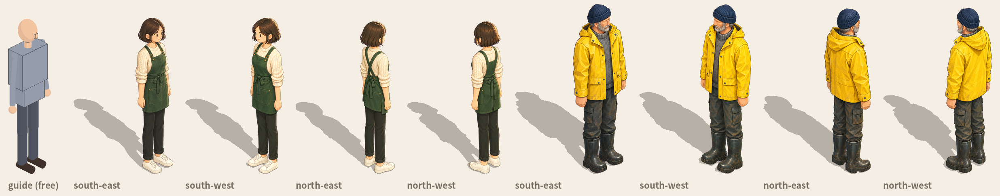

</details>

An NPC that only stands needs no illustration and no rig: it works like a prop. Claude poses a plain mannequin at the person's real height and renders it in each facing (4 or
8). The image model dresses it as you describe. The first facing is drawn first and the others follow it, so it stays the same person.

```json
{ "name": "barista",
  "character": { "body": "woman", "height": 1.63, "build": "slim", "directions": ["south-east", "south-west", "north-east", "north-west"] },
  "description": "a cheerful young café barista: a short dark-brown bob, a cream cable-knit sweater under a forest-green apron, ..." }
```

`"body"` is the plain mannequin that is posed: `"man"`, `"woman"` or `"child"` - three bald figures that come with SpriteCast. (Before 0.29 it was a figure of blocks; the two characters above were drawn on that.)

The anchor is between the feet. About $0.08 for the first facing and $0.09 for each of the others.

<details>
<summary><b>Poses, your own angles, and redrawing one facing</b></summary>

**Poses.** The mannequin has joints. `"pose"` is one of `stand` (default), `wave`, `point`, `hold` (hands together in front: a cup,
a tray, a book), `arms-crossed` or `walk` (mid-stride). Describe what goes with it ("waving hello", "holding a coffee cup"). Or give the angles yourself, and Claude can adjust them
for you ("raise the arm higher") and check them in the free render:

```json
"pose": { "base": "stand", "arm": { "left": [[150, 10], [170, 10]], "right": [[150, 10], [170, 10]] } }
```
Each limb is two parts, upper and lower (`[out, forward]` degrees each): turned out to its side, then swung forward. `left` and
`right` are the figure's own.

A palm can be turned (`"palm": {"left": "front"}` - a wave's open hand faces forward). And an arm cannot pass through the body or the other arm: after the pose is set, whatever overlaps is pushed apart, so crossed arms lie one over the other.


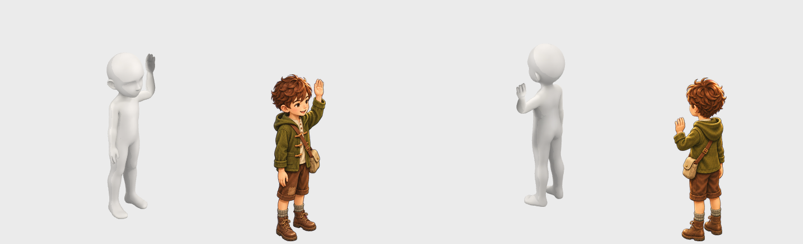

**Single pictures.** These posed figures are one picture per facing; for a walk, see [Walking characters](#walking-characters).
Look at every facing yourself (the outline check can't see a head turned the wrong way); redraw one with
`draw <spec> --yes --again --only north-west`.

</details>

## Shadows that match the drawing

The 3D guide's shadow is right for solid things like furniture. But a drawing has things the blocks don't: hair, a coat's hood,
leaves spilling out of a pot.

<details>
<summary><b>How the shadow is worked out</b></summary>

So SpriteCast also renders a **height map** of the guide: how high above the floor every pixel is. A point h metres up casts its
shadow a fixed step away on screen (h times the light's offset), whatever its depth. So each pixel of the drawing takes the height of
the guide under it, or of the nearest guide pixel for hair or leaves past the guide, and is moved by that step.

The shape is the drawing's. Where it starts is the 3D model's: each foot starts its own shadow, and a pot's shadow starts at its
base. Only what touches the floor has to be exact. Higher up (from 10 % to 35 % of the object's height) the height eases into a
smooth one read off the screen, so hair, hats and leaves cast a natural shadow instead of the guide's hard edges. Where it stands
(the guide up to 12 cm: shoes, a pot's base) the guide's own 3D shadow is added, so the shadow meets the object as a real one
would: on the side away from the light, never in front of it. Posed figures and `loose` things get it; solid props keep the 3D
shadow, and walking characters cast their 3D body's own (above). Choose with `"shadow": "drawn" | "guide"`.

</details>

<details><summary>shadows from the blocks and from the drawing</summary>


</details>

**A walking character's shadow is light as it falls** (since 0.20): the posed 3D body is pressed onto the ground along 16 directions across the sun's disc and 48
across the sky, and what each hides is added up - the same sum as [a prop's baked shadow](#light-shadow-wind). So it is deep where
the feet stand and under the body and pale at its far edge, and it changes with every frame's pose. The strips are shown at
character.json's `shadow_alpha` (0.56); pixel sets get the shadow in five steps. `"shadow": "flat"` in the spec keeps the one hard shape of before.

<details><summary>the rain girl walking, running and jumping over her shadow</summary>


</details>

## Cameras

2:1 isometric (default, 30° down), true isometric, 3/4 top-down, front, or `{"pitch": 40, "yaw": 30}` for your own angle - [the table](docs/guide/props.md#cameras).

## Putting it in your engine

`export.py <name>/out` (free) writes ready-made files for **Godot 4, Unity, Phaser 3 and Aseprite**: the body, its shadow and a
swing's effect, playing by name (`play("walk", "south-east")`). Props export to Phaser and Godot with their shadow, light, wind and
collision. Or read the numbers yourself from `sprite.json` / `character.json`.
**[docs/guide/engines.md](docs/guide/engines.md)** - also how it works step by step, fixes for common errors, and what is sent where.

## Install

In a terminal:
```
claude plugin marketplace add Sunghwan0112/spritecast
claude plugin install spritecast@spritecast
```
or inside Claude Code: `/plugin marketplace add Sunghwan0112/spritecast`, then `/plugin install spritecast@spritecast`.

**You also need** only Python 3.9+ and a browser (Chrome, or Edge - every Windows has it). The first time, Claude runs the setup
check (`doctor.py --fix`): it makes its own venv in `~/.cache/spritecast/` with the few packages (about 10 s), leaves your Python
alone, and tells you what each thing is for. Nothing to install by hand.

| what | for | needed? |
|---|---|---|
| Python 3.9+ | runs the scripts | yes |
| playwright + Chrome or Edge | renders the 3D guide on your computer (free) | yes (set up for you; a browser you have is used) |
| `OPENAI_API_KEY` | drawing | to draw |
| `TRIPO_API_KEY` | a 3D model: a walking character's (with its rig and walk), or a prop's for more detail | for walking characters; not for props from blocks, posed figures or `creature.py` |

**Try it first, free, no key:** ask Claude to *"try SpriteCast"*. It renders one of the examples' guides on your computer and
finishes it with the drawing that came with the example, so you see the whole way before paying for anything.

<details>
<summary><b>Keys: where they go, and OpenAI's verification</b></summary>

Keys: **in the plugin's settings.** When you enable SpriteCast, Claude Code asks for them (`/plugin` → SpriteCast → configure,
to change them later): the OpenAI key, and the Tripo key if you make walking characters - from Tripo's API platform, where API
credits are bought (75 a character, 30 an animal). They are kept in your system's credential store, masked, and handed to
SpriteCast's scripts when a session starts. A key already in your environment still works when the settings have none:

```bash
export OPENAI_API_KEY=sk-...          # macOS / Linux (add it to ~/.zshrc or ~/.bashrc to keep it)
```
```powershell
setx OPENAI_API_KEY "sk-..."          # Windows (then open a new terminal)
```
On Windows the settings reach the scripts only when Claude Code runs its commands in Git Bash (its default when Git is installed); in
PowerShell use the environment. Either way, set or change a key before you start Claude Code: one set while it runs is seen only
after a restart. Your key stays on your computer; it is only sent to OpenAI.

OpenAI may ask you to verify your organisation before a key can use image models (platform.openai.com → Settings →
Organization): do it once before your first drawing.

</details>

<details>
<summary><b>Running the scripts yourself</b></summary>

Claude runs them for you. To run them by hand from a clone of this repo, use the Python that `doctor.py` prints on its last line
(`PYTHON=...`); after `--fix` it is `~/.cache/spritecast/venv/bin/python` (Windows:
`%USERPROFILE%\.cache\spritecast\venv\Scripts\python.exe`). A plain `python` may not have the packages (`No module named ...`):
```bash
python3 skills/spritecast/scripts/doctor.py --fix
PYTHON=$(python3 skills/spritecast/scripts/doctor.py | sed -n 's/^PYTHON=//p')
$PYTHON skills/spritecast/scripts/isoprop.py --help
```
On Windows, in PowerShell:
```powershell
python skills/spritecast/scripts/doctor.py --fix
$PYTHON = "$env:USERPROFILE\.cache\spritecast\venv\Scripts\python.exe"
& $PYTHON skills/spritecast/scripts/isoprop.py --help
```

</details>

Everything runs on your computer except the drawing (OpenAI) and the 3D models (Tripo, or Meshy if you choose it).
[What is sent where, and what is downloaded](docs/guide/engines.md#what-it-sends-and-fetches).

## Roadmap

What is planned next, roughly in this order (no dates - it moves with feedback):
- **Seat-fitted poses, and riding**: a pose shaped to each seat, and characters riding in carts and vehicles.
- **Turning objects**: a vehicle rotated through many angles, so it turns smoothly instead of snapping between 8 facings.
- **Night versions**: a mask of what gives light (windows, bulbs, neon), for your engine to light after dark.
- **Walk-through props, automatic**: the front piece worked out from the 3D guide (today it is painted on the touch-up page).
- **More held things** (a sword, a staff) and effects with no held thing (a kick, a footstep's splash).
- **Small sprites**: the small design made from the ordinary one in one step, and a face at 32 px that needs no hand.
- **Engine exports for pixel sets.**

See [CHANGELOG.md](CHANGELOG.md) for what each version changed.

## Feedback

Feedback decides what comes next, and what changed because of it is marked in the changelog.
- **Something broke**: open an [issue](https://github.com/Sunghwan0112/spritecast/issues/new/choose) with the bug form - your OS, Python version,
  the command and the message help most.
- **An idea or a missing feature**: the feature form in [issues](https://github.com/Sunghwan0112/spritecast/issues/new/choose).
- **Show what you made, or ask how**: [Discussions](https://github.com/Sunghwan0112/spritecast/discussions).

## Notes
- The output is yours.
- Leave real brands, logos and characters from existing games out of descriptions.
- Don't use a living artist's work as your style picture without their permission.
- A `photo` for a character's likeness: only of someone who agreed to it.
- Settings: `SPRITECAST_MODEL` (the default is `gpt-image-2.6-sunburst`; `gpt-image-2.5-sunburst` draws with the one before) and `SPRITECAST_QUALITY` (`low` | `medium` | `high`).

## FAQ
- **What does it cost?** See [what each one costs](#cost), near the top.
- **Which keys do I need?** `OPENAI_API_KEY` to draw, `TRIPO_API_KEY` for walking characters and animals (Meshy optional). Where
  they go, and OpenAI's verification: [Keys](#install).
- **Isn't this AI art?** Yes: an image model does the painting; the size, the camera angle, the walk and the shadows come from 3D
  ([Why it works](#why-it-works)). You can give your own art as the style, or set `"draw": false` so the 3D renders are the frames
  ([Skipping the drawing](docs/guide/characters.md#skipping-the-drawing-the-3d-renders-as-the-frames)).
- **Do I draw pixel art frame by frame?** No. The frames are drawn by the image model from the 3D renders and cleaned up
  automatically; what is left is a few pixels a frame in the [pixel editor](#pixel-art-arcade-size).
- **What doesn't it do?** Walking characters start from an illustration facing front, standing straight. Pixel art works at 96 px,
  and at 64 px for a character designed small; a 32-px set is made from the 64 one, with rougher faces. Look at the results yourself:
  the outline check can't see a head turned the wrong way.
- **Which engine?** Any that takes PNGs: you get the sprite, its shadow and the anchor in JSON, and ready-made files for Godot,
  Unity, Phaser and Aseprite ([engines](docs/guide/engines.md)).

## License
MIT - the code and the examples (pictures, strips and the rain girl's rigged model alike). three.js (bundled in `skills/spritecast/scripts/vendor/three`) is MIT, © three.js authors. The effects in `skills/spritecast/effects/pvfx` are PVFX Foundry by Pixel VFX Studio, CC0 1.0 (its LICENSE.txt there).
