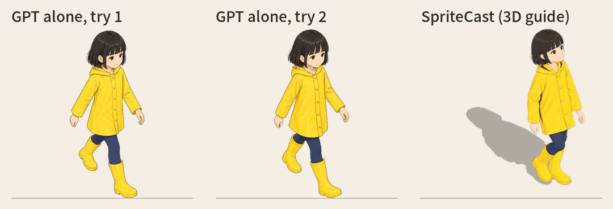
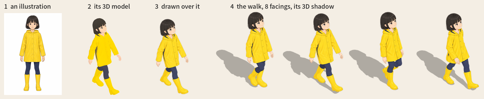
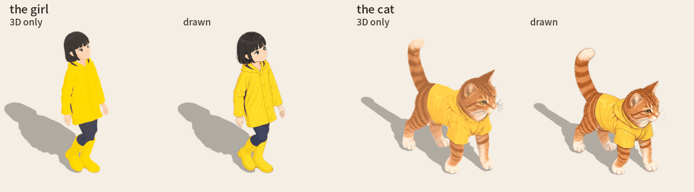
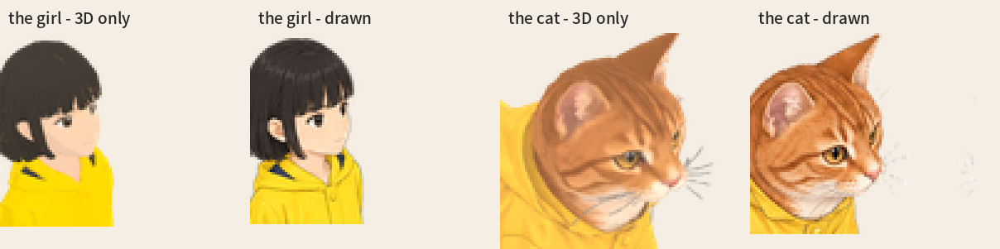

# SpriteCast

**An isometric sprite generator for Claude Code:** game props, characters and 8-direction walks at their real size and your game's camera angle.
An image model (OpenAI's, with your own key) paints them in your art style over a 3D guide; SpriteCast sets the size, the angle,
the walk and the shadows.

Free and MIT. You pay OpenAI (and Tripo, for walking characters) directly: about $0.07 a prop, about $2.2 and 75 Tripo credits a
walking character. To try it free with no key, ask Claude to *"try SpriteCast"*.

[한국어](README.ko.md)



*GPT alone (two tries) against SpriteCast: the same character walking south-east.*

```
claude plugin marketplace add Sunghwan0112/spritecast
claude plugin install spritecast@spritecast
```


## What it does

Ask an image model for "an isometric armchair" and you get a nice picture at a slightly wrong angle. Ask again and you get a
different wrong angle and a different size. Put ten of them on one floor and nothing lines up.

A walking character is worse. At the top is GPT alone (the same model, the same character sheet, the walk asked for frame by frame in
words) against SpriteCast. Each of GPT's frames is a nice drawing, but it doesn't walk: the same leg is in front in all eight frames,
the arms twitch at random instead of swinging against the legs, the camera is at eye level instead of looking down at the game's 30°, and there is no shadow.
Both tries are shown as they came out.

SpriteCast gives the model a guide that is hard to misread (and when it does misread, you're told):
1. Claude builds the object from simple blocks at its **real size in metres**.
2. The blocks are rendered with your game's **exact camera**.
3. The image model only redraws that guide in your **art style**.
4. The drawing is cut out and **fitted to the guide's box**, so its size and footprint are the guide's; a drawing whose outline
   doesn't follow the guide is flagged, not forced. It also gets a baked shadow and an anchor point for your engine.

**What you get from that:**
- **The angle and size are right.** The solid props in the examples land on their guide at 95–99 % outline overlap; the plant,
  drawn loosely on purpose, at 87 %, and the dressed figures at 69–88 % (clothes and hair go past the plain mannequin). Walking
  characters are scored frame by frame (below). The camera and the scale are fixed, so props made at different times line up on one floor.
- **Shadows that look right.** One light shared by every prop, so every shadow falls the same way. Solid props cast the 3D
  guide's own shadow. Posed figures and plants cast a shadow in the drawing's own shape (the hood, the hair, the leaves), placed by
  the 3D model, so a foot or a pot's base starts its shadow where it stands. Walking characters cast their 3D body's own shadow,
  frame by frame. Not a painted blob, not a blocky mannequin.
- **It checks itself.** After drawing, the result is compared with its guide. If the model drew another angle, nothing is squeezed to
  fit: you get a warning, and Claude suggests a fix before drawing again.
- **Your game's view and your style.** 2:1 isometric, true isometric, 3/4 top-down, front or any angle; all four facings of one
  object; the bundled `cozy` style or one picture of your own.

The output is painted (the `cozy` look: smooth shading, fine outlines), not pixel art. For a pixel-art game, give your own style
picture and a `look` that describes it, and expect it to take a few tries.

## How a session goes


You describe the prop. Claude asks only for what's missing: the size, the facing, your game's view, your style. It renders the
guide for free and shows it to you. It tells you the cost and waits for your OK. Then you get `sprite.png`, `shadow.png` and
`sprite.json`.

## Install

In a terminal:
```
claude plugin marketplace add Sunghwan0112/spritecast
claude plugin install spritecast@spritecast
```
or inside Claude Code: `/plugin marketplace add Sunghwan0112/spritecast`, then `/plugin install spritecast@spritecast`.

**You also need** only Python 3.9+ and a browser (Chrome, or Edge - every Windows has it). The first time, Claude runs the setup
check (`doctor.py --fix`): it makes its own venv in `~/.cache/spritecast/` with the few packages (about 10 s), leaves your Python
alone, and tells you what each thing is for. Nothing to install by hand.

**Running the scripts yourself.** Claude runs them for you. To run them by hand from a clone of this repo, use the Python that
`doctor.py` prints on its last line (`PYTHON=...`); after `--fix` it is `~/.cache/spritecast/venv/bin/python` (Windows:
`%USERPROFILE%\.cache\spritecast\venv\Scripts\python.exe`). A plain `python` may not have the packages (`No module named ...`). The commands below
write it as `$PYTHON`:
```bash
python3 skills/spritecast/scripts/doctor.py --fix
PYTHON=$(python3 skills/spritecast/scripts/doctor.py | sed -n 's/^PYTHON=//p')
$PYTHON skills/spritecast/scripts/isoprop.py --help
```
On Windows, in PowerShell:
```powershell
python skills/spritecast/scripts/doctor.py --fix
$PYTHON = "$env:USERPROFILE\.cache\spritecast\venv\Scripts\python.exe"
& $PYTHON skills/spritecast/scripts/isoprop.py --help
```
There, run the `$PYTHON ...` commands below as `& $PYTHON ...`.

| what | for | needed? |
|---|---|---|
| Python 3.9+ | runs the scripts | yes |
| numpy, pillow, scipy | cutting out, fitting, shadows | yes (set up for you) |
| playwright + Chrome or Edge | renders the 3D guide on your computer (free) | yes (set up for you; a browser you have is used) |
| onnxruntime + a 224 MB model | characters only: the AI cut-out that keeps white shoes on white paper | characters (fetched once, by itself) |
| `OPENAI_API_KEY` | drawing, about $0.07 a prop | to draw |
| `TRIPO_API_KEY` | characters: the 3D model, its rig and walk | for walking characters |

**Try it first, free, no key:** ask Claude to *"try SpriteCast"*. It renders one of the examples' guides on your computer and
finishes it with the drawing that came with the example (`isoprop.py try`), so you see the whole way before paying for anything.

Keys:

```bash
export OPENAI_API_KEY=sk-...          # macOS / Linux (add it to ~/.zshrc or ~/.bashrc to keep it)
```
```powershell
setx OPENAI_API_KEY "sk-..."          # Windows (then open a new terminal)
```
Your key stays on your computer. It is only sent to OpenAI, and you pay OpenAI for each drawing (about $0.07).

OpenAI may ask you to verify your organisation before a key can use image models (platform.openai.com → Settings →
Organization): do it once before your first drawing. Set the key before you start Claude Code; a key set while it runs is seen
only after a restart. Walking characters also need `TRIPO_API_KEY`, from Tripo's API platform, where API credits are bought
(75 a character, 30 an animal).

## Things to ask for

- *"Make an isometric bookshelf, 1.8 m tall, full of books, in the cozy style."*
- *"Our game is 3/4 top-down. Make a wooden market stall with a striped awning."*
- *"Make this sofa in all four facings."* (`views`)
- *"Make a shopkeeper NPC, an old man in a brown cardigan, in four directions."*
- *"A street musician, waving, facing south-east."*
- *"Here's a prop from my game (props/barrel.png). Make a matching crate in that style."*

## Examples

All in [`examples/`](examples), each with its spec and the files it produced (the raw drawings as WebP, to keep the repo small).

| | | |
|---|---|---|
|  |  |  |
| `reading_armchair`: 9 blocks: seat, back, arms, legs | `potted_monstera`: a pot, and the plant given as one volume | `arcade_cabinet`: its front faces down-left |


`armchair_four_ways`: `views: [0, 90, 180, 270]`. The later views are drawn with the first one as a reference, so it stays the same
chair. `arcade_cabinet_topdown`: `camera: "topdown"`. `reading_armchair_tripo`: the same armchair from a Tripo model (below).

The examples' 3D models (`reading_armchair_tripo`, and the walking characters' meshes and rigs) were generated with the [Tripo](https://www.tripo3d.ai) API.

## More detail: a 3D model first (Tripo)


Blocks are enough when what matters is where things stand and how big they are. For more detail (curved arms, tapered legs, buttons,
carving), let [Tripo](https://www.tripo3d.ai) make a real 3D model from the description first. It's fitted into the same real-size box
the blocks gave, so the arrangement doesn't change, and it becomes the guide. The image model then draws over a real shape, and the 3D
shadow is the model's own.

```
$PYTHON skills/spritecast/scripts/isoprop.py model  armchair.json --yes   # Tripo text-to-model (~20-40 Tripo credits, ~2 min); the spec now uses it
$PYTHON skills/spritecast/scripts/isoprop.py yaws   armchair.json         # free: the model turned four ways; set "model": {"yaw": ...} to the right one
$PYTHON skills/spritecast/scripts/isoprop.py render armchair.json         # then draw, finish as usual
```
Needs `TRIPO_API_KEY`. The blocks stay in the spec as `blocks_draft`.

## Characters


Standing characters work the same way. Claude poses a plain mannequin at the person's real height and renders it in each facing (4 or
8). The image model dresses it as you describe. The first facing is drawn first and the others follow it, so it stays the same person.

```json
{ "name": "barista",
  "character": { "height": 1.63, "build": "slim", "directions": ["south-east", "south-west", "north-east", "north-west"] },
  "description": "a cheerful young café barista: a short dark-brown bob, a cream cable-knit sweater under a forest-green apron, ..." }
```

The anchor is between the feet. About $0.07 for the first facing and $0.08 for each of the others.

**Poses.** The mannequin has joints. `"pose"` is one of `stand` (default), `wave`, `point`, `hold` (hands together in front: a cup,
a tray, a book), `arms-crossed` or `walk` (mid-stride). Describe what goes with it ("waving hello", "holding a coffee cup"). Or give the angles yourself, and Claude can adjust them
for you ("raise the arm higher") and check them in the free render:

```json
"pose": { "base": "stand", "arm": { "left": [[150, 10], [170, 10]], "right": [[150, 10], [170, 10]] } }
```
Each limb is two parts, upper and lower (`[out, forward]` degrees each): turned out to its side, then swung forward. `left` and
`right` are the figure's own.


**Single pictures.** These posed figures are one picture per facing; for a walk, see [Walking characters](#walking-characters).
Look at every facing yourself (the outline check can't see a head turned the wrong way); redraw one with
`draw <spec> --yes --again --only north-west`.

## Shadows that match the drawing

The 3D guide's shadow is right for solid things like furniture. But a drawing has things the blocks don't: hair, a coat's hood,
leaves spilling out of a pot.

So SpriteCast also renders a **height map** of the guide: how high above the floor every pixel is. A point h metres up casts its
shadow a fixed step away on screen (h times the light's offset), whatever its depth. So each pixel of the drawing takes the height of
the guide under it, or of the nearest guide pixel for hair or leaves past the guide, and is moved by that step.

The shape is the drawing's. Where it starts is the 3D model's: each foot starts its own shadow, and a pot's shadow starts at its
base. Only what touches the floor has to be exact. Higher up (from 10 % to 35 % of the object's height) the height eases into a
smooth one read off the screen, so hair, hats and leaves cast a natural shadow instead of the mannequin's corners. Where it stands
(the blocks up to 12 cm: shoes, a pot's base) the guide's own 3D shadow is added, so the shadow meets the object as a real one
would: on the side away from the light, never in front of it. Posed figures and `loose` things get it; solid props keep the 3D
shadow, and walking characters cast their 3D body's own (below). Choose with `"shadow": "drawn" | "guide"`.


## Walking characters




Give it one illustration of a character (facing front, standing straight, no pose) and you get a walk in 8 facings (8 frames each) and 8 standing views, in that
illustration's look. An image model can't keep a body and a pose from frame to frame, so the motion comes from 3D:
1. A turnaround is drawn from the illustration.
2. [Tripo](https://www.tripo3d.ai) makes the 3D model from it, rigs it and gives it a walk and an idle.
3. The walk is rendered with the game's camera (free), each frame with the 3D body's own shadow, pressed flat onto the ground
   along the light.
4. The image model draws over the renders, 4 frames a call. The front is drawn first and every other facing follows it, so it
   stays the same person.
5. Every frame is fitted back onto its render, the head sizes steadied and the edges cleaned. You get strips, a shadow per frame
   (the feet touch it, a lifted foot casts its own) and an anchor.

```
$PYTHON skills/spritecast/scripts/charpipe.py turnaround hero.json --yes   # then 3d (model, rig, renders) and draw (then finish, preview by themselves)
```
All eight facings are drawn by default. A design that is the same on both sides can set `"mirror": true` to flip the west facings
from the east ones (each keeping its own shadow), about $0.66 less.

Cost per character: about $2.2 (OpenAI; ~$1.5 with `"mirror": true`) and 75 Tripo credits (~$0.75; an animal 30). Or bring your
own rigged GLB (`"rig_glb"`) and skip to `render`.

`preview` also makes `walk-all.mp4` (every facing walking at once, with ffmpeg): the quickest way to see a head that grows and
shrinks or a frame that jumps. Tripo sometimes sends a model back turned sideways or uncoloured; both are fixed for you.
`"modeler": "meshy"` (and `MESHY_API_KEY`) has [Meshy](https://www.meshy.ai) make the model instead (~30 Meshy credits); the rig
is still Tripo's.

More options (several outfits, anchoring on the soles) and lessons:
[reference/character.md](skills/spritecast/reference/character.md). The girl above is in
[`examples/rain_girl`](examples/rain_girl): her illustration, turnaround, spec, strips, shadows, `character.json` and the sheet.
She was made with Tripo alone: about $1.7 of drawing and 85 Tripo credits.

### Four-legged animals

Tripo's rig for four-legged animals walks badly (no backbone, the shoulders hung off the neck), so an animal gets no bought rig.
With `"kind": "animal"` the 3D model alone (Tripo, ~30 credits) is enough: its skeleton is found from the mesh (the feet, the
back, the head, the tail, and which way it faces), it walks in a cat's or a dog's gait, and it gets the same drawing, fitting and
3D shadows as a person.

The turnaround is drawn on all four legs, each leg clear of the others, the tail out behind; clothes only snug ones (a knit vest, not a
cape or a scarf - anything hanging moves with the nearest leg). Check the renders before drawing: four legs, the head forward, the tail
behind. If Tripo's model grows an extra leg, make it again or use Meshy (`"modeler": "meshy"`).


The cat is in [`examples/tabby_cat`](examples/tabby_cat): an orange tabby in a little yellow raincoat (the girl's), its design,
turnaround, spec, strips, shadows and sheet - 30 Tripo credits and about $2.5 of drawing, redraws and design tries included. Its
frames fit their renders at 0.76-0.97 (north-east and north-west mixed frame by frame with `"mix"`, see reference/character.md).

### Skipping the drawing: the 3D renders as the frames

With `"draw": false` in the spec, no image model draws the frames: the 3D model's own renders (toon-shaded, its own texture) are
the frames, with the same 3D shadows and anchors. The image model draws only the turnaround (~$0.09); with your own rigged GLB
(`"rig_glb"`; an animal: its model, `"model_glb"`) it draws nothing at all. A character then costs the turnaround and the 3D
(75 Tripo credits, an animal 30) - two OKs, done as soon as `3d` is. The trade-off is sharpness: no drawn lines, a simpler face,
the model's texture as it came (blurrier fur and folds).





## Cameras

| `camera` | looks down | for |
|---|---|---|
| `"iso-2:1"` (default) | 30°, turned 45° | most isometric games; floor tiles twice as wide as tall |
| `"isometric"` | 35.26°, turned 45° | true isometric (120° between the axes) |
| `"topdown"` | 50°, square on | 3/4 top-down RPGs |
| `"front"` | 12°, square on | side-scrollers |
| `{"pitch": 40, "yaw": 30}` | anything | your own angle |

`"light": "left"` mirrors the light and the shadow.

Walking characters take `"pitch"` alone, not `camera`: 30 (default, 2:1), 35.26 (true isometric), 50 (3/4 top-down), 12 (front);
their 8 facings are 45° apart. `camera` covers props and posed figures.

## Putting it in your engine

`sprite.json` tells you where the prop touches the ground:

```json
"sprite": { "file": "sprite.png", "size": [299, 357], "anchor": [0.4993, 0.9966], "anchor_px": [149.3, 355.8] },
"shadow": { "file": "shadow.png", "offset_px": [-66, 116] },
"px_per_m": 256
```

- **anchor**: the footprint's front corner on the ground (the middle of its front edge in the square-on views). Put that point on
  the tile where the prop stands.
- **shadow**: draw `shadow.png` at `offset_px` from the sprite's top-left corner, at about 30 % opacity, under all sprites.
- **scale**: everything is drawn at `px_per_m` pixels per metre. For a 2:1 map whose tiles are 1 m and `T` px wide, scale by
  `T / 1.414 / px_per_m`.

| engine | how |
|---|---|
| Phaser | `this.add.image(x, y, 'armchair').setOrigin(anchor[0], anchor[1])` |
| Godot 4 | `Sprite2D`: `centered = false`, `offset = -anchor_px` |
| Unity | Sprite Editor → Pivot: Custom, `(anchor[0], 1 - anchor[1])` |

**Walking characters.** `character.json` gives `frame` (`[w, h]` in px), `anchor` (between the feet, as a fraction of the frame)
and `fps`. Each `walk-<facing>.png` is a strip of 8 frames side by side, and each `idle-<facing>.png` one frame. Shadow `i` of a
facing, `shadows.walk[facing][i]`, is drawn at its `offset` from frame `i`'s top-left corner, at about 30 % under everything.
There is no `px_per_m`: scale the frames to the height you want your character to stand. In Phaser, with `rain_girl`'s numbers:

```js
this.load.spritesheet('girl-se', 'walk-south-east.png', { frameWidth: 165, frameHeight: 256 });
this.anims.create({ key: 'walk-se', frames: this.anims.generateFrameNumbers('girl-se'), frameRate: 6.76, repeat: -1 });
this.add.sprite(x, y, 'girl-se').setOrigin(0.4926, 0.8839).play('walk-se');
```
The full format: [reference/character.md](skills/spritecast/reference/character.md#output-nameout).

## Sitting


Once a character walks, ask Claude to *"make her sit"*. Her 3D model is bent into sitting (thighs level, knees bent, hands on the
thighs) in 8 facings for free; you look at those renders, then they are drawn like the standing views (two sheets, about $0.22). She
sits on nothing - your game's chair goes under her. `character.json` gets a `sit` block: for each facing the file, the **seat point**
(put it on the chair's seat; a fraction of the frame, like `anchor`), the seat's height and the shadow. To put her on one of
your props, `seat.py` places her on its seat and works out the prop's **front piece for her** (an armrest, a pew's back, a bench's
backrest) from both of their 3D heights - no painting:


It finds the seat's height and which way it faces, and sits her back until her knees reach the seat's edge. If she sits a little off,
drag her on the touch-up page (below): letting go works the front piece out again from there.

```
$PYTHON skills/spritecast/scripts/charpipe.py sit <name>.json            # free: the seated renders
$PYTHON skills/spritecast/scripts/charpipe.py sit <name>.json --draw     # ~$0.22: drawn and finished
$PYTHON skills/spritecast/scripts/seat.py <prop>.json <name>.json --height 1.3   # free: on a prop, its front piece worked out
```

## Fixing things by hand


The automatic steps get you most of the way; the last bit is best done by eye. **Painting by hand is more accurate than any of the
automatic steps**: above, the pew's back hid the whole girl until it was painted and she was moved up, and the dining chair's and the
armchair's backs cut her in the wrong places. Cut-outs are not perfect either: a little paper left between an arm and the body, a white
shirt the cut-out took for the paper. Ask Claude to
open the touch-up page (or run `$PYTHON skills/spritecast/scripts/touchup.py <spec>.json`): every finished picture of that prop or
character, painted in the browser and saved as you go.

| colour | does |
|---|---|
| red | clears: made see-through |
| green | brings back: those pixels taken from the drawing itself (turn on "drawing under" to see it) |
| blue (props) | the **front piece**: what stands in front of a character inside the thing - an arch's near posts, a gazebo's roof, a chair's near armrest |
| ⬠ polygon (P) | click the corners and close it (double-click, Enter, or the first corner): filled in the colour you are painting, or erased |
| 🪑 (a seat) | drag the seated character (or the arrow keys); letting go re-makes the seat and its front piece from there |

Then `touchup.py <spec>.json --apply` (a character's strips are packed again). A prop with a front piece gets `sprite-front.png` and
`"front"` in `sprite.json`: draw the sprite behind whoever stands in it and the front piece over them. `finish` lays the paintings on
again by itself; a picture drawn again since it was painted keeps its painting aside instead of laying it on a different drawing.

## How it works

| step | what | cost |
|---|---|---|
| spec | Claude writes `<name>.json`: footprint, blocks in metres, a description of the finished object | free |
| `render` | three.js in headless Chrome: the guide, its shadow and the model's input | free |
| `draw` | OpenAI Images (`gpt-image-2.5-sunburst` by default): the guide redrawn in your style | ~$0.07 |
| `finish` | magenta keyed out softly, fitted back onto the guide's box, shadow baked, anchor measured | free |
| `preview` | the sprite on a 1 m floor grid | free |

You can run the steps yourself too:
`$PYTHON skills/spritecast/scripts/isoprop.py render|draw|finish|preview examples/reading_armchair.json` (`$PYTHON`: see
[Install](#install)). `draw` only prints the cost
until you add `--yes`. The spec format is in [reference/spec.md](skills/spritecast/reference/spec.md). Tips for good guides are in
[reference/tips.md](skills/spritecast/reference/tips.md).

## If something goes wrong

| problem | fix |
|---|---|
| `No module named ...` | run the script with the `PYTHON=` that `python3 skills/spritecast/scripts/doctor.py` prints (`--fix` first if it says not ready; Claude does this for you) |
| no browser | install Chrome, or `doctor.py --fix --browser` (Playwright's Chromium, ~150 MB) |
| `this Python cannot make a venv` | Debian/Ubuntu: `sudo apt install python3-venv`, or use another Python (python.org, conda) |
| `draw: set OPENAI_API_KEY` | set the key (above) and restart Claude Code |
| `HTTP 401` / `403` | the key is wrong, or OpenAI wants your organisation verified before it allows image models (platform.openai.com → Settings → Organization) |
| `finish: WARNING - the drawing does not follow the guide` | the model drew another angle or shape: make the description say what is seen from this camera, check the guide, draw again with `--again`. For plants and other loose shapes that may spill past their guide, set `"loose": true` |
| the drawing added things | say what must NOT be there in the description ("no rug, no logos"), then draw again |
| the shape is off | fix the blocks: the drawing follows the guide |

## What it sends and fetches

Everything runs on your computer except the steps below. Each paid step prints its cost and waits for your OK first.

| when | sent to | what |
|---|---|---|
| `draw` | OpenAI (`api.openai.com`) | the guide picture, your style picture and the text description, with your `OPENAI_API_KEY` |
| characters: `turnaround`, `draw` | OpenAI | the illustration, the turnaround and the 3D renders, with the same key |
| characters: `3d` | Tripo (`openapi.tripo3d.ai`) | the four turnaround views, with your `TRIPO_API_KEY`; the model, its rig and walk come back |
| `model` (props, optional) | Tripo | the text description |
| characters, `"modeler": "meshy"` (optional) | Meshy (`api.meshy.ai`) | the four views, with your `MESHY_API_KEY` |

The keys are read from your environment only, sent only to their own service, and never written to a file or printed. What is downloaded:

| what | from | when |
|---|---|---|
| numpy, pillow, scipy, playwright, onnxruntime | PyPI, into its own venv (`~/.cache/spritecast/venv`) | `doctor.py --fix`, once |
| Chromium (~150 MB) | Playwright's servers | only if there is no Chrome or Edge, and only after you say yes |
| the cut-out model, BiRefNet lite (224 MB, MIT), or the full one (973 MB) with `SPRITECAST_KEY_MODEL=general` | [rembg's GitHub release](https://github.com/danielgatis/rembg/releases/tag/v0.0.0), its md5 checked | characters, the first `finish` |
| MediaPipe Face Landmarker (3.7 MB, Apache-2.0); `mediapipe` itself is a separate `pip install` | Google (`storage.googleapis.com/mediapipe-models`) | only `facecheck` (optional), the first time |

The renders run in a headless browser on your computer with nothing loaded from the internet: three.js is bundled
(`skills/spritecast/scripts/vendor/three/`, MIT).

## Roadmap

What is planned next, roughly in this order (no dates - it moves with feedback):
- **Sitting on a given seat, and riding**: posed in 3D on the seat's own shape (a sofa's depth, a ride's footwell), and the seat's front
  worked out from the 3D (today: any chair, the front painted by hand).
- **Turning objects**: a vehicle or a ride rotated through many angles, so it turns smoothly instead of snapping between 8 facings.
- **Night versions**: a mask of what gives light (windows, bulbs, neon), so your engine can light just those parts after dark.
- **Walk-through props, automatic**: the front piece worked out from the 3D guide (today it is painted by hand on the touch-up page).
- **More actions**: idle breathing, running, an attack, beside the walk.
- **Engine exports**: sprite sheets with Godot, Unity and Aseprite files ready to import.

See [CHANGELOG.md](CHANGELOG.md) for what each version changed.

## Feedback

Feedback decides what comes next, and what changed because of it is marked in the changelog.
- **Something broke**: open an [issue](https://github.com/Sunghwan0112/spritecast/issues/new/choose) with the bug form - your OS, Python version,
  the command and the message help most.
- **An idea or a missing feature**: the feature form in [issues](https://github.com/Sunghwan0112/spritecast/issues/new/choose).
- **Show what you made, or ask how**: [Discussions](https://github.com/Sunghwan0112/spritecast/discussions).

## Notes
- The output is yours.
- Leave real brands, logos and characters from existing games out of descriptions.
- Don't use a living artist's work as your style picture without their permission.
- A `photo` for a character's likeness: only of someone who agreed to it.
- Solid props get the 3D shadow of their blocks; posed figures and `loose` things a shadow in the drawing's own shape (see Shadows);
  walking characters their 3D body's.
- Settings: `SPRITECAST_MODEL` and `SPRITECAST_QUALITY` (`low` | `medium` | `high`).

## FAQ
- **What does it cost?** The guides, finishing and the `try` are free. About $0.07 a prop, $0.08 for each further facing; a walking
  character about $2.2 of drawing (~$1.5 with `"mirror": true`) and 75 Tripo credits (an animal 30). Each paid step shows its cost
  and waits for your OK. The plugin is free; you pay OpenAI and Tripo directly, nothing goes to the author.
- **Which keys do I need?** `OPENAI_API_KEY` to draw, `TRIPO_API_KEY` for walking characters and animals (Meshy optional). OpenAI may
  ask you to verify your organisation first. See [Keys](#install).
- **Isn't this AI art?** Yes: an image model does the painting. What SpriteCast adds is the geometry: the size, the camera angle, the
  walk and the shadows come from 3D. You can give your own art as the style, or set `"draw": false` so no image model draws a walking
  character's frames: the 3D renders are the frames. The turnaround is still drawn, unless you bring your own rigged model
  ([Skipping the drawing](#skipping-the-drawing-the-3d-renders-as-the-frames)).
- **What doesn't it do?** Walking characters only walk and stand (more actions are on the [Roadmap](#roadmap)), and start from an
  illustration facing front, standing straight. Posed single pictures (wave, point, hold...) need only a description. Big flat things like rugs are better drawn top-down and skewed onto the floor
  ([tips](skills/spritecast/reference/tips.md)). Look at the results yourself: the outline check can't see a head turned the wrong way.
- **Which engine?** Any that takes PNGs: you get the sprite, its shadow and the anchor in JSON. See
  [Putting it in your engine](#putting-it-in-your-engine) for Phaser, Godot and Unity.

## License
MIT. three.js (bundled in `skills/spritecast/scripts/vendor/three`) is MIT, © three.js authors.
