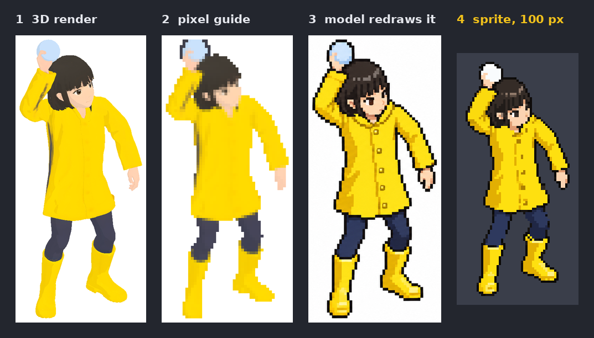
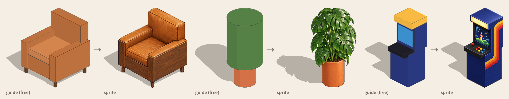

<h1 align="center"></h1>

<p align="center"><b>One illustration in. A game character out.</b><br>
An isometric sprite generator for Claude Code: 8-direction walks, actions and pixel art<br>
at your game's camera angle, with a 3D shadow under every frame - and the props to stand beside them.</p>

<p align="center"><a href="https://github.com/Sunghwan0112/spritecast/stargazers"></a></p>

<p align="center">
<a href="#what-you-can-make">What you can make</a> ·
<a href="#walking-characters">Characters</a> ·
<a href="#pixel-art-arcade-size">Pixel art</a> ·
<a href="#props-and-scenery">Props</a> ·
<a href="#install">Install</a> ·
<a href="#faq">FAQ</a> ·
<a href="README.ko.md">한국어</a> · <a href="README.zh-CN.md">简体中文</a> · <a href="README.ja.md">日本語</a> · <a href="README.es.md">Español</a> · <a href="README.pt-BR.md">Português</a>
</p>


<p align="center"><i>The same image model, the same character sheet. Left: GPT asked for a walk, as it came out. Right: what the 3D adds.</i></p>

```
claude plugin marketplace add Sunghwan0112/spritecast
claude plugin install spritecast@spritecast
```

Then just ask: *"Here's my character (hero.png). Make her walk in 8 directions."*
**To try it free, with no key**, ask Claude to *"try SpriteCast"*.

An image model (OpenAI's, with your own key) does the drawing. The body, the motion, the angle and the shadow come from 3D - so
every frame is the same person, and she actually walks.

| | you give | you get | you pay |
|---|---|---|---|
| **A walking character** | one illustration | a walk in 8 facings, standing views, a shadow per frame | about $2.2 + 75 Tripo credits |
| **More actions** | a name, or a Mixamo FBX | run, jump, slash, throw... in 8 facings | about 10 Tripo credits each (an FBX: none) + the drawing |
| **Pixel art** | a character that walks | pixel sprites about 100 px tall | about $0.075 a sheet (a walk, 8 facings: ~$1.35) |
| **An animal** | one illustration | a four-legged walk in 8 facings | 30 Tripo credits + the drawing |
| **Sitting** | a character that walks | seated in 8 facings, placed on your props | about $0.22 |
| **A prop, or a posed NPC** | a description | a sprite, its shadow, its anchor | about $0.07 (+ $0.08 a further facing) |
| **A pixel-art prop** | a description | pixel sprites from every side, at the pixel character's scale | about 20 Tripo credits + $0.08 a side |

Free and MIT. You pay OpenAI and Tripo directly; every paid step shows its cost and waits for your OK. `"facings": 4` draws only
the four diagonals - about half the cost - and the character still walks in all eight directions.

## What you can make

| | |
|---|---|
|  |  |
| **[A walk in 8 facings](docs/guide/characters.md#walking-characters)** from one illustration, a shadow per frame | **[Actions](docs/guide/characters.md#more-actions-run-jump-slash)**: run, jump, slash - or any Mixamo clip |
|  |  |
| **[Pixel art](docs/guide/pixel-art.md)**, about 100 px tall, with things that are held and thrown | **[Four-legged animals](docs/guide/characters.md#four-legged-animals)**, with no bought rig |
|  |  |
| **[Sitting](docs/guide/characters.md#sitting)** on your props, the armrest in front of her worked out in 3D | **[Pixel-art props](docs/guide/pixel-art.md#pixel-art-props-any-object-any-side)** from any side, at the character's scale |
|  |  |
| **[Shadows baked from the 3D model](docs/guide/pixel-art.md#light-shadow-wind)**: the sun, a grey day, or a lamp you place | **[Wind in the leaves](docs/guide/pixel-art.md#light-shadow-wind)**, bough by bough, from the same model |

## Things to ask for

- *"Here's my character (hero.png). Make her walk in 8 directions."*
- *"Add a run and a jump. And a throw - here's a Mixamo clip (Throw.fbx); put a snowball in her hand."*
- *"Our game is pixel art. Make her walk and throw as pixel sprites, about 96 px tall."*
- *"Make her sit, and put her on this armchair."*
- *"Make a shopkeeper NPC, an old man in a brown cardigan, in four directions."* (a posed figure: a description is enough)
- *"Make an isometric bookshelf, 1.8 m tall, full of books, in the cozy style."*

## Why it works

An image model can't keep a body and a pose from one frame to the next. Asked for a walk in words, it gives eight nice drawings
that don't walk:

| GPT alone | SpriteCast |
|---|---|
| the same leg in front in all eight frames | the legs come from a 3D walk |
| the arms twitch at random | the arms swing against the legs |
| the camera at eye level | your game's camera (30° down by default) |
| no shadow | the 3D body's own shadow, frame by frame |

So SpriteCast never asks it to. **3D does the moving; the image model only redraws** each rendered frame in your illustration's
look. Every drawing is fitted back onto its render and checked against it: a frame drawn in another pose is flagged and can be
redrawn, never squeezed to fit. Props work the same way, with blocks at real size in place of the rig - so props made at different
times line up on one floor, all lit by the same light.

## Made with it: Rain Girl

<p align="center"><a href="https://sunghwan0112.github.io/rain-girl/"></a></p>

<p align="center"><a href="https://sunghwan0112.github.io/rain-girl/"><b>▶ Play it in your browser</b></a> &nbsp;·&nbsp; <a href="https://github.com/Sunghwan0112/rain-girl">the game's code</a><br>No install, no account. Post your score and you are on the board below.</p>

<p align="center"><a href="https://sunghwan0112.github.io/rain-girl/"></a></p>

A small pixel action game: a girl in a yellow raincoat puts out fire monsters with her umbrella's water before the forest burns.
The girl, her two-hit combo, and all seven props (28 sprites, every side) came out of SpriteCast; the shadows, the shade she walks
into, the cover that stops a fireball and the wind in the trees are worked out from the 3D models; the effects are from
[PVFX Foundry](https://nerijs.itch.io/pvfx-foundry) (CC0), which comes with SpriteCast. **[How it was made](docs/guide/rain-girl.md)**.


## Walking characters


Give it one illustration (facing front, standing straight) and you get a walk in 8 facings and 8 standing views in that
illustration's look. A turnaround is drawn, [Tripo](https://www.tripo3d.ai) makes and rigs the 3D model, the walk is rendered at
your camera with the body's own shadow, and the image model redraws every frame. About $2.2 and 75 Tripo credits, or bring your own
rigged GLB.

- **Actions**: run, jump, slash, or any Mixamo clip (`addclip.py`), with a held thing built in the hand - an umbrella, a pistol, a snowball that is let go.
- **Effects on a swing**: `"trail": "water"` (or fire, leaves, snow... eleven looks) - worked out from the held thing's 3D path, free, nothing drawn again.
- **Joining animations**: the rig makes the frames between a walk and an attack, and links one attack into the next (`motion.py`).
- **Animals** on four legs, **sitting** on your own chairs, and `"draw": false` to use the 3D renders as the frames.

**Everything about characters: [docs/guide/characters.md](docs/guide/characters.md)**

### Pixel art (arcade size)



For a game drawn in pixels: the same character as real pixel art, about 100 px tall - one colour a pixel, a palette, a dark
outline, each frame's 3D shadow. The render is pixelized into a guide, the image model redraws it, and the drawing is read back
on the grid it was drawn on.

```
$PYTHON skills/spritecast/scripts/pixelart.py hero.json                        # the plan and its cost - spends nothing
$PYTHON skills/spritecast/scripts/pixelart.py hero.json --clips walk,throw --yes
```

- **How many frames go on a sheet is worked out, not chosen:** `pixelart.py` measures the renders and fits as many as have room -
  four for a walk, two when something is held, one for a long swing (so an attack costs more than a walk); the plan shows it
  before anything is spent. Everything after the drawing is automatic; you never draw a frame.
- **A pixel editor for the last bit** (`pixeledit.py`): a few pixels a frame - left-over white, an umbrella's tip - with the 3D
  render and the 3D shapes shown over the frame. The edits are kept and laid on again by every build.
- **Palettes** (`--colours 16`, `--palette pico8`, or your own Aseprite/Lospec file), **64 and 32 px**, and **pixel-art props** from every side.
- **Rain Girl's combo as a preset**: download two Mixamo moves yourself and `motion.py preset hero.json rain-girl-combo` makes the
  same changes to them - [which moves and how](docs/guide/pixel-art.md#pixel-art-arcade-size).

**Everything about pixel art, light and wind: [docs/guide/pixel-art.md](docs/guide/pixel-art.md)**

## Sitting

Once a character walks, ask Claude to *"make her sit"*: her 3D model is bent into sitting in 8 facings for free, then drawn
(about $0.22). `seat.py` puts her on one of your props and works out the armrest or backrest in front of her from both 3D models.
[Details](docs/guide/characters.md#sitting).

## Props and scenery



Ask an image model for "an isometric armchair" and you get a nice picture at a slightly wrong angle, and a different one next time.
SpriteCast builds the object from blocks at its **real size in metres** (or a Tripo model), renders it with your game's **exact
camera**, has the image model redraw only that guide in your **art style**, and fits the drawing back onto it, with a baked shadow
and an anchor. A standing NPC works the same way, from a description. Cameras: 2:1 isometric (default), true isometric, 3/4
top-down, front, or any angle.

**Props, posed figures, shadows and cameras: [docs/guide/props.md](docs/guide/props.md)** · all the [examples](examples)

## Putting it in your engine

`export.py <name>/out` (free) writes ready-made files for **Godot 4, Unity, Phaser 3 and Aseprite**: the body, its shadow and a
swing's effect, playing by name (`play("walk", "south-east")`). Props export to Phaser and Godot with their shadow, light, wind and
collision. Or read the numbers yourself from `sprite.json` / `character.json`.
**[docs/guide/engines.md](docs/guide/engines.md)** - also how it works step by step, fixes for common errors, and what is sent where.

## Install

In a terminal:
```
claude plugin marketplace add Sunghwan0112/spritecast
claude plugin install spritecast@spritecast
```
or inside Claude Code: `/plugin marketplace add Sunghwan0112/spritecast`, then `/plugin install spritecast@spritecast`.

**You also need** only Python 3.9+ and a browser (Chrome, or Edge - every Windows has it). The first time, Claude runs the setup
check (`doctor.py --fix`): it makes its own venv in `~/.cache/spritecast/` with the few packages (about 10 s), leaves your Python
alone, and tells you what each thing is for. Nothing to install by hand.

| what | for | needed? |
|---|---|---|
| Python 3.9+ | runs the scripts | yes |
| playwright + Chrome or Edge | renders the 3D guide on your computer (free) | yes (set up for you; a browser you have is used) |
| `OPENAI_API_KEY` | drawing, about $0.07 a prop | to draw |
| `TRIPO_API_KEY` | characters: the 3D model, its rig and walk | for walking characters |

**Try it first, free, no key:** ask Claude to *"try SpriteCast"*. It renders one of the examples' guides on your computer and
finishes it with the drawing that came with the example, so you see the whole way before paying for anything.

<details>
<summary><b>Keys: where they go, and OpenAI's verification</b></summary>

Keys: **in the plugin's settings.** When you enable SpriteCast, Claude Code asks for them (`/plugin` → SpriteCast → configure,
to change them later): the OpenAI key, and the Tripo key if you make walking characters. They are kept in your system's credential
store, masked, and handed to SpriteCast's scripts when a session starts (restart Claude Code after changing one). A key already in your
environment still works when the settings have none:

```bash
export OPENAI_API_KEY=sk-...          # macOS / Linux (add it to ~/.zshrc or ~/.bashrc to keep it)
```
```powershell
setx OPENAI_API_KEY "sk-..."          # Windows (then open a new terminal)
```
On Windows the settings reach the scripts only when Claude Code runs its commands in Git Bash (its default when Git is installed); in
PowerShell use the environment. Your key stays on your computer. It is only sent to OpenAI, and you pay OpenAI for each drawing (about $0.07).

OpenAI may ask you to verify your organisation before a key can use image models (platform.openai.com → Settings →
Organization): do it once before your first drawing. Set the key before you start Claude Code; a key set while it runs is seen
only after a restart. Walking characters also need `TRIPO_API_KEY`, from Tripo's API platform, where API credits are bought
(75 a character, 30 an animal).

</details>

<details>
<summary><b>Running the scripts yourself</b></summary>

Claude runs them for you. To run them by hand from a clone of this repo, use the Python that `doctor.py` prints on its last line
(`PYTHON=...`); after `--fix` it is `~/.cache/spritecast/venv/bin/python` (Windows:
`%USERPROFILE%\.cache\spritecast\venv\Scripts\python.exe`). A plain `python` may not have the packages (`No module named ...`):
```bash
python3 skills/spritecast/scripts/doctor.py --fix
PYTHON=$(python3 skills/spritecast/scripts/doctor.py | sed -n 's/^PYTHON=//p')
$PYTHON skills/spritecast/scripts/isoprop.py --help
```
On Windows, in PowerShell:
```powershell
python skills/spritecast/scripts/doctor.py --fix
$PYTHON = "$env:USERPROFILE\.cache\spritecast\venv\Scripts\python.exe"
& $PYTHON skills/spritecast/scripts/isoprop.py --help
```

</details>

Everything runs on your computer except the drawing (OpenAI) and the 3D models (Tripo, or Meshy if you choose it); each paid step
prints its cost and waits for your OK. [What is sent where, and what is downloaded](docs/guide/engines.md#what-it-sends-and-fetches).

## Roadmap

What is planned next, roughly in this order (no dates - it moves with feedback):
- **Seat-fitted poses, and riding**: a pose shaped to each seat, and characters riding in carts and vehicles.
- **Turning objects**: a vehicle rotated through many angles, so it turns smoothly instead of snapping between 8 facings.
- **Night versions**: a mask of what gives light (windows, bulbs, neon), for your engine to light after dark.
- **Walk-through props, automatic**: the front piece worked out from the 3D guide (today it is painted on the touch-up page).
- **More held things** (a sword, a staff) and effects with no held thing (a kick, a footstep's splash).
- **Small sprites**: the small design made from the ordinary one in one step, and a face at 32 px that needs no hand.
- **Engine exports for pixel sets.**

See [CHANGELOG.md](CHANGELOG.md) for what each version changed.

## Feedback

Feedback decides what comes next, and what changed because of it is marked in the changelog.
- **Something broke**: open an [issue](https://github.com/Sunghwan0112/spritecast/issues/new/choose) with the bug form - your OS, Python version,
  the command and the message help most.
- **An idea or a missing feature**: the feature form in [issues](https://github.com/Sunghwan0112/spritecast/issues/new/choose).
- **Show what you made, or ask how**: [Discussions](https://github.com/Sunghwan0112/spritecast/discussions).

## Notes
- The output is yours.
- Leave real brands, logos and characters from existing games out of descriptions.
- Don't use a living artist's work as your style picture without their permission.
- A `photo` for a character's likeness: only of someone who agreed to it.
- Settings: `SPRITECAST_MODEL` (e.g. `gpt-image-2.6-sunburst` to try the newer model; the default is what the checks were tuned on) and `SPRITECAST_QUALITY` (`low` | `medium` | `high`).

## FAQ
- **What does it cost?** The guides, finishing and the `try` are free. About $0.07 a prop, $0.08 for each further facing; a walking
  character about $2.2 of drawing (~$1.5 with `"mirror": true`) and 75 Tripo credits (an animal 30). Each paid step shows its cost
  and waits for your OK. The plugin is free; you pay OpenAI and Tripo directly, nothing goes to the author.
- **Which keys do I need?** `OPENAI_API_KEY` to draw, `TRIPO_API_KEY` for walking characters and animals (Meshy optional). OpenAI may
  ask you to verify your organisation first. See [Keys](#install).
- **Isn't this AI art?** Yes: an image model does the painting. What SpriteCast adds is the geometry: the size, the camera angle, the
  walk and the shadows come from 3D. You can give your own art as the style, or set `"draw": false` so the 3D renders are the frames
  ([Skipping the drawing](docs/guide/characters.md#skipping-the-drawing-the-3d-renders-as-the-frames)).
- **Do I draw pixel art frame by frame?** No. The frames are drawn by the image model from the 3D renders and cleaned up
  automatically; what is left is a few pixels a frame in the pixel editor.
- **What doesn't it do?** Walking characters start from an illustration facing front, standing straight. Pixel art works at 96 px,
  and at 64 px for a character designed small; a 32-px set is made from the 64 one, with rougher faces. Look at the results yourself:
  the outline check can't see a head turned the wrong way.
- **Which engine?** Any that takes PNGs: you get the sprite, its shadow and the anchor in JSON, and ready-made files for Godot,
  Unity, Phaser and Aseprite ([engines](docs/guide/engines.md)).

## License
MIT - the code and the examples (pictures, strips and the rain girl's rigged model alike). three.js (bundled in `skills/spritecast/scripts/vendor/three`) is MIT, © three.js authors. The effects in `skills/spritecast/effects/pvfx` are PVFX Foundry by Pixel VFX Studio, CC0 1.0 (its LICENSE.txt there).
