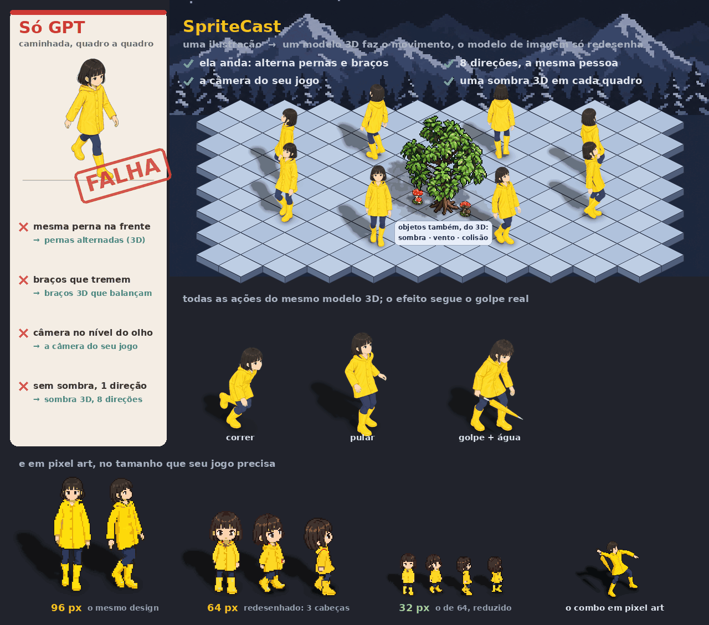
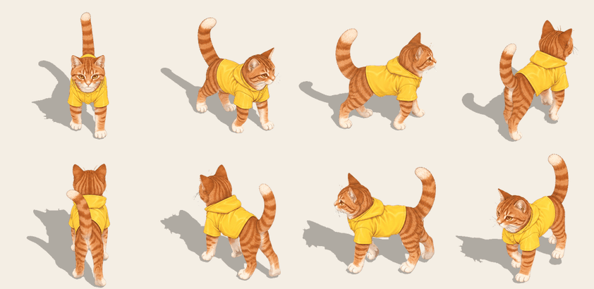
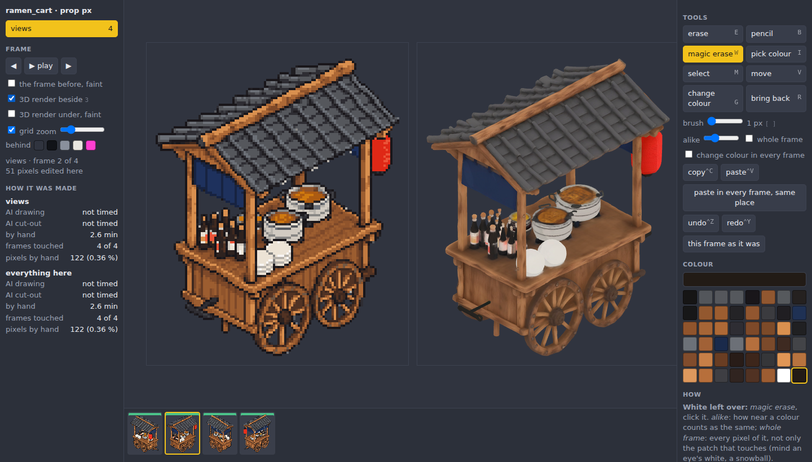
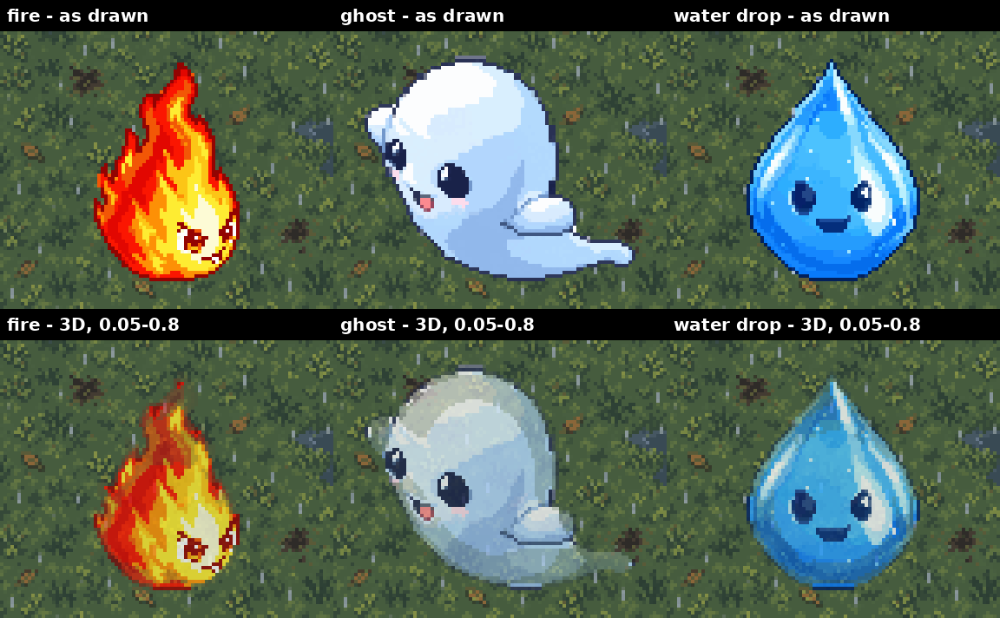
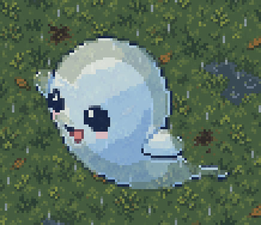
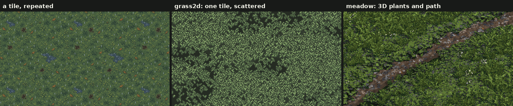
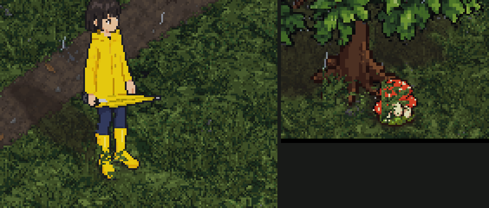
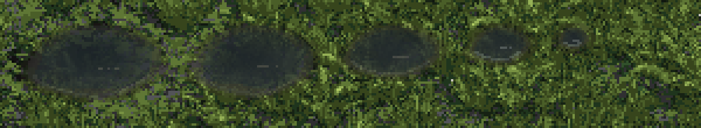
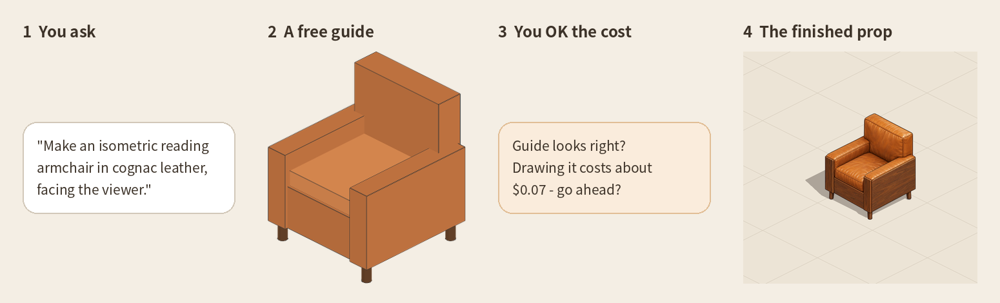
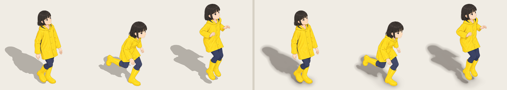

<h1 align="center"></h1>

<p align="center"><b>Entra uma ilustração. Sai um personagem de jogo.</b><br>
Um gerador de sprites isométricos para o Claude Code: caminhadas em 8 direções, ações e pixel art<br>
no ângulo de câmera do seu jogo, com uma sombra 3D sob cada frame - e os props para ficar ao lado deles.</p>

<p align="center"><a href="https://github.com/Sunghwan0112/spritecast/stargazers"></a></p>

<p align="center">
<a href="#o-que-você-pode-fazer">O que você pode fazer</a> ·
<a href="#personagens-que-andam">Personagens</a> ·
<a href="#pixel-art-tamanho-de-fliperama">Pixel art</a> ·
<a href="#props-e-cenário">Props</a> ·
<a href="#instalação">Instalação</a> ·
<a href="#perguntas-frequentes">Perguntas frequentes</a> ·
<a href="README.md">English</a> · <a href="README.ko.md">한국어</a> · <a href="README.zh-CN.md">简体中文</a> · <a href="README.ja.md">日本語</a> · <a href="README.es.md">Español</a>
</p>



<p align="center"><i>O mesmo modelo de imagem, a mesma folha de personagem. À esquerda: o GPT, quando pedimos uma caminhada, do jeito que saiu. À direita: o que o 3D acrescenta.</i></p>


<p align="center"><i>E coisas, não só pessoas: qualquer objeto em pixel art, de qualquer lado, na escala do personagem. <a href="#props-em-pixel-art-qualquer-objeto-qualquer-lado">Como</a>.</i></p>

```
claude plugin marketplace add Sunghwan0112/spritecast
claude plugin install spritecast@spritecast
```

Depois é só pedir: *"Aqui está minha personagem (hero.png). Faça ela andar em 8 direções."*
**Para testar de graça, sem chave**, peça ao Claude para *"testar o SpriteCast"*.

Um modelo de imagem (o da OpenAI, com a sua própria chave) faz o desenho. O corpo, o movimento, o ângulo e a sombra vêm do 3D - então
todo frame é a mesma pessoa, e ela anda de verdade.

| | você dá | você recebe | você paga |
|---|---|---|---|
| **Um personagem que anda** | uma ilustração | uma caminhada em 8 direções, poses paradas, uma sombra por frame | cerca de $2.2 + 75 créditos Tripo |
| **Mais ações** | um nome (Tripo: rápido), ou um FBX do Mixamo (mais natural) | correr, pular, golpear, arremessar... em 8 direções | cerca de 10 créditos Tripo cada (um FBX: nada) + o desenho |
| **Pixel art** | um personagem que anda | sprites em pixel com cerca de 100 px de altura | cerca de $0.075 por folha (uma caminhada, 8 direções: ~$1.35) |
| **Um animal** | uma ilustração | uma caminhada de quadrúpede em 8 direções | 30 créditos Tripo + o desenho |
| **Sentado** | um personagem que anda | sentado em 8 direções, posicionado nos seus props | cerca de $0.22 |
| **Um prop, ou um NPC posado** | uma descrição | um sprite, sua sombra, sua âncora | cerca de $0.07 (+ $0.08 por direção extra) |
| **Um prop em pixel art** | uma descrição | sprites em pixel de todos os lados, na escala do personagem em pixel | cerca de 20 créditos Tripo + $0.08 por lado |

Grátis e MIT. Você paga a OpenAI e a Tripo diretamente; cada etapa paga mostra o custo e espera o seu OK.

**Metade do desenho: quatro direções.** `"facings": 4` no spec desenha só as diagonais (sudeste, sudoeste, nordeste, noroeste): mais
ou menos metade do custo de desenho (uma caminhada: ~$1 em vez de ~$2; em pixel art ~$0.7 em vez de ~$1.35). O personagem exportado
continua andando nas oito direções: se você pede leste, ele mostra a direção desenhada mais próxima e a mantém, então andar reto de lado não pisca.

## O que você pode fazer

| | |
|---|---|
|  |  |
| **[Uma caminhada em 8 direções](#personagens-que-andam)** a partir de uma ilustração, uma sombra por frame | **[Ações](#mais-ações-correr-pular-golpear)**: correr, pular, golpear - ou qualquer clipe do Mixamo |
|  |  |
| **[Pixel art](#pixel-art-tamanho-de-fliperama)**, com cerca de 100 px de altura, com coisas que são seguradas e arremessadas | **[Animais de quatro patas](#animais-de-quatro-patas)**, sem rig comprado |
|  |  |
| **[Sentar](#sentar)** nos seus props, com o braço da poltrona na frente dela calculado em 3D | **[Props](#props-e-cenário)** no tamanho real, todos num mesmo chão |
|  |  |
| **[Sombras assadas do modelo 3D](#light-shadow-wind)**: o sol, um dia nublado ou uma luz que você posiciona | **[Vento nas folhas](#light-shadow-wind)**, galho a galho, do mesmo modelo |

## O que pedir

- *"Aqui está minha personagem (hero.png). Faça ela andar em 8 direções."*
- *"Adicione uma corrida e um pulo. E um arremesso - aqui está um clipe do Mixamo (Throw.fbx); coloque uma bola de neve na mão dela."*
- *"Nosso jogo é em pixel art. Faça ela andar e arremessar como sprites em pixel, com cerca de 96 px de altura."*
- *"Faça ela sentar, e coloque ela nesta poltrona."*
- *"Faça um NPC lojista, um senhor de cardigã marrom, em quatro direções."* (uma figura posada: uma descrição basta)
- *"Faça uma estante isométrica, de 1,8 m de altura, cheia de livros, no estilo cozy."*
- *"Aqui está um prop do meu jogo (props/barrel.png). Faça um caixote que combine, nesse estilo."*

## Por que funciona

Um modelo de imagem não consegue manter um corpo e uma pose de um frame para o outro. Quando você pede uma caminhada em palavras, ele dá oito desenhos bonitos
que não andam - o lado esquerdo da imagem lá em cima, do jeito que saiu:

| Só o GPT | SpriteCast |
|---|---|
| a mesma perna na frente nos oito frames | as pernas vêm de uma caminhada em 3D |
| os braços se mexem aleatoriamente | os braços balançam ao contrário das pernas |
| a câmera na altura dos olhos | a câmera do seu jogo (30° para baixo por padrão) |
| sem sombra | a sombra do próprio corpo 3D, frame a frame |

Então o SpriteCast nunca pede isso a ele. **O 3D faz o movimento; o modelo de imagem só redesenha** cada frame renderizado no visual
da sua ilustração. Depois, cada desenho é encaixado de volta no seu render e comparado com ele: um frame desenhado em outra pose é sinalizado e pode
ser redesenhado, nunca espremido para caber. Os props funcionam do mesmo jeito, com blocos em tamanho real no lugar do rig.

## Feito com SpriteCast: Rain Girl

<p align="center"><a href="https://sunghwan0112.github.io/rain-girl/"></a></p>

<p align="center"><a href="https://sunghwan0112.github.io/rain-girl/"><b>▶ Jogue no navegador</b></a> &nbsp;·&nbsp; <a href="https://github.com/Sunghwan0112/rain-girl">o código do jogo</a><br>Sem instalar nada e sem conta. Envie sua pontuação e você aparece no ranking abaixo.</p>

<p align="center"><a href="https://sunghwan0112.github.io/rain-girl/"></a></p>

<p align="center"><i>Rain Girl, um pequeno jogo de ação em pixel art: uma menina de capa de chuva amarela apaga monstros de
fogo com a água do guarda-chuva antes que a floresta queime. A menina e todos os objetos saíram do SpriteCast.</i></p>

- **A menina.** Uma ilustração; um modelo do Tripo com esqueleto, renderizado com a câmera do jogo (2:1, 30° para baixo): andar com o
  guarda-chuva, o golpe e parada, nas quatro direções diagonais (`"facings": 4`), cada frame redesenhado como pixel art de 96 px. A água
  que ela joga é o efeito do golpe, renderizado em 3D e desenhado do mesmo jeito; o loop parada é o `idleclip.py`.
- **A floresta.** Sete objetos - uma árvore, uma árvore meio queimada, uma árvore queimada, um arbusto, um toco queimado, uma pedra,
  cogumelos - cada um um modelo do Tripo renderizado de quatro lados na escala da menina (74 px por metro: uma árvore de 2,4 m tem
  cerca de 175 px) e desenhado como pixel art: 28 sprites. O jogo mostra cada objeto de um lado ao acaso; uma árvore que pega fogo
  fica meio queimada, depois queimada, do mesmo lado.
- **Uma luz só, nenhuma sombra pintada à mão.** Os 28 recebem luz do alto à direita, como seus guias 3D. Abaixo, cada lado de cada
  objeto:

<details><summary>os 28 sprites na grama do jogo</summary>


</details>

- **O combo.** Dois movimentos do Mixamo de uma mesma série - um corte para baixo e um revés giratório - levados para o rig dela, o golpe de
  machado transformado num corte de espada em arco, o segundo começando na última pose do primeiro (`motion.py`), desenhados em pixel art em
  quatro direções, com água que some ao dobro da altura dela. Aperte de novo durante o corte e vem o revés: um anel em volta dela tão largo quanto o alcance.
- **Os efeitos.** Acertos, fogos apagados, bolas de fogo voando e batendo na cobertura, itens pegos e os anéis do revés são efeitos do
  [PVFX Foundry](https://nerijs.itch.io/pvfx-foundry) (CC0), que agora vem com o SpriteCast: 253, e o `fxpack.py` para achar um e exportá-lo no
  tamanho e nas cores dos seus sprites. Um anel em volta dela é cortado no meio: a metade de trás atrás dela, a da frente na frente.


<details><summary>32 dos 253 efeitos que vêm com o SpriteCast</summary>


</details>

- Mais - uma paleta só, a menina escurecendo à sombra das árvores, a cobertura que para uma bola de fogo, o vento, quanto custou um objeto: [como foi feito](docs/guide/rain-girl.md) (em inglês).

## Personagens que andam


Dê a ele uma ilustração de um personagem (de frente, em pé e reto, sem pose) e você recebe uma caminhada em 8 direções (8 frames cada) e 8 poses paradas, no visual
dessa ilustração. Um modelo de imagem não consegue manter um corpo e uma pose de frame para frame, então o movimento vem do 3D:
1. Um turnaround é desenhado a partir da ilustração.
2. A [Tripo](https://www.tripo3d.ai) faz o modelo 3D a partir dele, coloca o rig e dá a ele uma caminhada e um idle.
3. A caminhada é renderizada com a câmera do jogo (grátis), cada frame com a sombra do próprio corpo 3D, achatada no chão
   na direção da luz.
4. O modelo de imagem desenha por cima dos renders, 4 frames por chamada. A frente é desenhada primeiro e todas as outras direções seguem ela, para
   continuar sendo a mesma pessoa.
5. Cada frame é encaixado de volta no seu render, os tamanhos da cabeça são estabilizados e as bordas limpas. Você recebe strips, uma sombra por frame
   (os pés tocam nela, um pé levantado projeta a sua própria) e uma âncora.

```
$PYTHON skills/spritecast/scripts/charpipe.py turnaround hero.json --yes   # then 3d (model, rig, renders) and draw (then finish, preview by themselves)
```
As oito direções são desenhadas por padrão. Um design que é igual dos dois lados pode usar `"mirror": true` para espelhar as direções oeste
a partir das leste (cada uma mantendo sua própria sombra), cerca de $0.66 a menos.
Ou `"facings": 4`: só as quatro diagonais, mais ou menos metade do desenho; o personagem exportado mostra a mais próxima delas em qualquer uma das oito direções.

Custo por personagem: cerca de $2.2 (OpenAI; ~$1.5 com `"mirror": true`) e 75 créditos Tripo (~$0.75; um animal, 30). Ou traga seu
próprio GLB com rig (`"rig_glb"`) e pule direto para `render`.

Mais opções (várias roupas, o vídeo de prévia, Meshy, a personagem de exemplo com o esqueleto): [docs/guide/characters.md](docs/guide/characters.md#walking-characters) (em inglês).

### Animais de quatro patas

O rig da Tripo para animais de quatro patas anda mal (sem coluna, os ombros pendurados no pescoço), então um animal não recebe rig comprado.
Com `"kind": "animal"` basta o modelo 3D sozinho (Tripo, ~30 créditos): o esqueleto é encontrado a partir da malha (as patas, as
costas, a cabeça, a cauda e para que lado ele está virado), ele anda com o passo de um gato ou de um cachorro, e recebe o mesmo desenho, encaixe e
sombras 3D que uma pessoa.

O turnaround é desenhado com o animal sobre as quatro patas, cada pata separada das outras, a cauda para trás; roupas só justas (um colete de tricô, não uma
capa ou um cachecol - tudo o que fica pendurado se move com a pata mais próxima). Confira os renders antes de desenhar: quatro patas, a cabeça para a frente, a cauda
para trás. Se o modelo da Tripo ganhar uma pata a mais, gere de novo ou use a Meshy (`"modeler": "meshy"`).

<details><summary>um gato laranja rajado com capa de chuva amarela andando em 8 direções</summary>


</details>

O gato está em [`examples/tabby_cat`](examples/tabby_cat): um gato laranja rajado com uma capinha de chuva amarela (a da garota), o design dele,
o turnaround, o spec, as strips, as sombras e a folha - 30 créditos Tripo e cerca de $2.5 de desenho, contando redesenhos e tentativas de design. Seus
frames se encaixam nos renders com 0.76-0.97 (nordeste e noroeste misturados frame a frame com `"mix"`, veja reference/character.md).

### Mais ações: correr, pular, golpear

Além da caminhada, um personagem pode correr, pular ou brandir alguma coisa. Liste no spec, `"actions": ["run", "jump", {"name": "slash",
"hold": "umbrella"}]`: o rig recebe essas animações da Tripo (cerca de 10 créditos cada; run, jump, slash, shoot, dive, climb, fall,
hurt e turn estão disponíveis), e cada uma é renderizada, desenhada e finalizada em 8 direções como a caminhada, em suas próprias strips com uma sombra por
frame. Um golpe precisa de algo na mão: `"hold"` monta o objeto a partir de formas simples e o coloca na mão, então ele se move em
todo frame (por enquanto um guarda-chuva, uma pistola ou uma pistola d'água; a mão direita, ou `"hand": "left"`). Com seu próprio modelo com rig, qualquer clipe dele pode ser uma ação. Um objeto segurado é descrito ao
modelo de imagem parte por parte - com mais cuidado a ponta que fica na mão (o cabo, o primeiro trecho da haste), que é pequena e fica contra
o corpo, e é onde ele chuta, se não for assim.

**Qual usar: Tripo para poupar tempo, Mixamo quando o resultado importa.** A Tripo dá os movimentos num passo, sem baixar nada, e andar, correr ou pular (de mãos vazias) saem bem com ela. Quando o resultado importa mais que o tempo, recomendamos o [Mixamo](https://www.mixamo.com/#/?page=1&query=melee&type=Motion%2CMotionPack) (grátis, com uma conta Adobe), sobretudo para ataques: movimentos capturados parecem mais naturais, há milhares, e os ataques de uma mesma série começam e terminam na mesma guarda, então se encadeiam em combos (`motion.py link`). Leva um pouco mais: baixe um (FBX Binary, 30 fps, Without Skin) e `addclip.py hero.json Move.fbx name` o passa para o esqueleto do personagem, de graça. O porém: o Mixamo não tem API, então o SpriteCast não consegue baixar dele - você vai ao site, olha os movimentos e baixa você mesmo; o Claude te dá o link de busca. O combo da Rain Girl são dois movimentos do Mixamo. Nunca coloque os FBX num repositório público.


**A maior parte sai de primeira.** A caminhada, a corrida e o pulo da garota da chuva se encaixam nos renders 3D com 0.78 ou mais em todo frame, todos
desenhados uma vez só. O golpe com guarda-chuva é mais difícil (uma coisa fina que gira em volta do corpo): uma arma desenhada no lugar errado é redesenhada
sozinha, e o que sobra se encaixa um pouco mais solto onde ela se curva muito - uma pose desenhada um pouco mais ereta, que fica bem em movimento.
Esses frames são listados para você olhar; mantenha ou redesenhe.

**Algo carregado o tempo todo, em qualquer mão** (vocês pediram). Coloque `"hold"` no próprio spec em vez de numa ação -
`"hold": {"kind": "watergun", "hand": "left"}` - e o personagem fica com o objeto durante a caminhada, as poses paradas e todas as ações.
Abaixo, uma pistola d'água na mão esquerda: o guia 3D em cima, os frames desenhados embaixo.

<details><summary>uma pistola d'água carregada na mão esquerda</summary>


</details>

- **Ele fica naquela mão.** Um personagem com algo numa mão não é igual dos dois lados, então nenhum frame é feito
  espelhando outro - espelhado, o objeto trocaria de mão. (`"mirror": "never"` pede o mesmo para qualquer personagem que não seja
  simétrico: um tapa-olho, uma manga só.) Cada folha é informada de qual mão e onde o render tem o objeto, e depois cada
  frame é comparado com seu render: dos 24 frames acima, um foi apontado para você olhar.
- **A mão fecha no cabo.** Os dedos de um rig ficam esticados, e um desenho por cima disso tem uma mão aberta ao lado de uma arma
  flutuando. Então o guia dobra a própria mão que segura: o cabo entra no punho, os quatro dedos dão a volta por um lado dele e
  o polegar pelo outro, cada dedo dobrado só até encostar. Um cabo grosso ganha uma mão mais solta; um grosso demais para a
  mão envolver fica mais fino.
- **Olhe a mão antes de desenhar qualquer coisa.** Num frame a empunhadura são poucos pixels, então a etapa grátis `render` também salva a mão
  de todos os lados, de perto (`render/hand-walk.png`), e mostra quão longe cada ponta de dedo está do cabo. Corrija ali, sem custo.
- Um objeto que já faz parte do seu próprio modelo com rig: `"hold": {"in_model": true, "words": "In the LEFT hand: a black pistol."}`.

O exemplo acima custou cerca de $0.7 para desenhar (8 folhas: a caminhada de três lados e a corrida de um).

<details>
<summary><b>Outros tamanhos: 512, 64 e 32 px a partir dos mesmos desenhos</b></summary>

**Qualquer tamanho que você precisar** (vocês pediram): os frames saem com 256 px de altura, e `charpipe.py pack CHAR.json --px 64` faz outro conjunto em
qualquer altura a partir dos mesmos desenhos - maior que 256 também fica nítido, os frames são guardados no nível de detalhe dos próprios desenhos - strips, sombras e `character.json` nesse tamanho, em `out-64px/`, com
nada redesenhado e `out/` deixado como está (`"frame_px"` no spec define o padrão). Abaixo, 512, 256 (o padrão), 64 e 32 px de altura, cada um mostrado no mesmo tamanho (ampliado pixel a pixel). Em 64 o cabelo, a capa de chuva,
as botas e o guarda-chuva são todos legíveis; em 32 a pose e as cores se mantêm, mas o rosto quase some - um redimensionamento simples, nada feito para esse tamanho
ainda (veja o [Roadmap](#roadmap)).


</details>

### Efeitos no golpe: água, fogo, folhas

Um golpe pode deixar algo no ar. Adicione `"trail"` à ação - `{"name": "slash", "hold": "umbrella", "trail": "water"}` - e
você recebe o efeito como um sprite próprio, sobreposto ao corpo. **É grátis e nada é desenhado de novo**: o rig 3D sabe onde está a
ponta do guarda-chuva em cada momento, então o efeito é calculado a partir dessa trajetória. Um golpe que você já tem ganha um sem mexer nos
frames dele.

<details><summary>o golpe com guarda-chuva da garota da chuva com oito efeitos</summary>


</details>

- **Ele segue o movimento real.** Um modelo de imagem a quem se pede um golpe inventa um arco e o repete; um efeito pronto é uma forma colada
  em todo golpe. Aqui a faixa e os pedaços saem da trajetória que o guarda-chuva deste personagem faz nesta ação, vista de cada uma
  das 8 direções, e o corpo e o guarda-chuva escondem a parte que passa atrás deles. Mude o movimento e o efeito muda.
- **Onze visuais**: `plain`, `wind`, `water`, `fire`, `drops`, `flames`, `leaves`, `greenleaves`, `petals`, `snow`, `sparkle`. Cores,
  quantidades e velocidades podem ser alteradas, um visual novo é mais uma entrada num arquivo, e você pode dar suas próprias imagenzinhas para serem
  espalhadas (`"image": "mine.png"`).
- **Os pedaços continuam voando de frame para frame.** Uma folha é solta uma vez, é levada um pouco pelo golpe, gira, balança e pousa no
  chão - a mesma folha em todo frame, não um espalhamento novo a cada vez.
- **Água e fogo se movem como um corpo só** (vocês pediram). A água sai como uma lâmina, se estica em fios, se quebra em gotas e deixa
  névoa; a chama é branco-amarelada no centro, laranja, depois uma borda vermelha que escurece conforme esfria, com cinzas subindo.
- **A água parece água.** Água fina é clara e transparente, água funda mais escura, com uma borda brilhante e um reflexo da
  mesma luz do personagem; gotas rápidas são desenhadas alongadas na direção em que vão, e algumas estouram no chão num anel e num respingo.
- **Só o golpe em si.** Nada sai enquanto o guarda-chuva está sendo erguido: o trecho rápido do movimento é encontrado sozinho.
- **Mais frames que o corpo.** O corpo é desenhado 8 vezes, mas a água tem 24 frames de efeito (três para cada) e o fogo 16 (dois), tocados
  mais rápido por cima - com 8, a lâmina estava inteira num frame e já em gotas no seguinte. Eles ficam em volta de cada
  frame do corpo (um terço antes, nele, um terço depois), então a água acompanha o guarda-chuva desenhado em vez de ir na frente.
- **Também em pixel art**, no tamanho do sprite: coisas sólidas mantêm bordas duras, a névoa continua transparente.


Um combo em pixel art - o corte para baixo e o revés giratório da Rain Girl em quatro direções, com a água e o anel do revés (`motion.py`, `fxpack.py`). Os dois movimentos são do Mixamo e você mesmo os baixa - quais e como, mais abaixo em "O combo da Rain Girl como preset":


**Sinceramente:** estes são calculados, não pintados, então são limpos em vez de desenhados à mão. A trajetória
é a do objeto segurado, então uma ação precisa de algo na mão. Feito e conferido só no golpe com guarda-chuva.

### Juntando duas animações: entrando no golpe e saindo dele

Uma caminhada não termina na primeira pose de um ataque, e um ataque não termina na da caminhada: tocados um depois do outro, o corpo pula.
O rig 3D faz os frames intermediários (vocês pediram): `{"name": "ready", "between": ["walk", "slash"], "frames": 3}` e
`{"name": "recover", "between": ["slash:end", "walk"], "frames": 4}`. Abaixo, tudo desenhado: ela anda com o guarda-chuva, desce para
a postura (3 frames do rig), golpeia com o efeito de água, volta a subir (mais 4) e segue andando.

<details><summary>a garota da chuva andando com o guarda-chuva, descendo para uma postur…</summary>


</details>

- **Como.** O rig toca as duas animações ao mesmo tempo, cada uma parada num momento, e vai de uma para a outra, suavizando a entrada e
  a saída. `"slash:end"` começa da última pose de um ataque em vez da primeira.
- **Grátis para renderizar, desenhado como qualquer ação** - uma folha para três ou quatro frames, cerca de $0.08.
- **Veja tudo junto**: `charpipe.py loop hero.json --only walk,ready,slash,recover --facing south-east` (grátis) faz um GIF como o
  de cima a partir dos frames finalizados, para que um frame que pula seja visto antes de qualquer coisa ser desenhada de novo. Um conjunto
  em pixel art também pode ser corrigido assim, com todos os frames em sequência no editor: `pixeledit.py hero.json --join walk,ready,slash,recover --facing south-east`.
- **Um frame errado? Desenhe só ele.** `charpipe.py frame hero.json --only slash --facing south-east --frame 5 --yes` (~$0.08) desenha
  de novo só aquele frame; `"frame_words"` na ação diz ao modelo de imagem o que o render daquele frame não consegue. O frame 5 acima tinha o
  punho esquerdo flutuando sobre o guarda-chuva cinco vezes seguidas; quando foi dito que a mão fica quase toda escondida atrás da cabeça dela, saiu certo.
- **O objeto na mão continua na mão.** Para ele estar lá na caminhada também, a caminhada o carrega (aqui, uma ação sobre o clipe da
  caminhada com o guarda-chuva); senão ele surgiria do nada no primeiro intermediário.

### Pixel art (tamanho de fliperama)

<details><summary>cinco direções da garota da chuva arremessando uma bola de neve, cada …</summary>


</details>

Para um jogo desenhado em pixels - um beat 'em up, um jogo de luta, um plataforma de fliperama - o mesmo personagem como pixel art de verdade, com cerca de 100 px
de altura: uma cor por pixel, uma paleta de umas 40, um contorno escuro, sem desfoque, e a sombra 3D de cada frame. Não é um redimensionamento dos
frames pintados: a ordem é ao contrário.


O render 3D é pixelizado num guia, o modelo de imagem o redesenha como pixel art, e o desenho é **lido de volta na grade em que o
modelo o desenhou** - a cabeça em linhas de grade próprias, para que os olhos e a boca sobrevivam - e então dimensionado e posicionado pelo render.

```
$PYTHON skills/spritecast/scripts/pixelart.py hero.json                        # the plan and its cost - spends nothing
$PYTHON skills/spritecast/scripts/pixelart.py hero.json --clips walk,throw --yes
```
Cerca de $0.075 por folha: uma caminhada nas oito direções são 18 folhas (cerca de $1.35); o arremesso acima, cinco direções, foram 14.

**Quantos quadros vão numa folha é calculado sozinho:** o `pixelart.py` mede os renders e põe quantos couberem - quatro numa caminhada, dois se segura algo, um num golpe longo (por isso um ataque custa mais que uma caminhada); o plano mostra antes de gastar qualquer coisa. Tudo depois do desenho é automático: você não desenha quadros, só corrige alguns pixels.

- **Coisas seguradas e arremessadas.** `"hold": {"kind": "snowball", "until": "auto"}` coloca o objeto na mão e o solta quando a mão
  se move mais rápido. O `pixel.json` então diz em qual frame, onde no frame, para que lado e a que velocidade - o bastante para sua engine criar
  o projétil - e você recebe a bola, seu formato em voo e uma explosão de 4 frames. A imagem acima são esses dados reproduzidos.
- **Qualquer animação do Mixamo.** `addclip.py hero.json Throw.fbx throw` leva um clipe FBX para o rig do personagem, de graça. O arremesso
  acima entrou assim.
- **Combos que se encadeiam.** `motion.py` liga um ataque ao seguinte como os jogos fazem: o segundo começa na pose em que o primeiro
  termina, sem mexer no golpe; também põe de volta no chão os pés de um clipe importado e transforma um golpe de machado num corte de espada em arco. Grátis, no rig - [a receita, do Mixamo ao jogo](skills/spritecast/reference/character.md).
- **O combo da Rain Girl como preset.** Os dois movimentos são do Mixamo e você mesmo os baixa (grátis, com uma conta Adobe): [Standing Melee Attack Downward](https://www.mixamo.com/#/?page=1&query=Standing+Melee+Attack+Downward&type=Motion%2CMotionPack) e [Standing Melee Attack Backhand](https://www.mixamo.com/#/?page=1&query=Standing+Melee+Attack+Backhand&type=Motion%2CMotionPack) - FBX Binary, 30 fps, Without Skin, sem redução de keyframes. `motion.py preset hero.json rain-girl-combo` faz neles as mesmas mudanças com os mesmos números e põe as duas ações na especificação. O preset guarda só as mudanças, nunca os movimentos - [o que foi mudado](docs/guide/pixel-art.md#pixel-art-arcade-size) (em inglês).
- **Ele se revisa.** Cada frame é comparado com seu render (a pose, o objeto segurado); `--redraw` desenha de novo as folhas marcadas
  e fica com o melhor desenho. Os 40 frames do arremesso passaram todos depois de um redesenho.
- **Depois, um editor de pixel para o finzinho.** Nem toda pixel art sai por regra. `pixeledit.py hero.json` abre todos os frames
  no navegador: borracha mágica numa mancha de branco que sobrou, lápis, trocar uma cor, mover uma seleção, copiar um rosto bom para os outros
  frames. Adicione qualquer cor à paleta; e os próprios frames podem ser copiados (um intermediário para desenhar por cima - 8 frames viraram 9),
  apagados e movidos: a sombra e os dados do jogo acompanham. As edições são guardadas e aplicadas de novo em todo build seguinte.
  Animações que tocam uma depois da outra podem ser abertas como uma só, para ver o loop inteiro e corrigir onde pula:
  `pixeledit.py hero.json --join walk,ready,slash,recover --facing south-east`.

<details><summary>o editor de pixel</summary>



</details>

E o render 3D a partir do qual o frame foi desenhado pode ser mostrado ao lado (tecla `3`) ou fraco por baixo - assim você vê o que um pixel
duvidoso deveria ser antes de mexer nele:

<details><summary>o editor de pixel com um personagem de 64 px prestes a arremessar uma …</summary>


</details>

Quanto sobra para a mão: muito pouco. Nos 40 frames do arremesso, cerca de 6 minutos de desenho por IA e 2 de recorte por IA; depois o único
trabalho manual foi a borracha mágica - um clique em cada pontinho de branco que sobrou, em 10 dos 40 frames (131 pixels, 0.15 % dos
sprites). Nenhum rosto foi tocado: estão como o pipeline os fez. O build mostra esses números toda vez.

**Um conjunto mais difícil, e o que a mão fez.** Se o personagem segura algo (uma arma, um guarda-chuva), os detalhes disso precisam
de um pequeno ajuste à mão: poucos pixels por frame, com uma borracha e um lápis, sem saber desenhar. O mesmo loop daquele em "Juntando
duas animações", em pixel art: ela anda com o guarda-chuva, desce para a postura, golpeia, volta a subir e segue andando; quatro animações
juntas, 23 frames. Só o guarda-chuva foi ajustado à mão: a ponta e a borda deixadas iguais de frame para frame. O personagem não; só foram
apagados alguns pontinhos brancos que sobraram. No total, 1,196 pixels de 51,442 (2.3 %), por alguém que não desenha, em poucos minutos. O que deixou rápido, e o que mais importa em pixel art: ver os 23 frames em sequência, tocando, não um por um; corrigir é fazer
com que nenhuma parte mude muitos pixels de um frame para o próximo. Não corrigido: em
dois frames da caminhada o guarda-chuva está desenhado um pouco fora do ângulo e do comprimento do 3D.

- **O editor mostra onde o 3D tem as coisas** (tecla `4`): o objeto segurado em vermelho e o contorno do corpo em azul, sobre o frame que você
  está desenhando - então um guarda-chuva desenhado comprido demais ou no ângulo errado é visto na hora.

<details><summary>o editor de pixel com o guarda-chuva 3D em vermelho e o contorno do co…</summary>


</details>

**Quantas cores.** Um conjunto sai com umas 40 cores. `--colours 16` limita a no máximo 16 (8 é o mínimo), e
`--palette` dá a cada pixel a cor mais próxima numa paleta definida: uma das 15 que vêm com a skill, pelo nome
(`--palette pico8`; `--palette list` mostra todas), ou um arquivo seu num formato que o Aseprite lê - `.png` `.gif` `.bmp` `.pcx`, `.hex`
(Lospec), `.gpl`, `.pal`, `.act`, `.col`, `.aseprite`. As duas são grátis: nada é desenhado de novo, os mesmos desenhos são lidos com
outra paleta. Props aceitam as mesmas duas opções. Até 16 o personagem se sai bem; com 8 cores próximas se fundem (as pernas azul-marinho dela
ficam pretas), e uma paleta sem nada perto de uma das cores dela vai mudar essa cor - olhe o resultado antes de ficar com ele.

<details><summary>os mesmos três sprites com as 43 cores padrão, com --colours 32, 16 e …</summary>


</details>

As paletas que vêm junto, nos mesmos dois sprites - uma capa amarela precisa de um amarelo na paleta (`c64`, `gameboy`,
`slso8` e `sweetie16` não têm):

<details><summary>a garota da chuva e o carrinho de lámen em cada uma das 15 paletas</summary>


</details>

*As paletas são de seus autores: AAP-64 por Adigun A. Polack, Apollo por AdamCYounis, DawnBringer 16/32 por DawnBringer, Endesga 32/64
por ENDESGA, Resurrect 64 por Kerrie Lake, SLSO8 por Luis Miguel Maldonado, Sweetie 16 por GrafxKid - tiradas do
[Lospec](https://lospec.com/palette-list).*

**Tamanhos.** 96 px é o tamanho para um personagem de proporções normais. **64 px funciona para um personagem projetado pequeno** - com cerca de três
cabeças de altura, com seu próprio modelo 3D - e sai com cerca de 70 px. Abaixo disso, o modelo de imagem nunca é chamado: ele não se mantém em tão
poucos quadradinhos (32 px foi tentado de quatro jeitos). `--px 32` desenha em 64 e faz o conjunto de 32 a partir dele, de graça - o mesmo movimento e frames, com
rostos mais grosseiros. 64 é o que sai bem.

<details><summary>o personagem pequeno andando e arremessando em oito direções em 64 px,…</summary>


</details>

Os dois conjuntos estão em [`examples/rain_chibi`](examples/rain_chibi): o design de três cabeças desenhado a partir da garota da chuva, seu turnaround, o
spec, `pixel64/` (caminhada e arremesso em oito direções, 128 frames, cada um com sua sombra; nenhum pixel foi tocado à mão) e `pixel32/` feito a partir dele. O arremesso dela é um clipe do Mixamo aplicado com `addclip.py --clear-head 55`; o clipe e o
rig não estão no repositório.

<details><summary>o mesmo personagem pequeno de cinco jeitos</summary>


</details>

**Por que não pedir 32 px?** O modelo de imagem (GPT) não faz pixel art pequena bem abaixo de 64. Ele desenha seus "pixels" num tamanho
próprio - quando pedimos quadrados de 8 px ele desenhou de 7.4 a 10.8 - e com 32 quadrados, um quadrado fora do lugar é um olho a menos. Acima: a fileira de cima
é o que ele desenha em 64; as três fileiras vermelhas são 32 px pedidos diretamente, cada uma com um layout de folha diferente, todas da mesma caminhada. Então a
skill pede 64 e faz 32 a partir disso (a fileira verde). Os detalhes: [reference/pixel.md](skills/spritecast/reference/pixel.md).

Os sprites acima estão em [`examples/rain_girl/pixel`](examples/rain_girl/pixel): o arremesso em cinco direções, uma caminhada em duas e o
golpe com guarda-chuva como strips, suas sombras, a bola de neve com seu formato em voo e explosão, e o `pixel.json` com os dados de soltura.

### Props em pixel art: qualquer objeto, qualquer lado

<details><summary>um carrinho de lámen de rua como modelo 3D visto de quatro lados, e os…</summary>


</details>

Do mesmo jeito que um personagem, só que para uma coisa: o guia 3D dela é pixelizado, o modelo de imagem o redesenha como pixel art na mesma grade,
e o desenho é lido de volta nessa grade e levado ao tamanho do guia. O ângulo é o da câmera, então uma coisa virada de quatro jeitos são
quatro sprites de UMA coisa - o mesmo teto, as mesmas rodas, cada lado com o que pertence a ele.

```
$PYTHON skills/spritecast/scripts/isoprop.py model cart.json --yes    # Tripo makes the 3D model from the description (~20 credits)
$PYTHON skills/spritecast/scripts/isoprop.py render cart.json         # free: the guide from each side ("views": [0, 90, 180, 270])
$PYTHON skills/spritecast/scripts/proppixel.py cart.json --yes        # ~$0.08 a side → out-pixel/sprite-<side>.png
```

- **Um modelo 3D de verdade é o que faz os lados saírem certos.** Só com blocos o modelo de imagem não sabe qual face tem o quê:
  um gabinete de fliperama saiu com a tela na face errada em uma das quatro vistas. O carrinho acima é um modelo da Tripo; os quatro lados
  bateram com ele no primeiro desenho. Uma vista de uma coisa simples (uma cadeira, um caixote) fica boa a partir de blocos.
- **A mesma escala do personagem.** `--ppm` é pixels por metro: a altura do personagem em pixel em pixels dividida pela altura dele em metros
  (54 para o personagem pequeno de exemplo), então o prop e o personagem ficam num mesmo chão com o mesmo tamanho de pixel.
- **O recorte é seu para finalizar.** O ar embaixo de um teto e entre os raios das rodas é limpo pelo recorte por IA; o que ele deixa, abra no
  mesmo editor de pixel dos personagens (`pixeledit.py cart.json`): os quatro lados são quatro frames, o render 3D pode ser mostrado ao lado
  ou por baixo do sprite, e o que você apaga é guardado. O carrinho acima teve 122 pixels finalizados assim.
- O carrinho está em [`examples/ramen_cart`](examples/ramen_cart): o spec, o modelo da Tripo, os quatro guias
  e os quatro sprites.

<a name="light-shadow-wind"></a>
### Luz, sombra e vento a partir do modelo 3D

O modelo que deu ao objeto os seus lados também sabe onde a luz é bloqueada e onde ficam os galhos. Por isso a sombra, a luz de uma
luminária no chão e o vento nas folhas são calculados a partir dele: grátis, no seu computador e sem desenhar.

- **A sombra, assada do modelo 3D** (grátis, alguns segundos, sozinha): a luz do sol e a do céu no chão, cada uma conforme o que o
  objeto deixa passar - escura de perto (embaixo do carrinho, em volta do pé de um tronco) e mais clara onde cai do alto (a de uma
  copa, com luz entre as folhas), em cinco passos de pixel art. O sol é a própria luz do guia, então o sombreado desenhado no objeto e a sombra no chão
  combinam. `--shadow overcast` (ou `"shadow": "overcast"` no spec) para um dia nublado: sem sol, só a penumbra suave em volta.
  `out-pixel/shadow-<lado>.png` e onde fica no `pixel.json`; desenhe embaixo do sprite.


- **Quão forte é a sombra** (grátis): `"shadow_strength"` na especificação, ou `--shadow-strength` - a sombra como se fosse posta
  esse número de vezes sobre si mesma. Como a luz a dá (1) a sombra está certa, mas fraca: em chão escuro ela some, e o sprite parece
  flutuar em vez de estar de pé no chão. Pixel art diz as coisas um pouco mais alto do que elas são, então **sprites em pixel art usam
  1.5 por padrão**, objetos e personagens (71 % no ponto mais escuro em vez de 56 %). Em um piso claro onde isso pesar, peça 1; em
  chão muito escuro, 2. O editor de luz tem um controle deslizante para isso.

<details><summary>a mesma árvore e a menina da chuva com as sombras em força 1, 1.5 e 2</summary>


</details>

- **Em ambientes internos, uma luminária onde você quiser.** `--lamp -1,2.4,-0.2 --lamp-size 0.03` (metros a partir do pé do objeto:
  para a direita, para cima, na direção de quem olha; o tamanho da própria luminária) - a sombra cai para longe dela, mais longa
  quanto mais baixa ela estiver, nítida com uma lâmpada nua e suave com uma cúpula grande, e some conforme a luz se espalha pelo chão. A luz no chão
  também sai: `light-<lado>.png`, mais forte logo abaixo, com a sombra do objeto recortada e os passos pontilhados - vai sobre o
  chão em modo soma (ADD). A própria luminária sai em pixel art (`lamp.png`) e seu lugar em cada lado fica no
  `pixel.json`: um jogo desenha o chão, a luz, a sombra, o objeto e a luminária como o editor mostrou.
  Sem ela, o sol. **Partes que deixam a luz passar** (um trançado de vime, folhas, uma rede) no modelo são pintadas, não vazadas:
  `"see_through": [{"colour": "#c8955a", "open": 0.35}]` deixa passar essa parte da luz pelo que tem essa cor. Uma cadeira pavão
  de rattan ([`examples/rattan_peacock_chair`](examples/rattan_peacock_chair)) sob seis luzes:

<details><summary>uma cadeira pavão de rattan em pixel art sob o sol, num dia nublado, s…</summary>


</details>

- **Mova a luz você mesmo**: `lightedit.py PROP.json` abre uma página no seu computador: arraste a luminária pelo chão, suba com a
  roda do mouse, mude o tamanho - a sombra e a luz da luminária no chão são redesenhadas na hora; Salvar assa todos os lados com ela e guarda no spec.
  **Sua própria luminária**: carregue a imagem dela (um PNG recortado na escala do objeto), clique onde sai a luz - ela fica onde
  você arrastar, na frente ou atrás do objeto como deve, e a luz sai dali. A sombra, o brilho e a luz no chão, em pixel art
  (passos, pontilhados) ou suaves (degradês, para um jogo em outro estilo: `"light_style": "smooth"`).


<details><summary>um abajur de chão em pixel art movido em volta da cadeira de rattan no…</summary>


</details>

- **O vento, também do modelo 3D** (`"sway": "leaves"` no spec, ou `propshade.py PROP.json --sway leaves`; grátis): uma copa são
  galhos, não uma folha só. Cada pixel de folha pega o ponto do modelo que ele mostra, os pontos são agrupados pelo lugar em 3D - os
  galhos da frente separados dos de trás - e cada grupo se move inteiro, um pixel por vez, os de longe primeiro; o tronco fica parado.
  Sem distorcer o desenho nem desenhar frames à mão. Sai `sway-<lado>.png` (12 frames x sem vento / brisa / rajada: uma linha em
  loop), `clumps-<lado>.png` com o lugar 3D de cada grupo para você mover, e `preview-sway.gif`. A árvore está em
  [`examples/forest_tree`](examples/forest_tree).


- **Onde ele atrapalha, a partir do mesmo modelo** (grátis, assado junto com a sombra): `solid-<side>.png` é onde um personagem não
  pode pisar: a pegada do objeto, cortada do modelo perto do chão (o pé de um tronco, uma mesa pelas quatro pernas). Com
  `"collide": {"cover": [0.55]}` sai também o que detém algo voando nessa altura: um tronco para uma bola de fogo, a copa acima não.
  Cada uma vem com sua posição e um contorno para um polígono de colisão. E **um personagem escurece na sombra dele**: cada sombra diz
  como lê-la para um ponto acima do chão, então os pés, a cintura e a cabeça pegam cada um o que há entre eles e o sol.
- **Para o seu motor**: `export.py PROP/out-pixel` escreve um módulo de Phaser 3 e uma cena de Godot 4: a sombra, a luz de uma
  luminária, o vento, a pegada como polígono de colisão e `shade()` / `cover()` para perguntar (abertos e conferidos no Phaser 3.90 e
  no Godot 4.7; Unity e Aseprite, por enquanto só para personagens). Coisa pequena também balança: os cogumelos acenam com o chapéu
  (`"sway": "caps"`, [`examples/forest_mushrooms`](examples/forest_mushrooms)).

<details><summary>duas árvores em pixel art e três grupos de cogumelos exportados para o…</summary>


</details>

### Coisas que deixam ver através e criaturas que se mexem

Uma chama, um fantasma, uma gota d'água deveriam deixar o chão aparecer - mais numa ponta fina do que na parte grossa. Com `"translucent": "fire" | "ghost" | "water"` na especificação de um objeto, o alfa de cada pixel vem de **quão grosso é ali o próprio modelo 3D** (a luz passando como por um meio), em poucos passos fixos para continuar pixel art; olhos e boca ficam nítidos. Um `"pulse"` faz as partes finas sumirem de vez em quando durante uma animação, então a chama tremula em vez de piscar. Grátis.



**Algo que se mexe sem esqueleto** (a cauda de um fantasma, os bracinhos): `proprig.py` acha alguns ossos no próprio modelo (uma corrente ao longo da cauda, os braços onde saem do corpo) e renderiza um ciclo de poses com a sua câmera (grátis; veja primeiro); `propanim.py` as desenha em pixel art **quatro quadros por folha**, para combinarem (~$0.08 por folha), e assa o alfa pose a pose. Exporta para Phaser e Godot como o vento numa árvore.

<details><summary>o ciclo do fantasma: a cauda ondula como a de um caracol, os braços balançam, as partes finas somem de vez em quando</summary>



</details>

### O chão: um prado, um caminho, poças

O chão onde os seus sprites ficam, com a mesma câmera e a mesma luz - **grátis**, nada desenhado por um modelo de imagem: `ground.py meadow GROUND.json` planta um prado de **grama, samambaias, flores silvestres e trevo em 3D** (vêm com o skill: feitos com Tripo, MIT) por uma densidade gaussiana - trechos densos e ralos, não um tapete uniforme - com um caminho de terra, dois sulcos de roda e cascalho 3D, ilumina com o sol dos objetos (a sombra de cada planta nas outras) e transforma em pixel art **na paleta dos seus próprios sprites**. Uma imagem só do mapa inteiro: sem ladrilho, então sem repetição nem grade.



- **Pés na grama.** As plantas também vêm cortadas em faixas pelas raízes (`ground-front.png` / `.json`): desenhe uma faixa sobre quem estiver atrás e os pés do personagem ficam na grama, e o pé de uma árvore também ([como, com código Phaser](skills/spritecast/reference/ground.md)).
- `ground.py terrain`: as subidas e descidas suaves do chão a partir de um mapa de alturas 3D, iluminadas pelo mesmo sol, sobre tudo o que está no chão.
- `ground.py puddles`: cinco poças, de grande a quase seca (uma forma encolhendo, para secar suave) - uma cavidade rasa de água escura com o céu e a sombra das árvores no ângulo da câmera, e uma borda molhada.
- `ground.py grass2d`: sem 3D - os tufos de um ladrilho de grama sem emendas recortados e espalhados do mesmo jeito (um segundo).
- **Não é pixel art?** `"style": "smooth"` na especificação (e `--smooth` para `translucent.py` / `propanim.py`): o mesmo chão, transparências e criaturas que se movem com luz, cor e alfa contínuos, bordas suaves - para um jogo ilustrado.

<details><summary>os pés dela e o pé de uma árvore na grama; as poças</summary>





</details>

### Pulando o desenho: os renders 3D como frames

Com `"draw": false` no spec, nenhum modelo de imagem desenha os frames: os próprios renders do modelo 3D (com toon shading, sua própria textura) são
os frames, com as mesmas sombras 3D e âncoras. O modelo de imagem desenha só o turnaround (~$0.09); com seu próprio GLB com rig
(`"rig_glb"`; um animal: seu modelo, `"model_glb"`) ele não desenha nada. Um personagem então custa o turnaround e o 3D
(75 créditos Tripo, um animal 30) - dois OKs, pronto assim que o `3d` termina. A contrapartida é a nitidez: sem traços desenhados, um rosto mais simples,
a textura do modelo como veio (pelos e dobras mais borrados).

<details><summary>a mesma garota e o mesmo gato andando</summary>


</details>

<details><summary>close nos próprios pixels das strips</summary>


</details>

## Sentar


Depois que um personagem anda, peça ao Claude para *"fazer ela sentar"*. O modelo 3D dela é dobrado na posição sentada (coxas na horizontal, joelhos dobrados, mãos nas
coxas) em 8 direções de graça; você olha esses renders, e depois eles são desenhados como as poses paradas (duas folhas, cerca de $0.22). Ela
senta sobre nada - a cadeira do seu jogo vai embaixo dela. O `character.json` ganha um bloco `sit`: para cada direção o arquivo, o **ponto do assento**
(coloque-o sobre o assento da cadeira; uma fração do frame, como `anchor`), a altura do assento e a sombra. Para colocá-la num dos
seus props, o `seat.py` a posiciona no assento dele e calcula a **peça da frente para ela** (um braço de poltrona, o encosto de um banco de igreja, o
encosto de um banco) a partir das alturas 3D dos dois - sem pintar nada:

<details><summary>A garota da chuva sentada em dez assentos</summary>


</details>

Ele encontra a altura do assento e para que lado ele está virado, e a senta para trás até os joelhos chegarem à borda do assento. Se ela ficar um pouco fora do lugar,
arraste-a na página de retoque (abaixo): ao soltar, a peça da frente é calculada de novo a partir dali.
Os detalhes: [reference/sitting.md](skills/spritecast/reference/sitting.md).

```
$PYTHON skills/spritecast/scripts/charpipe.py sit <name>.json            # free: the seated renders
$PYTHON skills/spritecast/scripts/charpipe.py sit <name>.json --draw     # ~$0.22: drawn and finished
$PYTHON skills/spritecast/scripts/seat.py <prop>.json <name>.json --height 1.3   # free: on a prop, its front piece worked out
```

## Corrigindo à mão


As etapas automáticas fazem a maior parte do caminho; o finzinho é melhor feito no olho. **Pintar à mão é mais preciso que qualquer uma das
etapas automáticas**: acima, o encosto do banco de igreja escondia a garota inteira até ser pintado e ela ser movida para cima, e os encostos da cadeira de jantar e da
poltrona a cortavam nos lugares errados. Os recortes também não são perfeitos: um pouco de papel que sobrou entre um braço e o corpo, uma camisa
branca que o recorte confundiu com o papel. Peça ao Claude para
abrir a página de retoque (ou rode `$PYTHON skills/spritecast/scripts/touchup.py <spec>.json`): todas as imagens finalizadas daquele prop ou
personagem, pintadas no navegador e salvas conforme você vai.

| cor | faz |
|---|---|
| vermelho | limpa: deixa transparente |
| verde | traz de volta: esses pixels são tirados do próprio desenho (ligue "drawing under" para vê-lo) |
| azul (props) | a **peça da frente**: o que fica na frente de um personagem dentro da coisa - os pilares da frente de um arco, o teto de um gazebo, o braço da frente de uma cadeira |
| ⬠ polígono (P) | clique nos cantos e feche (clique duplo, Enter, ou o primeiro canto): preenchido na cor que você está pintando, ou apagado |
| 🪑 (um assento) | arraste o personagem sentado (ou as setas do teclado); ao soltar, o assento e sua peça da frente são refeitos a partir dali |

Depois `touchup.py <spec>.json --apply` (as strips de um personagem são empacotadas de novo). Um prop com peça da frente ganha `sprite-front.png` e
`"front"` no `sprite.json`: desenhe o sprite atrás de quem estiver dentro dele e a peça da frente por cima. O `finish` aplica as pinturas
de novo sozinho; uma imagem desenhada de novo depois de pintada guarda a pintura à parte em vez de aplicá-la num desenho diferente.

**Sprites em pixel** têm um editor próprio, pixel a pixel - veja [Pixel art](#pixel-art-tamanho-de-fliperama).

## Props e cenário


Peça a um modelo de imagem "uma poltrona isométrica" e você recebe uma imagem bonita num ângulo um pouco errado. Peça de novo e recebe um
ângulo errado diferente e um tamanho diferente. Coloque dez delas num mesmo chão e nada se alinha.

O SpriteCast dá ao modelo um guia difícil de interpretar errado (e quando ele interpreta errado, você fica sabendo):
1. O Claude monta o objeto a partir de blocos simples no seu **tamanho real em metros**.
2. Os blocos são renderizados com a **câmera exata** do seu jogo.
3. O modelo de imagem só redesenha esse guia no seu **estilo de arte**.
4. O desenho é recortado e **encaixado na caixa do guia**, então o tamanho e a área ocupada no chão são os do guia; um desenho cujo contorno
   não segue o guia é sinalizado, não forçado. Ele também ganha uma sombra embutida e um ponto de âncora para sua engine.

Os props saem pintados (o visual `cozy`: sombreamento suave, contornos finos), ou no estilo de uma imagem sua.

## Como é uma sessão



Você descreve o prop. O Claude pergunta só o que falta: o tamanho, a direção, a visão do seu jogo, o seu estilo. Ele renderiza o
guia de graça e mostra para você. Ele diz o custo e espera o seu OK. Aí você recebe `sprite.png`, `shadow.png` e
`sprite.json`.

## Exemplos

Todos em [`examples/`](examples), cada um com seu spec e os arquivos que gerou (os desenhos brutos em WebP, para manter o repositório pequeno).

| | | |
|---|---|---|
|  |  |  |
| `reading_armchair`: 9 blocos: assento, encosto, braços, pernas | `potted_monstera`: um vaso, e a planta dada como um único volume | `arcade_cabinet`: a frente virada para baixo e para a esquerda |

<details><summary>quatro direções e uma vista top-down</summary>


</details>
`armchair_four_ways`: `views: [0, 90, 180, 270]`. As vistas seguintes são desenhadas com a primeira como referência, então continua sendo a mesma
poltrona. `arcade_cabinet_topdown`: `camera: "topdown"`. `reading_armchair_tripo`: a mesma poltrona a partir de um modelo da Tripo (abaixo).

Os modelos 3D dos exemplos (`reading_armchair_tripo`, e as malhas e rigs dos personagens que andam) foram gerados com a API da [Tripo](https://www.tripo3d.ai).

## Mais detalhes: primeiro um modelo 3D (Tripo)

<details><summary>blocos vs um modelo da Tripo como guia</summary>


</details>

Blocos bastam quando o que importa é onde as coisas ficam e qual o tamanho delas. Para mais detalhes (braços curvos, pernas afuniladas, botões,
entalhes), deixe a [Tripo](https://www.tripo3d.ai) fazer primeiro um modelo 3D de verdade a partir da descrição. Ele é feito com a altura que os blocos dizem e
mantém suas próprias proporções (a área que ele passa a ocupar no chão é escrita no `sprite.json`; `"shape": "box"` o comprime para a caixa dos blocos
em vez disso), e vira o guia. O modelo de imagem então desenha sobre uma forma real, e a sombra
3D é a do próprio modelo.

```
$PYTHON skills/spritecast/scripts/isoprop.py model  armchair.json --yes   # Tripo text-to-model (~20-40 Tripo credits, ~2 min); the spec now uses it
$PYTHON skills/spritecast/scripts/isoprop.py yaws   armchair.json         # free: the model turned four ways; set "model": {"yaw": ...} to the right one
$PYTHON skills/spritecast/scripts/isoprop.py render armchair.json         # then draw, finish as usual
```
Precisa de `TRIPO_API_KEY`. Os blocos ficam no spec como `blocks_draft`.

## Personagens posados (a partir de uma descrição)

<details><summary>um guia de manequim e dois personagens em quatro direções</summary>


</details>

Um NPC que só fica parado não precisa de ilustração nem de rig: ele funciona como um prop. O Claude posiciona um manequim liso na altura real da pessoa e o renderiza em cada direção (4 ou
8). O modelo de imagem o veste como você descrever. A primeira direção é desenhada primeiro e as outras seguem ela, para continuar sendo a mesma pessoa.

```json
{ "name": "barista",
  "character": { "height": 1.63, "build": "slim", "directions": ["south-east", "south-west", "north-east", "north-west"] },
  "description": "a cheerful young café barista: a short dark-brown bob, a cream cable-knit sweater under a forest-green apron, ..." }
```

A âncora fica entre os pés. Cerca de $0.07 para a primeira direção e $0.08 para cada uma das outras.

<details>
<summary><b>Poses, seus próprios ângulos, e redesenhar uma direção</b></summary>

**Poses.** O manequim tem articulações. `"pose"` é uma de `stand` (padrão), `wave`, `point`, `hold` (mãos juntas na frente: uma xícara,
uma bandeja, um livro), `arms-crossed` ou `walk` (no meio da passada). Descreva o que combina com ela ("acenando", "segurando uma xícara de café"). Ou dê os ângulos você mesmo, e o Claude pode ajustá-los
para você ("levante mais o braço") e conferi-los no render grátis:

```json
"pose": { "base": "stand", "arm": { "left": [[150, 10], [170, 10]], "right": [[150, 10], [170, 10]] } }
```
Cada membro tem duas partes, superior e inferior (`[out, forward]` em graus cada): girado para o seu lado, depois balançado para a frente. `left` e
`right` são os da própria figura.


**Imagens únicas.** Essas figuras posadas são uma imagem por direção; para uma caminhada, veja [Personagens que andam](#personagens-que-andam).
Olhe cada direção você mesmo (a checagem de contorno não percebe uma cabeça virada para o lado errado); redesenhe uma com
`draw <spec> --yes --again --only north-west`.

</details>

## Sombras que combinam com o desenho

A sombra do guia 3D é certa para coisas sólidas como móveis. Mas um desenho tem coisas que os blocos não têm: cabelo, o capuz de um casaco,
folhas transbordando de um vaso.

<details>
<summary><b>Como a sombra é calculada</b></summary>

Então o SpriteCast também renderiza um **mapa de altura** do guia: a que altura do chão cada pixel está. Um ponto a h metros de altura projeta sua
sombra a um passo fixo na tela (h vezes o deslocamento da luz), seja qual for sua profundidade. Então cada pixel do desenho pega a altura do
guia embaixo dele, ou do pixel de guia mais próximo para cabelo ou folhas que passam do guia, e é movido por esse passo.

O formato é o do desenho. Onde ela começa é o do modelo 3D: cada pé começa sua própria sombra, e a sombra de um vaso começa na
base. Só o que toca o chão precisa ser exato. Mais para cima (de 10 % a 35 % da altura do objeto) a altura passa suavemente para uma
altura suave lida da tela, então cabelo, chapéus e folhas projetam uma sombra natural em vez dos cantos do manequim. Onde ele está apoiado
(os blocos até 12 cm: sapatos, a base de um vaso) a própria sombra 3D do guia é somada, então a sombra encontra o objeto como uma real
encontraria: do lado oposto à luz, nunca na frente dele. Figuras posadas e coisas `loose` recebem isso; props sólidos mantêm a sombra
3D, e personagens que andam projetam a do próprio corpo 3D (acima). Escolha com `"shadow": "drawn" | "guide"`.

</details>

<details><summary>sombras a partir dos blocos e a partir do desenho</summary>


</details>

**A sombra de um personagem andando é a luz como ela cai** (desde 0.20): o corpo 3D na pose é pressionado contra o chão em 16 direções do disco do sol
e 48 do céu, e soma-se o que cada uma esconde: a mesma conta da [sombra assada de um objeto](#light-shadow-wind). Por isso ela é
profunda onde os pés pisam e sob o corpo e pálida na borda distante, e muda com a pose de cada quadro. As tiras são mostradas com o
`shadow_alpha` do character.json (0,56); os sets em pixel art a recebem em cinco degraus. `"shadow": "flat"` no spec mantém a forma dura de antes.

<details><summary>a menina da capa de chuva andando, correndo e pulando sobre a sombra</summary>



</details>

## Câmeras

Isométrico 2:1 (padrão, 30° para baixo), isométrico verdadeiro, 3/4 de cima, frontal, ou `{"pitch": 40, "yaw": 30}` para o seu ângulo - [a tabela](docs/guide/props.md#cameras) (em inglês).

## Colocando na sua engine

`export.py <name>/out` (grátis) gera arquivos prontos para **Godot 4, Unity, Phaser 3 e Aseprite**: o corpo, a sombra e o efeito do golpe, tocados pelo nome (`play("walk", "south-east")`). Os objetos vão para Phaser e Godot com sombra, luz, vento e colisão. Ou leia você mesmo os números em `sprite.json` / `character.json`. **[docs/guide/engines.md](docs/guide/engines.md)** (em inglês) - também como funciona passo a passo, soluções para erros comuns e o que é enviado para onde.

## Instalação

Num terminal:
```
claude plugin marketplace add Sunghwan0112/spritecast
claude plugin install spritecast@spritecast
```
ou dentro do Claude Code: `/plugin marketplace add Sunghwan0112/spritecast`, depois `/plugin install spritecast@spritecast`.

**Você também precisa** só de Python 3.9+ e de um navegador (Chrome, ou Edge - todo Windows tem). Na primeira vez, o Claude roda a checagem
de configuração (`doctor.py --fix`): ela cria seu próprio venv em `~/.cache/spritecast/` com os poucos pacotes (cerca de 10 s), deixa o seu Python
em paz, e diz para que serve cada coisa. Nada para instalar à mão.

<details>
<summary><b>Rodando os scripts você mesmo</b></summary>

**Rodando os scripts você mesmo.** O Claude roda para você. Para rodá-los à mão a partir de um clone deste repositório, use o Python que
o `doctor.py` mostra na última linha (`PYTHON=...`); depois de `--fix` ele é `~/.cache/spritecast/venv/bin/python` (Windows:
`%USERPROFILE%\.cache\spritecast\venv\Scripts\python.exe`). Um `python` comum pode não ter os pacotes (`No module named ...`). Os comandos abaixo
o escrevem como `$PYTHON`:
```bash
python3 skills/spritecast/scripts/doctor.py --fix
PYTHON=$(python3 skills/spritecast/scripts/doctor.py | sed -n 's/^PYTHON=//p')
$PYTHON skills/spritecast/scripts/isoprop.py --help
```
No Windows, no PowerShell:
```powershell
python skills/spritecast/scripts/doctor.py --fix
$PYTHON = "$env:USERPROFILE\.cache\spritecast\venv\Scripts\python.exe"
& $PYTHON skills/spritecast/scripts/isoprop.py --help
```
Lá, rode os comandos `$PYTHON ...` abaixo como `& $PYTHON ...`.

</details>

| o quê | para | obrigatório? |
|---|---|---|
| Python 3.9+ | roda os scripts | sim |
| numpy, pillow, scipy | recorte, encaixe, sombras | sim (configurado para você) |
| playwright + Chrome ou Edge | renderiza o guia 3D no seu computador (grátis) | sim (configurado para você; um navegador que você já tem é usado) |
| onnxruntime + um modelo de 224 MB | só personagens: o recorte por IA que mantém sapatos brancos sobre papel branco | personagens (baixado uma vez, sozinho) |
| `OPENAI_API_KEY` | desenho, cerca de $0.07 por prop | para desenhar |
| `TRIPO_API_KEY` | personagens: o modelo 3D, seu rig e caminhada | para personagens que andam |

**Teste primeiro, de graça, sem chave:** peça ao Claude para *"testar o SpriteCast"*. Ele renderiza o guia de um dos exemplos no seu computador e
o finaliza com o desenho que veio com o exemplo (`isoprop.py try`), então você vê o caminho todo antes de pagar qualquer coisa.

<details>
<summary><b>Chaves: onde ficam, e a verificação da OpenAI</b></summary>

Chaves: **nas configurações do plugin.** Quando você ativa o SpriteCast, o Claude Code pede por elas (`/plugin` → SpriteCast → configure,
para trocá-las depois): a chave da OpenAI, e a da Tripo se você fizer personagens que andam. Elas ficam guardadas no armazenamento de credenciais
do seu sistema, mascaradas, e são passadas aos scripts do SpriteCast quando uma sessão começa (reinicie o Claude Code depois de trocar uma). Uma chave que já está no seu
ambiente continua funcionando quando as configurações não têm nenhuma:

```bash
export OPENAI_API_KEY=sk-...          # macOS / Linux (add it to ~/.zshrc or ~/.bashrc to keep it)
```
```powershell
setx OPENAI_API_KEY "sk-..."          # Windows (then open a new terminal)
```
No Windows as configurações chegam aos scripts só quando o Claude Code roda seus comandos no Git Bash (o padrão dele quando o Git está instalado); no
PowerShell use o ambiente. Sua chave fica no seu computador. Ela só é enviada à OpenAI, e você paga a OpenAI por cada desenho (cerca de $0.07).

A OpenAI pode pedir que você verifique sua organização antes que uma chave possa usar modelos de imagem (platform.openai.com → Settings →
Organization): faça isso uma vez antes do seu primeiro desenho. Defina a chave antes de iniciar o Claude Code; uma chave definida com ele rodando só é vista
depois de reiniciar. Personagens que andam também precisam de `TRIPO_API_KEY`, da plataforma de API da Tripo, onde os créditos de API são comprados
(75 por personagem, 30 por animal).

</details>

Tudo roda no seu computador, exceto o desenho (OpenAI) e os modelos 3D (Tripo, ou Meshy se você escolher); cada passo pago mostra o custo e espera o seu OK. [O que é enviado para onde e o que é baixado](docs/guide/engines.md#what-it-sends-and-fetches) (em inglês).

## Roadmap

O que está planejado a seguir, mais ou menos nesta ordem (sem datas - muda conforme o feedback):
- **Poses ajustadas a cada assento, e montaria**: uma pose por assento, e personagens em carrinhos e veículos.
- **Objetos que giram**: um veículo que gira suave em vez de pular entre 8 direções.
- **Versões noturnas**: uma máscara do que emite luz (janelas, lâmpadas, neon).
- **Objetos atravessáveis, automáticos**: a peça da frente calculada pelo guia 3D (hoje pintada na página de retoque).
- **Mais coisas para segurar** (uma espada, um cajado) e efeitos sem objeto (um chute, o respingo de um passo).
- **Sprites pequenos**: o design pequeno a partir do normal num passo, e um rosto a 32 px sem retoque.
- **Exportação para engines dos sets de pixel.**

Veja o [CHANGELOG.md](CHANGELOG.md) para o que cada versão mudou.

## Feedback

O feedback decide o que vem a seguir, e o que mudou por causa dele é marcado no changelog.
- **Algo quebrou**: abra uma [issue](https://github.com/Sunghwan0112/spritecast/issues/new/choose) com o formulário de bug - seu SO, a versão do Python,
  o comando e a mensagem são o que mais ajuda.
- **Uma ideia ou um recurso que falta**: o formulário de recurso em [issues](https://github.com/Sunghwan0112/spritecast/issues/new/choose).
- **Mostre o que você fez, ou pergunte como**: [Discussions](https://github.com/Sunghwan0112/spritecast/discussions).

## Observações
- O resultado é seu.
- Deixe marcas reais, logos e personagens de jogos existentes fora das descrições.
- Não use o trabalho de um artista vivo como sua imagem de estilo sem a permissão dele.
- Uma `photo` para a semelhança de um personagem: só de alguém que concordou com isso.
- Props sólidos recebem a sombra 3D dos seus blocos; figuras posadas e coisas `loose`, uma sombra no formato do próprio desenho (veja Sombras);
  personagens que andam, a do próprio corpo 3D.
- Configurações: `SPRITECAST_MODEL` (ex.: `gpt-image-2.6-sunburst` para testar o modelo mais novo; o padrão é aquele em que as checagens foram ajustadas) e `SPRITECAST_QUALITY` (`low` | `medium` | `high`).

## Perguntas frequentes
- **Quanto custa?** Os guias, a finalização e o `try` são grátis. Cerca de $0.07 por prop, $0.08 por cada direção extra; um personagem
  que anda, cerca de $2.2 de desenho (~$1.5 com `"mirror": true`) e 75 créditos Tripo (um animal, 30). Cada etapa paga mostra seu custo
  e espera o seu OK. O plugin é grátis; você paga a OpenAI e a Tripo diretamente, nada vai para o autor.
- **De quais chaves eu preciso?** `OPENAI_API_KEY` para desenhar, `TRIPO_API_KEY` para personagens que andam e animais (Meshy opcional). A OpenAI pode
  pedir que você verifique sua organização antes. Veja [Chaves](#instalação).
- **Isso não é arte de IA?** Sim: um modelo de imagem faz a pintura. O que o SpriteCast acrescenta é a geometria: o tamanho, o ângulo da câmera, a
  caminhada e as sombras vêm do 3D. Você pode dar sua própria arte como estilo, ou usar `"draw": false` para que nenhum modelo de imagem desenhe os frames
  de um personagem que anda: os renders 3D são os frames. O turnaround ainda é desenhado, a menos que você traga seu próprio modelo com rig
  ([Pulando o desenho](#pulando-o-desenho-os-renders-3d-como-frames)).
- **Tenho que desenhar o pixel art quadro a quadro?** Não. O modelo de imagem desenha a partir dos renders 3D e a limpeza é automática; quantos quadros vão numa folha também é calculado pelo tamanho dos renders. O que sobra são alguns pixels por quadro no editor de pixels.
- **O que ele não faz?** Personagens que andam começam de uma ilustração de frente, em pé e reto. Pixel art funciona em 96 px, e em 64 px para um personagem
  projetado pequeno; um conjunto de 32 px é feito a partir do de 64, com rostos mais grosseiros
  ([Roadmap](#roadmap)). Imagens únicas posadas (acenar, apontar, segurar...) precisam só de uma descrição. Coisas grandes e planas como tapetes ficam melhores desenhadas top-down e inclinadas sobre o chão
  ([dicas](skills/spritecast/reference/tips.md)). Olhe os resultados você mesmo: a checagem de contorno não percebe uma cabeça virada para o lado errado.
- **Qual engine?** Qualquer uma que aceite PNGs: você recebe o sprite, sua sombra e a âncora em JSON. Veja
  [Colocando na sua engine](#colocando-na-sua-engine) para Phaser, Godot e Unity.

## Licença
MIT - o código e os exemplos (imagens, strips e o modelo com rig da garota da chuva, igualmente). O three.js (incluído em `skills/spritecast/scripts/vendor/three`) é MIT, © autores do three.js. Os efeitos em `skills/spritecast/effects/pvfx` são o PVFX Foundry da Pixel VFX Studio, CC0 1.0 (o LICENSE.txt dele ali).
