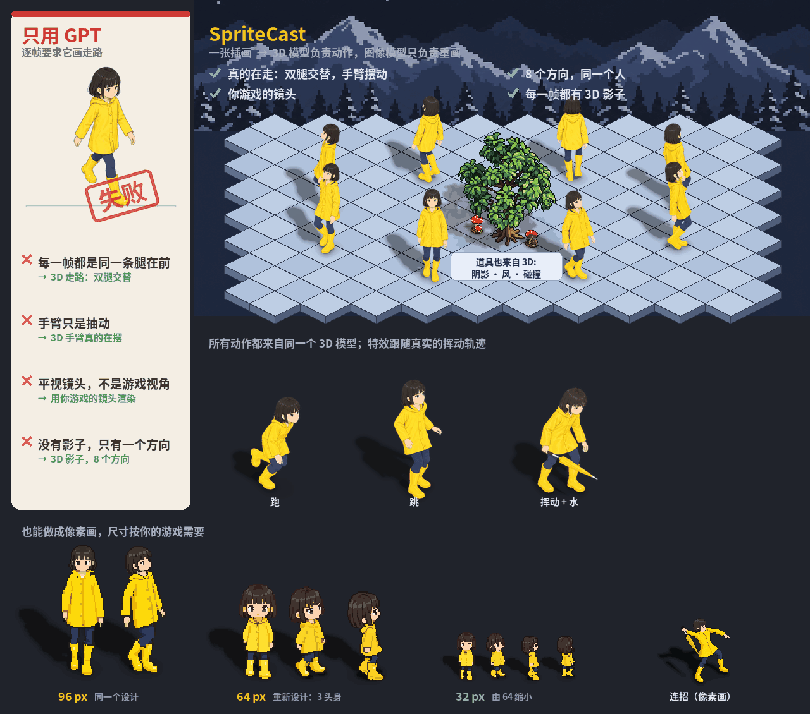
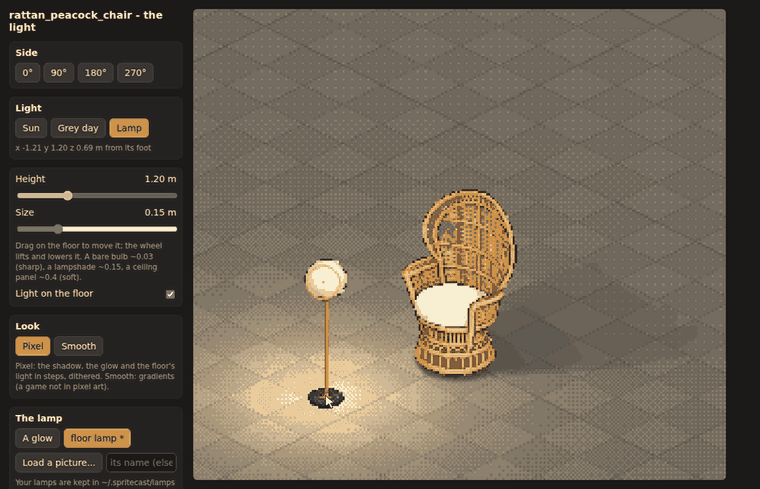
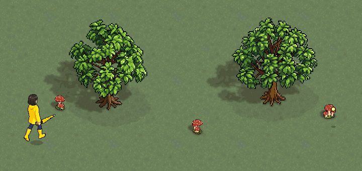

<h1 align="center"></h1>

<p align="center"><b>放进一张插画，得到一个游戏角色。</b><br>
一个用于 Claude Code 的等距精灵图生成器：8 方向行走、动作和像素画，<br>
都按你游戏的相机角度生成，每一帧下面都有 3D 阴影，还有能摆在旁边的道具。</p>

<p align="center"><a href="https://github.com/Sunghwan0112/spritecast/stargazers"></a></p>

<p align="center">
<a href="#能做什么">能做什么</a> ·
<a href="#行走角色">角色</a> ·
<a href="#像素画街机尺寸">像素画</a> ·
<a href="#道具与场景">道具</a> ·
<a href="#安装">安装</a> ·
<a href="#常见问题">常见问题</a> ·
<a href="README.md">English</a> · <a href="README.ko.md">한국어</a> · <a href="README.ja.md">日本語</a> · <a href="README.es.md">Español</a> · <a href="README.pt-BR.md">Português</a>
</p>



<p align="center"><i>同一个图像模型，同一张角色设定图。左：让 GPT 画行走，原样输出的结果。右：3D 带来的东西。</i></p>


<p align="center"><i>不只是人，物体也行：任何物体都能做成像素画，任意一面，与角色同一比例。<a href="#像素画道具任何物体任何一面">做法</a>。</i></p>

```
claude plugin marketplace add Sunghwan0112/spritecast
claude plugin install spritecast@spritecast
```

然后直接说：*"这是我的角色（hero.png）。让她朝 8 个方向走。"*
**想免费试用、不需要密钥**，就让 Claude *"try SpriteCast"*。

画图由图像模型完成（OpenAI 的，用你自己的密钥）。身体、动作、角度和阴影来自 3D，所以
每一帧都是同一个人，而且她真的在走。

| | 你提供 | 你得到 | 你花费 |
|---|---|---|---|
| **行走角色** | 一张插画 | 8 个朝向的行走、站立图、每帧一个阴影 | 约 $2.2 + 75 Tripo 积分 |
| **更多动作** | 一个名称，或一个 Mixamo FBX | 跑、跳、挥砍、投掷……8 个朝向 | 每个约 10 Tripo 积分（FBX：不需要）+ 绘制费用 |
| **像素画** | 一个会走的角色 | 高约 100 px 的像素精灵图 | 每张图约 $0.075（行走、8 个朝向：约 $1.35） |
| **动物** | 一张插画 | 8 个朝向的四足行走 | 30 Tripo 积分 + 绘制费用 |
| **坐姿** | 一个会走的角色 | 8 个朝向的坐姿，放到你的道具上 | 约 $0.22 |
| **道具，或摆好姿势的 NPC** | 一段描述 | 一张精灵图、它的阴影、它的锚点 | 约 $0.07（每多一个朝向 + $0.08） |
| **像素画道具** | 一段描述 | 各个面的像素精灵图，与像素角色同一比例 | 约 20 Tripo 积分 + 每面 $0.08 |

免费，MIT 许可。你直接付费给 OpenAI 和 Tripo；每个付费步骤都会显示费用并等你确认。

**绘制费用减半：4 个朝向。** 在 spec 里写 `"facings": 4`，只画四个斜向（东南、西南、东北、西北）——绘制费用约减半
（行走：约 $1 而不是约 $2；像素画约 $0.7 而不是约 $1.35）。导出的角色仍然能朝 8 个方向走：要东向时，它显示已画朝向中最近的那个
并保持住，所以笔直横着走也不会闪。

## 能做什么

| | |
|---|---|
|  |  |
| **[8 个朝向的行走](#行走角色)**，只需一张插画，每帧一个阴影 | **[动作](#更多动作跑跳挥砍)**：跑、跳、挥砍，或任意 Mixamo 片段 |
|  |  |
| **[像素画](#像素画街机尺寸)**，高约 100 px，包括拿在手里和扔出去的东西 | **[四足动物](#四足动物)**，不用买骨骼绑定 |
|  |  |
| **[坐姿](#坐姿)**，坐在你的道具上，她前面的扶手由 3D 算出 | **[道具](#道具与场景)**，按真实尺寸，全都在同一块地面上 |
|  |  |
| **[从 3D 模型烘焙的阴影](#light-shadow-wind)**:太阳、阴天,或你自己摆放的灯 | **[叶间的风](#light-shadow-wind)**,来自同一个模型,一枝一枝地摇 |

## 可以这样提要求

- *"这是我的角色（hero.png）。让她朝 8 个方向走。"*
- *"加上跑和跳。再加一个投掷，这是 Mixamo 片段（Throw.fbx）；在她手里放一个雪球。"*
- *"我们的游戏是像素画。把她的行走和投掷做成像素精灵图，高约 96 px。"*
- *"让她坐下，把她放到这张扶手椅上。"*
- *"做一个店主 NPC，穿棕色开衫的老人，四个方向。"*（摆姿势的人物：有描述就够了）
- *"做一个等距书架，高 1.8 m，摆满书，用 cozy 风格。"*
- *"这是我游戏里的一个道具（props/barrel.png）。照这个风格做一个配套的木箱。"*

## 为什么可行

图像模型无法在帧与帧之间保持同一个身体和姿势。用文字让它画行走，它会给你八张好看但并不在走的图，
也就是最上面那张图的左边，原样输出：

| 只用 GPT | SpriteCast |
|---|---|
| 八帧都是同一条腿在前 | 腿的动作来自 3D 行走 |
| 手臂随机抽动 | 手臂与腿反向摆动 |
| 相机在视平线高度 | 你游戏的相机（默认俯视 30°） |
| 没有阴影 | 3D 身体自己的阴影，逐帧 |

所以 SpriteCast 从不让它干这件事。**动作由 3D 完成；图像模型只负责重绘**每一帧渲染图，画成你插画的
样子。每张画之后都会被贴合回它的渲染图并与之对照：画成别的姿势的帧会被标记出来，可以
重画，绝不会被硬挤进去。道具也是同样的做法，只是用真实尺寸的方块代替骨骼。

**这样做带来的好处：**
- **角度和尺寸是对的。** 示例中的实体道具与引导图的轮廓重合度为 95–99 %；故意画得松散的植物
  为 87 %，穿衣人物为 69–88 %（衣服和头发会超出素体人偶）。行走
  角色逐帧打分（见下文）。相机和比例是固定的，所以不同时间做的道具能在同一块地面上对齐。
- **阴影看起来是对的。** 所有道具共用一个光源，所以每个阴影都朝同一个方向。实体道具投射 3D
  引导模型自己的阴影。摆姿势的人物和植物投射的阴影是画出来的形状（兜帽、头发、叶子），位置由
  3D 模型决定，所以脚或花盆底部的阴影就从它站的地方开始。行走角色投射 3D 身体自己的阴影，
  逐帧。不是画上去的一团，也不是方块人偶的影子。
- **它会自我检查。** 画完之后，结果会与引导图比较。如果模型画成了别的角度，不会硬挤进去：
  你会收到警告，Claude 会在重画前提出修改建议。
- **你游戏的视角和你的风格。** 2:1 等距、真等距、3/4 俯视、正面或任意角度；一个物体的
  全部四个朝向；自带的 `cozy` 风格，或你自己的一张图。
- **光照一致。** 每个引导图都由固定在屏幕上的同一个太阳照亮,图像模型在那张渲染上作画:物体的明暗来自它的 3D 形状,每个道具的
  每一面都从同一侧受光。没有手工涂的阴影([在游戏里看](#用它做的游戏rain-girl))。

## 用它做的游戏:Rain Girl

<p align="center"><a href="https://sunghwan0112.github.io/rain-girl/"></a></p>

<p align="center"><a href="https://sunghwan0112.github.io/rain-girl/"><b>▶ 在浏览器里直接玩</b></a> &nbsp;·&nbsp; <a href="https://github.com/Sunghwan0112/rain-girl">游戏代码</a><br>不用安装,不用注册。提交分数就会出现在下面的排行榜上。</p>

<p align="center"><a href="https://sunghwan0112.github.io/rain-girl/"></a></p>

<p align="center"><i>Rain Girl,一个小型像素动作游戏:穿黄色雨衣的女孩用伞里的水扑灭火焰怪物,不让森林烧起来。
女孩和游戏里的每个道具都出自 SpriteCast。</i></p>

- **女孩。** 一张插画 → Tripo 模型,绑定骨骼,按游戏的相机(2:1,俯视 30°)渲染 → 打伞行走、挥伞、站立,四个斜向(`"facings": 4`),
  每一帧重画成 96 px 的像素画。挥伞洒出的水是用 3D 渲染的特效、用同样的方法画成;站立循环来自 `idleclip.py`。
- **森林。** 七个道具 —— 树、半烧焦的树、烧焦的树、灌木、烧焦的树桩、岩石、蘑菇 —— 各自做成 Tripo 模型,按女孩的比例
  (每米 74 px:2.4 m 的树约 175 px 高)从四面渲染并画成像素画:共 28 张精灵图。游戏为每个道具随机显示一面;着火的树从原来那一面
  变成半烧焦,再变成烧焦。
- **一个光源,不手工上阴影。** 28 张都像它们的 3D 引导图一样从右上方受光。下面是每个道具的每一面:


- **一个调色板。** 最后把道具和草地贴图统一到一个 48 色调色板(原本 755 色),树的绿和灌木的绿是同一种绿。
- **3D 在游戏里继续发挥作用。** 地面上的阴影由每个道具的模型烘焙([方法](#light-shadow-wind)),女孩走进道具的阴影会变暗 —— 脚、腰、头各按它和太阳之间挡着的东西。火球在哪里被掩体挡住,来自每个道具自己的模型:在火球的高度(0.55 m)切开,按当前显示的那一面
  决定。树干挡得住,上面的树冠挡不住,蘑菇太矮。
- **风也来自模型。** 叶子按它们在 3D 模型上的位置分成叶团,每个叶团整体移动,一次一个像素,所以树是一枝一枝地摇 —— 顺着这一回合的风,阵风时更猛([方法](#light-shadow-wind))。
- **一个道具的花费:** 模型约 20 Tripo 积分,画四面约 $0.3。

## 行走角色


给它一张角色插画（面朝前方、站直、不摆姿势），你会得到 8 个朝向的行走（每个 8 帧）和 8 张站立图，画风与
那张插画一致。图像模型无法在帧与帧之间保持身体和姿势，所以动作来自 3D：
1. 根据插画画出一张转面图。
2. [Tripo](https://www.tripo3d.ai) 据此生成 3D 模型，绑定骨骼，并给它一个行走和一个待机动画。
3. 行走用游戏相机渲染（免费），每一帧都带有 3D 身体自己的阴影，沿光线方向
   压平到地面上。
4. 图像模型在渲染图上重绘，每次调用 4 帧。先画正面，其他朝向都以它为准，所以
   始终是同一个人。
5. 每一帧都被贴合回它的渲染图，头部大小保持稳定，边缘清理干净。你得到帧条、每帧一个阴影
   （脚踩在阴影上，抬起的脚有自己的阴影）以及一个锚点。

```
$PYTHON skills/spritecast/scripts/charpipe.py turnaround hero.json --yes   # then 3d (model, rig, renders) and draw (then finish, preview by themselves)
```
默认会画全部八个朝向。左右对称的设计可以设置 `"mirror": true`，把西侧朝向由东侧
翻转得到（各自保留自己的阴影），大约省 $0.66。
或者 `"facings": 4`：只画四个斜向，绘制约减半；导出的角色朝 8 个方向中任何一个走时，都显示其中最近的那个。

每个角色的费用：约 $2.2（OpenAI；用 `"mirror": true` 约 $1.5）和 75 Tripo 积分（约 $0.75；动物为 30）。或者带上你
自己绑好骨骼的 GLB（`"rig_glb"`），直接跳到 `render`。

<details>
<summary><b>更多：预览视频、Meshy，以及带骨骼的示例角色</b></summary>

`preview` 还会生成 `walk-all.mp4`（所有朝向同时行走，需要 ffmpeg）：这是发现头部忽大忽小
或某帧跳动的最快方法。Tripo 有时返回的模型是侧着的或没有颜色；这两种情况都会自动修正。
`"modeler": "meshy"`（以及 `MESHY_API_KEY`）改由 [Meshy](https://www.meshy.ai) 生成模型（约 30 Meshy 积分）；骨骼绑定
仍然用 Tripo 的。

更多选项（多套服装、以鞋底为锚点）和经验总结：
[reference/character.md](skills/spritecast/reference/character.md)。上面的女孩在
[`examples/rain_girl`](examples/rain_girl) 里：她的插画、转面图、spec、帧条、阴影、`character.json` 和整张图。
她只用 Tripo 制作：约 $1.7 的绘制费用和 85 Tripo 积分。她绑好骨骼的模型也在那里（`rig.glb`，带行走、
跑、跳和挥砍，与仓库其余部分一样是 MIT），所以你不需要任何密钥、不花一分钱就能试整个 3D 部分：复制这个文件夹，
在 spec 里加上 `"draw": false`，运行 `charpipe.py render rain_girl.json`，然后 `finish`，帧条、阴影和锚点都
直接来自 3D 模型。她的 spec 还展示了 `"notes"` 的用途：3D 渲染图中雨衣两侧和
手臂内侧有深色条纹，在 `notes` 里加了一行（"no dark line, stripe or seam on it anywhere... leave them out"），就让每一帧
都不再画出它们。模型的缺陷是在绘制中修好的，而不是在 3D 里。

</details>

### 四足动物

Tripo 给四足动物的骨骼绑定走起来很糟（没有脊椎，肩膀挂在脖子上），所以动物不使用买来的骨骼绑定。
用 `"kind": "animal"` 时只需要 3D 模型本身（Tripo，约 30 积分）：骨架从网格中找出（脚、
背、头、尾巴，以及它面朝哪边），它以猫或狗的步态行走，并获得与人一样的绘制、贴合和
3D 阴影。

转面图要画成四脚着地，每条腿彼此分开，尾巴伸向后方；衣服只能是贴身的（针织背心，而不是
斗篷或围巾，任何垂下来的东西都会跟着最近的那条腿动）。绘制前先检查渲染图：四条腿、头朝前、尾巴
在后。如果 Tripo 的模型多长出一条腿，就重新生成，或者用 Meshy（`"modeler": "meshy"`）。


这只猫在 [`examples/tabby_cat`](examples/tabby_cat) 里：一只穿着黄色小雨衣（那个女孩的）的橘色虎斑猫，包括它的设计、
转面图、spec、帧条、阴影和整张图。花了 30 Tripo 积分和约 $2.5 的绘制费用，包括重画和设计尝试。它的
帧与渲染图的贴合度为 0.76-0.97（东北和西北用 `"mix"` 逐帧混合，见 reference/character.md）。

### 更多动作：跑、跳、挥砍

除了行走，角色还可以跑、跳或挥动东西。把它们列在 spec 里，`"actions": ["run", "jump", {"name": "slash",
"hold": "umbrella"}]`：骨骼从 Tripo 获得这些动画（每个约 10 积分；有 run、jump、slash、shoot、dive、climb、fall、
hurt 和 turn），每个动作都像行走一样在 8 个朝向上渲染、绘制和收尾，输出成各自的帧条，每帧
一个阴影。挥砍需要手里有东西：`"hold"` 用简单形状搭出它并放进手里，于是它随
每一帧移动（目前有雨伞、手枪或水枪；默认右手，或 `"hand": "left"`）。用你自己绑好骨骼的模型时，里面的任何片段都可以作为动作。手持物会被
逐部分地描述给图像模型，最仔细描述的是手握的那一端（握把、杆身的第一段），它很小又贴着
身体，模型在这里最容易乱猜。


**大部分一次就能成功。** 雨中女孩的行走、跑和跳在每一帧与 3D 渲染图的贴合度都在 0.78 以上，全部
只画了一次。雨伞挥砍更难（一个绕着身体挥动的细长物体）：画错位置的武器会被自动
重画，剩下的在她深弯腰处贴得稍松一些，也就是姿势画得稍微直一点，在动起来时看着没问题。
这些帧会列出来供你查看；保留或重画都可以。

**一直拿着的东西，左右手都行**（应用户要求）。把 `"hold"` 放在 spec 本身而不是某个动作里，
`"hold": {"kind": "watergun", "hand": "left"}`，角色在行走、站立图和每个动作中都会拿着它。
下面是左手拿着水枪：上面是 3D 引导图，下面是绘制出的帧。


- **它一直在那只手里。** 一只手拿着东西的角色左右并不对称，所以任何帧都不会通过
  翻转另一帧得到，翻转的话东西就换手了。（`"mirror": "never"` 让任何不
  对称的角色也这样处理：眼罩、单边袖子。）每张图都会被告知是哪只手、渲染图中东西在哪里，之后每一
  帧都会与它的渲染图对照：上面 24 帧中，有一帧被点名让你查看。
- **手握住握把。** 骨骼的手指是伸直的，在此基础上画出来的是一只张开的手旁边飘着一把
  枪。所以引导图会把握持的手弯起来：握把放进拳头里，四根手指从一侧绕过去，
  拇指从另一侧绕过去，每根手指只弯到碰到为止。粗握把手握得松一些；粗到手
  握不住的会被做细。
- **画之前先看手。** 在一帧中握持只有几个像素，所以免费的 `render` 步骤还会保存这只手
  各个方向的特写（`render/hand-walk.png`），并打印每个指尖离握把多远。在这里修正，不花钱。
- 已经是你自己骨骼模型一部分的东西：`"hold": {"in_model": true, "words": "In the LEFT hand: a black pistol."}`。

上面的示例绘制费用约 $0.7（8 张图：三个方向的行走和一个方向的跑）。

<details>
<summary><b>其他尺寸：用同一批绘制得到 512、64 和 32 px</b></summary>

**你需要的任何尺寸**（应用户要求）：帧默认高 256 px，`charpipe.py pack CHAR.json --px 64` 可以用同一批绘制
生成任意高度的另一套，比 256 大也同样清晰，因为帧保留了绘制本身的细节。帧条、阴影和该尺寸的 `character.json` 放在 `out-64px/`，
不重画任何东西，`out/` 保持原样（spec 中的 `"frame_px"` 设置默认值）。下面分别是 512、256（默认）、64 和 32 px 高，都以相同大小显示（逐像素放大）。64 时头发、雨衣、
靴子和雨伞都看得清；32 时姿势和颜色还在，但脸基本没了，这只是普通的缩放，还没有专门为这个尺寸
做的处理（见[路线图](#路线图)）。


</details>

### 挥动时的特效：水、火、树叶

挥动可以在空中留下东西。给动作加上 `"trail"`，`{"name": "slash", "hold": "umbrella", "trail": "water"}`，
你就会得到作为单独精灵图的特效，叠在身体上。**它是免费的，不会重画任何东西**：3D 骨骼知道
伞尖在每个时刻的位置，所以特效由这条轨迹计算得出。已有的挥砍也能加上特效，不用改动
它的帧。


- **它跟随真实的动作。** 让图像模型画挥砍，它会编一条弧线然后反复用；现成的特效是同一个形状贴在
  每次挥动上。这里的光带和碎片来自这个角色的雨伞在这个动作中走过的轨迹，从 8 个朝向
  分别看，身体和雨伞会挡住经过它们后面的部分。改变动作，特效也会跟着变。
- **十一种外观**：`plain`、`wind`、`water`、`fire`、`drops`、`flames`、`leaves`、`greenleaves`、`petals`、`snow`、`sparkle`。颜色、
  数量和速度都可以改，新外观只是文件里多一个条目，你还可以提供自己的小图片让它
  散落出来（`"image": "mine.png"`）。
- **碎片一帧接一帧地飞。** 一片叶子只放出一次，被挥动带着走一小段，翻转、摇摆，然后落到
  地上，每一帧都是同一片叶子，而不是每次重新撒一遍。
- **水和火作为一个整体运动**（应用户要求）。水先成片甩出，拉成细丝，碎成水滴，留下
  水雾；火焰中心是白黄色，然后是橙色，再外面是冷却时逐渐变暗的红边，还有灰烬向上飘。
- **水看起来像水。** 薄的水浅而透明，深的水更暗，有明亮的边缘和来自与角色
  同一光源的高光；快速的水滴沿运动方向拉长，有几滴落地溅成一圈水花。
- **只有挥动本身。** 举起雨伞时不会甩出任何东西：动作中快速的那一段会被自动找出。
- **比身体更多的帧。** 身体画了 8 帧，但水有 24 个特效帧（每帧三个），火有 16 个（每帧两个），叠在上面以更快的速度
  播放。只用 8 帧时，水片在一帧里还是完整的，下一帧就已经成了水滴。这些帧分布在身体帧的前后
  （提前 ⅓ 帧、正好、延后 ⅓ 帧），所以水跟着画出的雨伞走，而不会跑到它前面。
- **像素画也可以**，按精灵图的尺寸：实体保持硬边，水雾保持透明。


**老实说：** 这些是计算出来的，不是画出来的，所以它们干净而非手绘感。轨迹
是手持物的，所以动作需要手里有东西。目前只在雨伞挥砍上制作和检查过。

### 衔接两段动画：进入挥击，再退出来

行走不会停在攻击的第一个姿势上，攻击也不会停在行走的姿势上：一个接一个播放，身体会跳一下。
3D 骨骼会生成中间的帧（应用户要求）：`{"name": "ready", "between": ["walk", "slash"], "frames": 3}` 和
`{"name": "recover", "between": ["slash:end", "walk"], "frames": 4}`。下面全部是绘制的：她拿着雨伞走，下沉进入
架势（骨骼生成 3 帧），带着水特效挥动，再起身（另外 4 帧），继续走。


- **原理。** 骨骼同时播放两段动画，各自停在某一时刻，然后从一个过渡到另一个，带缓入
  缓出。`"slash:end"` 从攻击的最后一个姿势而不是第一个开始。
- **渲染免费，绘制方式与普通动作相同**，三四帧一张图，约 $0.08。
- **连起来看**：`charpipe.py loop hero.json --only walk,ready,slash,recover --facing south-east`（免费）用完成的帧生成
  一个像上面那样的 GIF，这样在重画任何东西之前就能看到跳动的帧。像素画的一套
  也可以这样在编辑器里把所有帧连起来直接修：`pixeledit.py hero.json --join walk,ready,slash,recover --facing south-east`。
- **只有一帧不对？单独画它。** `charpipe.py frame hero.json --only slash --facing south-east --frame 5 --yes`（约 $0.08）只
  重画那一帧；动作里的 `"frame_words"` 告诉图像模型那一帧的渲染图表达不了的东西。上面的第 5 帧连续五次
  左拳飘在雨伞上方；告诉它那只手大部分藏在她头后面之后，就画对了。
- **手里的东西一直在手里。** 要让它在行走中也在，行走就得拿着它（这里是在行走片段上加一个
  带雨伞的动作）；否则它会在第一个中间帧里凭空出现。

### 像素画（街机尺寸）


对于用像素绘制的游戏，比如清版动作、格斗、街机平台跳跃，同一个角色可以做成真正的像素画，高约 100 px：
每个像素一种颜色，调色板约 40 色，深色描边，没有模糊，并带有每帧的 3D 阴影。不是把绘制好的
帧缩小：顺序正好相反。


3D 渲染图被像素化成引导图，图像模型把它重绘成像素画，然后**按模型绘制时用的网格读回**
这张画，头部用它自己的网格线，这样眼睛和嘴巴能保留下来，再根据渲染图确定大小和位置。

```
$PYTHON skills/spritecast/scripts/pixelart.py hero.json                        # the plan and its cost - spends nothing
$PYTHON skills/spritecast/scripts/pixelart.py hero.json --clips walk,throw --yes
```
每张图约 $0.075：全部八个朝向的行走是 18 张（约 $1.35）；上面的投掷有五个朝向，用了 14 张。

- **拿着和扔出去的东西。** `"hold": {"kind": "snowball", "until": "auto"}` 把它放进手里，在手
  移动最快时松手。之后 `pixel.json` 会告诉你是哪一帧、在帧中哪个位置、朝哪个方向以及多快，足够你的引擎生成
  投射物；你还会得到雪球、它的飞行形状和 4 帧的碎裂效果。上面的图就是回放这些数据的结果。
- **任意 Mixamo 动画。** `addclip.py hero.json Throw.fbx throw` 把 FBX 片段套到角色的骨骼上，免费。上面的投掷
  就是这样加进来的。
- **它会自我审查。** 每一帧都会与它的渲染图对照（姿势、手持物）；`--redraw` 重画被标记的图，
  保留更好的那张。投掷的 40 帧在一次重画后全部通过。
- **最后一点交给像素编辑器。** 像素画不能全靠规则得到。`pixeledit.py hero.json` 在
  浏览器中打开每一帧：魔术擦除残留的白色块、铅笔、换颜色、移动选区、把一张好脸复制到其他
  帧。可以往调色板里加任何颜色；帧本身也可以复制（作为中间帧在上面画，8 帧变成 9 帧）、
  删除和移动：阴影和游戏数据会跟着变。编辑会被保留，之后每次构建都会重新叠加上去。
  连续播放的几段动画可以合在一起打开，播放整个循环，哪里跳就在哪里修：
  `pixeledit.py hero.json --join walk,ready,slash,recover --facing south-east`。


还可以把这一帧所依据的 3D 渲染图显示在旁边（按键 `3`），或者淡淡地垫在下面，这样在动手之前就能看出一个
拿不准的像素本来应该是什么：


留给手工的有多少：很少。40 帧投掷，AI 绘制约 6 分钟，AI 抠图约 2 分钟；之后唯一的
手工是魔术橡皮擦：在 40 帧中的 10 帧里，对每个残留白点点一下（131 个像素，占
精灵图的 0.15 %）。没有动过任何一张脸：它们就是流程生成的样子。每次构建都会打印这些数字。

**更难的一套，以及手工做了什么。** 如果角色拿着东西（武器、雨伞），这件东西的细节需要手工稍作修正：每帧几个像素，
用橡皮擦和铅笔就行，不需要绘画技能。与"衔接两段动画"中相同的循环，做成像素画：她拿着雨伞走，下沉进入架势，挥动，起身，继续走，
四段动画连在一起，共 23 帧。手工修正的只有雨伞：让伞尖和伞边在帧与帧之间保持一致。角色本身没有修，只是擦掉了几个残留的白点。
总共 51,442 个像素中改了 1,196 个（2.3 %），由一个不会画画的人在几分钟内完成。之所以快，也是像素画里最重要的一点：不是一帧一帧地看，而是把 23 帧连起来播放着看。修正就是让任何部分的像素在帧与帧之间都不会大幅变化。
没修的：两帧行走中雨伞画得与 3D 雨伞的角度和长度略有偏差。


- **编辑器会显示 3D 中东西的位置**（按键 `4`）：手持物显示为红色，身体轮廓显示为蓝色，叠在你
  正在画的帧上，所以画得太长或角度不对的雨伞一眼就能看出来。


**多少种颜色。** 一套默认约 40 色。`--colours 16` 把它限制在最多 16 色（最少 8 色），
`--palette` 把每个像素换成指定调色板中最接近的颜色：可以是技能自带的 15 个调色板之一，按名称指定
（`--palette pico8`；`--palette list` 列出它们），或者你自己的 Aseprite 能读取的文件：`.png` `.gif` `.bmp` `.pcx`、`.hex`
（Lospec）、`.gpl`、`.pal`、`.act`、`.col`、`.aseprite`。两者都免费：不会重画任何东西，只是用
另一个调色板读取同一批绘制。道具也支持这两个选项。降到 16 色时角色仍然很好；到 8 色时相近的颜色会合并（她的藏青色腿
变成黑色），而调色板中如果没有与她某种颜色接近的颜色，那种颜色就会变掉，保留之前先看看结果。


自带的调色板，用同样的两个精灵图展示。黄色外套需要调色板里有黄色（`c64`、`gameboy`、
`slso8` 和 `sweetie16` 没有）：


*调色板归各自的作者所有：AAP-64 by Adigun A. Polack、Apollo by AdamCYounis、DawnBringer 16/32 by DawnBringer、Endesga 32/64
by ENDESGA、Resurrect 64 by Kerrie Lake、SLSO8 by Luis Miguel Maldonado、Sweetie 16 by GrafxKid，取自
[Lospec](https://lospec.com/palette-list)。*

**尺寸。** 96 px 是普通比例角色的尺寸。**64 px 适用于专门设计成小个子的角色**，大约三
头身，有它自己的 3D 模型，出来大约 70 px。再小就不会交给图像模型了：它守不住这么
少的格子（32 px 试了四种方式）。`--px 32` 以 64 绘制，再从中免费生成 32 的一套，动作和帧相同，
脸更粗糙。64 是效果好的那个。


两套都在 [`examples/rain_chibi`](examples/rain_chibi) 里：根据雨中女孩画的三头身设计、它的转面图、
spec、`pixel64/`（八个朝向的行走和投掷，128 帧，每帧带阴影；没有任何像素经过手工修改），以及由它生成的 `pixel32/`。她的投掷是用 `addclip.py --clear-head 55` 套上的 Mixamo 片段；片段和
骨骼不在仓库里。


**为什么不直接要 32 px？** 图像模型（GPT）在 64 以下画不好小像素画。它按自己的尺寸
画"像素"，要求 8 px 的格子，它画出来的从 7.4 到 10.8 都有，而在 32 格里差一格就是少一只眼睛。上图：最上面一行
是它在 64 下画的；三行红色的是直接要 32 px 的结果，每行用不同的图排布，画的都是同一个行走。所以
技能先要 64，再从中生成 32（绿色那行）。详情：[reference/pixel.md](skills/spritecast/reference/pixel.md)。

上面的精灵图在 [`examples/rain_girl/pixel`](examples/rain_girl/pixel) 里：五个朝向的投掷、两个朝向的行走和
雨伞挥砍的帧条，它们的阴影，带飞行形状和碎裂效果的雪球，以及包含松手数据的 `pixel.json`。

### 像素画道具：任何物体，任何一面


对物体的做法与角色相同：它的 3D 引导图被像素化，图像模型在同一网格上把它重绘成像素画，
然后按那个网格读回这张画，并调整到引导图的大小。角度就是相机的角度，所以一个物体转四个方向就是
同一个物体的四张精灵图：同样的顶棚、同样的轮子，每一面都有该有的东西。

```
$PYTHON skills/spritecast/scripts/isoprop.py model cart.json --yes    # Tripo makes the 3D model from the description (~20 credits)
$PYTHON skills/spritecast/scripts/isoprop.py render cart.json         # free: the guide from each side ("views": [0, 90, 180, 270])
$PYTHON skills/spritecast/scripts/proppixel.py cart.json --yes        # ~$0.08 a side → out-pixel/sprite-<side>.png
```

- **真正的 3D 模型才能让各个面画对。** 只有方块的话，图像模型分不清哪一面上有什么：
  一台街机框体在四个视图中有一个把屏幕画到了错误的那一面。上面的摊车是 Tripo 模型；四个面
  第一次绘制就全部对上了。简单物体（椅子、木箱）的单个视图用方块就够了。
- **与角色同一比例。** `--ppm` 是每米像素数：像素角色的像素高度除以它的米制身高
  （小个子示例角色为 54），这样道具和角色站在同一块地面上，像素大小也相同。
- **抠图的收尾由你来做。** 顶棚下面和辐条之间的空隙由 AI 抠图清除；剩下的，在
  与角色相同的像素编辑器里打开（`pixeledit.py cart.json`）：四个面就是四帧，3D 渲染图可以显示在精灵图旁边
  或下面，你擦掉的内容会被保留。上面的摊车用这种方式收尾了 122 个像素。
- 摊车在 [`examples/ramen_cart`](examples/ramen_cart) 里：spec、Tripo 模型、四张引导图
  和四张精灵图。

<a name="light-shadow-wind"></a>
### 来自 3D 模型的光、影和风

做出道具四个面的模型,也知道光在哪里被挡住、枝条在哪里。所以阴影、灯在地面上的光和叶间的风都由它算出 —— 免费,在你的电脑上,不需要绘制。

- **阴影由 3D 模型烘焙**(免费、几秒、自动完成):地面上太阳和天空的光,各按物体遮挡的多少计算 —— 所以靠近处深(摊车底下、
  树干根部周围),从高处投下的阴影更淡(树冠的影子,叶间透出光点),按像素画分成 5 级。太阳就是引导图自己的光,所以道具上画的明暗和地面的
  阴影方向一致。阴天用 `--shadow overcast`(或在 spec 里写 `"shadow": "overcast"`):没有太阳,只有四周柔和的暗影。
  输出 `out-pixel/shadow-<面>.png`,位置写在 `pixel.json` 里;画在精灵图下面即可。


- **室内:灯放在你想放的地方。** `--lamp -1,2.4,-0.2 --lamp-size 0.03`(从道具脚下算起的米数:向右、向上、朝向观看者;灯本身的
  大小)—— 阴影背着灯落下,灯越低越长,裸灯泡清晰、大灯罩柔和,并随灯光在地面上的衰减变淡。灯光在地面上的光斑也一并输出 —— `light-<面>.png`:灯正下方最亮,
  道具挡住的地方被挖掉,各级之间用抖动衔接;用叠加(ADD)铺在地面上。灯本身也以像素画(`lamp.png`)输出,
  每个面里的位置写进 `pixel.json`,游戏可以照编辑器里看到的样子画出地面、光、阴影、道具和灯。不写就用太阳。**透光的部分**(藤编、
  树叶、网)在模型上只是画上去的,并没有镂空:`"see_through": [{"colour": "#c8955a", "open": 0.35}]` 让这个颜色的部分透过相应
  比例的光。一把藤编孔雀椅([`examples/rattan_peacock_chair`](examples/rattan_peacock_chair))在六种光下:


- **自己移动光源**: `lightedit.py PROP.json` 会在你的电脑上打开一个页面:在地面上拖动灯,用滚轮调高度,用滑块调大小 ——
  阴影和灯光在地面上的光斑随即重画;保存后每个面都按这盏灯烘焙,并写进 spec。
  **用你自己的灯**:载入灯的图(与道具同比例、抠好的 PNG),点一下光从哪里发出 —— 它立在你拖到的地方(在道具前就画在前面,
  在后就画在后面),光从那里发出。阴影、光晕和地面的光可选像素画(分级、抖动)或平滑(渐变,适合非像素风的游戏:`"light_style": "smooth"`)。




- **风中的摇动也来自 3D 模型**(在 spec 里写 `"sway": "leaves"`,或 `propshade.py PROP.json --sway leaves`;免费):树冠不是一整片,而是
  一根根枝条。每个叶子像素取它所显示的模型上的点,这些点按 3D 位置分组(前面的枝和后面的枝分开),每一团整体移动,形状不变,
  一次一个像素,先画远的;树干不动。不扭曲画面,也不用手画帧。输出 `sway-<面>.png`(12 帧 × 无风 / 微风 / 阵风,循环播放一行)、
  可自行驱动的 `clumps-<面>.png` 和每团的 3D 位置,以及 `preview-sway.gif`。这棵树在 [`examples/forest_tree`](examples/forest_tree)。


- **哪里会挡路,也来自同一个模型**(免费,和阴影一起烘焙):`solid-<side>.png` 是走不进去的地方 —— 把模型在贴近地面处切开得到的
  道具落脚范围(树根、靠四条腿站着的桌子)。加上 `"collide": {"cover": [0.55]}`,还会得到在那个高度飞行的东西被挡住的地方:树干挡得住
  火球,上面的树冠挡不住。两者都带位置和用于碰撞多边形的轮廓。并且**角色走进阴影会变暗**:每个阴影都写明了离地高度上该怎么读,
  所以脚、腰、头各按它和太阳之间挡着的东西变暗。
- **进入引擎**:`export.py PROP/out-pixel` 写出 Phaser 3 模块和 Godot 4 场景 —— 阴影、灯光、风、落脚范围的碰撞多边形,以及可以询问的
  `shade()` / `cover()`(已在 Phaser 3.90 和 Godot 4.7 中打开检查;Unity 和 Aseprite 目前只支持角色)。小东西也会摇:蘑菇的菌盖会点头
  (`"sway": "caps"`,[`examples/forest_mushrooms`](examples/forest_mushrooms))。



### 跳过绘制：直接用 3D 渲染作为帧

在 spec 中设置 `"draw": false` 时，没有图像模型来画帧：3D 模型自己的渲染图（卡通着色，用它自己的贴图）就是
帧，带有同样的 3D 阴影和锚点。图像模型只画转面图（约 $0.09）；如果用你自己绑好骨骼的 GLB
（`"rig_glb"`；动物：它的模型 `"model_glb"`），就什么都不画。这时一个角色的费用就是转面图加上 3D
（75 Tripo 积分，动物 30），两次确认，`3d` 一完成就做完了。代价是清晰度：没有画出来的线条，脸更简单，
模型的贴图保持原样（毛发和褶皱更模糊）。


## 坐姿


角色会走之后，就可以让 Claude *"让她坐下"*。她的 3D 模型会被免费弯成坐姿（大腿水平、膝盖弯曲、双手放在
大腿上），8 个朝向；你先看这些渲染图，然后它们会像站立图一样被绘制（两张图，约 $0.22）。她
是坐在空气上的，你游戏里的椅子放在她下面。`character.json` 会得到一个 `sit` 块：每个朝向的文件、**座位点**
（放在椅子的座面上；以帧的比例表示，和 `anchor` 一样）、座面高度和阴影。要把她放到你的
某个道具上，`seat.py` 会把她放在它的座面上，并根据两者的 3D 高度算出道具**挡在她前面的部分**（扶手、长椅的靠背、长凳的
靠背），不需要手绘：


它会找出座面的高度和朝向，让她往后坐，直到膝盖到达座面边缘。如果坐得有点偏，
就在修饰页面上拖动她（见下文）：松手后会从那个位置重新计算前景部分。
详情：[reference/sitting.md](skills/spritecast/reference/sitting.md)。

```
$PYTHON skills/spritecast/scripts/charpipe.py sit <name>.json            # free: the seated renders
$PYTHON skills/spritecast/scripts/charpipe.py sit <name>.json --draw     # ~$0.22: drawn and finished
$PYTHON skills/spritecast/scripts/seat.py <prop>.json <name>.json --height 1.3   # free: on a prop, its front piece worked out
```

## 手动修正


自动步骤能帮你完成大部分工作；最后一点最好靠眼睛来做。**手工涂绘比任何
自动步骤都准确**：上图中，教堂长椅的靠背把整个女孩都挡住了，直到涂绘并把她往上移才好，餐椅和
扶手椅的靠背也在错误的位置切开了她。抠图也不完美：手臂和身体之间残留一点纸色，白色
衬衫被抠图当成了纸。让 Claude
打开修饰页面（或运行 `$PYTHON skills/spritecast/scripts/touchup.py <spec>.json`）：该道具或
角色的每一张完成图都会在浏览器中打开，可以涂绘，边画边保存。

| 颜色 | 作用 |
|---|---|
| 红色 | 清除：变为透明 |
| 绿色 | 恢复：这些像素从绘制图本身取回（打开 "drawing under" 可以看到它） |
| 蓝色（道具） | **前景部分**：在物体内部挡在角色前面的东西，比如拱门靠近的柱子、凉亭的顶、椅子靠近的扶手 |
| ⬠ 多边形 (P) | 点击各个角并闭合（双击、Enter，或点第一个角）：用正在涂的颜色填充，或擦除 |
| 🪑（座位） | 拖动坐着的角色（或用方向键）；松手后从那个位置重新生成座位和它的前景部分 |

然后运行 `touchup.py <spec>.json --apply`（角色的帧条会重新打包）。有前景部分的道具会得到 `sprite-front.png` 以及
`sprite.json` 中的 `"front"`：把精灵图画在站在其中的角色后面，把前景部分画在角色上面。`finish` 会自动重新
叠加涂绘；如果某张图在涂绘之后被重画过，它的涂绘会被放到一边，而不会叠到另一张绘制上。

**像素精灵图**有自己的逐像素编辑器，见[像素画](#像素画街机尺寸)。

## 道具与场景


让图像模型画"一把等距扶手椅"，你会得到一张好看但角度略微不对的图。再要一次，你会得到
另一个不对的角度和另一个尺寸。把十个放在同一块地面上，没有一个对得齐。

SpriteCast 给模型一张难以看错的引导图（万一看错了，会告诉你）：
1. Claude 用简单的方块按**真实米制尺寸**搭出物体。
2. 方块用你游戏的**精确相机**渲染。
3. 图像模型只是把这张引导图重绘成你的**美术风格**。
4. 绘制被抠出来并**贴合到引导图的外框**，所以它的尺寸和占地就是引导图的；轮廓
   不符合引导图的绘制会被标记，而不是被强行套上。它还会得到烘焙好的阴影和供引擎使用的锚点。

道具出来是绘画风格的（`cozy` 风格：平滑的明暗、细描边），或者是你自己一张图的风格。

## 一次会话的流程


你描述道具。Claude 只问缺少的信息：尺寸、朝向、你游戏的视角、你的风格。它免费渲染
引导图并给你看。它告诉你费用并等你确认。然后你得到 `sprite.png`、`shadow.png` 和
`sprite.json`。

## 示例

都在 [`examples/`](examples) 里，每个都有它的 spec 和生成的文件（原始绘制保存为 WebP，以保持仓库较小）。

| | | |
|---|---|---|
|  |  |  |
| `reading_armchair`：9 个方块：座面、靠背、扶手、腿 | `potted_monstera`：一个花盆，植物作为一个整体体积给出 | `arcade_cabinet`：正面朝左下 |


`armchair_four_ways`：`views: [0, 90, 180, 270]`。后面的视图以第一个为参考来画，所以始终是同一把
椅子。`arcade_cabinet_topdown`：`camera: "topdown"`。`reading_armchair_tripo`：同一把扶手椅，用 Tripo 模型（见下文）。

示例中的 3D 模型（`reading_armchair_tripo`，以及行走角色的网格和骨骼）由 [Tripo](https://www.tripo3d.ai) API 生成。

## 更多细节：先做 3D 模型（Tripo）


当重要的只是东西放在哪、有多大时，方块就够了。想要更多细节（弯曲的扶手、收窄的腿、纽扣、
雕花），就先让 [Tripo](https://www.tripo3d.ai) 根据描述生成一个真正的 3D 模型。它的高度按方块给定的来做，
保持自身比例（它实际覆盖的占地会写入 `sprite.json`；`"shape": "box"` 则把它压进方块的外框），
然后它就成为引导图。图像模型于是在真实的形状上绘制，3D
阴影也是模型自己的。

```
$PYTHON skills/spritecast/scripts/isoprop.py model  armchair.json --yes   # Tripo text-to-model (~20-40 Tripo credits, ~2 min); the spec now uses it
$PYTHON skills/spritecast/scripts/isoprop.py yaws   armchair.json         # free: the model turned four ways; set "model": {"yaw": ...} to the right one
$PYTHON skills/spritecast/scripts/isoprop.py render armchair.json         # then draw, finish as usual
```
需要 `TRIPO_API_KEY`。方块会以 `blocks_draft` 的形式保留在 spec 中。

## 摆姿势的角色（根据描述）


只是站着的 NPC 不需要插画，也不需要骨骼：它的做法和道具一样。Claude 按这个人的真实身高摆一个素体人偶，在每个朝向上渲染（4 或
8 个）。图像模型按你的描述给它穿上衣服。先画第一个朝向，其他朝向以它为准，所以始终是同一个人。

```json
{ "name": "barista",
  "character": { "height": 1.63, "build": "slim", "directions": ["south-east", "south-west", "north-east", "north-west"] },
  "description": "a cheerful young café barista: a short dark-brown bob, a cream cable-knit sweater under a forest-green apron, ..." }
```

锚点在两脚之间。第一个朝向约 $0.07，其他每个朝向 $0.08。

<details>
<summary><b>姿势、自定义角度，以及重画单个朝向</b></summary>

**姿势。** 人偶有关节。`"pose"` 可以是 `stand`（默认）、`wave`、`point`、`hold`（双手在身前合拢：杯子、
托盘、书）、`arms-crossed` 或 `walk`（迈步中）。描述与之相配的内容（"waving hello"、"holding a coffee cup"）。或者自己给出角度，Claude 可以帮你调整
（"把手臂抬高一点"），并在免费渲染中检查：

```json
"pose": { "base": "stand", "arm": { "left": [[150, 10], [170, 10]], "right": [[150, 10], [170, 10]] } }
```
每条肢体分为上下两段（每段 `[out, forward]` 度）：先向身体侧面转出，再向前摆。`left` 和
`right` 是人物自己的左右。


**单张图片。** 这些摆姿势的人物每个朝向一张图；要行走，见[行走角色](#行走角色)。
每个朝向都要自己看一遍（轮廓检查看不出头转错了方向）；用
`draw <spec> --yes --again --only north-west` 重画其中一个。

</details>

## 与绘画相符的阴影

3D 引导图的阴影对家具这类实体是对的。但绘制中有方块没有的东西：头发、外套的兜帽、
从花盆里垂出来的叶子。

<details>
<summary><b>阴影是怎么算出来的</b></summary>

所以 SpriteCast 还会渲染引导图的**高度图**：每个像素离地面有多高。离地 h 米的点在屏幕上
投下的阴影偏移固定的距离（h 乘以光线的偏移量），与深度无关。于是绘制中的每个像素取它下面
引导图的高度，对于超出引导图的头发或叶子则取最近的引导图像素的高度，再按那个距离移动。

形状是绘制的。起始位置是 3D 模型的：每只脚开始自己的阴影，花盆的阴影从它的
底部开始。只有接触地面的部分需要精确。再往上（物体高度的 10 % 到 35 %），高度逐渐过渡为
从屏幕上读出的平滑高度，所以头发、帽子和叶子投下自然的阴影，而不是人偶的棱角。在它站立的地方
（12 cm 以下的方块：鞋、花盆底部）会加上引导图自己的 3D 阴影，这样阴影和物体的衔接就像真实的
阴影一样：在背光的一侧，绝不会在前面。摆姿势的人物和 `loose` 物体使用这种阴影；实体道具保留 3D
阴影，行走角色投射 3D 身体自己的阴影（见上文）。用 `"shadow": "drawn" | "guide"` 选择。

</details>


**行走角色的阴影,就是光落下来的样子**(自 0.20 起):把摆好姿势的 3D 身体沿太阳圆盘的 16 个方向和天空的 48 个方向压到地面上,
再把每个方向挡住的部分加起来 —— 和[道具烘焙阴影](#light-shadow-wind)是同一种算法。所以脚下和身体下方最深,远处边缘最淡,
并随每一帧的姿势变化。阴影帧条按 character.json 的 `shadow_alpha`(0.56)显示;像素套图分五级。
在 spec 里写 `"shadow": "flat"` 可保留以前那种单一浓度的硬边阴影。


## 相机

| `camera` | 俯视角 | 适用于 |
|---|---|---|
| `"iso-2:1"`（默认） | 30°，旋转 45° | 大多数等距游戏；地砖宽是高的两倍 |
| `"isometric"` | 35.26°，旋转 45° | 真等距（轴间夹角 120°） |
| `"topdown"` | 50°，正对 | 3/4 俯视 RPG |
| `"front"` | 12°，正对 | 横版卷轴 |
| `{"pitch": 40, "yaw": 30}` | 任意 | 你自己的角度 |

`"light": "left"` 会镜像光线和阴影。

行走角色只用 `"pitch"`，不用 `camera`：30（默认，2:1）、35.26（真等距）、50（3/4 俯视）、12（正面）；
它们的 8 个朝向相隔 45°。`camera` 用于道具和摆姿势的人物。

## 放进你的引擎

**为 Godot、Unity、Phaser 和 Aseprite 准备好的文件。** `export.py <name>/out`（免费）会写出 `out/export/`：

| | 你得到 | 怎么用 |
|---|---|---|
| `godot/` | 一个包含 Shadow、Body 和 Effect 的场景，以及一个小脚本 | 把文件夹放进 Godot 4 项目；`play("walk", "south-east")` |
| `unity/` | 帧条和一个编辑器脚本 | 复制到 `Assets/`；每个动画的预制体和动画片段会自动生成；`GetComponent<Animator>().Play("walk_south_east")` |
| `phaser/` | 一个 Phaser 3 的 ES 模块 | `preload(this, base)`、`create(this)`、`add(this, x, y).play('walk', 'south-east')` |
| `aseprite/` | 每个动作一个 `.aseprite` | 每个朝向一个标签，图层 `shadow`、`body`、`effect`，一个标记脚部位置的切片 |

角色站在你放置的位置（两脚之间的点），阴影与身体同步，挥动的特效
在其上播放。每一种都打开检查过：Godot 4.7、Unity 6000.3、Phaser 3.90 和 Aseprite。像素套装暂时还不能导出。

要自己处理的话，所有数值都在 JSON 里：

`sprite.json` 告诉你道具在哪里接触地面：

```json
"sprite": { "file": "sprite.png", "size": [299, 357], "anchor": [0.4993, 0.9966], "anchor_px": [149.3, 355.8] },
"shadow": { "file": "shadow.png", "offset_px": [-66, 116] },
"px_per_m": 256
```

- **anchor**：占地在地面上的前角（在正对视角中是前边的中点）。把这个点放在
  道具所在的地砖上。
- **shadow**：在距精灵图左上角 `offset_px` 处绘制 `shadow.png`，不透明度约 30 %，放在所有精灵图下面。
- **scale**：所有东西都按每米 `px_per_m` 像素绘制。对于地砖为 1 m、宽 `T` px 的 2:1 地图，按
  `T / 1.414 / px_per_m` 缩放。

| 引擎 | 做法 |
|---|---|
| Phaser | `this.add.image(x, y, 'armchair').setOrigin(anchor[0], anchor[1])` |
| Godot 4 | `Sprite2D`：`centered = false`，`offset = -anchor_px` |
| Unity | Sprite Editor → Pivot: Custom，`(anchor[0], 1 - anchor[1])` |

**行走角色。** `character.json` 给出 `frame`（`[w, h]`，单位 px）、`anchor`（两脚之间，以帧的比例表示）
和 `fps`。每个 `walk-<facing>.png` 是 8 帧并排的帧条，每个 `idle-<facing>.png` 是一帧。某个朝向的第 `i` 个阴影
`shadows.walk[facing][i]` 绘制在距第 `i` 帧左上角 `offset` 处，不透明度约 30 %，放在所有东西下面。
没有 `px_per_m`：把帧缩放到你希望角色站立的高度。在 Phaser 中，用 `rain_girl` 的数值：

```js
this.load.spritesheet('girl-se', 'walk-south-east.png', { frameWidth: 165, frameHeight: 256 });
this.anims.create({ key: 'walk-se', frames: this.anims.generateFrameNumbers('girl-se'), frameRate: 6.76, repeat: -1 });
this.add.sprite(x, y, 'girl-se').setOrigin(0.4926, 0.8839).play('walk-se');
```
完整格式：[reference/character.md](skills/spritecast/reference/character.md#output-nameout)。

## 安装

在终端中：
```
claude plugin marketplace add Sunghwan0112/spritecast
claude plugin install spritecast@spritecast
```
或者在 Claude Code 内：`/plugin marketplace add Sunghwan0112/spritecast`，然后 `/plugin install spritecast@spritecast`。

**另外只需要** Python 3.9+ 和一个浏览器（Chrome 或 Edge，每台 Windows 都有）。第一次使用时，Claude 会运行环境
检查（`doctor.py --fix`）：它在 `~/.cache/spritecast/` 中创建自己的 venv 并装上几个包（约 10 秒），不动你的
Python，并告诉你每样东西是做什么用的。不需要手动安装任何东西。

<details>
<summary><b>自己运行脚本</b></summary>

**自己运行脚本。** Claude 会替你运行它们。要在本仓库的克隆中手动运行，请使用
`doctor.py` 最后一行打印的 Python（`PYTHON=...`）；`--fix` 之后它是 `~/.cache/spritecast/venv/bin/python`（Windows：
`%USERPROFILE%\.cache\spritecast\venv\Scripts\python.exe`）。普通的 `python` 可能没有这些包（`No module named ...`）。下面的命令
把它写成 `$PYTHON`：
```bash
python3 skills/spritecast/scripts/doctor.py --fix
PYTHON=$(python3 skills/spritecast/scripts/doctor.py | sed -n 's/^PYTHON=//p')
$PYTHON skills/spritecast/scripts/isoprop.py --help
```
在 Windows 上，用 PowerShell：
```powershell
python skills/spritecast/scripts/doctor.py --fix
$PYTHON = "$env:USERPROFILE\.cache\spritecast\venv\Scripts\python.exe"
& $PYTHON skills/spritecast/scripts/isoprop.py --help
```
在那里，把下面的 `$PYTHON ...` 命令写成 `& $PYTHON ...` 来运行。

</details>

| 什么 | 用途 | 是否必需 |
|---|---|---|
| Python 3.9+ | 运行脚本 | 是 |
| numpy, pillow, scipy | 抠图、贴合、阴影 | 是（自动安装） |
| playwright + Chrome 或 Edge | 在你的电脑上渲染 3D 引导图（免费） | 是（自动安装；会使用你已有的浏览器） |
| onnxruntime + 一个 224 MB 的模型 | 仅限角色：在白纸上保住白鞋的 AI 抠图 | 角色需要（自动下载一次） |
| `OPENAI_API_KEY` | 绘制，每个道具约 $0.07 | 绘制需要 |
| `TRIPO_API_KEY` | 角色：3D 模型、骨骼和行走 | 行走角色需要 |

**先免费试用，不需要密钥：** 让 Claude *"try SpriteCast"*。它会在你的电脑上渲染某个示例的引导图，并用
示例自带的绘制完成收尾（`isoprop.py try`），让你在付费之前看到完整流程。

<details>
<summary><b>密钥：放在哪里，以及 OpenAI 的验证</b></summary>

密钥：**放在插件的设置里。** 启用 SpriteCast 时，Claude Code 会要求你填写（之后要修改：`/plugin` → SpriteCast → configure）：
OpenAI 密钥，如果要做行走角色还有 Tripo 密钥。它们保存在系统的凭据
存储中，以掩码显示，并在会话开始时交给 SpriteCast 的脚本（修改后请重启 Claude Code）。如果设置里没有，
环境变量中已有的密钥仍然有效：

```bash
export OPENAI_API_KEY=sk-...          # macOS / Linux (add it to ~/.zshrc or ~/.bashrc to keep it)
```
```powershell
setx OPENAI_API_KEY "sk-..."          # Windows (then open a new terminal)
```
在 Windows 上，只有当 Claude Code 在 Git Bash 中运行命令时（安装了 Git 时的默认设置），设置才会传给脚本；在
PowerShell 中请使用环境变量。你的密钥留在你的电脑上。它只会发送给 OpenAI，每次绘制由你付费给 OpenAI（约 $0.07）。

OpenAI 可能会要求你先验证组织，密钥才能使用图像模型（platform.openai.com → Settings →
Organization）：在第一次绘制前做一次即可。请在启动 Claude Code 之前设置密钥；运行期间设置的密钥
要重启后才能生效。行走角色还需要 `TRIPO_API_KEY`，从 Tripo 的 API 平台获取，API 积分也在那里购买
（每个角色 75，每个动物 30）。

</details>

## 工作原理

| 步骤 | 内容 | 费用 |
|---|---|---|
| spec | Claude 编写 `<name>.json`：占地、以米为单位的方块、对成品物体的描述 | 免费 |
| `render` | 在无头 Chrome 中运行 three.js：引导图、它的阴影和模型的输入 | 免费 |
| `draw` | OpenAI Images（默认 `gpt-image-2.5-sunburst`）：把引导图重绘成你的风格 | 约 $0.07 |
| `finish` | 柔和地抠掉品红色背景，贴合回引导图的外框，烘焙阴影，测量锚点 | 免费 |
| `preview` | 把精灵图放在 1 m 的地面网格上 | 免费 |

你也可以自己运行这些步骤：
`$PYTHON skills/spritecast/scripts/isoprop.py render|draw|finish|preview examples/reading_armchair.json`（`$PYTHON`：见
[安装](#安装)）。在加上 `--yes` 之前，`draw` 只会
打印费用。spec 格式见 [reference/spec.md](skills/spritecast/reference/spec.md)。做好引导图的技巧见
[reference/tips.md](skills/spritecast/reference/tips.md)。

## 出了问题时

| 问题 | 解决办法 |
|---|---|
| `No module named ...` | 用 `python3 skills/spritecast/scripts/doctor.py` 打印的 `PYTHON=` 来运行脚本（如果它说没准备好，先运行 `--fix`；Claude 会替你做） |
| 没有浏览器 | 安装 Chrome，或运行 `doctor.py --fix --browser`（Playwright 的 Chromium，约 150 MB） |
| `this Python cannot make a venv` | Debian/Ubuntu：`sudo apt install python3-venv`，或使用别的 Python（python.org、conda） |
| `draw: set OPENAI_API_KEY` | 在插件设置中填写密钥（`/plugin` → SpriteCast），或在环境变量中设置（见上文），然后重启 Claude Code |
| `HTTP 401` / `403` | 密钥不对，或者 OpenAI 要求先验证你的组织才允许使用图像模型（platform.openai.com → Settings → Organization） |
| `finish: WARNING - the drawing does not follow the guide` | 模型画成了别的角度或形状：在描述中写清从这个相机角度能看到什么，检查引导图，用 `--again` 重画。对于可能超出引导图的植物和其他松散形状，设置 `"loose": true` |
| 绘制多出了东西 | 在描述中写明不能有什么（"no rug, no logos"），然后重画 |
| 形状不对 | 修改方块：绘制会跟随引导图 |

## 发送与下载的内容

<details>
<summary><b>什么被发送到哪里，以及下载了什么</b></summary>

除了下面这些步骤，一切都在你的电脑上运行。每个付费步骤都会先打印费用并等你确认。

| 时机 | 发送到 | 内容 |
|---|---|---|
| `draw` | OpenAI（`api.openai.com`） | 引导图、你的风格图片和文字描述，附带你的 `OPENAI_API_KEY` |
| 角色：`turnaround`、`draw` | OpenAI | 插画、转面图和 3D 渲染图，附带同一个密钥 |
| 角色：`3d` | Tripo（`openapi.tripo3d.ai`） | 转面图的四个视图，附带你的 `TRIPO_API_KEY`；返回模型、骨骼和行走 |
| `model`（道具，可选） | Tripo | 文字描述 |
| 角色，`"modeler": "meshy"`（可选） | Meshy（`api.meshy.ai`） | 四个视图，附带你的 `MESHY_API_KEY` |

密钥只从你的环境中读取，只发送给各自的服务，绝不会写入文件或打印出来。下载的内容：

| 什么 | 来源 | 时机 |
|---|---|---|
| numpy, pillow, scipy, playwright, onnxruntime | PyPI，装进它自己的 venv（`~/.cache/spritecast/venv`） | `doctor.py --fix`，一次 |
| Chromium（约 150 MB） | Playwright 的服务器 | 仅在没有 Chrome 或 Edge 时，并且要你同意之后 |
| 抠图模型 BiRefNet lite（224 MB，MIT），或用 `SPRITECAST_KEY_MODEL=general` 时的完整版（973 MB） | [rembg 的 GitHub release](https://github.com/danielgatis/rembg/releases/tag/v0.0.0)，校验 md5 | 角色，第一次 `finish` 时 |
| MediaPipe Face Landmarker（3.7 MB，Apache-2.0）；`mediapipe` 本身需要单独 `pip install` | Google（`storage.googleapis.com/mediapipe-models`） | 仅 `facecheck`（可选），第一次 |

渲染在你电脑上的无头浏览器中运行，不从互联网加载任何东西：three.js 是内置的
（`skills/spritecast/scripts/vendor/three/`，MIT）。

</details>

## 路线图

接下来的计划，大致按这个顺序（没有日期，会根据反馈调整）：
- **贴合座位的姿势，以及乘坐**（坐姿本身已经完成，见坐姿）：针对每个座位调整的姿势（在深沙发上往后靠，脚
  踩在游乐设施的踏板上），而不是所有椅子都用同一个坐姿；以及角色乘坐推车和载具。
- **转动的物体**：载具或游乐设施在多个角度上旋转，转动平滑，而不是在 8 个朝向之间跳变。
- **夜间版本**：标出发光部分（窗户、灯泡、霓虹灯）的遮罩，让你的引擎在天黑后只点亮这些部分。
- **可穿行的道具，自动化**：从 3D 引导图算出前景部分（目前是在修饰页面上手工涂绘）。
- **更多动作和手持物**：跑、跳和挥砍已经有了，任何 Mixamo 片段都可以加进来（投掷，带一个会松手的雪球）；接下来是更多手持物（剑、法杖）和待机呼吸。
- **小尺寸精灵图**：96 px 的像素画，以及专门设计成小个子角色的 64 px 像素画已经有了（见像素画）；32 px 的一套由
  64 的生成。接下来：一步从普通设计生成小个子设计，以及不需要手工修的 32 px 脸。
- **引擎导出**：Godot、Unity、Phaser 和 Aseprite 文件已经有了（见放进你的引擎）。接下来：像素套装。
- **特效**：挥动时的水、火、树叶等已经有了（见挥动时的特效）。接下来：不需要手持物的特效（踢腿、
  脚步溅起的水花），以及手绘的碎片。

每个版本改了什么，见 [CHANGELOG.md](CHANGELOG.md)。

## 反馈

反馈决定接下来做什么，因反馈而做的改动会在更新日志中标注。
- **出了故障**：用 bug 表单提一个 [issue](https://github.com/Sunghwan0112/spritecast/issues/new/choose)，你的操作系统、Python 版本、
  命令和报错信息最有帮助。
- **一个想法或缺少的功能**：[issues](https://github.com/Sunghwan0112/spritecast/issues/new/choose) 中的功能请求表单。
- **展示你的作品，或询问怎么做**：[Discussions](https://github.com/Sunghwan0112/spritecast/discussions)。

## 说明
- 输出归你所有。
- 不要在描述中使用真实品牌、商标以及现有游戏中的角色。
- 未经在世艺术家许可，不要用他们的作品作为你的风格图片。
- 用于角色肖像的 `photo`：只能使用本人同意的照片。
- 实体道具得到方块的 3D 阴影；摆姿势的人物和 `loose` 物体得到绘制形状的阴影（见阴影）；
  行走角色得到 3D 身体的阴影。
- 设置：`SPRITECAST_MODEL`（例如用 `gpt-image-2.6-sunburst` 试用更新的模型；默认值是检查规则调校时所用的模型）和 `SPRITECAST_QUALITY`（`low` | `medium` | `high`）。

## 常见问题
- **要花多少钱？** 引导图、收尾和 `try` 都是免费的。每个道具约 $0.07，每多一个朝向 $0.08；一个行走
  角色约 $2.2 的绘制费用（用 `"mirror": true` 约 $1.5）和 75 Tripo 积分（动物 30）。每个付费步骤都会显示费用
  并等你确认。插件是免费的；你直接付费给 OpenAI 和 Tripo，作者不收任何钱。
- **我需要哪些密钥？** 绘制需要 `OPENAI_API_KEY`，行走角色和动物需要 `TRIPO_API_KEY`（Meshy 可选）。OpenAI 可能
  会先要求你验证组织。见[密钥](#安装)。
- **这不就是 AI 绘画吗？** 是的：上色是图像模型做的。SpriteCast 增加的是几何：尺寸、相机角度、
  行走和阴影都来自 3D。你可以用自己的美术作为风格，或者设置 `"draw": false`，让图像模型不画行走
  角色的帧：3D 渲染图就是帧。转面图仍然要画，除非你带上自己绑好骨骼的模型
  （[跳过绘制](#跳过绘制直接用-3d-渲染作为帧)）。
- **它做不到什么？** 行走角色要从面朝前方、站直的插画开始。像素画适用于 96 px，以及专门设计成小个子的
  角色的 64 px；32 px 的一套由 64 的生成，脸更粗糙
  （[路线图](#路线图)）。摆姿势的单张图片（挥手、指向、拿着……）只需要描述。地毯这类又大又平的东西最好俯视绘制再斜贴到地面上
  （[技巧](skills/spritecast/reference/tips.md)）。结果要自己看一遍：轮廓检查看不出头转错了方向。
- **支持哪个引擎？** 任何能用 PNG 的引擎：你会得到精灵图、它的阴影和 JSON 中的锚点。Phaser、Godot 和 Unity 的用法见
  [放进你的引擎](#放进你的引擎)。

## 许可证
MIT：代码和示例（图片、帧条以及雨中女孩的骨骼模型都包括在内）。three.js（内置于 `skills/spritecast/scripts/vendor/three`）是 MIT，© three.js authors.
