# Characters: walks, actions, effects, sitting

[← back to the README](../../README.md)

## Walking characters

Two ways to make one walk: **on SpriteCast's mannequin** - no 3D model of the character, no Tripo, about $0.55 for 8 facings
([below](#no-3d-model-a-walk-on-a-mannequin)) - or **with its own 3D model** made by Tripo, about $3: what a character that will hold
a weapon and attack needs.

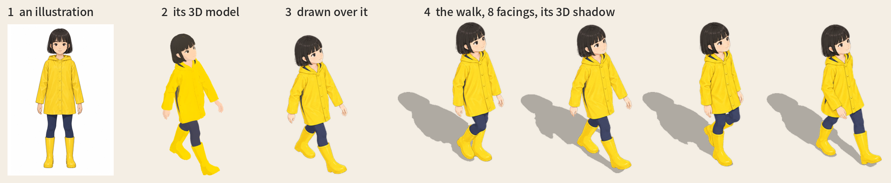

Give it one illustration of a character (facing front, standing straight, no pose) and you get a walk in 8 facings (8 frames each) and 8 standing views, in that
illustration's look. An image model can't keep a body and a pose from frame to frame, so the motion comes from 3D:
1. A turnaround is drawn from the illustration.
2. [Tripo](https://www.tripo3d.ai) makes the 3D model from it, rigs it and gives it a walk and an idle.
3. The walk is rendered with the game's camera (free), each frame with the 3D body's own shadow, pressed flat onto the ground
   along the light.
4. The image model draws over the renders, 4 frames a call. The front is drawn first and every other facing follows it, so it
   stays the same person.
5. Every frame is fitted back onto its render, the head sizes steadied and the edges cleaned. You get strips, a shadow per frame
   (the feet touch it, a lifted foot casts its own) and an anchor.

```
$PYTHON skills/spritecast/scripts/charpipe.py turnaround hero.json --yes   # then 3d (model, rig, renders) and draw (then finish, preview by themselves)
```
All eight facings are drawn by default. A design that is the same on both sides can set `"mirror": true` to flip the west facings
from the east ones (each keeping its own shadow), about $0.66 less.
Or `"facings": 4`: the four diagonals only, about half the drawing; the exported character shows the nearest of them for any of the eight directions.

Cost per character: about $2.2 (OpenAI; ~$1.5 with `"mirror": true`) and 75 Tripo credits (~$0.75; an animal 30). Or bring your
own rigged GLB (`"rig_glb"`) and skip to `render`.

<details>
<summary><b>More: the preview video, Meshy, and the example character with her rig</b></summary>

`preview` also makes `walk-all.mp4` (every facing walking at once, with ffmpeg): the quickest way to see a head that grows and
shrinks or a frame that jumps. Tripo sometimes sends a model back turned sideways or uncoloured; both are fixed for you.
`"modeler": "meshy"` (and `MESHY_API_KEY`) has [Meshy](https://www.meshy.ai) make the model instead (~30 Meshy credits); the rig
is still Tripo's.

More options (several outfits, anchoring on the soles) and lessons:
[reference/character.md](../../skills/spritecast/reference/character.md). The girl above is in
[`examples/rain_girl`](../../examples/rain_girl): her illustration, turnaround, spec, strips, shadows, `character.json` and the sheet.
She was made with Tripo alone: about $1.7 of drawing and 85 Tripo credits. Her rigged model is there too (`rig.glb`, with its walk,
run, jump and slash, MIT like the rest of the repo), so you can try the whole 3D side with no keys and nothing paid: copy the folder,
add `"draw": false` to the spec and run `charpipe.py render rain_girl.json` then `finish` - the strips, shadows and anchors come
from the 3D model itself. Her spec also shows what `"notes"` is for: the 3D render had dark streaks down the raincoat's sides and
inside the arms, and one line in `notes` ("no dark line, stripe or seam on it anywhere... leave them out") had them drawn out of
every frame - a flaw in the model fixed in the drawing, not in 3D.

</details>

## No 3D model: a walk on a mannequin

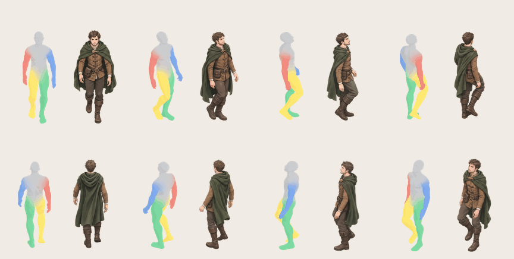

SpriteCast comes with plain mannequins - a man, a woman, a child and a dog: bald, grey, the right limbs red and the left blue.
`creature.py` renders the one your description names walking, with the game's camera (free), and the image model draws your
character over its poses: one design, then one picture a facing. No Tripo and no model of the character: a walk in 8 facings is
about $0.54.

```
$PYTHON skills/spritecast/scripts/creature.py mannequin guard.json   # free: the mannequin walking, a guide per facing; then design, and walk (one facing first: --only south-east)
```
- `"view": "above"`: 8 facings (or 4) seen from above, for an isometric or top-down game. `"view": "side"` (the default): one facing
  for a side-scroller ([below](#a-side-scrolling-game-one-facing-and-monsters-drawn-in-2d)).
- `"pixel": 96`: as pixel art - the mannequin reduced to sprite pixels and drawn over on that grid (two pictures a facing).
- The guard above was drawn from one design seen from the side: the same man in all eight facings - his cloak, buckles and keys -
  the north ones from behind. Each frame comes with an anchor (the ground under him) and how far a step carries him, so the feet do
  not slide.

<details><summary>as pixel art: the mannequin reduced to sprite pixels, and the guard drawn on it</summary>

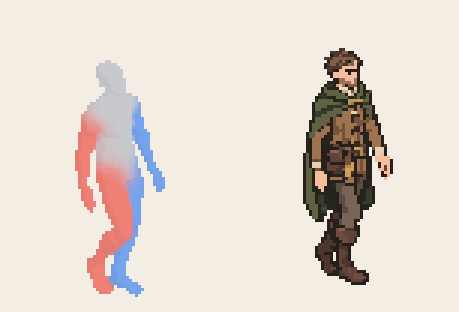

</details>

**When to make its own 3D model instead.** On a mannequin, walks come out well, and other moves (a jump, being struck) mostly do,
drawn as a sheet of moments. But for a character that will hold a weapon and attack - like Rain Girl swinging her umbrella - or that
needs many actions (a combo, a Mixamo clip, a swing's effect), we recommend making it with Tripo from the start
([above](#walking-characters)): the rig carries the held thing in every frame and every action comes from the same model's real
motion, so it stays consistent in every pose, and each new action is one more clip on the same rig.

## Four-legged animals

Tripo's rig for four-legged animals walks badly (no backbone, the shoulders hung off the neck), so an animal gets no bought rig.
With `"kind": "animal"` the 3D model alone (Tripo, ~30 credits) is enough: its skeleton is found from the mesh (the feet, the
back, the head, the tail, and which way it faces), it walks in a cat's or a dog's gait, and it gets the same drawing, fitting and
3D shadows as a person.

The turnaround is drawn on all four legs, each leg clear of the others, the tail out behind; clothes only snug ones (a knit vest, not a
cape or a scarf - anything hanging moves with the nearest leg). Check the renders before drawing: four legs, the head forward, the tail
behind. If Tripo's model grows an extra leg, make it again or use Meshy (`"modeler": "meshy"`).

<details><summary>an orange tabby in a yellow raincoat walking in 8 facings</summary>


</details>

The cat is in [`examples/tabby_cat`](../../examples/tabby_cat): an orange tabby in a little yellow raincoat (the girl's), its design,
turnaround, spec, strips, shadows and sheet - 30 Tripo credits and about $2.5 of drawing, redraws and design tries included. Its
frames fit their renders at 0.76-0.97 (north-east and north-west mixed frame by frame with `"mix"`, see reference/character.md).

## A side-scrolling game: one facing, and monsters drawn in 2D

For a platformer or a side-view RPG, `"view": "side"` puts the camera level, straight from the side. ONE facing is drawn - walking
right - and the other is its mirror: a walk and the standing view are 3 sheets (~$0.33) where eight facings take 18. The body is
turned 45° toward the viewer by default, so both eyes show and a swing across the body is not hidden behind it (`"turn": 0` for a
strict profile). Actions work as before:
a cut with its water, a jump (`"air"`), a ladder climbed with her back to us (`"face": "away"`).

<details><summary>a side-scrolling game: the rain girl at the foot of a castle wall in the rain, a stag beside her, a stone wolf on the wall, a storm cloud over a wooden ledge</summary>

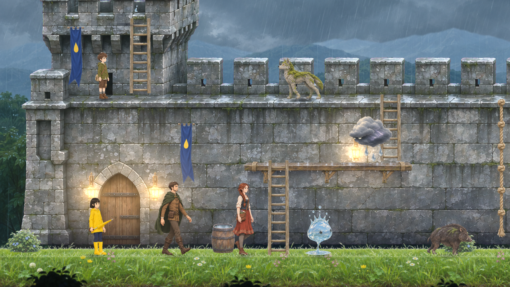

</details>

**Monsters, animals and townspeople need no 3D model each.** `creature.py` draws one design in the look of a picture of your game,
then its walk on the poses of a plain **mannequin** that comes with SpriteCast - a grey dog, or a bald man, woman or child, the
near limbs red and the far ones blue - and anything else it does (struck, falling apart, a hop) as a sheet of four moments said in
words. About $0.06 a picture.

- **A four-legged creature.** The dog mannequin is first stretched to the design's own leg length, body depth and neck (free).
  Drawn on the dog as it was, a boar and a stag both came out with a dog's legs; fitted, each kept its build. A stone wolf's 8
  frames came out within 3 px of the mannequin's places.
- **A person.** The design is drawn standing as the mannequin stands, then walking on its poses. A cloaked guard and a herbalist
  in a skirt kept their buckles, keys and braid through all 8 frames.
- **In the game** the walk's frame is read off the distance walked (`step` px a whole step), so paws and feet do not slide.

<details><summary>a boar and a stag: the design, the walk drawn on the dog as it was, and on the dog given their proportions</summary>

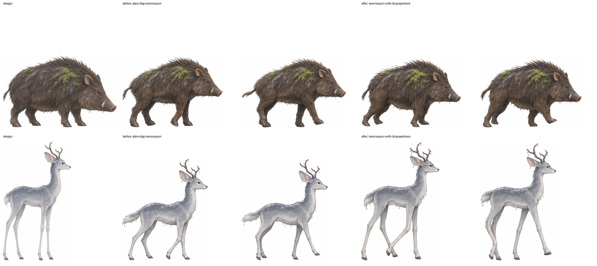

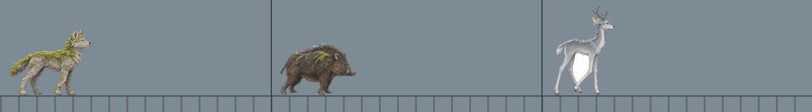

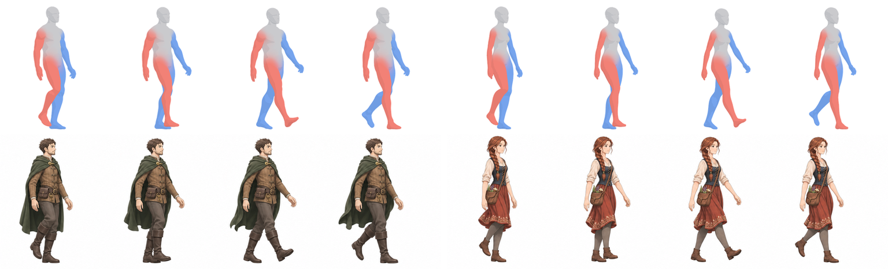

</details>

What stands with its legs out to the sides (a lizard, a spider) has no mannequin yet: a salamander came out standing on dog legs.
**A mannequin or its own 3D model?** As for any character: [when to make its own 3D model](#no-3d-model-a-walk-on-a-mannequin). Details:
[reference/creature.md](../../skills/spritecast/reference/creature.md).

## More actions: run, jump, slash

Beside the walk, a character can run, jump or swing something. List them in the spec, `"actions": ["run", "jump", {"name": "slash",
"hold": "umbrella"}]`: the rig gets those animations from Tripo (about 10 credits each; run, jump, slash, shoot, dive, climb, fall,
hurt and turn are there), and each is rendered, drawn and finished in 8 facings like the walk, into its own strips with a shadow per
frame. A slash needs something in the hand: `"hold"` builds it from simple shapes and puts it in the hand, so it moves with
every frame (an umbrella, a pistol or a water pistol for now; the right hand, or `"hand": "left"`). With your own rigged model, any clip in it can be an action. A held thing is described to the
image model part by part - most carefully the end at the hand (the handle, the first stretch of the shaft), which is small and against
the body and is where it guesses otherwise.

**Which to use: Tripo to save time, Mixamo when the result matters.** Tripo gives the moves in one step, with nothing to download - and a walk, a run, a jump (nothing in the hands) come out fine from it. When the result matters more than the time, we recommend [Mixamo](https://www.mixamo.com/#/?page=1&query=melee&type=Motion%2CMotionPack) (free, with an Adobe account), attacks above all: motion-captured moves look more natural, there are thousands, and the attacks of one set start and end in the same stance, so they join into combos (`motion.py link`). It takes a little longer: download one (FBX Binary, 30 fps, Without Skin) and `addclip.py hero.json Move.fbx name` carries it onto the character's rig, free. The catch: Mixamo has no API, so SpriteCast cannot fetch from it - you go to the site, look through the moves and download them yourself; Claude gives you the search link. Rain Girl's combo is two Mixamo moves. Never put the FBX files in a public repository.


**Most of it comes out in one go.** The rain girl's walk, run and jump fit their 3D renders at 0.78 or better in every frame, all
drawn once. The umbrella slash is harder (a thin thing that swings round the body): a weapon drawn in the wrong place is redrawn by
itself, and what is left fits a little looser where she bends deep - a pose drawn a touch more upright, which reads fine in motion.
Those frames are listed for you to look at; keep them or redraw them.

**Something carried all the time, in either hand** (you asked). Put `"hold"` in the spec itself instead of in one action -
`"hold": {"kind": "watergun", "hand": "left"}` - and the character has it through the walk, the standing views and every action.
Below, a water pistol in the left hand: the 3D guide above, the drawn frames under it.

<details><summary>a water pistol carried in the left hand</summary>

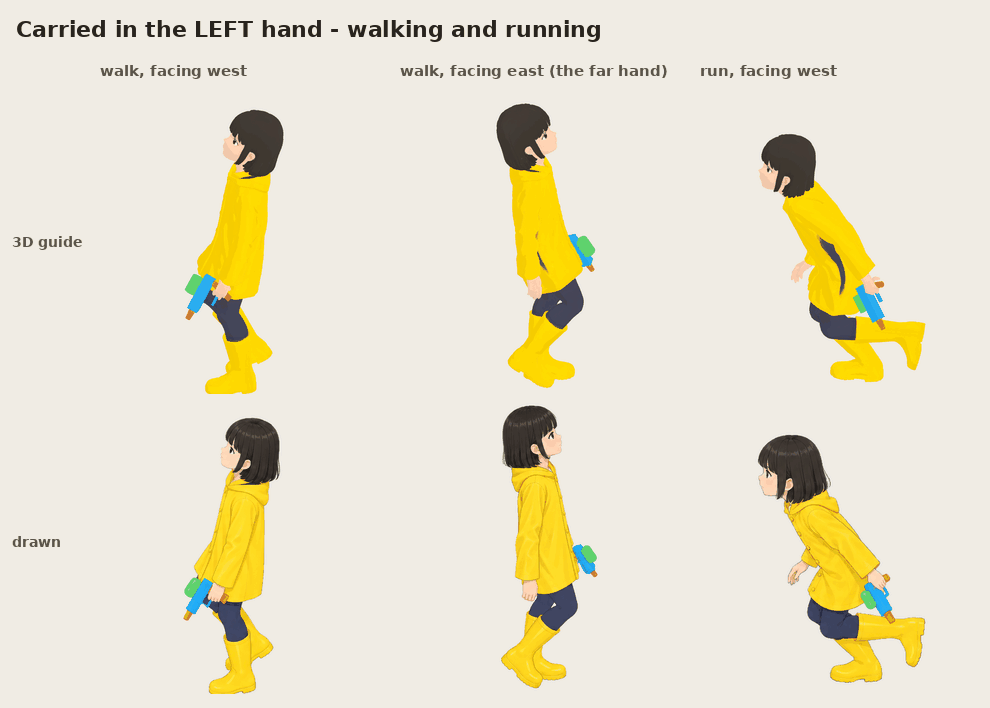

</details>

- **It stays in that hand.** A character with a thing in one hand is not the same on both sides, so no frame is ever made by
  flipping another - flipped, the thing would change hands. (`"mirror": "never"` asks for the same for any character that is not
  symmetrical: an eye patch, one sleeve.) Each sheet is told which hand and where its render has the thing, and afterwards every
  frame is checked against its render: of the 24 frames above, one was named for you to look at.
- **The hand closes on the handle.** A rig's fingers are out straight, and a drawing over that has an open hand beside a floating
  gun. So the guide bends the holding hand itself: the handle goes into the fist, the four fingers come round one side of it and
  the thumb round the other, each finger bent only until it touches. A thick handle gets a looser hand; one too thick to get a
  hand round is made thinner.
- **Look at the hand before anything is drawn.** In a frame the grip is a few pixels, so the free `render` step also saves the hand
  from all round, close up (`render/hand-walk.png`), and prints how far each fingertip is off the handle. Fix it there, at no cost.
- A thing that is already part of your own rigged model: `"hold": {"in_model": true, "words": "In the LEFT hand: a black pistol."}`.

The example above cost about $0.7 to draw (8 sheets: the walk from three sides and the run from one).

<details>
<summary><b>Other sizes: 512, 64 and 32 px from the same drawings</b></summary>

**Any size you need** (you asked): frames come out 256 px tall, and `charpipe.py pack CHAR.json --px 64` makes another set at
any height from the same drawings - larger than 256 stays sharp too, the frames are kept at the drawings' own detail - strips, shadows and `character.json` at that size, in `out-64px/`, with
nothing redrawn and `out/` left as it is (`"frame_px"` in the spec sets the default). Below, 512, 256 (the default), 64 and 32 px tall, each shown at the same size (enlarged pixel for pixel). At 64 the hair, raincoat,
boots and umbrella all read; at 32 the pose and colours hold, but the face is mostly gone - a plain resize, nothing made for that size
yet (see the [Roadmap](../../README.md#roadmap)).


</details>

## Effects on a swing: water, fire, leaves

A swing can leave something in the air. Add `"trail"` to the action - `{"name": "slash", "hold": "umbrella", "trail": "water"}` - and
you get the effect as a sprite of its own, laid over the body. **It is free and nothing is drawn again**: the 3D rig knows where the
umbrella's tip is at every moment, so the effect is worked out from that path. A slash you already have gets one without touching
its frames.

<details><summary>the rain girl's umbrella slash with eight effects</summary>


</details>

- **It follows the real motion.** An image model asked for a slash invents one arc and repeats it; a stock effect is one shape pasted
  on every swing. Here the band and the pieces come off the path this character's umbrella takes in this action, seen from each
  of the 8 facings, and the body and the umbrella hide the part that passes behind them. Change the motion and the effect changes.
- **Eleven looks**: `plain`, `wind`, `water`, `fire`, `drops`, `flames`, `leaves`, `greenleaves`, `petals`, `snow`, `sparkle`. Colours,
  amounts and speeds can be changed, a new look is one more entry in a file, and you can give your own little pictures to be
  scattered (`"image": "mine.png"`).
- **Pieces fly on from frame to frame.** A leaf is let go once, is carried a little by the swing, turns, sways and settles on the
  ground - the same leaf in every frame, not a new scatter each time.
- **Water and fire move as one body** (you asked). Water comes off as a sheet, stretches into strings, breaks into drops and leaves
  mist; flame is white-yellow at its heart, orange, then a red rim that darkens as it cools, with ash drifting up.
- **Water looks like water.** Thin water is pale and see-through, deep water darker, with a bright rim and a highlight from the
  same light as the character; fast drops are drawn long along their way, and a few burst on the floor in a ring and a splash.
- **Only the swing itself.** Nothing comes off while the umbrella is being raised: the fast stretch of the motion is found by itself.
- **More frames than the body.** The body is drawn 8 times, but water has 24 effect frames (three to each) and fire 16 (two), played
  faster over them - at 8 the sheet was whole in one frame and already drops in the next. They sit around each body frame
  (a third of a frame before it, on it, a third after), so the water stays with the drawn umbrella instead of running ahead of it.
- **In pixel art too**, at the sprite's size: solid things keep hard edges, mist stays see-through.

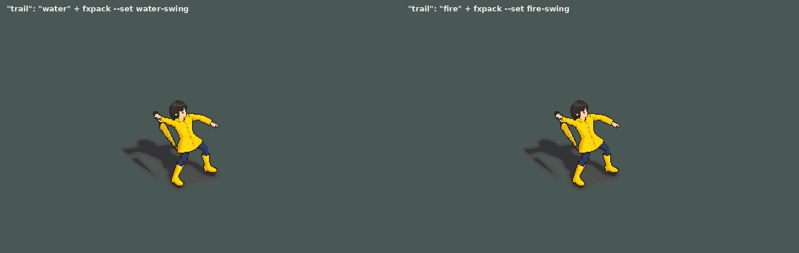

A combo in pixel art - Rain Girl's downward cut and spinning backhand in four facings, with their water and the backhand's ring (`motion.py`, `fxpack.py`). The two moves are Mixamo's, downloaded yourself - which ones and how, under "Making Rain Girl's combo yourself" below:


**Honestly:** these are worked out, not painted, so they are clean rather than hand-drawn. The path
is the held thing's, so an action needs something in the hand. Made and looked at on the umbrella slash only.

## Joining two animations: into a swing and back out

A walk does not end in an attack's first pose, and an attack does not end in the walk's: played one after the other, the body jumps.
The 3D rig makes the frames between (you asked): `{"name": "ready", "between": ["walk", "slash"], "frames": 3}` and
`{"name": "recover", "between": ["slash:end", "walk"], "frames": 4}`. Below, all drawn: she walks with her umbrella, goes down into
the stance (3 frames from the rig), swings with the water effect, comes back up (4 more) and walks on.

<details><summary>the rain girl walking with her umbrella, going down into a stance, swi…</summary>

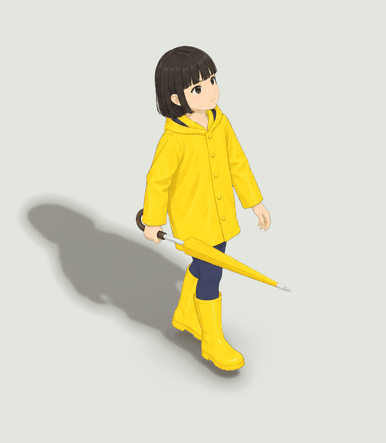

</details>

- **How.** The rig plays both animations at once, each stopped at one moment, and goes from the one to the other, easing in and
  out. `"slash:end"` starts from an attack's last pose instead of its first.
- **Free to render, drawn like any action** - one sheet for three or four frames, about $0.08.
- **Look at them joined**: `charpipe.py loop hero.json --only walk,ready,slash,recover --facing south-east` (free) makes a GIF like the
  one above from the finished frames, so a frame that jumps is seen before anything is drawn again. A pixel set
  can be fixed that way too, all the frames end to end in the editor: `pixeledit.py hero.json --join walk,ready,slash,recover --facing south-east`.
- **One frame wrong? Draw it alone.** `charpipe.py frame hero.json --only slash --facing south-east --frame 5 --yes` (~$0.08) draws
  just that frame again; `"frame_words"` in the action tells the image model what that frame's render cannot. Frame 5 above had the
  left fist floating over the umbrella five times running; told the hand is mostly hidden behind her head, it came out right.
- **The thing in the hand stays in the hand.** For it to be there in the walk too, the walk carries it (here an action on the walk's
  clip with the umbrella); otherwise it would appear from nowhere in the first in-between.

## Skipping the drawing: the 3D renders as the frames

With `"draw": false` in the spec, no image model draws the frames: the 3D model's own renders (toon-shaded, its own texture) are
the frames, with the same 3D shadows and anchors. The image model draws only the turnaround (~$0.09); with your own rigged GLB
(`"rig_glb"`; an animal: its model, `"model_glb"`) it draws nothing at all. A character then costs the turnaround and the 3D
(75 Tripo credits, an animal 30) - two OKs, done as soon as `3d` is. The trade-off is sharpness: no drawn lines, a simpler face,
the model's texture as it came (blurrier fur and folds).

<details><summary>the same girl and cat walking</summary>

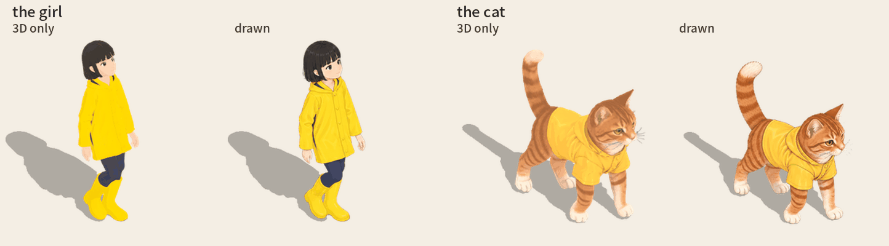

</details>

<details><summary>close-up at the strips' own pixels</summary>

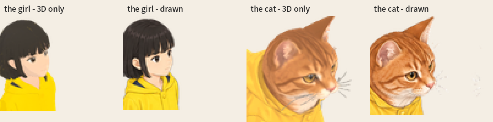

</details>

## Sitting


Once a character walks, ask Claude to *"make her sit"*. Her 3D model is bent into sitting (thighs level, knees bent, hands on the
thighs) in 8 facings for free; you look at those renders, then they are drawn like the standing views (two sheets, about $0.22). She
sits on nothing - your game's chair goes under her. `character.json` gets a `sit` block: for each facing the file, the **seat point**
(put it on the chair's seat; a fraction of the frame, like `anchor`), the seat's height and the shadow. To put her on one of
your props, `seat.py` places her on its seat and works out the prop's **front piece for her** (an armrest, a pew's back, a bench's
backrest) from both of their 3D heights - no painting:

<details><summary>The rain girl seated on ten seats</summary>


</details>

It finds the seat's height and which way it faces, and sits her back until her knees reach the seat's edge. If she sits a little off,
drag her on the touch-up page (below): letting go works the front piece out again from there.
The details: [reference/sitting.md](../../skills/spritecast/reference/sitting.md).

```
$PYTHON skills/spritecast/scripts/charpipe.py sit <name>.json            # free: the seated renders
$PYTHON skills/spritecast/scripts/charpipe.py sit <name>.json --draw     # ~$0.22: drawn and finished
$PYTHON skills/spritecast/scripts/seat.py <prop>.json <name>.json --height 1.3   # free: on a prop, its front piece worked out
```

## Fixing things by hand


The automatic steps get you most of the way; the last bit is best done by eye. **Painting by hand is more accurate than any of the
automatic steps**: above, the pew's back hid the whole girl until it was painted and she was moved up, and the dining chair's and the
armchair's backs cut her in the wrong places. Cut-outs are not perfect either: a little paper left between an arm and the body, a white
shirt the cut-out took for the paper. Ask Claude to
open the touch-up page (or run `$PYTHON skills/spritecast/scripts/touchup.py <spec>.json`): every finished picture of that prop or
character, painted in the browser and saved as you go.

| colour | does |
|---|---|
| red | clears: made see-through |
| green | brings back: those pixels taken from the drawing itself (turn on "drawing under" to see it) |
| blue (props) | the **front piece**: what stands in front of a character inside the thing - an arch's near posts, a gazebo's roof, a chair's near armrest |
| ⬠ polygon (P) | click the corners and close it (double-click, Enter, or the first corner): filled in the colour you are painting, or erased |
| 🪑 (a seat) | drag the seated character (or the arrow keys); letting go re-makes the seat and its front piece from there |

Then `touchup.py <spec>.json --apply` (a character's strips are packed again). A prop with a front piece gets `sprite-front.png` and
`"front"` in `sprite.json`: draw the sprite behind whoever stands in it and the front piece over them. `finish` lays the paintings on
again by itself; a picture drawn again since it was painted keeps its painting aside instead of laying it on a different drawing.

**Pixel sprites** have an editor of their own, pixel by pixel - see [Pixel art](pixel-art.md#pixel-art-arcade-size).
