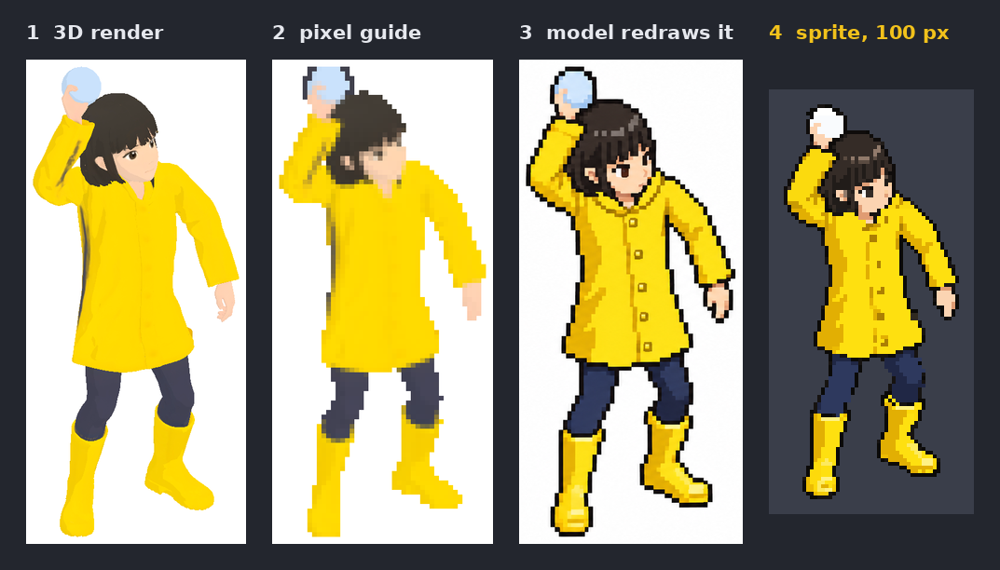
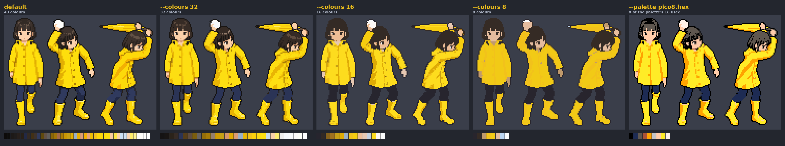
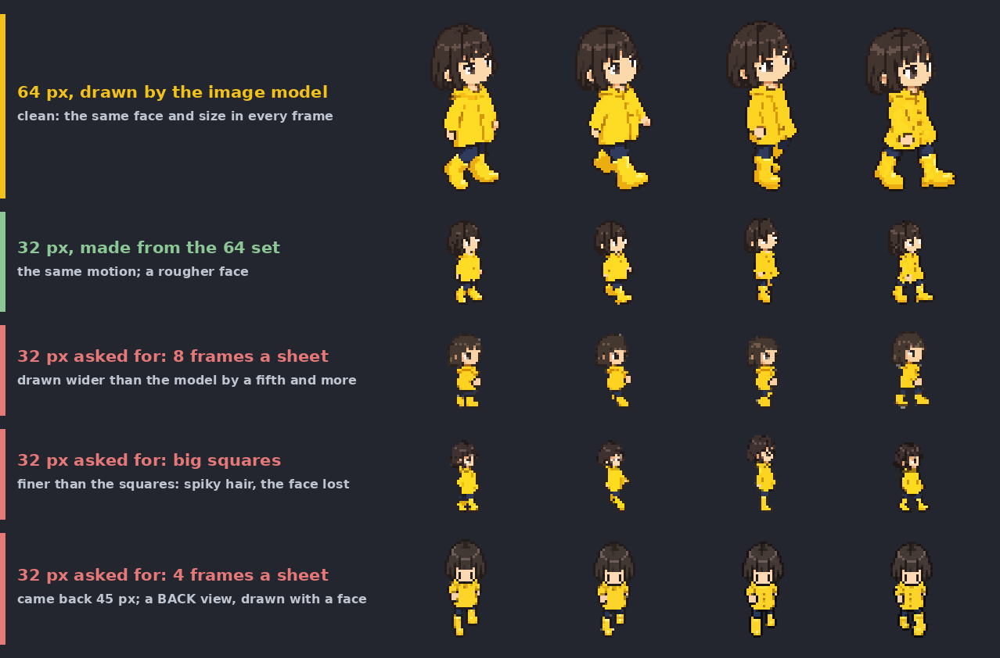
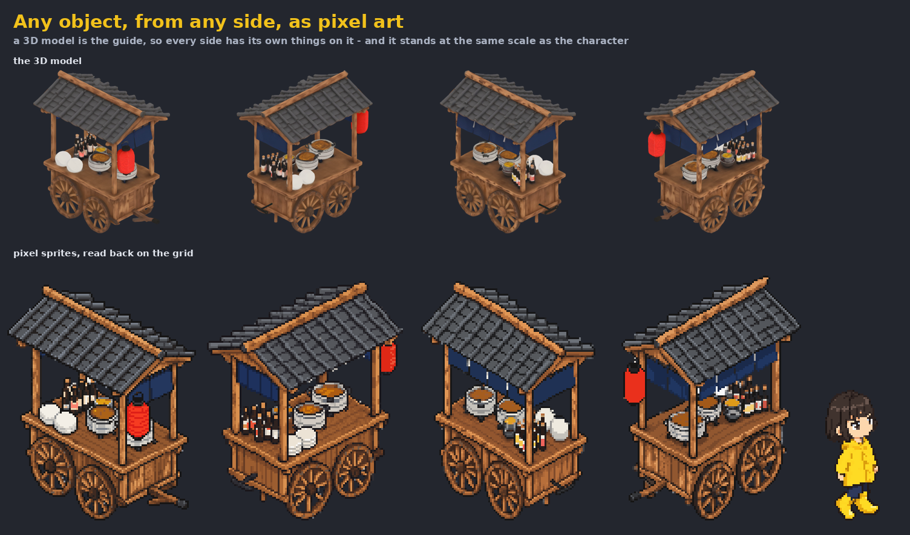
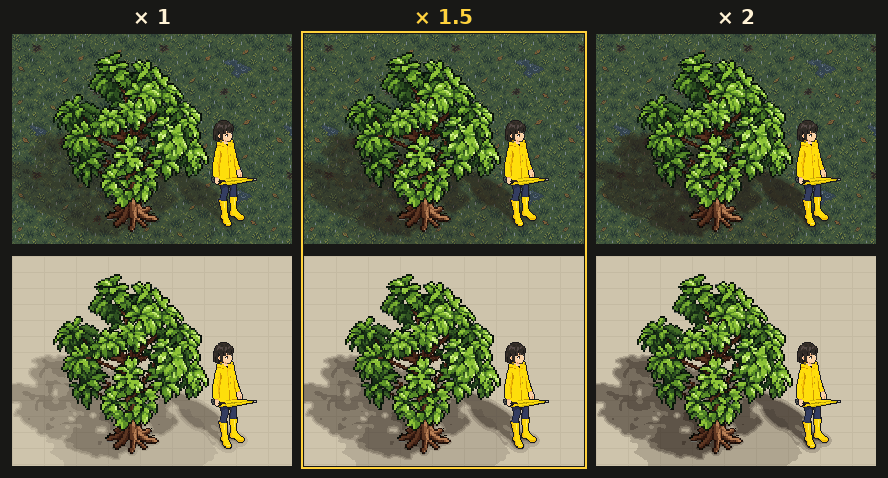
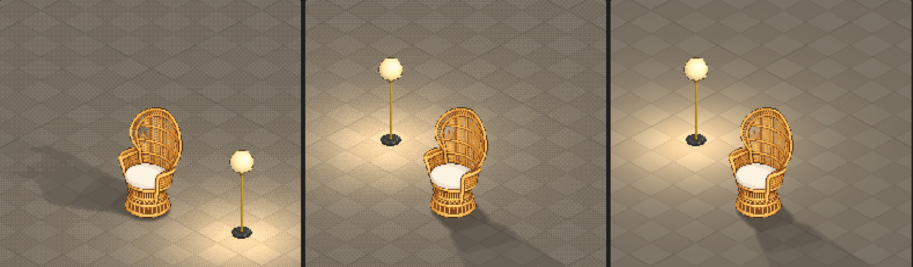

# Pixel art: characters, props, light and wind

[← back to the README](../../README.md)

## Pixel art (arcade size)

<details><summary>five facings of the rain girl throwing a snowball, each ball flying it…</summary>


</details>

For a game drawn in pixels - a belt-scroller, a fighter, an arcade platformer - the same character as real pixel art, about 100 px
tall: one colour a pixel, a palette of about 40, a dark outline, no blur, and each frame's 3D shadow. Not a resize of the painted
frames: the order is the other way round.



The 3D render is pixelized into a guide, the image model redraws it as pixel art, and the drawing is **read back on the grid the
model drew it on** - the head on grid lines of its own, so the eyes and mouth survive - then sized and placed by the render.

```
$PYTHON skills/spritecast/scripts/pixelart.py hero.json                        # the plan and its cost - spends nothing
$PYTHON skills/spritecast/scripts/pixelart.py hero.json --clips walk,throw --yes
```
About $0.075 a sheet: a walk in all eight facings is 18 sheets (about $1.35); the throw above, five facings, was 14.

**How many frames go on a sheet is worked out, not chosen:** `pixelart.py` measures the renders and fits as many as have room - four for a walk, two when something is held, one for a long swing (so an attack costs more than a walk); the plan shows it before anything is spent. Everything after the drawing is automatic; you never draw a frame, only fix a few pixels.

- **Things held and thrown.** `"hold": {"kind": "snowball", "until": "auto"}` puts it in the hand and lets it go when the hand
  moves fastest. `pixel.json` then says which frame, where in the frame, which way and how fast - enough for your engine to spawn
  the projectile - and you get the ball, its flight shape and a 4-frame burst. The picture above is that data played back.
- **Any Mixamo animation.** `addclip.py hero.json Throw.fbx throw` carries an FBX clip onto the character's rig, free. The throw
  above came in that way.
- **Combos that join.** `motion.py` links one attack to the next the way games do - the second starts from the pose the first ends in, its
  stroke untouched - puts carried feet back on the ground, and turns an axe chop into a sword cut on an arc. Free, on the rig - [the recipe, Mixamo to the game](../../skills/spritecast/reference/character.md).
- **Making Rain Girl's combo yourself - the moves don't come with SpriteCast, only the changes.** The moves are Mixamo's, and Mixamo lets
  them be used, not handed on, so you download them yourself (free, with an Adobe account).
  1. On [mixamo.com](https://www.mixamo.com), Animations: search **Standing Melee Attack Downward** and **Standing Melee Attack
     Backhand** - two moves of one set, so they start and end in the same stance. Download each: Format **FBX Binary (.fbx)**,
     **30** frames per second, Skin **Without Skin** (with works too), Keyframe Reduction **none**.
  2. Put the two files beside your character's spec and ask: *"Apply the rain-girl-combo preset."* - `motion.py preset hero.json
     rain-girl-combo` carries both moves onto your character's rig and makes the same changes with the same numbers, then puts the two
     actions in the spec. The preset (`skills/spritecast/presets/rain-girl-combo.json`) keeps only the changes, never the moves.
     Without it, ask: *"Make a combo from these two like Rain Girl's: the downward cut, then
     the backhand, with water."* Mixamo's moves as they come are not what you see - they were changed on the rig (free), and these
     are the changes you ask for:
     - **Feet on the ground** (`motion.py ground`): carried onto a child's rig they stood 8-15 cm in the air.
     - **The axe chop made a sword cut** (`motion.py blade downward --stroke 0.75-1.25`, bend 0.55, lag 0.9): the downward move was
       made for an axe - less forward bend now, and the umbrella runs on from the arm on an arc, its tip trailing the hand and
       catching up at the hit.
     - **The backhand started from the cut's last pose** (`motion.py link downward@1.40 backhand@0.3-2.0 --blend 0.4`): as it
       comes, the backhand starts from standing and the join jumps; now it starts where the cut ends, its own swing untouched.
     - **What is drawn**: the cut from 0.35 to 1.40 s and the backhand's first 1.40 s, 8 frames each, the water reaching twice as
       far (`"trail_reach": 2`).

     Claude renders it and shows it to you before the one paid step, the drawing (about $4.5 for both moves in four facings).
  3. The rings and the ripple round her: `fxpack.py export --set water-swing` (or `fire-swing`).

  Any two attacks of one Mixamo set work the same way. Never put the FBX files - or a rig with their motion in it - in a public
  repository. [The full recipe](../../skills/spritecast/reference/character.md).
- **It reviews itself.** Every frame is checked against its render (the pose, the held thing); `--redraw` draws the marked sheets
  again and keeps the better drawing. The throw's 40 frames all passed after one redraw.
- **Then a pixel editor for the last bit.** Pixel art is not all to be had by rule. `pixeledit.py hero.json` opens every frame in
  the browser: magic-erase a patch of left-over white, pencil, change a colour, move a selection, copy a good face into the other
  frames. Add any colour to the palette; and the frames themselves can be copied (an in-between to draw on - 8 frames made 9),
  deleted and moved: the shadow and the game's data follow. The edits are kept and laid on again by every later build.
  Animations played one after another can be opened as one, to play the whole loop and fix it where it jumps:
  `pixeledit.py hero.json --join walk,ready,slash,recover --facing south-east`.

<details><summary>the pixel editor</summary>


</details>

And the 3D render the frame was drawn from can be shown beside it (key `3`) or faint under it - so you can see what a doubtful
pixel is meant to be before you touch it:

<details><summary>the pixel editor with a 64 px character about to throw a snowball, see…</summary>


</details>

How much is left to the hand: very little. For the 40 throw frames, about 6 minutes of AI drawing and 2 of AI cut-out; then the only
hand work was the magic eraser - a click on each speck of left-over white, in 10 of the 40 frames (131 pixels, 0.15 % of the
sprites). No face was touched: they are as the pipeline made them. The build prints those numbers every time.

**A harder set, and what the hand did.** With something held - a weapon, an umbrella - its details need a little fixing by hand:
a few pixels a frame, with an eraser and a pencil, no drawing skill. The same loop as the one under "Joining two animations", in pixel
art: she walks with her umbrella, goes down into the stance, swings, comes back up and walks on - four animations joined, 23 frames.
Only the umbrella was fixed by hand: its tip and edge made the same from frame to frame. The character was not; a few left-over white
specks were erased, nothing more. In all 1,196 pixels of 51,442 (2.3 %), by someone who does not draw, in a few minutes. What made it quick, and what matters most in pixel art: looking at all 23 frames in a row, playing, not one at a time - a fix is
making sure no part's pixels change a lot from one frame to the next. Not fixed: in two walk frames
the umbrella is drawn a little off the 3D one's angle and length.

- **The editor shows where the 3D has things** (key `4`): the held thing in red and the body's outline in blue, over the frame you
  are drawing - so an umbrella drawn too long or at the wrong angle is seen at once.

<details><summary>the pixel editor with the 3D umbrella laid in red and the 3D body's ou…</summary>


</details>

**How many colours.** A set comes out with about 40 colours. `--colours 16` gives it 16 at most (8 is the least), and
`--palette` gives every pixel its nearest colour in a set palette: one of the 15 that come with the skill, by name
(`--palette pico8`; `--palette list` shows them), or your own file in what Aseprite reads - `.png` `.gif` `.bmp` `.pcx`, `.hex`
(Lospec), `.gpl`, `.pal`, `.act`, `.col`, `.aseprite`. Both are free: nothing is drawn again, the same drawings are read with
another palette. Props take the same two options. Down to 16 the character holds up well; at 8 close colours merge (her navy legs
go black), and a palette with nothing near one of her colours will change that colour - look at the result before you keep it.

<details><summary>the same three sprites with the default 43 colours, with --colours 32,…</summary>



</details>

The palettes that come with it, on the same two sprites - a yellow coat needs a yellow in the palette (`c64`, `gameboy`,
`slso8` and `sweetie16` have none):

<details><summary>the rain girl and the ramen cart in each of the 15 palettes</summary>


</details>

*The palettes are their authors': AAP-64 by Adigun A. Polack, Apollo by AdamCYounis, DawnBringer 16/32 by DawnBringer, Endesga 32/64
by ENDESGA, Resurrect 64 by Kerrie Lake, SLSO8 by Luis Miguel Maldonado, Sweetie 16 by GrafxKid - taken from
[Lospec](https://lospec.com/palette-list).*

**Sizes.** 96 px is the size for a character of ordinary proportions. **64 px works for a character designed small** - about three
heads tall, with its own 3D model - and comes out about 70 px. Under that, the image model is never asked: it does not keep to so
few squares (32 px was tried four ways). `--px 32` draws at 64 and makes the 32 set from it, free - the same motion and frames, with
rougher faces. 64 is the one that comes out well.

<details><summary>the small character walking and throwing in eight facings at 64 px, an…</summary>


</details>

Both sets are in [`examples/rain_chibi`](../../examples/rain_chibi): the three-heads design drawn from the rain girl, its turnaround, the
spec, `pixel64/` (walk and throw in eight facings, 128 frames, each with its shadow; no pixel was touched by hand) and `pixel32/` made from it. Her throw is a Mixamo clip put on with `addclip.py --clear-head 55`; the clip and the
rig are not in the repo.

<details><summary>the same small character five ways</summary>



</details>

**Why not ask for 32 px?** The image model (GPT) does not do small pixel art well under 64. It draws its "pixels" at a size of its
own - asked for 8-px squares it drew anything from 7.4 to 10.8 - and at 32 squares one square off is an eye gone. Above: the top row
is what it draws at 64; the three red rows are 32 px asked for directly, each a different sheet layout, all of the same walk. So the
skill asks for 64 and makes 32 from that (the green row). The details: [reference/pixel.md](../../skills/spritecast/reference/pixel.md).

The sprites above are in [`examples/rain_girl/pixel`](../../examples/rain_girl/pixel): the throw in five facings, a walk in two and the
umbrella slash as strips, their shadows, the snowball with its flight shape and burst, and `pixel.json` with the release data.

## Pixel-art props: any object, any side

<details><summary>a ramen street cart as a 3D model from four sides, and the same four s…</summary>



</details>

The same way round as a character, for a thing: its 3D guide is pixelized, the image model redraws it as pixel art on the same grid,
and the drawing is read back on that grid and brought to the guide's size. The angle is the camera's, so a thing turned four ways is
four sprites of ONE thing - the same roof, the same wheels, each side with what belongs on it.

```
$PYTHON skills/spritecast/scripts/isoprop.py model cart.json --yes    # Tripo makes the 3D model from the description (~20 credits)
$PYTHON skills/spritecast/scripts/isoprop.py render cart.json         # free: the guide from each side ("views": [0, 90, 180, 270])
$PYTHON skills/spritecast/scripts/proppixel.py cart.json --yes        # ~$0.08 a side → out-pixel/sprite-<side>.png
```

- **A real 3D model is what makes the sides come out right.** From blocks alone the image model cannot tell which face has what on it:
  an arcade cabinet came out with its screen on the wrong face in one view of four. The cart above is a Tripo model; all four sides
  matched it on the first drawing. One view of a simple thing (a chair, a crate) is fine from blocks.
- **The same scale as the character.** `--ppm` is pixels per metre: the pixel character's height in pixels over its height in metres
  (54 for the small example character), so the prop and the character stand on one floor in the same size of pixel.
- **The cut-out is yours to finish.** The air under a roof and between spokes is cleared by the AI cut-out; what it leaves, open in the
  same pixel editor as the characters (`pixeledit.py cart.json`): the four sides are four frames, the 3D render can be shown beside
  or under the sprite, and what you erase is kept. The cart above had 122 pixels finished that way.
- The cart is in [`examples/ramen_cart`](../../examples/ramen_cart): the spec, the Tripo model, the four guides
  and the four sprites.

<a name="light-shadow-wind"></a>
## Light, shadow and wind from the 3D model

The model that gave a prop its sides also knows where its light is blocked and where its boughs are. So its shadow, a lamp's light
on the floor and the wind in its leaves are worked out from it - free, on your computer, with no drawing.

- **Its shadow, baked from its 3D model** (free, a few seconds, done by itself): the sun's light and the sky's on the ground, each
  as much as the thing leaves open - so it is deep close by (under the cart, round a trunk's foot) and paler where it falls
  from high up (a crown's, the light coming through between its leaves), in five steps of pixel art. The sun is the guide's own light, so the shade drawn on the prop and the shadow
  on the ground agree. `--shadow overcast` (or `"shadow": "overcast"` in the spec) for a grey day: no sun, only the soft dark round it.
  `out-pixel/shadow-<side>.png` and where it sits in `pixel.json`; draw it under the sprite.


- **How deep the shadow is** (free): `"shadow_strength"` in the spec, or `--shadow-strength` - the shadow as if laid that many times
  over itself. As the light gives it (1) a shadow is right but quiet: on dark ground it is lost, and the sprite seems to float over the
  ground instead of standing on it. Pixel art says things a little louder than they are, so **pixel sprites get 1.5 by default**, props
  and characters alike (71 % at its deepest instead of 56 %). On a light floor where that looks heavy ask for 1; on very dark ground, 2.
  The light editor has a slider for it.

<details><summary>the same tree and the rain girl with their shadows at strength 1, 1.5 …</summary>



</details>

- **Indoors, a lamp where you put it.** `--lamp -1,2.4,-0.2 --lamp-size 0.03` (metres from the prop's foot: right, up, towards the
  viewer; the lamp's own size) - the shadow falls away from it, longer the lower it hangs, sharp from a bare bulb and soft from a big
  shade, and fades as its light does across the floor. Its light on the floor comes too - `light-<side>.png`, brightest under it, the
  thing's shadow cut out, dithered in steps - to lay on the floor with ADD - and the lamp itself as pixel art (`lamp.png`) with where it is in each side's
  pixels in `pixel.json`, so a game draws the floor, its light, the shadow, the prop and the lamp right where the editor showed them. Leave it out and the sun is used. **See-through parts** (a wicker weave, leaves,
  a net) are painted on a model, not cut: `"see_through": [{"colour": "#c8955a", "open": 0.35}]` lets the parts of that colour pass
  that share of the light. A rattan peacock chair ([`examples/rattan_peacock_chair`](../../examples/rattan_peacock_chair)) under six lights:

<details><summary>a rattan peacock chair as pixel art under the sun, on a grey day, unde…</summary>


</details>

- **Move the light yourself**: `lightedit.py PROP.json` opens a page on your computer: drag the lamp across the floor, lift it with
  the wheel, size it - the shadow and the lamp's light on the floor are redrawn as you go; Save bakes every side with it and keeps it in the spec.
  **Your own lamp**: load a picture of it (a cut-out PNG at the prop's scale), click where its light comes from - it stands where you
  drag it, in front of or behind the prop as it should, and its light comes from there. The shadow, the glow and the floor's light come
  as pixel art (steps, dithered) or smooth (gradients, for a game in another style: `"light_style": "smooth"`). Below: a pixel floor lamp (`examples/lamps/floor_lamp/out-pixel/sprite.png`) in front, behind, and smooth.


<details><summary>a pixel-art floor lamp moved round the rattan chair in the light editor</summary>



</details>

- **The wind in it, from its 3D model** (`"sway": "leaves"` in the spec, or `propshade.py PROP.json --sway leaves`; free): a crown is
  boughs, not one sheet. Each leaf pixel takes the model's point it shows, the points are grouped by where they are in 3D - the near
  boughs apart from those behind them - and every clump moves whole, a pixel at a time, far ones laid first; the trunk stands. No
  warping, no hand-drawn frames. You get `sway-<side>.png` (12 frames x still air / breeze / gust - play a row as a loop),
  `clumps-<side>.png` with each clump's place in 3D to move them yourself, and `preview-sway.gif`. The tree is in
  [`examples/forest_tree`](../../examples/forest_tree); its leaves also let light through its shadow.


- **Where it is in the way, from the same model** (free, baked with the shadow): `solid-<side>.png` is where a walker cannot stand -
  the prop's footprint, cut from the model near the ground (a trunk's foot, a table by its four legs) - and `"collide": {"cover": [0.55]}`
  adds what stops a thing flying at that height: a trunk stops a fireball, the crown above it does not. Each comes with its place and
  an outline for a collision polygon. And **a character darkens in its shade**: every shadow says how to read it for a point above the
  ground, so her feet, middle and head each take what stands between them and the sun.
- **Into your engine**: `export.py PROP/out-pixel` writes a Phaser 3 module and a Godot 4 scene - the shadow, a lamp's light, the wind,
  the footprint as a collision polygon, and `shade()` / `cover()` to ask (opened and checked in Phaser 3.90 and Godot 4.7; Unity and
  Aseprite are for characters only so far). A small thing sways too: mushrooms nod at the cap (`"sway": "caps"`,
  [`examples/forest_mushrooms`](../../examples/forest_mushrooms)).

<details><summary>two pixel-art trees and three patches of mushrooms exported to Phaser,…</summary>


</details>
