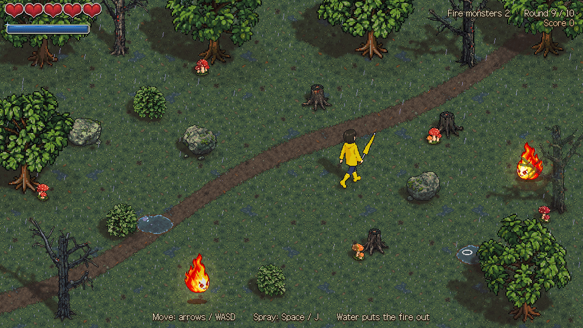
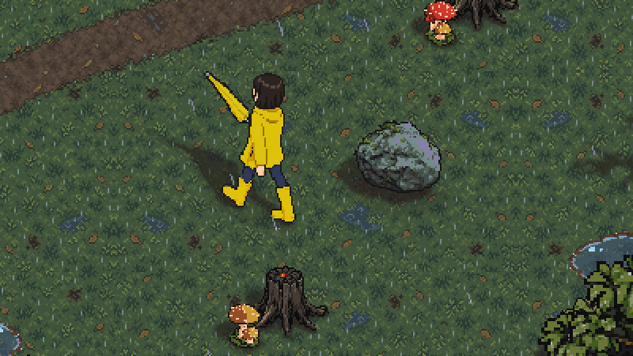

# Rain Girl: how it was made

[← back to the README](../../README.md)

## Made with it: Rain Girl

<a href="https://sunghwan0112.github.io/rain-girl/"><b>▶ Play it in your browser</b></a> &nbsp;·&nbsp; <a href="https://github.com/Sunghwan0112/rain-girl">the game's code</a> No install, no account. Post your score and you are on the board below.

<i>Rain Girl, a small pixel action game: a girl in a yellow raincoat puts out fire monsters with her umbrella's
water before the forest burns. The girl and every prop in it came out of SpriteCast.</i>

- **The girl.** One illustration; a Tripo model, rigged and rendered at the game's camera (2:1, 30° down): a walk with her umbrella,
  the swing and standing, in the four diagonal facings (`"facings": 4`), every frame redrawn as 96 px pixel art. The water she throws
  is the swing's effect, rendered in 3D and drawn the same way; the standing loop is `idleclip.py`.
- **The forest.** Seven props - a tree, a half-burnt tree, a burnt tree, a bush, a burnt stump, a rock, mushrooms - each a Tripo model
  rendered from four sides at the girl's scale (74 px a metre: a 2.4 m tree is about 175 px tall) and drawn as pixel art: 28 sprites.
  The game shows each prop from one side at random; a tree that burns goes half-burnt, then burnt, from the side it stood.
- **One light, no shading by hand.** All 28 are lit from the upper right, as their 3D guides were. Below, every side of every prop:

the 28 prop sprites on the game's grass

- **The combo.** Two Mixamo moves of one set - a downward cut, a spinning backhand - carried onto her rig, the axe's chop made a
  sword's cut on an arc, the second started from the first's last pose (`motion.py`), drawn as pixel art in four facings, with water
  that fades out at twice her height. Press again during the cut and the backhand follows: a ring round her as wide as it reaches.
- **The effects.** Hits, fires put out, fireballs in flight and on cover, pickups and the backhand's rings are effects from
  [PVFX Foundry](https://nerijs.itch.io/pvfx-foundry) (CC0), which now comes with SpriteCast: 253 of them, `fxpack.py` to find one and
  write it out at your sprites' size and in their colours. A ring round her is cut at its middle - the far half behind her, the near half in front.

32 of the 253 effects that come with SpriteCast

- **One palette.** Afterwards the props and the grass tile were put on one 48-colour palette (from 755), so a tree's greens and a
  bush's are the same greens.
- **The 3D keeps working in the game.** The shadows on the ground are baked from each prop's model ([how](pixel-art.md#light-shadow-wind)), and the girl darkens in a prop's shade - her
  feet, middle and head each by what lies between them and the sun. Where a fireball breaks on cover comes from each prop's own model, cut at the fireball's
  height (0.55 m), for the side that is showing: a trunk stops it, the crown above does not, a mushroom is too low.
- **The wind is the model's too.** The crowns sway bough by bough: the leaves are grouped into clumps by where they are on the 3D
  model, and each clump moves whole, a pixel at a time - with the round's wind, harder in a gust ([how](pixel-art.md#light-shadow-wind)).
- **A prop's cost:** about 20 Tripo credits for the model and about $0.3 to draw its four sides.
